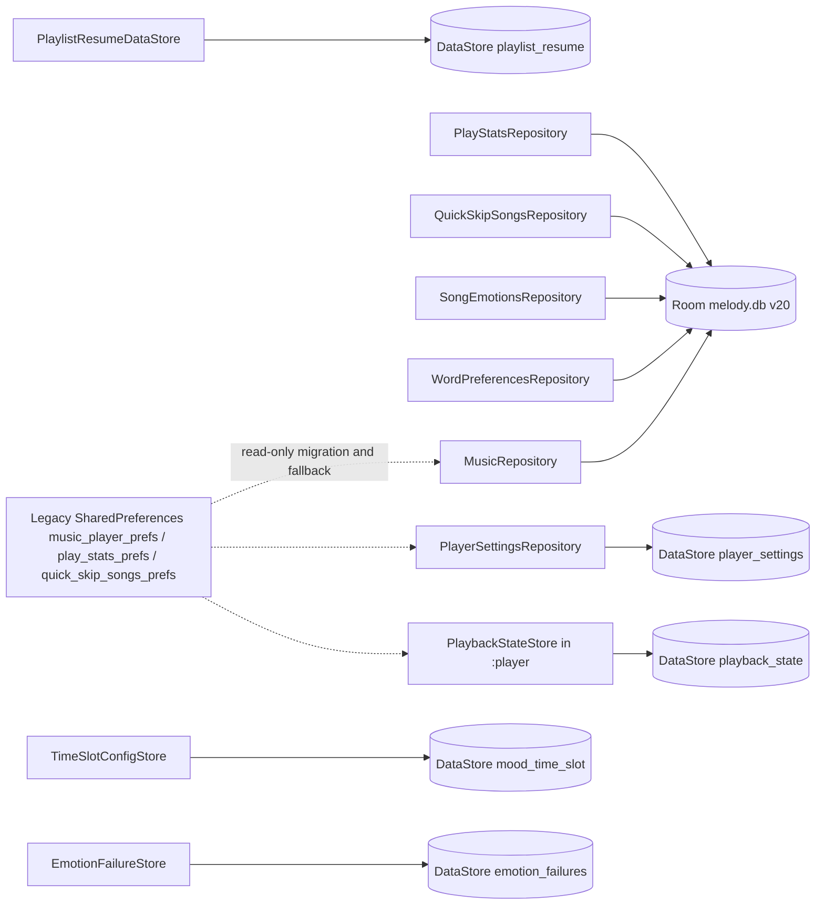
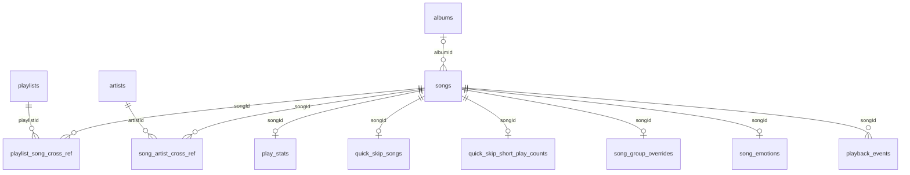
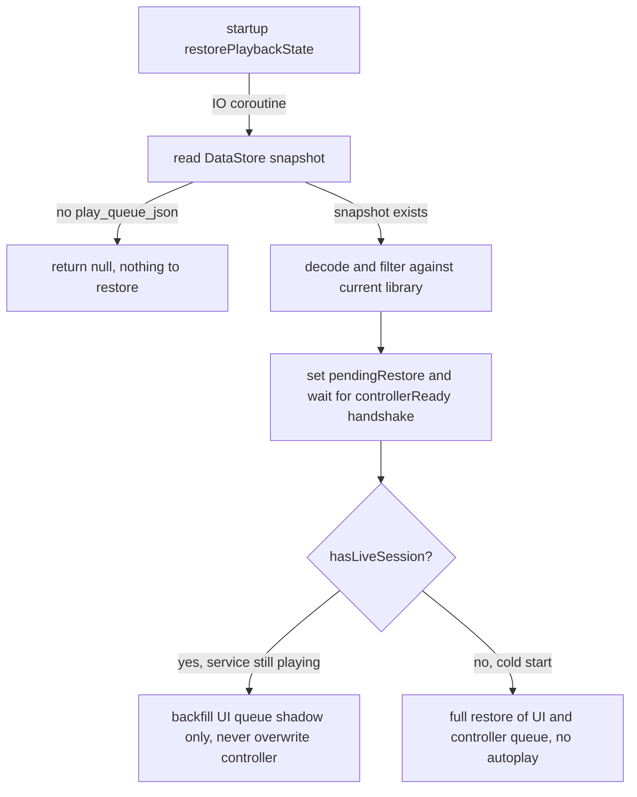

# Data persistence: Room v20 and DataStore

The app persists data through two complementary stacks. **Room** (`MelodyDatabase`, version 20, 14 entity tables) owns all structured data — library, playlists, stats, quick-skip, group overrides, emotions, and the emotion word-preference vote table (`word_preferences`). **DataStore Preferences** (5 independent files) owns small, non-relational settings and state snapshots: player settings, playback snapshot, playlist resume, mood time-slot config JSON, emotion failure records. There are also **legacy read-only SharedPreferences channels**: the one-shot `SharedPreferencesLegacyJsonMigration` that moves v1 JSON into Room, and the legacy-value fallbacks inside `PlayerSettingsRepository`/`PlaybackStateStore` — every legacy key is deleted as soon as the new storage is written, so legacy SharedPreferences survive only to serve the migration path.

*Persistence map: Room is the single source of truth for structured data; the five DataStore domains are independent files; legacy SharedPreferences keeps only three read-only dashed paths (one-shot migration, settings fallback, playback snapshot fallback).*

Module ownership: Room and all DataStores except `playback_state` live in `:data` and are exposed narrowly through `:domain` repository interfaces; `PlaybackStateStore` lives in `:player` (it directly serves the Media3 session) and is wired through the `PlaybackStateStorage`/`PlaybackStateRepository` interfaces by `app/di/PlayerModule`. Dependency boundaries are covered in `/openwiki/architecture/module-graph.md`.

## Room: MelodyDatabase v20 (14 entity tables)

`MelodyDatabase` declares `version = 20, exportSchema = true` with 14 entities and a single DAO, `MelodyDao`. The database file is `melody.db`, built by `DatabaseModule` via `Room.databaseBuilder` as a Hilt `@Singleton` with all migrations v1→v20 registered through `addMigrations(*MelodyMigrations.ALL)`.

| Table | Entity | Purpose |
| --- | --- | --- |
| `songs` | `SongEntity` | Library master table: title/artist/album, `albumId`, `sampleRate`, audio-spec columns (`bitDepth`, `bitRateKbps`, `channelCount`, `audioCodec`, `spatialAudio`), `durationMs`, `uri`/`albumArtCacheUri`/`lrcUri`, `size`/`lastModified` (file fingerprint), `importedAt`; unique `uri` index + `albumId` index |
| `playlists` | `PlaylistEntity` | Playlist catalog (id, name, created/updated timestamps) |
| `playlist_song_cross_ref` | `PlaylistSongCrossRef` | Playlist↔song many-to-many; `sortOrder` preserves order |
| `play_stats` | `PlayStatsEntity` | Per-song aggregate stats: effective play count, raw play count, accumulated duration, last played |
| `playback_events` | `PlaybackEventEntity` | One row per playback session (started at, duration, effective flag); supports day/week/month aggregation; composite index + `songId` index |
| `quick_skip_songs` | `QuickSkipSongEntity` | Quick-skipped songs |
| `quick_skip_short_play_counts` | `QuickSkipShortPlayEntity` | Short-play counters (accumulate to trigger auto quick-skip) |
| `song_group_overrides` | `SongGroupOverrideEntity` | `titleOverride` per song: the manual version-group key (emptied by the v19→v20 migration) |
| `migration_state` | `MigrationStateEntity` | Data-migration completion markers (name primary key + completedAt); currently only `shared_preferences_json_v1` |
| `artists` | `ArtistEntity` | Atomic artist rows (`name` unique; artists split from `/`-separated tags) |
| `albums` | `AlbumEntity` | Albums (`name` unique) |
| `song_artist_cross_ref` | `SongArtistCrossRef` | Song↔atomic-artist many-to-many |
| `song_emotions` | `SongEmotionEntity` | Emotion analysis results: V/A, per-window `curveJson`, `embeddingB64`, user calibration fields (`userTags` is truth; `userValence`/`userArousal` retained but deprecated), `userTagsEdited`, `vocalScore` |
| `word_preferences` | `WordPreferenceEntity` | Emotion word listen-preference tallies (`word` primary key, `likeVotes`/`dislikeVotes`/`updatedAt`); ratio-weighted votes |

Entities declare **no Room foreign-key constraints**; all relationships (playlist↔song, song↔artist/album, and the songId-keyed stat tables) are logical, maintained by repository code rather than enforced by the schema.

*Logical relationships among Room tables, joined on songId/albumId/artistId and maintained in code — not FK-enforced. `word_preferences` is a standalone word→votes table keyed by word.*

### Audio-spec columns and the backfill contract

The `songs` table gained two rounds of audio-spec columns: **v17→v18** added `bitDepth` (original bit depth; `0` = unknown, lossy, or not exposed by the platform), and **v18→v19** added `bitRateKbps`, `channelCount`, `audioCodec` (track MIME such as `audio/flac`, null = unknown) and `spatialAudio` (lightweight E-AC-3 JOC / AC-4 detection). They are populated at import from `AudioMetadataExtractor` and persisted through the explicit `SongEntity`↔`Song` field mapping in `RoomMusicLibraryDataSource`.

The migration contract for these columns is deliberately *non-destructive and lazy*:

- **Old rows default silently.** `bitDepth`/`bitRateKbps`/`channelCount`/`spatialAudio` migrate as `0`/`false` and `audioCodec` as `NULL` — the migrations never re-open files, so an upgraded library initially reports "unknown" specs rather than guessing.
- **Only a user-triggered deep verification rewrites them.** `MusicRepository.validateAndCleanupLocalFiles(FileCheckMode.DEEP)` re-extracts metadata for every song whose URI still resolves and funnels it through `refreshMetadata`, which re-reads the spec fields, writes them back, and persists the library. `FileCheckMode.QUICK` only re-reads songs whose `size:mtime` fingerprint changed. Background import, restore, and playback never backfill.
- **New fields participate in change detection.** `refreshMetadata` treats a row as changed when `meta.bitDepth != 0 && meta.bitDepth != song.bitDepth` (and likewise for bit rate and channel count), `meta.audioCodec.isNotBlank() && meta.audioCodec != song.audioCodec`, and `meta.audioCodec.isNotBlank() && meta.spatialAudio != song.spatialAudio`. The `!= 0` / `isNotBlank()` guards mean an extraction failure cannot erase a value that was already known; the merge into the in-memory library repeats the same guard.
- **The spatial flag is guarded by codec readability.** If the codec could not be read, `spatialAudio` keeps its previous value rather than being reset to `false` — in both the change-detection predicate and the write-back (`spatialAudio = if (r.audioCodec.isNotBlank()) r.spatialAudio else songs[idx].spatialAudio`). A transient MediaMetadataRetriever failure must not clear an already-recognized Atmos track.
- **The stored flag is not the statistics source.** `LocalMusicStorageStats` recounts spatial audio live via `AudioQualityTier.isSpatial(audioCodec, channelCount)` so a stale persisted flag can never inflate the number.
- **The file size column has the same lazy shape.** `SongEntity.size` is only serialized from `Song.fileFingerprint` (`"size:mtime"`), so a freshly imported song persists `size = NULL` until a file check records a fingerprint — which is exactly why the storage statistics need the SAF fallback described below.

Two consequences for changes:

1. **Playback snapshots need no serializer change.** `PlaybackStateSnapshotSerializer` persists only `{songIds, currentIndex, playMode, playOrderIds}` and resolves every id against the current library at restore time, so new `songs` columns appear automatically in queue entries. The full behavior is in `/openwiki/workflows/playback-session-lifecycle.md`.
2. **Anything that copies `Song` fields must be revisited.** Adding a spec column therefore requires touching `SongEntity`, the explicit `SongEntity.toSong`/`Song.toEntity` mappers in `RoomMusicLibraryDataSource`, the import path and `refreshMetadata` in `MusicRepository`, the legacy JSON parser's defensive defaults, and the readers of the new field (for example `SongVersionComparer` spec rows/ranking and `SongSorter`'s `BIT_RATE` mode). Missing the mapper is silent: the column would be written as its default on every full-table snapshot.

### Group overrides: why v19→v20 deletes every row

`Song.groupKey` is `titleOverride ?: defaultGroupKey`, where the default key is `title` + `artist` + `album` joined by `U+0001`. v19 and earlier used `titleOverride ?: title`, and stored either a bare target title (manual link) or `"标题#id"` (manual detach). Under the new semantics those values cannot be mapped onto a target group — a bare title silently becomes a one-song group with a legacy label.

`MIGRATION_19_20` therefore executes `DELETE FROM song_group_overrides`, and **the user must re-create manual group links after upgrading** — both links and detaches are cleared; the new flow writes the target group's full `groupKey` (or `"标题#id"` for a detach) so the values it produces afterwards are meaningful again.

The destructive step owns its own version number on purpose: developer devices may already be on v19, so folding the `DELETE` into an unreleased 18→19 migration would leave it unrun there. A destructive change earns a fresh version.

### Room write path: MusicRepository and RoomMusicLibraryDataSource

`MusicRepository` holds the in-memory library (`songs`/`playlists`) and persists via **asynchronous full-table snapshots**: every change snapshots the current list into `persistScope` (a single-threaded IO scope, `Dispatchers.IO.limitedParallelism(1)`), where `RoomMusicLibraryDataSource.persistSongs`/`persistPlaylists` replace everything inside the `@Transaction` methods `replaceSongs`/`replacePlaylists`. Serializing snapshots on one thread guarantees the later snapshot always supersedes the earlier one (the final state is correct) while UI actions on the main thread never wait for disk.

`RoomMusicLibraryDataSource.restore()` rebuilds domain objects from `songs` + `song_group_overrides` + `playlists` + refs at startup and calls `MelodyDao.syncLibraryCatalog` to sync the artist/album catalogs: idempotently insert missing atomic artists and albums, rebuild all `song_artist_cross_ref` rows, batch-backfill `songs.albumId` (avoiding the early per-song N+1 query regression), then delete orphan artists/albums. Restore reads entities only once and the `albumId` mapping is read with a two-column projection *after* `syncLibraryCatalog` rebuilds the album directory.

`persistSongs` also enforces **playback-event retention** (M-6): `playback_events` is a pure-append table with no other cleanup path, so each persist/import deletes events older than `PLAYBACK_EVENT_RETENTION_MS` (365 days) — covering the "today/this-week/this-month" aggregation windows while bounding the table's growth.

### File-check dedup scan and cleanup

Detecting and removing songs that point at the same physical file is a persistence-coordinated flow exposed through `SongRepository.scanDuplicateSongGroups()`/`deduplicateSongs()` (delegated by `SongRepositoryAdapter` to `MusicRepository`, both suspend and dispatched to IO):

- **Scan**: `scanDuplicateSongGroups()` snapshots the in-memory library and buckets each song by `SongPathResolver.resolveRealPath(context, uri)`, which normalizes a URI's real on-disk path (handling `file://`, MediaStore, and SAF document/tree URIs whose string prefixes differ even when they resolve to the same file). Unresolvable songs (null path) are excluded from any group so normalization failure never causes a false duplicate or deletion. Groups with `size > 1` return as `DuplicateSongGroup`s with songs sorted by ascending songId; `keep` is the earliest-imported (smallest id) entry.
- **Cleanup**: `deduplicateSongs(groups)` collects every `duplicates.id`, then under the library write lock removes those ids from each playlist's `songIds` (updating song counts) and from `songs`, queuing full-table `persistSongs`/`persistPlaylists` snapshots. It then calls `cleanupMissingSongAssociations`, which purges the removed ids' orphan records from `play_stats`, `playback_events`, `quick_skip_songs`, `quick_skip_short_play_counts`, and `song_emotions`, and deletes now-orphaned artists/albums. **The underlying physical file is never deleted** — the kept entry still points at it, so deleting the file would destroy the survivor too.

### Emotion word listen-preference tallies (word_preferences)

`WordPreferencesRepository` is the **only data source** for the `word_preferences` table (added in v11, explore play). Each emotion word has a single row keyed by `word` with `likeVotes`/`dislikeVotes`/`updatedAt`. Playback outcomes **accumulate votes only** — they never overwrite an affinity directly — so a word can simultaneously hold votes on both sides; the domain-level `WordPreference.kind` (`core/model/WordPreference.kt`) decisively labels it `LIKE`/`DISLIKE`/`NEUTRAL` by which count is higher (a tie is neutral), making a single skip unable to flip a liked word (multiple evidence is required to flip).

- **Weighted votes**: vote weight = the word's ratio in the song × `ExplorePlaybackPolicy.VOTE_WEIGHT_SCALE` (100) — "80% emo" votes far more than "20% emo". Votes are cast only for words meeting `VOTE_MIN_RATIO` (= `EmotionGroup.MIN_RATIO`, deliberately the same threshold used on the detail page so a skip negates exactly the tags the user saw). The table schema stays integer; migration 15→16 rescales all historical votes ×100 so old and new votes share one scale.
- **Write path**: `recordSongOutcome(votes, liked)` reads the current rows and applies **per-word SQL-atomic increments** (`ensureWordPreference` idempotent row creation + `addWordVotesDelta` with `MIN(x, 2147483647)` saturation so votes never overflow to negative — M-22). This replaced the "read whole table → recompute → whole-table upsert" that lost votes under two concurrent settlements. Empty input is a no-op, and words with non-positive vote weight are dropped.
- **Read path**: `observeAll()` maps `MelodyDao.observeAllWordPreferences()` (Room invalidation-driven Flow, cached by `PlayerRuntime` for explore play) and `getAll()` is a full-table blocking snapshot.
- **Consumer**: `PlayerRuntime.handleExploreSongSettled` decides per completed/skipped song (settlement is via `ExplorePlaybackPolicy.isSkipped` — <30s or <1/4 total duration is a skip) and calls `recordSongOutcome(votes, liked = !skipped)`; `PlayerRandomQueueFacade` filters candidates by word preference kind, and the user screen renders the like/neutral/dislike buckets.
- **Tests**: `WordPreferencesRepositoryTest` and `AtomicIncrementRoomTest` lock the vote-accumulation and no-lost-update semantics; `MelodyDatabaseMigrationTest.migration15To16RescalesHistoricalVotesToTheWeightedScale` covers the rescale.

### The playback_events index design

The composite index `(startedAtMs, isEffectivePlay, songId)` on `playback_events` covers every time-range aggregation query: `totalDurationBetween` (duration), `distinctSongsBetween` (distinct songs), `dailyDurationsBetween` (per-day), and `playCountsBetween` (song TOP chart, fully index-covered). The v7→v8 migration replaced the single-column `startedAtMs` index created in v5→v6 with this composite index (the old one was a redundant prefix) and repaired the historical inconsistency of "fresh installs missing the index".

M-6 added a **`songId` single-column index** to `playback_events`: `DELETE FROM playback_events WHERE songId IN (...)` (song deletion/dedup/file-check cleanup) filters by `songId` equality, and in the composite index `songId` sits third so it cannot be a lookup prefix — every cleanup was a full table scan on an unbounded append table. Likewise M-5 added `index_songs_albumId` to `songs` so album-catalog queries and the "orphan album cleanup" (which runs on every persist and every song deletion/dedup/file-check) do not scan the whole table.

### Storage statistics: the id + size lookup

Storage stats must not materialize the library. `MelodyDao.songSizes()` is the dedicated projection — `SELECT id, size FROM songs` returning `SongSizeRow(id, size)` — mirroring the `songIds()`/`songAlbumIds()` id-only projections. **Never reintroduce `SELECT *` for aggregation**: `songs()` is a full-row query that would pull every `uri`, `albumArtCacheUri`, `lrcUri`, and spec column just to sum bytes.

`MediaStorageStatsRepositoryImpl.measureFileSizes(songs)` is the resolution half of the contract:

1. Read the persisted sizes in one `songSizes()` query (failures are logged and degrade to "nothing stored", never to an exception).
2. For each song whose stored size is missing or `<= 0`, resolve the size through SAF on an IO dispatcher: first `contentResolver.query(uri, arrayOf(OpenableColumns.SIZE))`, then `openFileDescriptor(uri, "r").statSize`; both are `runCatching`-guarded because a song may point at a revoked or deleted document.
3. Concurrency is capped by `Semaphore(permits = 8)` so a large library cannot exhaust file descriptors; unresolvable songs are simply absent from the returned map.
4. `LocalMusicStorageStats.from(songs, sizeBySongId)` counts absent entries as `unknownSizeSongs`, so partial measurement is visible (`sizeCoverageRatio`) instead of being reported as zero bytes.

`songs.size` is only written from the file fingerprint (see the backfill contract), so in practice freshly imported libraries need this SAF pass until a file check records fingerprints. Consumers are the "my page" storage/quality panel (`PlayerViewModel.measureLocalSongFileSizes`).

## Room schema change workflow (enforced)

Every entity/DAO change must follow this workflow:

1. **Change the entity/DAO** under `data/src/main/java/cn/com/dcsgo/mihx/data/local/{entity,dao}`.
2. **Bump the version**: `MelodyDatabase.version` (currently 20 → next 21).
3. **Export the new schema JSON**: `:data` configures KSP with `arg("room.schemaLocation", "$projectDir/schemas")`, so building generates `data/schemas/cn.com.dcsgo.mihx.data.local.MelodyDatabase/21.json` automatically. The build also exposes that directory as unit-test assets and forces `mergeXxxUnitTestAssets` to depend on `kspXxxKotlin`, otherwise `MigrationTestHelper` cannot find a schema exported in the same build.
4. **Register the migration**: add `Migration(20, 21)` in `MelodyMigrations` (a dedicated object extracted from `DatabaseModule` so migration regression tests reference the same instances) and include it in `MelodyMigrations.ALL`; `DatabaseModule` registers the whole array via `addMigrations(*MelodyMigrations.ALL)`.
5. **Add a unit test** for any migration involving data movement, and remember that `runMigrationsAndValidate` compares the hand-written SQL against the exported schema — index, column, and nullability drift fails the test.
6. **Never modify existing schema JSONs** — they are immutable historical snapshots (the verification gate below depends on it).

Destructive or semantic-changing steps get **their own version number** even when the previous version is still unreleased: devices (especially developer devices) may already have run `N-1`, and a folded-in data rewrite would never re-run for them.

`verifyProductArchitecture` (root `build.gradle.kts`, rule body in `buildSrc` `ProductArchitectureVerification`, unit-covered by `:buildSrc:test`) machine-enforces persistence invariants: schema v1 must not contain `quick_skip_short_play_counts`, v2 must contain it but not `lrcUri`, v3 must contain `lrcUri`; `MelodyMigrations` must keep `Migration(1, 2)`/`Migration(2, 3)` and `DatabaseModule` must call `addMigrations(*MelodyMigrations.ALL)`; both backup rule files must contain the full privacy exclude list (below). The task is wired into `check` for the root project and every subproject. The full rule inventory lives in `/openwiki/operations/build-and-verification.md`.

### Migration history v1 → v20

| Migration | Content |
| --- | --- |
| 1→2 | Create `quick_skip_short_play_counts` |
| 2→3 | Add `lrcUri` to `songs` |
| 3→4 | Add `album` column to `songs` |
| 4→5 | Create `artists`/`albums`/`song_artist_cross_ref`; add `albumId` to `songs` |
| 5→6 | Create `playback_events` (no single-column `startedAtMs` index — the v6 entity declared no `@Index`, matching the exported schema; the `DROP` in 7→8 still keeps the historical old 5→6 index compatible) |
| 6→7 | Add `durationMs` to `songs` |
| 7→8 | Swap `playback_events` to the composite index (drop any single-column index) |
| 8→9 | Create `song_emotions` (V/A curve table) |
| 9→10 | Add `embeddingB64`/`userValence`/`userArousal`/`userTags` to `song_emotions` (personalization loop) |
| 10→11 | Create `word_preferences` (emotion word listen-preference tallies, explore play) |
| 11→12 | Add `userTagsEdited` to `song_emotions` (whether the user disagreed with the model; nullable — old rows had no way to know if the user edited, so `NULL` is honest) |
| 12→13 | **modelVersion fingerprint rewrite + coordinate deprecation**: rewrite v4-era version strings to `V4_MODEL_VERSION` (`yamnet-va-v4-rms@b18e43ff`) so later `LIKE 'yamnet-va-v4-rms%'` matches still work through 14→15 (writing the actual **v4** string, not today's version — these curves were produced under v4); null `userValence`/`userArousal` on user-tagged rows because coordinates are now **read-time derived** from `userTags` (the true source) and stored coords would go stale on curve-coordinate-system change |
| 13→14 | Add `vocalScore` to `song_emotions` (YAMNet vocal-class score mean; the analyzer always computed it but discarded it; nullable, NULL for rows analyzed before its introduction) |
| 14→15 | Rewrite v4 label rows to current `EmotionModelSpec.MODEL_VERSION` (`yamnet-va-v5-vocal@edbf6fe5`); **no rescan** because v5 vocal compensation is read-time derived — stored curves are unchanged so old curves remain valid under the new label |
| 15→16 | Rescale `word_preferences` historical votes ×100 (likeVotes/dislikeVotes) so new ratio-weighted votes (15–100/word) and old 1-vote units share one scale; relative like-vs-dislike judgments are scale-invariant |
| 16→17 | Add `index_songs_albumId` and `index_playback_events_songId` (M-5/M-6); index-only change |
| 17→18 | Add `songs.bitDepth INTEGER NOT NULL DEFAULT 0` (original bit depth; unknown/lossy → 0) |
| 18→19 | Add `songs.bitRateKbps`/`channelCount` (`INTEGER NOT NULL DEFAULT 0`), `audioCodec` (nullable `TEXT`), `spatialAudio` (`INTEGER NOT NULL DEFAULT 0`) |
| 19→20 | **Destructive**: `DELETE FROM song_group_overrides` — every legacy manual group link/detach is dropped because the group key changed from `titleOverride ?: title` to `titleOverride ?: title + artist + album`; users re-link after upgrading |

`MelodyDatabaseMigrationTest` (Robolectric `MigrationTestHelper`) validates each hand-written migration against the stored schema snapshots (`:data` exposes the schemas dir as test assets): `runMigrationsAndValidate` checks columns/indexes/primary keys against the target JSON, then the test asserts data survival and new-column defaults. The v17→18 and v18→19 tests assert old rows read back `0`/`NULL`, the v19→20 test asserts the override table is emptied, and a 1→10 path test runs the whole registered array.

## Legacy JSON migration: v1 SharedPreferences → Room

v1 stored the library and playlists as SharedPreferences JSON; a one-shot migration now moves it into Room:

- **Sources** (`SharedPreferencesLegacyJsonMigration`): `music_player_prefs` (`songs_json`, `playlists_json`), `play_stats_prefs` (`play_count_*`/`raw_play_count_*`/`play_duration_*` keys), and `quick_skip_songs_prefs` (`quick_skip_song_ids_json`, `short_play_count_*`).
- **Parsing** (`LegacyJsonSnapshotParser`): each JSON block is parsed in its own `runCatching`; a corrupted block degrades to empty without blocking the others. Playlist refs keep only songIds that match already-parsed `availableSongIds`; songs are deduplicated by `uri`. `titleOverride` values are lifted into `song_group_overrides`, and the audio-spec fields are read with defaults (`optInt("bitDepth", 0)`, `optInt("bitRateKbps", 0)`, `optInt("channelCount", 0)`, `optString("audioCodec")`, `optBoolean("spatialAudio", false)`) so a v1 snapshot without them migrates cleanly.
- **Idempotency marker**: it writes `MigrationStateEntity(LEGACY_MIGRATION_NAME, completedAt)` (name = `shared_preferences_json_v1`) into `migration_state`; on subsequent launches the marker short-circuits `migrateIfNeeded()`.
- **Trigger point**: `MusicRepository.loadPersistedSongs()` calls `migrateIfNeeded()` **before** restoring from Room — the legacy JSON is consumed read-only once, and Room remains the single source of truth.
- **Tests**: `SharedPreferencesLegacyJsonMigrationTest` locks down three behaviors — full migration plus completion marker, stats still migrated (plus marker) when JSON is corrupt, and complete skip (no rewrite) when the marker already exists; `LegacyJsonSnapshotParserTest` covers the parser in isolation.

## The five DataStore domains

Each domain is its own `preferencesDataStore` file (independent key spaces). The design rule: **only small, non-relational state goes into DataStore** — the `TimeSlotConfigStore`/`EmotionFailureStore` comments explicitly cite "no Room schema change" as the selection rationale.

### 1. `player_settings` — PlayerSettingsDataStore

`PlayerSettingsRepository` reads and writes every key in `PlayerSettingsKeys`: `theme_mode`/`theme_variant` (`theme_variant` defaults to `MONO`), `screen_orientation_mode` (default `SENSOR_AUTO`), uniform-random toggle, Bluetooth playback monitoring, playback notification, lyric font scale, sleep timer (`sleep_timer_end_at_ms` + play-last-song), daily listening goal, emotion scan pause (`emotion_scan_paused`), the mood time-slot master switch (`mood_time_slot_enabled`), and local-music sorting.

**Sort persistence is enum-name based with one read-time normalization.** `song_sort_mode` stores `SongSortMode.name`; on read the repository first maps the retired `"SAMPLE_RATE"` value to `SongSortMode.BIT_RATE.name` (the dimension replaced sample-rate sorting with bit-rate sorting) before matching `SongSortMode.entries`, falling back to `IMPORT_ORDER` for null/unknown values — a purely in-memory migration, so no DataStore write and no migration version. `song_sort_ascending` is a separate boolean key defaulting to `true`, so dimension and direction persist orthogonally.

**Accessor split**: settings are exposed as reactive `Flow`s on the domain interface (e.g. `themeMode`, `songSortMode`, `songSortAscending`) plus suspend setters (`setThemeMode`, `setSongSortAscending`, …); reads and writes are all suspend/coroutine-friendly since the M-5 refactor removed the `currentXxx()`/`setXxxBlocking()` runBlocking families. Reads carry a **legacy fallback**: every boolean setting is emitted through `legacyBackedFlow`, which reads the legacy key once on the IO thread and merges it as the default into the DataStore Flow (`m-12`) — so when DataStore lacks a value the legacy `dark_theme`-style key is consulted (theme additionally falls back through an in-DataStore `dark_theme` boolean — the pre-flip key — then the SharedPreferences key). Once the user explicitly writes (e.g. `setThemeMode`), the setter deletes the corresponding legacy key — old keys decay with use. **Random-enhance mode**: the newer `RANDOM_ENHANCE_MODE` key is preferred; old users without it fall back to the `mood_time_slot_enabled` switch (true → `TIME_SLOT`, else `OFF`) and `setRandomEnhanceMode` writes both keys back in one transaction so the two read paths stay consistent (`moodTimeSlotEnabled` derives from `randomEnhanceMode == TIME_SLOT`). The sleep timer's end time and play-last-song flag persist so that `PlayerSleepTimerCoordinator.restore()` resurrects unexpired countdowns after restart (expired ones reset to zero).

### 2. `playback_state` — PlaybackStateStore + PlaybackStateSnapshotSerializer

The process-death recovery data, living in `:player`:

- **Keys**: `play_queue_json` (queue JSON), `play_position_ms`, `is_infinite_play`, `infinite_played_ids`, `is_explore_play`, `current_song_id`.
- **Save semantics**: an empty session (empty queue, no currentSongId, not infinite play) **never writes the queue JSON over an existing snapshot** and never deletes it — the UI-recreation window has a transient all-empty state, and the old clear behavior erased a valid snapshot written seconds earlier, leaving the queue permanently empty after restart. With an existing snapshot it keeps the queue and only updates `current_song_id` + position; with no existing snapshot but a present `currentSongId` it writes a single-song queue for restore-time correction; only a fully empty save with no prior snapshot writes nothing. Explicit clearing goes through `clearPlaybackState()`, and legacy keys are cleared on write only when DataStore actually changed. Save failures are logged and swallowed so playback control is never interrupted.
- **Serialization (ids only)**: `PlaybackStateSnapshotSerializer` encodes the queue as `{songIds, currentIndex, playMode, playOrderIds}` JSON; decoding resolves the ids against the current library, filters unavailable songs, clamps `currentIndex`, and repairs the play order; corrupt JSON returns null. Infinite-play played ids are filtered against available songs on decode too. Because the snapshot stores ids rather than songs, **new `songs` columns need no serializer change** — but any bookkeeping that copies `Song` objects outside the library (mappers, comparison/sort helpers) still has to be revisited.
- **Restore decision**: `PlayerPersistenceGraph` lazily builds `PlaybackStateStore`, `PlaybackRestoreCoordinator`, `PlayerPersistenceFacade`, and `PlayerPlaybackStateAutosaver`. `restorePlaybackState()` reads and decodes the snapshot on an IO coroutine (in parallel with controller connection); `onControllerReady()` sets a `controllerReady` flag and both sides rendezvous in `maybeApplyRestore()`, which waits for `controllerReady` and a non-null `pendingRestore` before deciding via `hasLiveSession()` — if the service is still playing, only the UI queue shadow is backfilled (the live controller session is never overwritten); on a cold start with no session, UI and controller queue are fully restored via `prepareControllerQueue` without autoplay. Restore also re-anchors the queue onto the stored `current_song_id`, synthesizing a single-song queue if the song is absent from the saved queue.
- **Safety-net writes**: `PlayerPlaybackStateAutosaver` persists every 5 seconds (`DEFAULT_INTERVAL_MS = 5_000L`) on playback position; `AppMediaSessionService` writes the final snapshot asynchronously on `onDestroy`/`onTaskRemoved` via a process-level scope (suspend `persistCurrentPlaybackSnapshot`) and, in the same coroutine, settles the playlist resume record (`recordCurrentSource`).

*Playback snapshot restore decision: snapshot read and controller connection run in parallel and rendezvous in `maybeApplyRestore` (after `onControllerReady`) to remove the race.*

### 3. `playlist_resume` — PlaylistResumeDataStore

Playlist resume records: one key per playlist (`resume_<id>`) holding `{"songId":N,"updatedAtMs":T}` JSON, plus a `source_playlist_id` marker for "the playlist the current queue came from". Two **transactional methods** are the core invariant:

- `switchSourcePlaylist(newSource, currentSongId)`: reading the old source and writing the new one must happen inside a single `edit` transaction — otherwise rapid playlist switching can settle a song onto the wrong playlist;
- `recordCurrentSource(songId)` (the playback service exit hook): read source, write the resume record, and clear the marker in one transaction, returning whether a record was made.

`PlaylistResumeDataStoreTest` covers the transactional semantics (settle the old playlist, same-playlist switch does not settle, switching to non-playlist source settles first then clears) and corrupt JSON tolerance (`observeResume` returns null).

### 4. `mood_time_slot` — TimeSlotConfigStore

Mood time-slot configs for contextual random playback: a single key `time_slot_configs` holds a JSONArray such as `[{"id":1,"name":"深夜静谧","start":1320,"end":360,"tags":["静谧","禅"],"excludedTags":[]}]`. With single-digit to low-double-digit slot counts, JSON serialization suffices and **no Room schema change is needed**.

- **`excludedTags` is an optional, tolerantly parsed array.** `serialize` always writes both `tags` and `excludedTags`, but `parse` reads the exclusion list through `optJSONArray("excludedTags")`, so configs written before exclusions existed (only `tags`) deserialize with an empty exclusion set instead of failing. Include/exclude semantics (match at `MATCH_MIN_RATIO`, exclude at `EXCLUDE_MIN_RATIO`) are documented in `/openwiki/concepts/mood-time-slot.md`.
- `save` validates through `MoodSlotResolver.validate` first: non-blank name within `NAME_MAX_LENGTH`, **at least one include or exclude tag** (`NO_TAGS`), include and exclude sets that do not intersect (`EXCLUDED_TAG_OVERLAP`), non-zero-length window, and no overlap with another slot; conflicts throw `IllegalArgumentException` with a message naming the conflicting slot. On success the whole key is rewritten sorted by start time.
- **Parse tolerance is two-level**: the outer `runCatching` returns an empty list on failure; the inner per-item `runCatching` skips a single corrupted entry (with a warning log) instead of losing the entire list.
- Runtime consumption: `PlayerRuntime.observeMoodSlotCaches()` continuously collects `timeSlotConfigRepository.observeConfigs()`, `songEmotionRepository.observeAll()` (mapped into match/vote ratio maps), and `wordPreferenceRepository.observeAll()` into `@Volatile` caches, and `PlayerRandomQueueFacade` evaluates the active slot / word preferences on each random draw to filter the candidate pool. The persisted `excludedTags` are consumed there: songs carrying an excluded word at `EXCLUDE_MIN_RATIO` (the detail-page threshold) are dropped before the include-rule match, so what the user saw on the detail page is what gets skipped.

### 5. `emotion_failures` — EmotionFailureStore

Emotion analysis failure records (same design as TimeSlotConfigStore): one key `emotion_failures` holds a JSONObject keyed by songId with `{reason, failedAt, attempts}`. `record` reads-modifies-writes in one transaction, accumulating `attempts` and overwriting `reason`/`failedAt` with the latest; parsing skips corrupted entries. The consumer is `EmotionScanWorker`: songs with `attempts >= MAX_ATTEMPTS(3)` stop being retried automatically (the detail page still allows manual retry via `clearForRetry`, which clears records and re-enqueues), otherwise every scan pass spins on the same broken files. A successful analysis clears the record via `clear(songId)`. The periodic scan is scheduled by `EmotionScanScheduler` in `MelodyApplication.onCreate` (unique `emotion_periodic_scan` work, KEEP policy, charging + battery-not-low constraints, every 6 hours with a 30-minute initial delay, ≤40 songs per pass).

## The suspend persistence contract

Most `:data` repositories expose **suspend/`Flow` APIs that `withContext(Dispatchers.IO)`** the Room query rather than blocking: `SongEmotionsRepository`, `PlayStatsRepository` (the room read/writes plus atomic SQL upserts such as `incrementPlayCount`), and `QuickSkipSongsRepository` were refactored (M-5) from `runBlocking(IO)` bridges to already-suspend functions — the old 17-call-site blocking families (`currentXxx()`/`setXxxBlocking()` on `PlayerSettingsRepository`) were removed in the same refactor in favor of `Flow` observation plus suspend writes. This removed main-thread blocking from `PlayerRuntime.start`'s startup settings and the sleep-timer restore path.

**All persistence entrypoints are now suspend** (N-1): `PlaybackStateStore.save`/`restore`/`clear`/`saveCurrentPlaybackSnapshot` and `PlaybackStateStorage`/`PlaybackStateRepository` are fully suspend — the review removed the last `runBlocking(Dispatchers.IO)` that wrapped DataStore writes as synchronous calls, so main-thread-reachable paths (ViewModel `onCleared`, "clear queue") no longer block on disk. Callers choose the thread; the suspend `persistCurrentPlaybackSnapshot` variant still offloads to `Dispatchers.IO` for service-teardown paths. `PlaybackStateStore.save` exceptions are caught and logged (re-throwing `CancellationException`), never interrupting playback control.

Playback snapshot writes are additionally serialized through **`PlayerPersistenceGraph`'s FIFO persist queue**: a single-consumer, unbounded channel on an IO scope (`persistCommands`) that guarantees write ordering — the N-1 async refactor otherwise broke the "clear runs before save" timing guarantee that relied on the old synchronous clear. Because the consumer outlives the ViewModel, the last queued write on `onCleared` still lands on disk.

**Contract for callers**: suspend bridges must not be called purely for thread-shifting convenience on the hot path; suspend paths offload via `Dispatchers.IO` internally or the caller switches (e.g. `AppMediaMetadataViewModel.saveEmotionCorrection` wraps the emotion repository calls in `withContext(Dispatchers.Default)` so the DataStore/Room writes do not jank the UI). For new repository methods prefer suspend/`Flow` APIs and `withContext(Dispatchers.IO)`; document the thread requirement in the KDoc.

## Song emotions read path: lightweight projection and curve cache

`SongEmotionsRepository` reads `song_emotions` through the **`SongEmotionLite` projection** (same shape minus `embeddingB64`) for `getAll()`/`observeAll()` (P0): each row's embedding is ~5.3KB of base64, so `SELECT *` materializes the whole library's embeddings (~90MB of strings + ~64MB of arrays) even though the consumers (emotion word-tag caches, library emotion tab, time-slot stats) never touch embeddings. The projection makes Room skip the column; the table schema is unchanged (no migration), and `embedding` is still stored per analysis for future supervised retraining — retrieved only through the full-row `get(songId)`.

Re-parsing is capped by a **`parsedCurveCache`** keyed on `(songId -> analyzedAt)` (M-1): Room's invalidation tracker re-emits the whole table whenever any row changes, and batch scan writes one song at a time → 300 writes × 1000-row library = 300k curve JSON re-parses per sweep. Rows whose `analyzedAt` is unchanged reuse the cached parsed curve, so each re-emit parses only the newly written row. `analyzedAt` is the analysis timestamp and does not change on user calibration (`updateSongEmotionCorrection`), so calibration keeps the cache valid; entries for deleted songs are pruned.

Calibration and scan writes are **conflict-free at the SQL level** (M-23): `upsert` merges via a single atomic `UPDATE song_emotions SET ... WHERE songId = :id` that leaves existing user tags intact when the incoming value has none, then falls back to `INSERT` when no row exists — eliminating the TOCTOU where a scan overwrote a user's just-saved tags. `saveCorrection` uses the same update-then-insert pattern (never touching model columns), and `clearCorrection` deletes the now-empty row so it is not misread as analyzed.

## Backup and privacy exclusions (release checklist)

`app/src/main/res/xml/backup_rules.xml` (`<full-backup-content>`, pre-Android 12) and `data_extraction_rules.xml` (both `cloud-backup` and `device-transfer` scenarios) must exclude the same set of data:

- Legacy SharedPreferences: `music_player_prefs.xml`, `play_stats_prefs.xml`, `quick_skip_songs_prefs.xml`;
- The full Room family: `melody.db`, `melody.db-journal`, `melody.db-shm`, `melody.db-wal`;
- The five DataStore files: `datastore/player_settings.preferences_pb`, `datastore/playback_state.preferences_pb`, `datastore/playlist_resume.preferences_pb`, `datastore/mood_time_slot.preferences_pb`, `datastore/emotion_failures.preferences_pb`;
- Album-art caches: `album_art_cache/`, `album_art/`, `cache/album_art/`.

**This is a release checklist item**: `verifyProductArchitecture` walks a `requiredPrivacyExcludes` list (legacy prefs, the Room family, the player_settings/playback_state DataStores, and `cache/album_art/`) against both rule files and fails on any missing entry. The restore semantics justify it — library/playback state is device-bound (SAF URIs die off-device, snapshots cannot match another device's library), so backing it up only adds restore payload and privacy surface. When adding a new persisted file (e.g. a new DataStore domain), add it to both rule files (and to `requiredPrivacyExcludes` where appropriate) or the architecture gate will fail.

## Key tests

| Test | Locked behavior |
| --- | --- |
| `MelodyDatabaseMigrationTest` | Each hand-written migration validated against stored schema snapshots (Robolectric `runMigrationsAndValidate`), incl. 12→13 fingerprint rewrite, 15→16 vote rescale, 16→17 index additions, **17→18/18→19 old rows default to 0/NULL, 19→20 empties `song_group_overrides`**, plus the 1→10 full path |
| `PlaybackStateStoreTest` | Snapshot round trip (queue/position/mode/order/duplicates), restore filters unavailable songs, infinite-play state kept, **empty-session save keeps existing snapshot**, currentSongId corrects the queue, legacy fallback and next-save clears legacy keys |
| `PlaybackStateSnapshotSerializerTest` | Queue JSON round trip (ids only), corrupt JSON returns null, missing currentIndex returns null, optional-field defaults, infinite-play id filtering |
| `SharedPreferencesLegacyJsonMigrationTest` / `LegacyJsonSnapshotParserTest` | Full migration + completion marker, stats still migrated on corrupt JSON, marker skips migration; per-block parse isolation, URI dedup, playlist-ref filtering |
| `PlaylistResumeDataStoreTest` | Resume record/overwrite/per-playlist clear, corrupt JSON returns null, source marker and transactional settle semantics |
| `PlayerSettingsRepositoryTest` | Theme legacy fallback → DataStore write → legacy key cleared, defaults, random-enhance mode legacy mirror |
| `WordPreferencesRepositoryTest` / `AtomicIncrementRoomTest` | Vote accumulation on skip/full-listen (weighted), tie → neutral, empty input ignored; concurrent short-play counts and word votes lose no updates |
| `SongEmotionsRepositoryTest` | Rescan preserves user tags, user-only rows do not wipe analysis, projection omits embedding while the row still stores it, `clearCorrection` deletes user-only rows, vocal score round trip |
| `MusicRepositoryRoomTest` / `MusicRepositoryDeleteSongTest` / `PlayStatsRepositoryRoomTest` / `QuickSkipSongsRepositoryRoomTest` | Room repository contracts against FakeDaos, incl. group-override round trip and association cleanup on deletion |

When changing persistence behavior (especially playback snapshot save/restore, legacy migration, and the audio-spec backfill), these tests are the regression floor; schema-migration changes additionally require the migration unit test from step 5 above.
