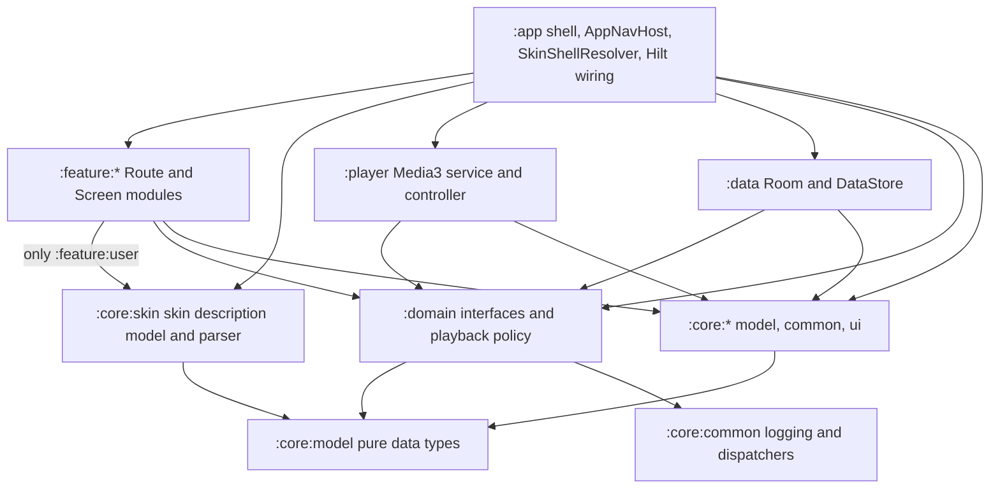
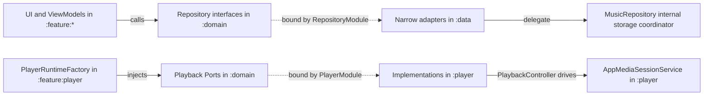
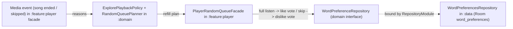

# Module Layering and Dependency Boundaries

The product is a 15-module Android Gradle project (`melody-in-heart`, applicationId `cn.com.dcsgo.mihx`). Layers are arranged so that pure logic lives at the bottom (`:core:*`, `:domain`), platform mechanics live in the middle (`:data`, `:player`), UI features live at the top (`:feature:*`), and the `:app` shell is the only module allowed to see everything. Two mechanisms keep this from eroding: Gradle dependency declarations (narrow by construction) and `verifyProductArchitecture`, whose rule engine lives in `buildSrc` and re-checks the whole tree on every `check` run.

## Layer responsibilities

| Layer | Module(s) | Owns | Must not touch |
| --- | --- | --- | --- |
| App shell | `:app` | `MelodyApplication` (`@HiltAndroidApp`, logger install, Coil `ImageLoaderFactory`, uncaught-exception hook), `MainActivity` (`@AndroidEntryPoint`), `AppRoot`/`AppScaffold`/`AppNavHost`, the runtime `AppShell`/`AppTab` model and `SkinShellResolver`/`SkinSwitcherRoute`/`SkinSwitcherStore` (the shell-skinnning bridge between `:core:skin` descriptions and host routes/drawables), `PermissionCoordinator`, app-level Hilt modules (`CoroutineModule`, `LoggerModule`, `PlayerModule`) | — (depends on every other module) |
| Feature | `:feature:home`, `:feature:playlist`, `:feature:user`, `:feature:lyrics`, `:feature:player`, `:feature:settings` | Public `XxxRoute` + internal `XxxScreen` composables, `XxxRouteState`/`XxxRouteActions` data classes, feature ViewModels; `:feature:player` additionally hosts the `PlayerRuntime` facade graph (`PlayerRandomQueueFacade`, `PlayerControllerQueueFacade`, `PlayerMediaEventFacade`, …); `:feature:playlist` hosts the library sorting helpers (`SongSorter`, `SortModeDropdownMenu`, `SongListTemplate`); `:feature:user` hosts the partitioned "我的" page (`UserSections` metadata consumed by `:core:skin`) and depends on `:core:skin` to reference the part catalog | `:data`, `:player`, and any other `:feature:*` module |
| Domain | `:domain` | Repository **interfaces** (`cn.com.dcsgo.mihx.domain.repository.*`), playback policy as pure logic (`QueueManager`, `PlaybackQueueActionPlanner`, `RandomQueuePlanner`, `ExplorePlaybackPolicy`, `ControllerQueuePlanner`, `ControllerPlaybackStateSynchronizer`, `PlaybackRestoreCoordinator`, ...), and the playback **Ports**/factories (see below) | No Android/Compose imports; only `:core:model` (as `api`) + `:core:common` |
| Data | `:data` | Room `MelodyDatabase` (v17, 14 entities) + `MelodyDao` + the migrations in `MelodyMigrations`, DataStore wrappers (`player_settings`, `mood_time_slot`, legacy prefs), `MusicRepository` storage coordinator, narrow repository adapters, `SharedPreferencesLegacyJsonMigration`; owns the Room `word_preferences` table backing `WordPreferenceRepository`; also declares the album-art `FileProvider` (authority `${applicationId}.artworkprovider`) exposing `cacheDir/album_art` as `content://` URIs | `:feature:*`, `:player` |
| Player | `:player` | `AppMediaSessionService` (Media3 `MediaSessionService` owning ExoPlayer), `PlaybackController` (MediaController client), windowed queue planning in `player/window/` (`WindowedControllerQueuePlanner`, `ControllerWindowSynchronizer`, `PlaybackWindowPlanner`), `PlaybackStateStore`, Bluetooth coordinators, `PlayDurationTracker`, FFmpeg (`FfmpegPcmDecoder`) + `EmotionAnalyzer` support, `di/AppCoroutineScopeModule` | `:feature:*`, `:data` |
| Core | `:core:model`, `:core:common`, `:core:ui`, `:core:skin` | `:core:model`: data types (`Song`, `Playlist`, `PlayQueue`, `PlayMode`, `AlbumEntry`, `ArtistEntry`, `LyricLine`, `SongInfo`, `SongEmotion`, `TimeSlotConfig`, `WordPreference`/`WordPreferenceKind`, `ThemeMode`/`ThemeVariant`) with zero project dependencies (only compose-runtime for `@Stable`/`@Immutable` annotations); `:core:common`: `AppLog`/`AppLogger`, `PerformanceTrace`, `CoroutineDispatchers`, time helpers; `:core:ui`: `MusicplayerTheme` and shared Compose components (song lists, toasts, dialogs, lyrics view, icons); `:core:skin`: skin **description model + parser/validator** (`Skin`, `SkinPartCatalog`, `DefaultSkin`, `SkinParser`, `SkinIssue`) — intentionally UI-free | `:core:model` must carry no Android resources and no `R.*` ids (enforced); `:core:skin` is likewise UI- and Compose-free (no resources, no Compose runtime) |

`:core:model` sits at the bottom with no project dependencies (it deliberately keeps only compose-runtime annotations, and `Song` stores an `android.net.Uri`); `:core:common` is standalone; `:core:ui` depends on `:core:model` and `:core:common`; `:core:skin` depends only on `:core:model` plus `org.json` (no Compose, no UI, so the whole description is parseable and unit-testable headlessly); `:domain` re-exports `:core:model` (`api(project(":core:model"))`) so every consumer gets the data types transitively.

## Dependency graph

*Allowed dependency directions. Only `:app` may depend on all layers; arrows into `:data`/`:player` from `:feature:*` and between features are forbidden and enforced. `:core:skin` is a bottom-layer core module (depends only on `:core:model` + `org.json`) that, among the features, only `:feature:user` consumes directly.*

The direction rules are:

- **`feature → core:* + domain` only.** Every `:feature:*` build file declares `implementation(project(":core:model"))`, `:core:common`, `:core:ui` and `:domain` (plus Compose/Coil/Hilt libraries); `:feature:user` additionally declares `implementation(project(":core:skin"))`. No feature declares `project(":data")` or `project(":player")`, and no feature declares another `project(":feature:…")` — cross-feature navigation goes through `:app` (the runtime shell derives the bottom tabs and `AppNavHost` composes `HomeRoute`, `LyricsRoute`, `PlaylistRoute`'s detail routes, `SettingsRoute`, and the `:feature:user` routes together).
- **`:player` and `:data` depend only on `core:* + domain`.** They reach each other's mechanics only through narrow interfaces/Ports provided by Hilt (see below), never through implementation imports.
- **`:domain` has no Android dependencies.** Despite being an `com.android.library` module, no file under `domain/src/main/java` imports `android.*`, `androidx.*`, or Compose; its entire source surface is interfaces, data classes, and pure policy functions over `:core:model` types (only `:core:common` time helpers are imported for `SongVersionComparer`). **M-21 caveat:** the gate's Android-framework ban on `:core:model` and `:domain` was introduced (2026-10-27) on a **ratchet** basis — pre-existing `import android.*` sites (notably `android.net.Uri` in `Song`/`AlbumEntry`/`ArtistEntry` and `FolderImporter`/`MusicImportRepository` in `:domain`) are whitelisted in a baseline, so they do not fail the build today, but any **new** `import android.*` in those two layers fails. The intended end state is `String`-based URIs parsed at the `:data`/`:player` boundary; that migration has not happened yet.

## Hilt assembly points

Hilt is the mechanism that lets the upper layers depend on `:domain` abstractions while `:app`/`:data` decide the concrete implementations. All Hilt modules are `SingletonComponent` modules.

**Entry points (checked by the architecture gate):**

| Component | Annotation | Location |
| --- | --- | --- |
| `MelodyApplication` | `@HiltAndroidApp` | `app/src/main/java/cn/com/dcsgo/mihx/MelodyApplication.kt` |
| `MainActivity` | `@AndroidEntryPoint` | `app/src/main/java/cn/com/dcsgo/mihx/MainActivity.kt` |
| `AppMediaSessionService` | `@AndroidEntryPoint` | `player/src/main/java/cn/com/dcsgo/mihx/player/AppMediaSessionService.kt` |
| `PlayerViewModel` | `@HiltViewModel` | `feature/player/src/main/java/cn/com/dcsgo/mihx/feature/player/PlayerViewModel.kt` |

Note that `AppMediaSessionService` lives in `:player` but is assembled by the `:app`-rooted Hilt graph; correspondingly the gate forbids declaring it in the `:app` manifest — it must stay in the `:player` manifest, where it is declared. `MelodyApplication` in `:app` schedules `EmotionScanScheduler` from `onCreate()`. The `:player` module's classes live under `cn.com.dcsgo.mihx.player` (migrated from the old `cn.com.dcsgo.mihx.data.player` so the package matches the module namespace); the gate now blocks any stale `data.player` reference from returning.

**Hilt modules (all required to exist and remain `SingletonComponent`):**

- `app/di/CoroutineModule` — provides `CoroutineDispatchers`.
- `app/di/LoggerModule` — provides `AppLogger` (`AndroidAppLogger(BuildConfig.DEBUG)`).
- `app/di/PlayerModule` — binds every playback Port (table below).
- `data/di/DatabaseModule` — builds the Room `MelodyDatabase` (`melody.db`) singleton with all migrations registered via `addMigrations(*MelodyMigrations.ALL)`, provides `MelodyDao` and `LegacyJsonMigration`.
- `data/di/DataStoreModule` — provides qualified `DataStore<Preferences>` instances (`@PlayerSettingsStore`, `@TimeSlotConfigStore`) and `@LegacyMusicPlayerPreferences`.
- `data/di/RepositoryModule` — binds `:domain` repository interfaces to `:data` implementations.
- `player/.../player/di/AppCoroutineScopeModule` — provides the `@ApplicationScope` process-level `CoroutineScope` used by `AppMediaSessionService` so snapshot persistence survives service destruction.

## Pattern: interfaces in :domain, narrow adapters in :data

Repository **contracts** live in `:domain` (`SongRepository`, `PlaylistRepository`, `MusicImportRepository`, `AlbumArtRepository`, `LyricsRepository`, `SongMetadataRepository`, `PlayStatsRepository`, `QuickSkipRepository`, `PlayerSettingsRepository`, `PlaybackStateRepository`, `PlaylistResumeRepository`, `SongEmotionRepository`, `EmotionFailureRepository`, `TimeSlotConfigRepository`, `WordPreferenceRepository`). **Implementations** live in `:data`, but `MusicRepository` — the Room/scan/storage coordinator — deliberately does *not* implement any of them. Instead each contract gets a narrow adapter that delegates to it, and `RepositoryModule` binds interface → adapter:

- `SongRepositoryAdapter` → `SongRepository` (delegates `loadSongs`, `observeSongsSnapshot`, `updateSongTitleOverride`, `deleteSong`, library artists/albums, file validation to `MusicRepository`)
- `PlaylistRepositoryAdapter` → `PlaylistRepository`
- `MusicImportRepositoryAdapter` → `MusicImportRepository`
- `AlbumArtRepositoryAdapter` → `AlbumArtRepository`
- `MediaMetadataRepository` → both `LyricsRepository` and `SongMetadataRepository`
- `PlayerSettingsRepository`, `PlaylistResumeDataStore`, `EmotionFailureStore`, `QuickSkipSongsRepository`, `PlayStatsRepository`, `SongEmotionsRepository`, `TimeSlotConfigStore`, `WordPreferencesRepository` → their respective `:domain` interfaces

The gate enforces both halves of this pattern: no file under `feature/`, `domain/` or `player/` may `import cn.com.dcsgo.mihx.data.repository.*` or `cn.com.dcsgo.mihx.data.local.*` (implementation imports cannot leak), `MusicRepository` must not declare any of the four domain repository types as a supertype, and the four `*RepositoryAdapter.kt` files must exist and implement their named interface.

*Binding flow: features and the player feature see only `:domain` contracts; `RepositoryModule` and `PlayerModule` (installed in `:app`/`:data`) attach the `:data`/`:player` implementations.*

## Playback Ports and PlayerModule

The `:feature:player` runtime must not know about Media3 service classes, Bluetooth managers, or storage files. Those capabilities are expressed as interfaces and `fun interface` factories in `cn.com.dcsgo.mihx.domain.playback`, injected into `PlayerRuntimeFactory` (which passes them into `PlayerRuntime` and its graph objects such as `PlayerMediaControllerGraph`), and given concrete `:player` implementations by `app/di/PlayerModule`:

| Port / factory (`:domain`) | Implementation provided by `PlayerModule` | Purpose |
| --- | --- | --- |
| `ControllerQueuePlannerPort` | `WindowedControllerQueuePlanner` (`:player`, `player/window/`) | Plans the windowed MediaController queue from the business `PlayQueue` via `ControllerWindowSynchronizer` |
| `PlaybackControllerPortFactory` | creates `PlaybackController(context, AppMediaSessionService::class.java, callbacks)` | Connects the UI to the Media3 session; `PlaybackController` implements `PlaybackControllerPort` with a bounded pending-action queue (FIFO cap 64) |
| `PlaybackStateStore` (`@Singleton`) + `PlaybackStateStorageFactory` + `PlaybackStateRepository` | `PlaybackStateStore` (`:player`) | Persists the playback snapshot to the `playback_state` DataStore (with legacy SharedPreferences fallback); one class serves both the `:domain` storage port and the repository interface |
| `BluetoothPlaybackMonitorFactory` | creates `BluetoothPlaybackCoordinator` composed of `BluetoothStateManager` + `BluetoothAudioQualityManager` | User-triggered Bluetooth pause/quality monitoring (must never start at app startup) |
| `PlaybackDurationMonitorFactory` | creates `PlayDurationTracker` wired to `PlayStatsRepository` + `QuickSkipRepository` | Credits effective play time and short-play counters |
| `PlayerQueueServicesFactory` | builds `PlayerQueueServices` bundle: `ImportCoordinator`, `PlaylistManager`, `SongGroupCoordinator`, `SongDeletionCoordinator`, `QuickSkipCoordinator`, `QueueManager.defaultPlayOrderBuilder`, `PlaybackQueueActionPlanner` | Supplies the library/queue side-effect bundle used by the domain queue policy |

In addition to the six ports, `PlayerRuntimeFactory` also injects the repository contracts `TimeSlotConfigRepository`, `SongEmotionRepository` and `WordPreferenceRepository` directly into `PlayerRuntime` for the mood-slot/explore playback features (see below).

Because `PlayerModule` is the single place where these ports meet their implementations, `:feature:player` compiles against interfaces only, and `:player` mechanics remain swappable and unit-testable (e.g. `PlayerControllerQueueFacadeTest` substitutes a fake `ControllerQueuePlannerPort`).

## Explore playback and emotion word preferences (v3.11.0)

Explore playback ("随心播放" / exploration mode) added in v3.11.0 is a domain-policy feature split across the two sides of the boundaries:

- **`:domain`** owns the pure policy in `ExplorePlaybackPolicy` (no Android imports, JVM-unit-testable): `INITIAL_BATCH_SIZE = 10` (random queue opens with 10 songs), `REFILL_COUNT = 5` (auto-refill appends 5 songs when the just-ended song is the second-to-last in the queue), `REFILL_THRESHOLD = 0`, and `MIN_LISTEN_MS = 30_000L` / `MIN_LISTEN_RATIO = 0.25f` defining what counts as a "quick skip" (a song heard under 30 s **or** under ¼ of its duration). `RandomQueuePlanner.planExploreRefill(allSongs, queue, count)` picks `count` random playable songs not already in the queue.
- **`:feature:player`** owns the orchestration in `PlayerRandomQueueFacade` (`refillExplorePlayQueue`, `buildExploreRefillPool`, `stopExplorePlay`), which is injected with `MoodSlotResolver`, mood-slot state, and the `WordPreference` lookups. When explore mode is active, `playRandomQueue` plans a 10-song batch, sets `isExplorePlay = true`, and `isInfinitePlay = false`; the layered refill candidate pool prefers songs carrying ≥1 liked word and no disliked word, then falls back to no-disliked-word songs, then the full library.
- **`:data`** owns persistence of the word-preference vote table. `WordPreferenceRepository` (`:domain`) reads the `word_preferences` Room table through `WordPreferencesRepository` (`:data`, the sole source), which has been consumed by both `:domain` and `:feature:player` (the `PlayerRandomQueueFacade` applies the vote via the `recordSongOutcome` contract). Playback outcomes accumulate votes only — a song listened fully (`liked = true`, ≥30 s and ≥¼ duration) adds a like vote to all its emotion words, a quick skip adds a dislike vote — with per-word atomic SQL increments (`ensureWordPreference` + `addWordVotesDelta`, M-22) so concurrent skip/full-listen settlements never lose a vote; the domain `WordPreference.kind` (`WordPreferenceKind.LIKE`/`DISLIKE`/`NEUTRAL`, tie = neutral) labels each word by the higher count, so a single skip cannot flip a liked word. Since v15 the vote weight is scaled by the word's proportion in the song (×100); since v15→16 the historical votes were ×100 to keep a single scale.
- **Room schema** went to **version 17 with 14 entities** (running through `11.json` and beyond); migration `10→11` creates `word_preferences` (`word` primary key, `likeVotes`/`dislikeVotes`/`updatedAt`), and later migrations (`11→12`..`16→17`) add the emotion-coordinate/`vocalScore`/weight-scale changes and the missing `index_songs_albumId` / `index_playback_events_songId` indexes. Migrations now live in `data/.../migration/MelodyMigrations.kt` (registered by `DatabaseModule` via `addMigrations(*MelodyMigrations.ALL)`), split out from `DatabaseModule` so the migration-regression test can reference them directly.

## `:core:skin`: UI-free skin description model

`:core:skin` (namespace `cn.com.dcsgo.mihx.core.skin`) is the newest core module, added to keep the "plugin shell" (path B: declarative JSON description + host part library) from leaking UI/routing knowledge into `:core`. A skin is **never executable code** — it is a JSON description the host uses to assemble existing parts, so import has zero composition-time crash risk and can be validated field-by-field with precise failure reasons. The module's whole surface is the description **model + parser/validator**:

- `Skin` / `SkinTokens` / `SkinShell` / `SkinTab` / `SkinPage` / `SkinPageHeader` / `SkinHeaderAction` / `SkinSection` / `NowPlayingConfig` — the data model (bottom `tokens` for visuals, `shell.bottomBar` for tabs, `pages` assembled from `sections`, plus `playerEntry` TAB/SHEET and `nowPlaying`).
- `SkinPartCatalog` — the **part whitelist** (fail-closed); it also carries the `skinSwitcher` / `customSkin` part names that map to `:feature:user`'s `UserSections.SKIN_SWITCHER`, `songList.template`/`source`/`count` value domains, and the `iconNames` icon table.
- `SkinParser` — fail-closed parse/validate returning `SkinValidation` (all issues at once, aggregate `summary()`); unknown `part` **rejects** (no silent downgrade), unknown fields are ignored (forward compat), out-of-range tokens are clamped as warnings. Rejects unknown `ThemeVariant` ids via `KNOWN_THEMES = setOf("MONO", "VERMILION")`, enforces schema version 1 and 2–5 bottom-bar tabs.
- `DefaultSkin` — the built-in default skeleton as a literal JSON string (not constructed in Kotlin), so the built-in and user-imported skins travel the **same** parse/validate path; `ID = "dcsgo.skin.builtin"`.
- `SkinIssue` — structured failure reasons (`Code` + `message` + `field`) the UI renders directly and unit tests assert per-case.

**Why it lives under `:core` and not `:app`:** the module deliberately carries no Android resources, no `R.*` ids, and no Compose runtime — it depends only on `:core:model` (for `ThemeVariant`) and `org.json`. That makes the description headlessly parseable and unit-testable. Only `:app` and `:feature:user` depend on it. The symbols → host artifacts mapping happens in `:app`'s `SkinShellResolver`, which resolves `part`/`icon`/page keys and `sections` into concrete routes (`library`→`AppRoutes.PLAYLIST`, `player`→`AppRoutes.HOME`, `me`→`AppRoutes.USER`), drawable ids and the `:feature:user` section order. `:core:skin` deliberately holds **no routing knowledge** — for the same dependency-direction reason as `:feature:player` avoiding `:player`, a `:core` module holding `R.drawable.*` or `AppRoutes` would break the module layering the gate enforces. `SkinSwitcherStore` (`SharedPreferences` `skin_switcher`) and the runtime `AppShell` (derived in `AppRoot` via `SkinShellResolver.resolveById(...)`) live in `:app`.

## verifyProductArchitecture: boundaries as build gates

The rule engine was extracted (refactor noted 2026-10-15) from the ~530-line root `build.gradle.kts` block into a unit-testable pure function `ProductArchitectureVerification.verify(rootDir)` in `buildSrc`. The root `verifyProductArchitecture` task (group `verification`) now only walks the tree (`kt`/`kts`/`java`/`xml`/`toml`, skipping `build`/`.gradle`/`.git`/`.idea`/`buildSrc`) and hands the file list to that function, which **collects all violations** into a list and reports them together (instead of failing on the first); the task throws `GradleException` when the list is non-empty. Rules are text/regex-based, which is why comments and string literals can trip them; the `:buildSrc:test` suite (`ProductArchitectureVerificationTest`) exercises the rules on synthetic repo trees.

Root `check` aggregates `spotlessCheck` + `verifyProductArchitecture` + every subproject's `check`, so a violation fails the standard pre-commit gate.

Key enforced rules (see `/openwiki/operations/build-and-verification.md` for the operational workflow):

- **Module manifest** — `settings.gradle.kts` must include all 15 required modules (`:app`, `:core:model`, `:core:common`, `:core:ui`, `:core:skin`, `:domain`, `:data`, `:player`, the six `:feature:*`, `:benchmark`); every one of them must keep a local `.gitignore` containing `/build/`, `/.cxx/`, `/.externalNativeBuild/`, `/captures/`.
- **Spotless/Hilt assembly** — the version catalog must keep the Spotless plugin id, the root build must apply the `spotless` alias, and `check` must run `spotlessCheck`; the four entry points must carry their annotations, and the six Hilt modules must exist and remain `SingletonComponent` modules (`@Module` + `@InstallIn(SingletonComponent::class)`).
- **Feature isolation** — no `feature/*/build.gradle.kts` may contain `project(":data")`, `project(":player")`, or any `project(":feature:…")`; no source under `feature/`, `domain/`, `player/` may import `cn.com.dcsgo.mihx.data.repository.*` or `cn.com.dcsgo.mihx.data.local.*`.
- **Route/Screen ownership** — `:feature:lyrics`, `:feature:settings`, `:feature:home`'s play-stats/quick-skip screens and `:feature:user`'s version-management screens must own their `*Route.kt`/`*Screen.kt` files; the retired overlay routing files (`AppOverlay.kt`, `AppOverlayHost.kt`, `OverlayRoute.kt`) must not reappear; `:feature:home` must navigate to `:feature:lyrics` instead of importing `cn.com.dcsgo.mihx.ui.lyrics` directly.
- **Repository adapter binding** — `MusicRepository` must stay an internal storage coordinator (no `SongRepository`/`PlaylistRepository`/`MusicImportRepository`/`AlbumArtRepository` supertype), and the four adapter files must exist and implement the matching `:domain` interface.
- **Doc anchors** — the gate also checks documentation presence/content: `docs/architecture/PLAYBACK_STATE_MACHINE.md` must document the requested state/sync terms, and `docs/refactor/PRODUCT_REFACTOR_AUDIT.md` must track the required audit terms (the two non-source triggers of the gate).
- **Room schema immutability** — schema snapshots `1.json`, `2.json`, `3.json` must exist with pinned content: v1 must *not* contain `quick_skip_short_play_counts`, v2 must contain it but *not* `lrcUri`, v3 must contain `lrcUri`; `MelodyMigrations` must keep `Migration(1, 2)`/`Migration(2, 3)` and `DatabaseModule` must register `addMigrations(*MelodyMigrations.ALL)`. Exported history now runs to `17.json` (`MelodyDatabase` declares `version = 17` with 14 entities), with `MIGRATION_16_17` adding the two missing indexes; the rule is: never edit an existing schema JSON — add a new snapshot and migration instead.
- **LazyColumn keys** — every `items`/`itemsIndexed`/`item {` call in `app`, `core` and `feature` sources must pass a stable `key =` (regex-scanned) so product-scale lists don't drop item state.
- **Logging** — direct `Log.d/i/w/e/v/wtf(...)` calls are banned everywhere except `AppLogger.kt`; use `AppLog`/`AppLogger` (which redact URIs/paths in release).
- **Privacy and backup excludes** — `app/src/main/res/xml/backup_rules.xml` and `data_extraction_rules.xml` must each exclude `music_player_prefs.xml`, `play_stats_prefs.xml`, `quick_skip_songs_prefs.xml`, `melody.db` (+`-journal`/`-shm`/`-wal`), `datastore/player_settings.preferences_pb`, `datastore/playback_state.preferences_pb` and `cache/album_art/`.
- **Release build shape** — the `:app` `release` block must set `isMinifyEnabled = true` and `isShrinkResources = true`; a `benchmark` build type must exist with `initWith(getByName("release"))`; the `:app` manifest must not declare `AppMediaSessionService` nor request `READ_EXTERNAL_STORAGE` (SAF document-tree import). `READ_MEDIA_AUDIO` **is** allowed: it is used to accelerate import scanning via `java.io.File` direct traversal when granted, with SAF still the primary path and fallback. The `release` block is now extracted with a brace-pairing parser (`extractBracedBlock`) that survives nested lambdas/compose closures inside the block — replacing the old "first closing brace" regex, which truncated when nested braces appeared. The album-art `FileProvider` sits in the `:data` manifest with authority `${applicationId}.artworkprovider` (matching the debug variant's `<package>.debug` applicationId) and a `@xml/artwork_file_paths` path mapping, so the `content://` artwork URIs can be shared across processes (notifications/SystemUI/Android Auto).
- **Observability anchors** — `MusicRepository` must keep the `music_import_scan`/`music_import_folder` `PerformanceTrace` operations and `PlaybackController` must keep `controller_play_queue`/`controller_prepare_queue`/`controller_sync_queue`/`play_next_command`; `PlaybackWindowPerformanceShapeTest` must keep covering 100/500/1_000/71-song window sizing; `:benchmark` must remain a real Macrobenchmark module (`targetProjectPath = ":app"`) with a `StartupBenchmark` using `MacrobenchmarkRule`, `StartupTimingMetric`, `StartupMode.COLD`.
- **Privacy-sensitive startup rules** — Bluetooth playback monitoring must be user-triggered from Settings (`PlayerStartupFacade` must not mention Bluetooth; `SettingsScreen` must expose the 蓝牙播放监听/申请蓝牙权限 controls; the setting must be persisted through `PlayerSettingsRepository`/DataStore and surfaced via `PlayerUiState`, and state must not be held in app-shell `remember`), and no startup-path file (`MainActivity`, `AppRoot`, `PlayerRuntime`, `PlayerStartupFacade`) may request notification/Bluetooth permissions; `PermissionCoordinator` must support a granted callback.
- **`:player` package/`data.player` ban** — because `:player` classes migrated to `cn.com.dcsgo.mihx.player`, the gate rejects any remaining `cn.com.dcsgo.mihx.data.player` reference in `:player` sources.
- **Misc bans** — legacy `com.dcsgo.data.model` package references, the old `PlayerViewModelComponents`/`PlayerViewModelComponentFactory` assembly hub, Android Things dependencies (`com.google.android.things`), and `:core:model` resources/`R.*` ids are all rejected.

Full-module list and the missing-module failure message come straight from the `requiredModules` table in `ProductArchitectureVerification`, so adding a module is a two-file change by design (see below).

## Adding a new feature module

1. **Register it**: add `include(":feature:xxx")` to `settings.gradle.kts`.
2. **Build file**: create `feature/xxx/build.gradle.kts` with the `kotlin-android` + `kotlin-compose` library plugins (add `ksp` + `hilt` only if the module declares DI entry points — today only `:feature:player` does) and depend on `implementation(project(":core:model"))`, `:core:common`, `:core:ui`, `:domain` — never `:data`, `:player`, or another feature. Only `:feature:user` additionally declares `implementation(project(":core:skin"))` (it owns the `UserSections` partition metadata and the skin switcher section that the skin descriptions reference).
3. **`.gitignore`**: create `feature/xxx/.gitignore` containing `/build/`, `/.cxx/`, `/.externalNativeBuild/`, `/captures/` — the gate fails if any required module lacks it.
4. **Route/Screen**: add a public `XxxRoute.kt` (receives `XxxRouteState` + `XxxRouteActions` + callback lambdas) and an internal `XxxScreen.kt`; the route/state/actions types are the module's entire public API.
5. **Wire navigation**: register the destination in `app/.../AppNavHost.kt` and map it to a bottom tab in `AppDestinations` if it is a top-level page — `:app` is the only place cross-feature routing may happen.
6. **Verify**: run `./gradlew verifyProductArchitecture` (or `check`). Missing `.gitignore` patterns, leaked dependencies, absent Route/Screen files, or unkeyed `LazyColumn` items will fail the build immediately.

## Related pages

- `/openwiki/operations/build-and-verification.md` — running and tripping the verification gates, build variants, signing.
- `/openwiki/architecture/app-shell-navigation.md` — `AppRoot`/`AppNavHost` wiring and bottom-tab destinations.
- `/openwiki/architecture/data-persistence.md` — Room/DataStore internals behind the `:data` layer, incl. the `word_preferences` table and adaptive emotion-analysis memory budgeting.
- `/openwiki/player/runtime-facades.md` — the `PlayerRuntime` facade graph consuming the ports listed above.
