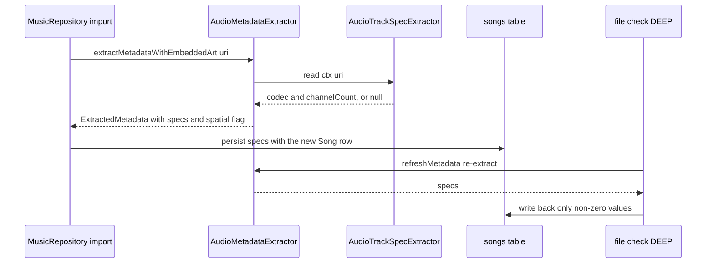

# Audio spec model: quality tiers and spatial audio

Every local track yields **two independent verdicts** from one small set of track specs: an `AudioQualityTier` (音质档位) and a spatial-audio boolean. Both live in `:core:model` as pure Kotlin — `AudioQualityTier` keeps the thresholds and the codec MIME sets, and `Song.qualityTier`/`Song.qualityLabel` are computed getters — while the Android APIs that actually read a file (`MediaMetadataRetriever`, `MediaExtractor`) are confined to the `:data` boundary. No tier is ever persisted; only the raw specs are, so a rule change re-labels the whole library on the next read.

The model deliberately excludes two things that look like quality but are not: "母带" (master — a *source* attribute) and "沉浸环绕声" (a *rendering* dimension). Spatial audio is likewise **recognition and display only**: nothing here promises Atmos object-audio playback. The persisted state of these columns and the migration contract are covered in `/openwiki/architecture/data-persistence.md`; the aggregate counts built on top of them are in the storage-stats page.

## Where the specs live

`Song` is the persisted carrier of the raw specs (Room `songs` columns), with `0` / `""` / `false` as the "unknown" sentinel for each:

| `Song` field | Meaning | Unknown sentinel |
| --- | --- | --- |
| `sampleRate` | sample rate in Hz | `0` |
| `bitDepth` | original bit depth | `0` = unknown, lossy, or not exposed by the platform |
| `bitRateKbps` | bitrate in kbps (chiefly for lossy grading) | `0` |
| `channelCount` | channel count | `0` |
| `audioCodec` | track MIME such as `audio/flac` | `""` |
| `spatialAudio` | persisted spatial-audio recognition result | `false` |

Three display helpers and the tier itself are derived, never stored: `sampleRateDisplay` (`"96kHz"`), `bitDepthDisplay` (`"24bit"`), `channelDisplay` (`"6 声道"`), `qualityTier` (calls `AudioQualityTier.classify` with the four spec fields) and `qualityLabel`, which returns `qualityTier.label` **only when the tier is not `UNKNOWN`** and otherwise returns `""` so a UI binds the label and shows nothing instead of guessing.

`SongInfo` is the transient counterpart for the information dialog. It carries no numeric specs at all — `bitRate`, `sampleRate`, `bitDepth`, `quality`, `channelCount` are already-formatted display strings ("未知", "24bit", "6 声道") plus the `spatialAudio` boolean and the raw `codec` MIME. That formatting happens inside the extractor, which is why `SongInfo.quality` is `""` for an `UNKNOWN` tier.

## Tier classification

`AudioQualityTier.classify(audioCodec, bitRateKbps, bitDepth, sampleRate)` is the single entry point. It lowercases the MIME, branches on membership in the lossless set, and never throws:

<!-- openwiki: mermaid parse failed and this diagram was converted to a text fence so it does not break rendering. Fix the diagram source and restore the mermaid fence. Parser error: Heuristic: an unescaped angle bracket inside a label breaks rendering; rephrase the label. -->
```text
flowchart TD
    START["classify codec, bitRateKbps, bitDepth, sampleRate"] --> LS{"codec in LOSSLESS_CODECS"}
    LS -- "no (lossy)" --> B320{"bitRateKbps >= 320"}
    B320 -- yes --> VERYHIGH["VERY_HIGH 极高"]
    B320 -- no --> B192{"bitRateKbps >= 192"}
    B192 -- yes --> HIGH["HIGH 较高"]
    B192 -- no --> B0{"bitRateKbps > 0"}
    B0 -- yes --> STANDARD["STANDARD 标准"]
    B0 -- no --> UNKNOWN_A["UNKNOWN 未知"]
    LS -- "yes (lossless)" --> DSD{"codec is DSD"}
    DSD -- yes --> HIRES["HI_RES 高解析"]
    DSD -- no --> D24{"bitDepth >= 24 and sampleRate >= 48000"}
    D24 -- yes --> HIRES
    D24 -- no --> CD{"bitDepth >= 16 and sampleRate >= 44100"}
    CD -- yes --> LOSSLESS["LOSSLESS 无损"]
    CD -- no --> NOD{"bitDepth == 0 and sampleRate >= 44100"}
    NOD -- yes --> LOSSLESS
    NOD -- no --> UNKNOWN_B["UNKNOWN 未知"]
```

*The full classification decision tree: lossy codecs are graded by bitrate alone; lossless codecs by bit depth and sample rate, with DSD short-circuited into HI_RES.*

| Tier | `label` | `rule` (canonical UI copy) | Condition |
| --- | --- | --- | --- |
| `STANDARD` | 标准 | 有损，码率低于 192kbps | lossy codec, `bitRateKbps > 0` and `< 192` |
| `HIGH` | 较高 | 有损，192–319kbps | lossy codec, `192 ≤ bitRateKbps < 320` |
| `VERY_HIGH` | 极高 | 有损，320kbps 及以上 | lossy codec, `bitRateKbps ≥ 320` |
| `LOSSLESS` | 无损 | 无损编码，16bit / 44.1kHz 起 | lossless codec, `bitDepth ≥ 16 && sampleRate ≥ 44_100`, **or** `bitDepth == 0 && sampleRate ≥ 44_100` |
| `HI_RES` | 高解析 | 无损编码，24bit 且 48kHz 及以上；DSD 直接归入 | lossless codec, `bitDepth ≥ 24 && sampleRate ≥ 48_000`, or any DSD codec |
| `UNKNOWN` | 未知 | 规格数据不足，建议执行深度校验 | lossy with `bitRateKbps == 0`; lossless failing every branch above |

The lossless set is a literal MIME allow-list, because it must match what `MediaExtractor`/MMR report rather than what the filename implies: `audio/flac`, `audio/x-flac`, `audio/alac`, `audio/x-alac`, `audio/raw` (Android's usual MIME for WAV), `audio/wav`, `audio/x-wav`, `audio/aiff`, `audio/x-aiff`, `audio/ape`, `audio/x-ape`, `audio/dsd`, `audio/x-dsd`. `isLossless(codec)` exposes the same membership test so the extractor can gate bit-depth reading.

Two asymmetries are intentional:

- **DSD bypasses the depth/sample-rate test.** DSD's 1-bit/2.8 MHz is a different spec system from PCM, so `audio/dsd` / `audio/x-dsd` short-circuit to `HI_RES` before any threshold comparison.
- **A zero bit depth does not force `UNKNOWN`.** Some lossless files expose no `METADATA_KEY_BITS_PER_SAMPLE` even though the sample rate is readable; the `bitDepth == 0 && sampleRate ≥ 44_100` branch keeps them `LOSSLESS` instead of degrading the whole library. Unreadable *sample rate* is what pushes a lossless file to `UNKNOWN`.

Because the `label`/`rule` pairs are the canonical wording, any surface that restates a rule must copy these strings verbatim (see the guide sheet below), and `StorageStatsScreen`'s bucket legend even renders `tier.label` directly — including 未知 as a bucket, which is the one place 未知 appears as a label rather than being suppressed.

## Spatial-audio verdict

`AudioQualityTier.isSpatial(audioCodec, channelCount)` is a lightweight MIME switch — it parses no AC-4 presentation or object metadata:

| Codec MIME | Spatial? | Notes |
| --- | --- | --- |
| `audio/eac3-joc` | always `true`, any channel count | the JOC extension itself is the Atmos/object-audio marker; `audio/eac3-joc` with 2 channels still counts |
| `audio/ac4` | `true` only when `channelCount > 2` | 2.0 AC-4 is plain stereo encoding, so it must not get the badge; `channelCount == 0` (unreadable) also yields `false` |
| `audio/eac3` (E-AC-3 / DD+) | never | multichannel only — shown as 声道, not as spatial |
| `audio/ec+3` (E-AC-3 / DDP variant) | never | same rule; the old "DD+ is Atmos" assumption is explicitly rejected |
| anything else | never | e.g. `audio/flac` 2ch |

The channel count that feeds the AC-4 branch comes from `MediaExtractor`, not from the persisted `Song.channelCount` guess, at extraction time. Since the rule changed after rows had already been written, `spatialAudio` in the database can be **stale in both directions**: statistics therefore never count the stored flag but recount `AudioQualityTier.isSpatial(song.audioCodec, song.channelCount)` live, so a row written under the old DD+ rule cannot inflate the spatial total.

## How specs are read (the `:data` boundary)

`AudioMetadataExtractor` performs one MMR open per file and combines three sources:

1. **`MediaMetadataRetriever`** supplies sample rate (`METADATA_KEY_SAMPLERATE`), duration, title/artist/album, the bitrate (in bps, divided by 1000 and floored at `0`), and a **MIME fallback** (`METADATA_KEY_MIMETYPE`, accepted only when it starts with `audio/`).
2. **`AudioTrackSpecExtractor.read(ctx, uri)`** opens a `MediaExtractor`, finds the first track whose MIME starts with `audio/`, and returns `TrackSpec(codec, channelCount)`. It exists because MMR has **no channel-count key**; the value is read from `MediaFormat.KEY_CHANNEL_COUNT` and clamped to `1..64`, `0` otherwise. It returns `null` (never throws) on any failure, and both MMR and the extractor fall back from `setDataSource(ctx, uri)` to a file descriptor (`openFileDescriptor` / `openAssetFileDescriptor`, honouring start offset and length when known) because SAF `content://` URIs frequently reject the URI path.
3. **`readBitDepth(retriever, audioCodec)`** reads `METADATA_KEY_BITS_PER_SAMPLE` (API 31+) *only* when `AudioQualityTier.isLossless(audioCodec)` is true, and only accepts `1..64`.

`readTrack` then composes the verdict: the extractor's codec wins over the MMR MIME when non-empty, `channelCount` is the extractor's value or `0`, and `spatialAudio = isSpatial(codec, channelCount)` is computed once here, so `Song`/`SongInfo`/statistics all read the same predicate.

Everything in this layer degrades to "unknown" instead of failing an import: a full MMR exception yields `ExtractedMetadata(fallbackTitle, "未知艺术家", "", sampleRate = 0)` with zeroed specs, and `AudioTrackSpecExtractor` logs at debug level and returns `null`.

## Lifecycle: import, backfill, and the live-read dialog



*Specs flow into the library at import; the only path that refreshes rows written before the columns existed is a DEEP file check.*

- **Imports persist immediately.** `addFolder` calls `extractMetadataWithEmbeddedArt` (one MMR open that also grabs embedded art) and builds the `Song` with `bitDepth`, `bitRateKbps`, `channelCount`, `audioCodec` and `spatialAudio` straight from `ExtractedMetadata`. There is no "import then grade later" step: the row is complete the moment it is written.
- **Rows from before v18/v19 stay empty.** `MIGRATION_17_18` adds `bitDepth` with default `0`; `MIGRATION_18_19` adds `bitRateKbps = 0`, `channelCount = 0`, `audioCodec = NULL`, `spatialAudio = false`. Neither migration re-opens any file, so an upgraded library legitimately reads as 未知 until the user acts.
- **Deep verification is the backfill.** `MusicRepository.validateAndCleanupLocalFiles(FileCheckMode.DEEP)` treats every song whose URI still resolves as a refresh candidate; `FileCheckMode.QUICK` only refreshes songs whose `size:mtime` fingerprint changed. Both funnel into `refreshMetadata`, which re-extracts in parallel (unlocked), then takes one write lock to batch-apply results and persist.
- **The merge is guarded so a failed read can't erase data.** Change detection only fires for `meta.bitDepth != 0 && meta.bitDepth != song.bitDepth` (likewise bitrate and channels), `audioCodec.isNotBlank() && …`, and the merge repeats the same guards. `spatialAudio` is additionally gated on codec readability — if the codec could not be read, the previous flag is preserved rather than reset to `false`.
- **The information dialog never reads the database.** `MediaMetadataRepository.songInfo(song)` calls `AudioMetadataExtractor.extractFullMetadata(context, uri)` on IO for every open, so a dialog always shows the file's real specs even when the persisted row is stale (bit depth renders 未知 for lossy, quality is blank when `UNKNOWN`, channels are blank at `0`). Callers reach it through `loadSongInfoSafely`, which is the only sanctioned invocation form.

## Display surfaces and their rules

| Surface | Component | Rule |
| --- | --- | --- |
| Song list rows | `AudioSpecBadges` inside `SongListItem` | Emits a compact `qualityLabel` pill plus a 14dp `SpatialAudioIcon`; **returns early with no layout when the label is empty and the flag is false**, so unsupported songs consume zero space. Present rows add ~16dp of height. |
| Home "now playing" badge | `HiResBadge` (rendered in `HomeScreen` top-start) | Strictly gated on `song.qualityTier == AudioQualityTier.HI_RES`, so it can never disagree with the list pill; `contentDescription` reads `Hi-Res 音频（96kHz / 24bit）`, omitting the bit depth when it is `0`. |
| Version selector (home) | `VersionSelector` | Lists each same-name version as `qualityLabel` with an explicit `"未知"` fallback, appends `SpatialAudioIcon` in the item's trailing icon only when `spatialAudio`, and the switch toast echoes `已切换到「…」版本 · 空间音频`. |
| Version management cards | `VersionManagementComponents` | Shows a quality pill next to the sample-rate pill, hidden entirely when `qualityLabel` is empty. |
| Information dialog | `SongInfoDialog` | 比特率 and 采样率 always render (falling back to 未知); 位深 is hidden when blank **or** `"未知"` (avoiding a "位深：未知" line on every lossy track); 音质 / 声道 / 编码 render only when non-blank; 空间音频 renders `支持（Atmos）` only when true. Shared by playlist, artist, album, emotion library, local-music management, version management and now-playing. |
| Version comparison | `SongVersionComparer` + `VersionComparisonScreen` | Builds 位深 / 音质 / 声道 / 空间音频 spec rows only when at least one version carries that data (`bitDepth > 0`, any non-`UNKNOWN` tier, `channelCount > 0`, any `spatialAudio`), filling per-version cells with 未知/`—` for the others; bitrate and file size come from each version's live `SongInfo`. Rows equal across versions collapse into "各版本一致". |
| Storage statistics | `LocalMusicStorageStats` + `StorageStatsScreen` | Buckets by the computed `qualityTier` (never a stored tier) and recounts spatial audio live via `isSpatial`; the 统计口径 card restates the depth/DSD/AC-4 rules. |
| Rule sheet | `AudioQualityGuideSheet` | Opened by tapping the logo on the 「我的」 page (`onLogoTap` → `showAudioQualityGuide`); lists the five tier rules, the lossy/lossless codec families, the three spatial rows, and the bullets "只做识别与展示，不承诺 Atmos 对象音频回放" / "老数据需要执行一次「深度校验」" / "详情弹窗始终实时读取文件". Its tier and spatial rows must be kept byte-identical to `AudioQualityTier.label`/`rule` (and to `isSpatial`), otherwise the app explains two different rules. |

## Invariants reviewers broke before

- **Never infer quality from the file extension.** `.m4a` is a container that may hold AAC (lossy) or ALAC (lossless); only the track MIME decides. The guide sheet states this literally ("扩展名（如 .m4a）只是容器，不代表音质"), and `SongVersionComparer`'s extension-based `format`/`isLossless` fields are presentation-only, used for the format badge and the quality score, never for the persisted tier.
- **Never surface a decoded bit depth for lossy codecs.** `readBitDepth` returns `0` unless the MIME is in the lossless set, so an MP3 that reports 16 bits cannot masquerade as lossless data.
- **`UNKNOWN` means "insufficient data", not "bad audio".** `qualityLabel` maps it to an empty string and every primary surface hides the label; only the version selector/comparison and the stats bucket show a literal 未知 marker, and the user-facing remedy is a DEEP file check.
- **A failed codec read must not clear a recognized Atmos flag.** Both the change predicate and the write-back guard `spatialAudio` behind `audioCodec.isNotBlank()`.
- **Plain E-AC-3 / DD+ and 2.0 AC-4 are not spatial.** Only `audio/eac3-joc` (any channel count) and `audio/ac4` with `channelCount > 2` earn the badge.

## Tests that pin the rules

- `AudioQualityTierTest` pins the bitrate ladder boundaries (`128 → STANDARD`, `192 → HIGH`, `320 → VERY_HIGH`, `0 → UNKNOWN`), the lossless/Hi-Res thresholds (`16bit/44.1k → LOSSLESS`, `24bit/48k` and `24bit/96k → HI_RES`, `audio/raw` treated as lossless, DSD `1bit/2.8224MHz → HI_RES`), the empty-spec `UNKNOWN` cases, the full spatial matrix (`eac3-joc` 2ch true, `ec+3` 6ch false, `ac4` 6ch/10ch true, `ac4` 2ch/0ch false, `eac3` 6ch false, `flac` false), and that `Song.qualityTier`/`qualityLabel` derive from persisted specs while an empty song yields `""`.
- `SongVersionComparerTest` pins that 位深/音质/声道/空间音频 rows appear only when the data exists and that cells read `高解析` / `极高` / `6 声道` / `支持`.
- `LocalMusicStorageStatsTest` pins the live spatial recount (including a stale `spatialAudio = true` on an `ec+3` row being ignored) and the "FLAC with unknown bit depth at 44.1kHz is still LOSSLESS" rule.
- `MelodyDatabaseMigrationTest` pins the v17→v18 and v18→v19 column defaults (`0` / `NULL` / `false`).
- `HomeScreenComposeTest` pins the Hi-Res badge gate end to end by asserting the `Hi-Res 音频（96kHz / 24bit）` content description for a 24bit/96kHz FLAC song.

The broader test inventory lives in `/openwiki/testing/test-map.md`.
