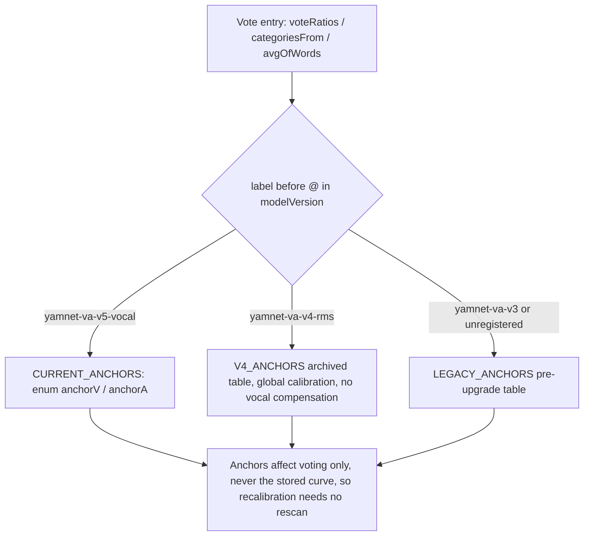
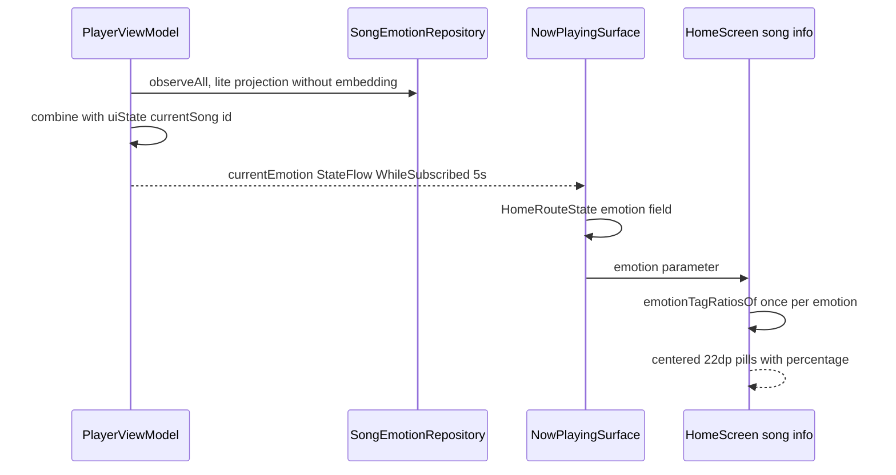

# Emotion model: curve → Chinese tags → three ratio projections

Song emotion is a **layered two-track** domain model. Underneath sits a continuous valence/arousal (V/A) coordinate in `[-1,1]`: sortable, interpolable, and stored as a per-window curve. On top sits a closed Chinese vocabulary (10 groups, anchored V/A points) used for display and user interaction. The two layers convert through fixed functions only: `EmotionGroup.voteRatios` / `categoriesFor` turn a curve into tag votes, `EmotionGroup.avgOfWords` turns user-selected words back into coordinates. The vocabulary is a **mapping/display layer only and never a classification training target** — stated in the `EmotionGroup` KDoc and the design boundary of the whole feature.

The model lives in `:core:model` (`SongEmotion`, `EmotionGroup`, `EmotionTags`, `EmotionDisplay`, `EmotionConfidence`, `VocalCalibration`, `WordPreference`), the analyzer in `player/src/main/java/cn/com/dcsgo/mihx/player/EmotionAnalyzer.kt`, persistence in Room `melody.db` (`song_emotions`, `word_preferences`), and the render surfaces in `:core:ui`, `:feature:home`, `:app` and `:feature:playlist`.

## Coordinate system: physical loudness arousal, calibrated valence, compensated vocal component

`EmotionAnalyzer` produces the curve with three deliberate departures from a naive regression head:

- **A — arousal is a physical loudness envelope.** Per window it takes the RMS of the already-decoded 16 kHz PCM, converts to dBFS and maps `-30..-5 dBFS` onto `[-1,1]` (`windowArousal` / `dbToArousal`, bounds `DB_FLOOR`/`DB_CEIL`). It is **not** the VA head's arousal output, which behaved as a genre proxy ("does this sound like electronic/hip-hop") and made absolute-energy words like 「燃」/「静谧」 almost unreachable.
- **B — valence is zero-point/slope calibrated.** Raw output is systematically positive (device-wide 1094-song mean `+0.264`); the analyzer applies `v' = (v - 0.25) / 0.85` (`V_CAL_BIAS` / `V_CAL_SCALE`), which centers the library at `+0.017`.
- **C — v5 strips the vocal component.** Part of valence was measuring "is somebody singing"; `VocalCalibration` removes that at read time (see below).

Windows are **5 s with a 2.5 s hop** (`WINDOW_SEC` / `HOP_SEC`); each window's raw `(v,a)` is stored unsmoothed, and smoothing belongs to the renderer. A window with **both** `|v| < 0.15` and `|a| < 0.15` abstains from voting; `|effectiveValence|` or `|effectiveArousal|` below `SongEmotion.LOW_CONF = 0.15` means the mean falls in the undetermined band and the UI must not force a quadrant.

### Version string: `<label>@<fingerprint>`

`modelVersion` is `"<coordinate label>@<content fingerprint>"`, generated into `EmotionModelSpec` from `core/model/emotion_model_spec.properties` — the single source of truth for the coordinate definition and the two tflite asset hashes:

- the **label** (`yamnet-va-v5-vocal`) is the coordinate system's semantic identity; it selects the anchor table, and the fingerprint plays no part in voting;
- the **fingerprint** (`edbf6fe5` today) is the content identity: changing model assets without updating the spec fails the build (`generateEmotionModelSpec` verifies SHA-256), and a changed fingerprint makes `modelVersion` differ, which triggers rescans.

`EmotionGroup.ANCHORS_CALIBRATED_FOR = "b8a45a93"` is hardcoded to the parameter fingerprint the anchor table was calibrated against; `EmotionModelSpecTest` compares it with `EmotionModelSpec.PARAMS_FINGERPRINT`, turning "changed coordinates but kept the old anchors" into a red build instead of silently wrong tags.

### Anchor tables are chosen by label

Because rescanning is gradual, old curves coexist with new ones for days, so `EmotionGroup.anchorsFor(modelVersion)` selects the table from the label before `@`:

Anchor table selection by coordinate label; the fingerprint never participates.

Voting a legacy curve with the current table is a measured failure: legacy valence is positively biased by `+0.264`, so **47.1 % of the 1095-song library would become 「治愈」**. `anchorsForManualPoint(emotion)` picks the table for a user click: a row with a curve (`windowsAnalyzed > 0`) must use its own coordinate system; a row without one (unanalyzed or `user-only`) uses the current anchors, because the future curve will be produced by the current model.

## SongEmotion: analysis output and its read-time derivations

`SongEmotion` is both the analyzer's output and the single shape every reader consumes:

- `valence` / `arousal`: whole-song per-window means; `curve`: the per-window `(v,a)` sequence, 5 s window / 2.5 s hop, raw and unsmoothed;
- `peakSec`: second of the A-axis maximum (`peak * HOP_SEC`). It is still produced and persisted, but **no current UI draws a peak marker** — the detail chart plots the two curves only;
- `windowsAnalyzed` / `durationSec`; `modelVersion` / `analyzedAt` (the former drives rescanning *and* anchor selection);
- `embedding`: whole-song mean YAMNet embedding (1024 dims), nullable for old rows;
- `vocalScore`: mean YAMNet AudioSet vocal-class score, `null` before 2026-10-25 — the input to vocal compensation;
- user fields: `userTags` (selected word labels, **the ground truth**), `userTagsEdited`, and the deprecated `userValence` / `userArousal`.

**User calibration: words are truth, coordinates are derived.** The coordinate columns are no longer a source of truth — a stored coordinate goes stale as soon as the curve changes coordinate system; after a rescan, 3 user-calibrated songs had entirely wrong stored coordinates. Instead `userPoint()` computes them at read time as `EmotionGroup.avgOfWords(userTags, anchorsForManualPoint(this))` in the row's own coordinate system, and `effectiveValence` / `effectiveArousal` prefer that point over the model mean. `userCorrected` is simply `userTags.isNotEmpty()`. `userTagsEdited` distinguishes active correction (user words ≠ model words), plain acceptance (`false`), and "nothing to compare against" (`null`); only `true` samples — plus pure manual marks on unanalyzed songs — are independent labels usable as ground truth.

### Vocal compensation (VocalCalibration)

`VocalCalibration.adjustCurve` shifts **valence only**, by `VOCAL_COMP_SHIFT = +0.091`, for instrumental rows (`vocalScore <= VOCAL_COMP_THRESHOLD = 0.010`); arousal is physical loudness and has no vocal component. Rows with `vocalScore == null` are not compensated. `shiftFor` returns `0f` in that case and `adjustedCurve` returns the same list instance, so no allocation happens when there is nothing to shift.

The amount is the residual after matching on arousal: 1095 songs split by `vocalScore` into 376 vocal (`valence +0.120`) and 719 instrumental (`-0.041`) songs, a `-0.162` gap of which roughly half is explained by "vocal songs are also louder". Within arousal bins the residual is `-0.091`, while an independent model (MusicNN + DEAM head) shows `≈ 0` (`+0.026`) on the same split — evidence that this component is specific to the current pipeline rather than a property of music.

Compensation is a constant read-time translation of the curve; the database keeps the raw curve, so changing the amount requires no rescan and no migration. **Voting and confidence must use `compensatedCurve`** (and `compensatedValence` for the song mean), otherwise tags describe a vote that no longer exists. `compensatedCurve` is a computed property: it re-materializes the list on every access, which is why display callers must not re-derive it repeatedly (see the single-vote rule below).

## EmotionGroup: 10 anchored groups, 39 Chinese words

Each enum entry carries `words`, `anchorV`, `anchorA` and `auto`. Nominal size is 4 words per group, with **ABYSS having only 3** (「窒息 孤独 深渊」), for 39 distinct words total — locked by `assertEquals(39, all.size)` in `SongEmotionSectionTest`. `headline = words.first()` is the auto-display word; users may pick any word of a group. `MAX_TAGS = 4` and `MIN_RATIO = 0.15` live on the companion object, `wordIndex` backs `groupOf(word)` (the vocabulary is closed and duplicate-free).

| Group | Words | anchorV | anchorA | auto |
| --- | --- | --- | --- | --- |
| BRIGHT | 元气 快乐 轻快 俏皮 | 0.590 | +0.240 | ✓ |
| RAGE | 燃 热血 战斗 力量 | 0.045 | +0.604 | ✓ |
| EPIC | 神圣 浩瀚 震撼 史诗 | 0.013 | +0.332 | ✓ |
| **WITTY** | 鬼畜 沙雕 戏谑 荒诞 | 0.2 | 0.3 | **✗ manual only** |
| LOVE | 治愈 心动 缱绻 深情 | 0.390 | +0.080 | ✓ |
| STILL | 静谧 空灵 禅 专注 | 0.213 | -0.610 | ✓ |
| SAD | emo 伤感 遗憾 雨季 | -0.827 | -0.449 | ✓ |
| ANXIOUS | 躁 焦虑 压迫 狂躁 | -0.928 | +0.453 | ✓ |
| CHILL | 放松 慵懒 午后 微醺 | 0.279 | -0.302 | ✓ |
| ABYSS | 窒息 孤独 深渊 | -0.941 | +0.055 | ✓ |

The v5 table was optimized by `tools/anchor_opt.py` on the **compensated** 1095-song ground truth (81002 windows, advantage 0.773) under semantic and share constraints, then reviewed with `tools/anchor_fit.py`. Two values are manual rollbacks: 元气 (the optimizer gave arousal `+0.129`, which would leave it as flat as 治愈 → `+0.240`) and 治愈 (the optimizer gave valence `+0.697` at a 3.4 % share, i.e. squeezed out → `+0.390`, back to 9.4 %).

### Voting algorithm

`EmotionGroup.voteRatios(curve, anchors)` is the unfiltered base (review M-11 lifted the loop invariants: `AUTO_GROUPS` and the candidate anchors are resolved once, zero allocation per window):

1. each window whose `|v|` **and** `|a|` are both below `LOW_CONF` abstains; an empty curve or all-abstaining curve returns an empty list;
2. every valid window votes for the nearest `auto = true` group by squared distance `(v-anchorV)² + (a-anchorA)²`;
3. results are sorted by ratio descending, **ties broken by enum ordinal** — integer vote counts tie often (92 songs have ratio ties in the displayed set, 17 tie at top-1) and `votes` is a `HashMap` whose iteration order is not contractually stable across processes, so only declaration order keeps tag order stable across restarts.

`categoriesFrom(votes, topN = MAX_TAGS, minRatio = MIN_RATIO)` filters `ratio >= minRatio` and takes the first `topN`; `categoriesFor` is `voteRatios` + `categoriesFrom`; `confidenceOf` is the top ratio; `headlineTagsFor(curve, modelVersion)` maps the chosen categories to headline words using `anchorsFor`.

`avgOfWords(words, anchors)` resolves words to groups and returns the mean anchor coordinate (multiple words of one group = that anchor; cross-group = mean; unknown words or empty input → `null`).

## Three ratio projections — same curve, three different questions

`EmotionTags.kt` deliberately exposes **three different projections of the same vote**. They are not interchangeable, and each one answers a different question:

| Projection | Gate | User-marked tags | Answers | Consumers |
| --- | --- | --- | --- | --- |
| `emotionTagRatiosOf(emotion, minRatio = MIN_RATIO, topN = MAX_TAGS)` | 15 % floor, top 4 | `EmotionTagRatio(tag, ratio = null)` — no invented share | "what does this song sound like" | Song detail chips, playback-page pills |
| `emotionMatchRatiosOf(emotion)` | none — full distribution | `1.0` per word (strong match) | "does this song match my slot words" | Time-slot filtering, pool statistics, refill key set |
| `emotionVoteRatiosOf(emotion, minRatio = VOTE_MIN_RATIO, topN = VOTE_MAX_TAGS)` | same gate as display | `1.0` per word | "which dominant emotions did I just reject or accept" | Explore-play like/dislike learning |

- **Display.** `emotionTagRatiosOf` returns `List<EmotionTagRatio>` where `ratio` is the share of valid windows near that group's anchor; for user-marked tags `ratio` is **`null`** because "I think this song is emo" has no share and should not be faked. Model tags go through `categoriesFrom`, so at most 4 tags, each ≥ 15 %.
- **Matching.** `emotionMatchRatiosOf` returns a `word → ratio` map with **no display threshold and no `topN`**. The display layer shows only the top 4, but a slot target sitting at rank 5 must still match, so matching cannot be truncated. `MoodSlotPolicy` re-applies its own thresholds downstream (`MATCH_MIN_RATIO = 0.35` for inclusion, `EXCLUDE_MIN_RATIO = EmotionGroup.MIN_RATIO` for exclusion, so excluded words equal what the detail page showed the user).
- **Vote learning.** `emotionVoteRatiosOf` gates on the **same** share floor and `topN` as display, and defaults are literally `ExplorePlaybackPolicy.VOTE_MIN_RATIO = EmotionGroup.MIN_RATIO` / `VOTE_MAX_TAGS = EmotionGroup.MAX_TAGS`, so the two can never drift. Skipping a song therefore rejects exactly the labels the user saw.

**Why they must not be collapsed.** Each wrong reuse has a measured cost:

- using the full distribution for display lists ~**6.26** words per song instead of **2.31**, i.e. a wall of tags the user cannot judge;
- using the full distribution for voting makes one skip reject 6.26 words instead of the 2.31 shown, so "dislike" spreads **2.7× faster** and a few dozen songs turn every tag black (all 9 auto-group headwords ended up `DISLIKE`); with the gated distribution every song still casts at least one vote (every song has at least one group ≥ 15 %);
- using the gated distribution (or the display list) for matching makes any target word below 15 % or outside the top 4 permanently unmatchable.

`EmotionVoteRatiosTest` pins the contract directly (`vote set equals what the detail page shows`, `gate is the display gate by default`), and `EmotionTagRatioTest` pins the display side (`user tagged words carry no ratio`, `ratios come from the compensated curve`).

`emotionTagsOf(emotion)` is the plain display list: the user's words if present, otherwise `headlineTagsFor(compensatedCurve, modelVersion)`. It is what surfaces that need names only use — library rows and the user-only detail row.

`modelTagsOf(emotion)` is the companion function for "what does the model think": always recomputed from `compensatedCurve`, ignoring the user override, and empty when there is no curve. Comparing a user's words against "model words" must use it — using `emotionTagsOf` on a calibrated song compares the user's own words with themselves (`isUserCorrection`, and the local override inside `SongEmotionSection`).

### Single-vote display derivation

`EmotionDisplay.kt` collapses the display path into one vote. `emotionDisplayOf(emotion)` returns `EmotionDisplay(tags, tagRatios, confidence)`:

- user-marked song → `tags = userTags`, ratios all `null`, confidence `HIGH`;
- empty curve → empty tags/ratios, confidence `HIGH` (nothing to compare, no hint);
- otherwise **one** `EmotionGroup.voteRatios(compensatedCurve, anchorsFor(modelVersion))`, then `categoriesFrom(vote)` gives the tags, the tags+ratios list, and the top ratio that drives the confidence level.

**Performance rule:** callers that need tags *and* ratios *and* confidence must call `emotionDisplayOf` once. The pre-M-11 code called `emotionTagsOf` + `emotionTagRatiosOf` + `emotionConfidenceLevelOf` separately, re-voting the same curve 3–4 times per composition and rebuilding `compensatedCurve` on every access. (The library list path still makes two passes — `EmotionViewModel.buildRows` calls `emotionTagsOf` for the tags and `emotionConfidenceLevelOf` for the level of every analyzed song — the single-vote rule is enforced where all three results are needed at once.)

## Confidence: the signal is the top vote share

`EmotionConfidence.kt` defines how sure the model is, with the signal being the **highest group's share of the window vote** — a value that was already computed and then thrown away by the `minRatio` filter. Evidence (1095 songs, v5-vocal): songs with contradictory tags average a top-1 share of `0.398` versus `0.484` for the rest (`Mann-Whitney U p = 1.7e-14`), so top-1 share *is* a ready-made certainty measure.

Three levels (`EmotionConfidenceLevel`):

- **HIGH** — votes concentrated and tags not contradictory; a user-marked song is always HIGH (the model's certainty is irrelevant to words the user chose);
- **SPREAD** — top-1 share `< LOW_CONFIDENCE_RATIO = 0.35` (the library's p25 is 0.345): votes spread out, the model itself is unsure;
- **MIXED** — votes concentrated (≥ 0.35) yet cool and warm words co-occur (`isMixedColdWarm` against `COOL_WORDS = {emo, 躁, 窒息}` and `WARM_WORDS = {元气, 燃, 神圣, 治愈, 放松}`; 「静谧」 is neutral and never conflicts) — a *confident but contradictory* verdict, which is why 137 songs (12.5 %) with high top-1 shares (median 0.62) need a separate level.

Evaluation order is spread first, then contradiction: when both hold, "spread" wins because it is the more fundamental cause.

`emotionConfidenceOf` must use `compensatedCurve` (same vote, same signal), returns `null` for an empty curve, and `emotionConfidenceLevelOf` returns HIGH for user-marked or curve-less rows. `needsConfidenceHint` is simply "level ≠ HIGH". `EmotionConfidenceTest` locks the levels, the mixed-word sets, the spread-before-mixed order, the anchor-table-follows-curve rule, and the compensation effect on confidence.

## Every surface where tags render

### Library 「情绪」 tab

`EmotionViewModel.buildRows` flattens `getAll()` with the library into `EmotionSongRow(tags = emotionTagsOf(e), corrected = e.userCorrected, confidence = emotionConfidenceLevelOf(e))`; `AppNavHost` re-flattens those into the `:core:model` `EmotionSongUiRow` (song, tags, corrected, `confidence`), shared by the library tab and the analysis detail page. `EmotionLibraryView` uses the row tags for multi-select chip filtering and sorts "manual marks first, then rows with tags". Each row's one-line subline shows the tags joined with `" · "`, appends `" · 不确定"` in the secondary colour when `confidence != HIGH`, shows 「未定」 for empty tags, and appends 「已校准」 when `corrected`. The row carries only the confidence **level**; the subline cannot fit the detail page's two full hint sentences.

### Song detail (`SongEmotionSection`)

`SongEmotionSection` renders:

- the header 「情绪」 plus an action button labelled 「不像？标记」, or 「修改」 once the song carries user tags;
- `display.tagRatios` as `AssistChip`s in a `FlowRow`: model tags carry `"${(ratio * 100).toInt()}%"` next to the word, user-marked tags (null ratio) show no percentage; empty tags render 「未定」;
- for a user-marked song, 「已由你纠正」 when `userTagsEdited == true`, otherwise 「已由你校准」;
- for levels other than HIGH, the two distinct hint sentences: SPREAD → 「模型把握不大，词条仅供参考」, MIXED → 「词条里有冷有热，这首歌可能不止一种情绪」;
- the V/A chart from `smoothCurve(shown.compensatedCurve)` (5-point moving average, shrunken at the edges, lists shorter than 3 returned unchanged), V drawn in `colorScheme.primary` and A in `colorScheme.tertiary`, with the legend 「冷暖（参考）」 / 「能量」;
- a song with no emotion row at all renders 「情绪分析：尚未完成（充电时自动分析曲库）」 instead.

A `user-only` row (fewer than 2 windows) is **not** early-returned: it lists `emotionTagsOf(emotion)` and, if the user marked it, adds 「已由你标记（自动分析失败，词条以你的标记为准）」 — automatic analysis failed, the user's words are authoritative, and the chart is simply omitted. Confirming the calibration dialog (`EmotionCalibrateDialog`: 「这首歌听起来是…」, 「最多选 4 个词，已记录你的标记，这首歌将显示你选择的词条」, 「已选 (点按移除)」 / 「原有 (点按移除/恢复)」 rows, per-group `FilterChip`s, a 「恢复自动」 exit when tags exist) saves through `LocalEmotionCorrectionController` and then applies a local override so the new words show immediately.

### Playback page (now carries the tags)

The now-playing screen shows the current song's tags above the progress bar, from the same display projection as the detail page:

- `PlayerViewModel.currentEmotion` is `combine(uiState, songEmotionRepository.observeAll())` picking `emotions[state.currentSong?.id]`, then `distinctUntilChanged()` and `stateIn(viewModelScope, SharingStarted.WhileSubscribed(5_000), null)`. It deliberately uses the whole-library **lite** flow instead of `SongEmotionRepository.get`: a single-row `get` decodes the embedding, while the page only needs curve and user tags, and `WhileSubscribed(5s)` stops the collection shortly after leaving the screen.
- `NowPlayingSurface` collects `currentEmotion` and passes it into `HomeRouteState.emotion`; `HomeScreen`'s song info section remembers `emotionTagRatiosOf(emotion)` (one derivation per emotion instance) and renders `HomeEmotionRatios`.

Playback-page tag plumbing from the repository flow to the pill row.

Rendering rules: a centered `FlowRow` of 22 dp pills (`RoundedCornerShape(50)`, primary at 10 % fill, 0.5 dp border at 22 %), each pill showing the tag plus `"${(ratio * 100).toInt()}%"`; **the row is hidden entirely when there are no tags** (unanalyzed or untagged songs show nothing), and user-marked tags appear without a percentage because their ratio is `null`.

### Mood slot configuration

`MoodTimeSlotViewModel.loadStats` builds two things from one `getAll()` pass: tag song counts from `emotionTagsOf` (driving the chip list and per-chip counts) and the **full-distribution** ratio table from `emotionMatchRatiosOf`. `MoodPoolStats.from` then counts excluded (any excluded word with `ratio >= 0.15`) and matched (any included word with `ratio >= 0.35`) songs per row-level ratio map; `MoodSlotEditDialog` only offers `availableTags.take(12)` and never recomputes on keystrokes.

### Explore-play vote learning

`PlayerRuntime.observeMoodSlotCaches` subscribes to `SongEmotionRepository.observeAll()` once and computes **both** projections per song on `Dispatchers.Default` — `emotionMatchRatiosOf` into the volatile `moodEmotionRatiosCache` and `emotionVoteRatiosOf(VOTE_MIN_RATIO, VOTE_MAX_TAGS)` into `exploreVoteRatiosCache` — while `wordPreferenceRepository.observeAll()` feeds `wordPreferenceCache`. New analysis, user corrections and vote changes propagate into decisions without polling.

## WITTY (鬼畜/沙雕/戏谑/荒诞) is manual-only

WITTY is the only `auto = false` group, excluded from curve voting but fully available for manual marking (`groupOf("鬼畜")` still resolves). Two reasons, in the enum KDoc and the test name `WITTY excluded from auto voting (center-vacuum fix)`:

1. **The meme is not acoustically separable** — 鬼畜/沙雕 are cultural jokes (deliberately bad, repeated cuts) indistinguishable from earnest 燃/快乐;
2. **A centered anchor attracts votes** — WITTY's anchor `(0.2, 0.3)` sits near the centre of the V-A plane, so lukewarm windows get pulled there wholesale; the test votes 20 windows exactly at `(0.2, 0.3)` and asserts the result never contains WITTY.

Downstream, this means WITTY words can only ever appear on songs the user marked by hand. Tag song counts are computed from `emotionTagsOf`, so an unmarked WITTY word has count 0 and never enters the mood-slot chip list (`availableTags` is built from the observed counts); a slot configured only with such words yields an empty pool and falls back to library-wide random.

## Embedding: still stored, no longer consumed

The analyzer accumulates each window's YAMNet embedding and stores the whole-song mean (1024 dims) as base64 little-endian float32 in `embeddingB64`. Read paths (`getAll` / `observeAll`) use the **lightweight projection** `SongEmotionLite` and never decode it (a full library would materialize roughly 5.3 KB × 16 k ≈ 90 MB); `get(songId)` does the full-row read when the embedding is actually needed.

Its former consumer, kNN anchor propagation, was removed on 2026-08-31 (`EmotionKnn`, `EmotionPersonalizer`, `correctedWithEmbedding`): measured contagion accuracy was ~30 %, i.e. no better than guessing among 7 groups, because YAMNet representations are timbre-dominated (43 % same-group neighbour accuracy vs a 42 % baseline) and high-dimensional hubness leaves no usable global distance threshold. Embedding remains the raw material for future supervised retraining of the VA head; current tag decisions use only user words plus curve voting.

## Word-preference votes: weighted by share, gated like display

A second, independent channel sits on top of the tag model: **per-word listening preference voting** that drives explore play. `song_emotions` decides which words a song carries; `word_preferences` decides whether the user likes those words overall. Two tables, two repositories, no write-back into `song_emotions`.

`WordPreference(word, likeVotes, dislikeVotes)` derives `kind` in the domain layer (`likeVotes > dislikeVotes` → `LIKE`, `<` → `DISLIKE`, tie → `NEUTRAL`), so a word can accumulate evidence on both sides and a single skip never immediately flips a liked word. Voting is share-weighted: `ExplorePlaybackPolicy.voteWeightOf(ratio) = round(ratio * VOTE_WEIGHT_SCALE)` with `VOTE_WEIGHT_SCALE = 100`, and `votesOf` drops zero weights, so a word below 0.5 % share casts no vote at all. Votes stay integers ×100 (no schema change); `MIGRATION_15_16` scaled historical votes by 100 to keep one scale. `WordPreference.likeSharePercent` (0–100) is what the UI shows — raw vote counts live in the 15–1500 range and absolute numbers mean nothing to a user.

`PlayerRuntime.handleExploreSongSettled(songId, playedMs)` settles when a song ends or is switched away: it reads `exploreVoteRatiosCache[songId]` (the gated projection), classifies the listen with `ExplorePlaybackPolicy.isSkipped` (`playedMs < 30 s` or `< duration/4`; unknown duration falls back to the 30 s rule), converts to weights and calls `WordPreferenceRepository.recordSongOutcome(votes, liked = !skipped)`. That method ignores empty/zero weights, then per word runs `ensureWordPreference` (idempotent insert) followed by `addWordVotesDelta`, a statement-level atomic increment with `MIN(x, 2147483647)` saturation — the saturated add prevents an overflow into negative votes flipping the "majority wins" verdict, and the atomic increment removes the lost-update race of the old read-modify-write loop.

`buildExploreRefillPool` classifies songs through the **full-distribution** key set (`moodEmotionTagsOf`, i.e. the keys of `emotionMatchRatiosOf`) against `wordPreferenceOf(word).kind`, then layers the pool: ① contains ≥1 liked word and no disliked word, ② no disliked word, ③ the whole library. The fallback criterion is "enough songs to fill 5", not "pool is non-empty" — a non-empty but too-small pool used to self-lock the session. Time-slot (`TIME_SLOT`) and explore (`EXPLORE`) are mutually exclusive enhance modes.

## Storage: `song_emotions`, its write paths, and rescanning

Room `melody.db` is at **version 20**, but the emotion tables have been stable since migration 15→16: v8→v9 creates `song_emotions`, v9→v10 adds `embeddingB64` plus the three user columns, v10→v11 creates `word_preferences`, v11→v12 adds `userTagsEdited`, v12→v13 appends fingerprints to `modelVersion` and nulls the coordinate columns, v13→v14 adds `vocalScore`, v14→v15 relabels v4 rows to v5 (no rescan — compensation is read-time), v15→v16 scales votes ×100. v16→v17 only adds indexes on `songs` / `playback_events`, and v17→v18, v18→v19, v19→v20 touch `songs` and `song_group_overrides`. `song_emotions` has primary key `songId` and no foreign key.

| Entity field | Domain model | Encoding |
| --- | --- | --- |
| `curveJson` (TEXT NOT NULL) | `curve` | flat `[v,a,v,a,...]` JSONArray; parse failure degrades to an empty curve |
| `embeddingB64` (TEXT?) | `embedding` | base64 of little-endian float32; read paths use `SongEmotionLite` |
| `userTags` (TEXT?) | `userTags` | comma-joined; read side splits and drops blank segments; **the truth** |
| `userValence` / `userArousal` (REAL?) | deprecated | historical rows only; coordinates are derived at read time |
| `userTagsEdited` (INTEGER?) | `userTagsEdited` | nullable on purpose: old data cannot say whether anything was edited |
| `vocalScore` (REAL?) | `vocalScore` | input to read-time vocal compensation |
| `modelVersion` (TEXT NOT NULL) | `modelVersion` | `<label>@<fingerprint>` or `"user-only"` |
| other columns | same name | direct |

**`SongEmotionsRepository` is the only data source** for the table (`:data` singleton over `MelodyDao`, exposed as the `:domain` repository; the `:player` analyzer is the main writer). Three write paths, each with an invariant:

- **upsert (rescan)** issues one atomic SQL statement, `updateSongEmotionPreservingUserTags`: when the new row carries no `userTags`, a `CASE` keeps the row's existing `userTags` / `userTagsEdited`, so a rescan can never silently swallow a user's hand-marked words (this replaced "read old row → merge in memory → upsert whole row", which lost corrections to the TOCTOU window). Coordinates are never inherited. Only when the `UPDATE` affects 0 rows does it fall back to `upsertSongEmotion`.
- **saveCorrection** writes **only** the word columns (`userTags`, `userTagsEdited`) and nulls `userValence` / `userArousal`; on 0 affected rows it calls `insertUserOnlyCorrectionIfAbsent`, a deliberate `INSERT OR IGNORE` with `curveJson = "[]"`, `windowsAnalyzed = 0`, `modelVersion = "user-only"` — `@Upsert` here would replace a whole row and erase an existing analysis.
- **clearCorrection** nulls the three user columns and, if the row is now an empty `user-only` row (`windowsAnalyzed == 0` and no embedding), deletes it; otherwise "analyzed" checks that treat a non-null emotion row as analyzed would misclassify it.

Reads are also cached: Room's invalidation tracker re-emits the entire table whenever any row changes, and batch scanning writes row by row, so `parsedCurveCache` (songId → `(analyzedAt, curve)`) reuses a parsed curve when `analyzedAt` is unchanged — only the newly written row is parsed per re-emission. Calibration does not touch `analyzedAt` or the curve, so the cache survives it.

Rescanning is driven by `modelVersion`: `EmotionScanWorker`'s pending set is `analyzed[songId] != EmotionAnalyzer.MODEL_VERSION` **or** the song is missing `vocalScore` (`songIdsMissingVocalScore()`, `windowsAnalyzed > 0` so `user-only` rows are left to the failure-retry path), and songs that already failed `MAX_ATTEMPTS` (3) times are excluded so a broken file cannot spin the scanner forever. `EmotionAnalyzer.MODEL_VERSION` references `EmotionModelSpec.MODEL_VERSION` directly to prevent two hand-written copies. New assets ⇒ new fingerprint ⇒ `modelVersion` mismatch ⇒ automatic rescan; the v5 compensation change only relabeled rows, so it required zero rescan.

## Behaviour locked by tests

- **Vocabulary**: 39 distinct words in 10 groups, `headline = words.first()`, `groupOf` round-trip; `avgOfWords` same-group anchor, cross-group mean, unknown word → null.
- **Voting**: `voteRatios` keeps groups the display layer drops, `categoriesFor` is its filtered view, confidence equals the top share, all-near-zero and empty curves score 0, tie order follows declaration order (`EmotionGroupVoteOrderTest`), confidence uses the curve's own anchor table for legacy/v4/current, and the same curve changes tags when the coordinate system changes.
- **Anchors**: bounds and minimum spacing of 0.25, 燃 highest arousal, 窒息 lowest valence, 元气/治愈 the two most positive, 静谧 lowest arousal, the three negative words exactly {emo, 躁, 窒息}, no anchor near the origin, WITTY excluded, legacy curves vote with the legacy table, manual points share the curve's coordinate system (`EmotionGroupAnchorTest`); `ANCHORS_CALIBRATED_FOR` equals the current parameter fingerprint (`EmotionModelSpecTest`).
- **Projections**: display ratios sum to 1 when all groups clear the floor, the 15 % floor drops minor words (`minRatio = 0f` still returns the full distribution), user tags carry no ratio, ratios follow the compensated curve, the vote set equals the displayed set, and the vote gate is the display gate (`EmotionTagRatioTest`, `EmotionVoteRatiosTest`).
- **Confidence**: HIGH/SPREAD/MIXED, `isMixedColdWarm`, `needsConfidenceHint`, HIGH for user-marked and curve-less songs, and the compensated-curve computation (`EmotionConfidenceTest`).
- **Display helpers**: `smoothCurve` keeps length and short lists, `lowConfidence` per axis, `emotionTagsOf` user override and empty result for low confidence, `modelTagsOf` / `isUserCorrection` semantics, `likeSharePercent` (`SongEmotionSectionTest`, `EmotionTagsCorrectionTest`).
- **Storage and votes**: `SongEmotionsRepositoryTest`, `WordPreferencesRepositoryTest` (weighted votes, skip does not flip a liked word, cross-session accumulation, empty words ignored, clearAll), `AtomicIncrementRoomTest` (concurrent settlement), `MelodyDatabaseMigrationTest`.

## Related pages

- `/openwiki/concepts/mood-time-slot.md` — slot configuration, matching thresholds and explore-play candidate pools built on these projections
- `/openwiki/workflows/emotion-analysis-pipeline.md` — analyzer, batch worker, failure handling and progress reporting
- `/openwiki/player/random-and-infinite.md` — random/explore queue assembly and refill
- `/openwiki/player/state-machine.md` — playback runtime and UI state feeding the playback page
- `/openwiki/workflows/storage-and-quality-stats.md` — Room schema, migrations and quality statistics
