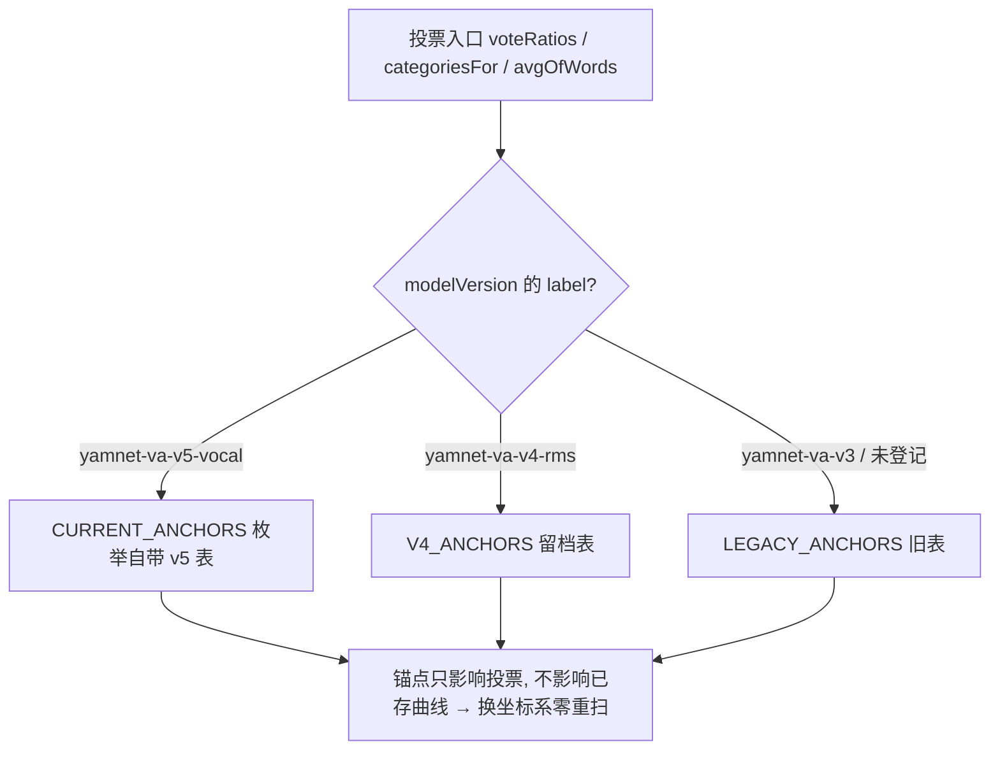
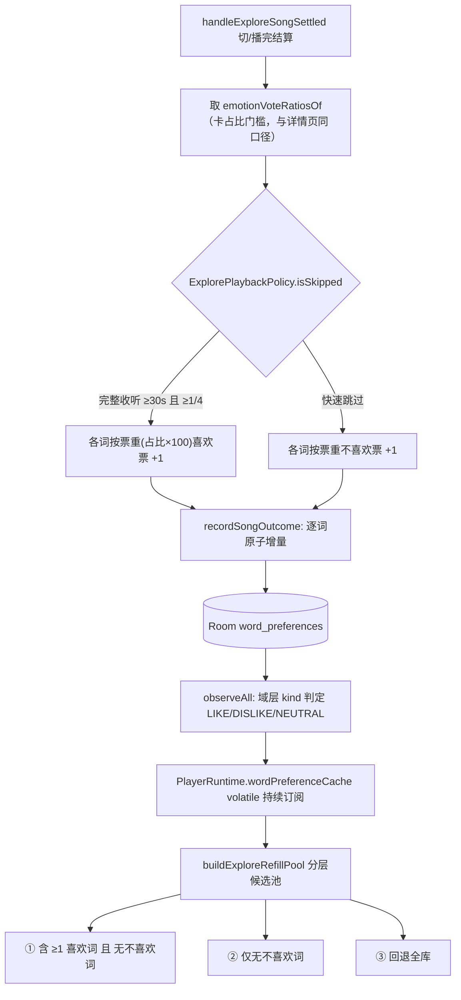
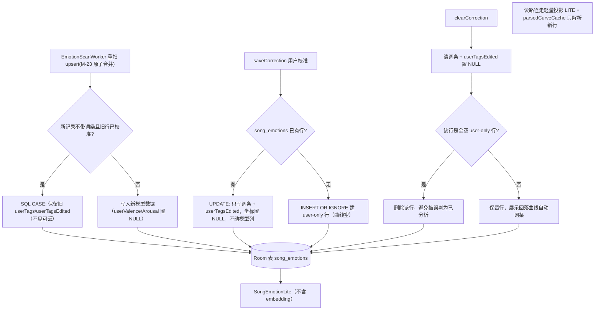

# 情绪领域模型与词表

情绪功能的核心是一个**分层双轨**的领域模型：底层是连续的 valence（愉悦度）/arousal（能量）坐标（均归一到 -1..1），可排序、可插值、可做逐窗曲线；表层是一个封闭的中文词表（10 组 V-A 锚定词），供运算展示与用户交互。两层通过固定函数互相换算：`EmotionGroup.categoriesFor` 把曲线换算成词条投票，`EmotionGroup.avgOfWords` 把用户勾选词换算回坐标。词表**只做"映射展示层"，绝不做分类训练目标**——这一点写在 `EmotionGroup` 的 KDoc 里，是整个设计的边界声明。

模型文件集中在 `core/model`（`SongEmotion` / `EmotionGroup` / `EmotionTags` / `EmotionConfidence` / `EmotionDisplay` / `VocalCalibration` / `WordPreference`）。存储落在 Room `melody.db`（**v17**）的两张相关联但**语义分离**的表中：`song_emotions`（`SongEmotionEntity`，歌曲情绪数据，唯一数据源是 `:data` 的 `SongEmotionsRepository`）与 `word_preferences`（`WordPreferenceEntity`，探索播放的情绪词条收听偏好计票表，唯一数据源是 `:data` 的 `WordPreferencesRepository`）。两条数据通道各自独立持久化；归属判定（`WordPreference.kind`）发生在**域层而非 UI**。

## 坐标系定义：arousal 是物理响度、valence 经标定、v5 剥掉人声成分

2026-10-25 全面改造了 `EmotionAnalyzer` 的坐标系语义（`docs/architecture/EMOTION_VA_UPGRADE.md`）：

- **A（arousal）→ 真实响度包络**：arousal 改为窗内 PCM 的 RMS → dB（`-30..-5 dBFS → [-1,1]` 映射）的**物理定义**，不再取 VA 头回归出的"曲风代理"。之前的 VA-head arousal 测的是"像不像电子/嘻哈那种曲风"，导致「燃」「静谧」这类**绝对能量**词条几乎不可达；真实响度让它们回到可达区。
- **B（valence）→ 零点/斜率标定**：模型输出系统性正偏（真机全库歌级均值 +0.264），标定为 `v' = (v - 0.25) / 0.85`，标定后居中。
- **C（v5）→ 人声成分补偿**：见 `VocalCalibration` 一节——valence 有一部分在测"有没有人唱"，v5 在**读时**剥掉它。

窗口参数：**5s 窗 / 2.5s hop**，逐窗 `(v,a)` 存**原始未平滑值**，平滑归渲染端；`windowArousal` 直接从已解码 16k PCM 算，零额外解码、零额外分配。**未定带**：`|v|` 或 `|a| < 0.15` 的曲线单元视为"该轴未定"，UI 不硬判。

### 版本串：标签 @ 指纹

模型版本成为 `"<label>@<content-fingerprint>"`，定义在生成物 `EmotionModelSpec`（源头 `core/model/emotion_model_spec.properties`，全仓唯一真源）：

- `label` = `yamnet-va-v5-vocal` 是坐标系的**语义身份**——锚点表按它选（`anchorsFor`），**指纹不参与投票，只回答"这条曲线是这版权本产出的吗"**；
- `fingerprint`（完整 = 坐标定义 + 资产哈希）是**内容身份**，重扫判定比它——换模型资产必须同步改属性文件里的 SHA-256，否则**构建直接失败**（`generateEmotionModelSpec` 校验），不会出现"换资产却老数据静默不重扫"。

锚点表标定参数指纹 `ANCHORS_CALIBRATED_FOR = "b8a45a93"` 硬编码在 `EmotionGroup`：改了 `emotion_model_spec.properties` 的参数而没重标定锚点表时，`EmotionGroupAnchorTest` 拿它跟当前参数指纹比对并失败——把"改了坐标系却沿用旧锚点"从静默错误变成响亮构建失败。

## 分层双轨设计：连续坐标打底，中文词表做展示

`EmotionGroup` 枚举定义 10 个情绪组，每组锚定一个 `(anchorV, anchorA)` 坐标并携带一组中文词（名义每组 4 词；**例外是 ABYSS 组只有 3 个词**——"窒息/孤独/深渊"，全表共 39 个不重复词，`SongEmotionSectionTest` 用 `assertEquals(39, all.size)` 锁定）。组代表词 `headline = words.first()` 用于自动分析展示；用户手动标记可选组内任意词。

下表是当前 v5 坐标系（人声成分补偿后）的锚点表，由 `tools/anchor_opt.py` 在**补偿后的全库 1095 首真值**（81002 窗，优势 0.773）上受约束优化标定，`tools/anchor_fit.py` 复核（见 `EMOTION_VA_UPGRADE.md` §16）：

| 组 | 词 | anchorV | anchorA | auto |
| --- | --- | --- | --- | --- |
| BRIGHT | 元气 快乐 轻快 俏皮 | 0.590 | +0.240 | ✓ |
| RAGE | 燃 热血 战斗 力量 | 0.045 | +0.604 | ✓ |
| EPIC | 神圣 浩瀚 震撼 史诗 | 0.013 | +0.332 | ✓ |
| **WITTY** | 鬼畜 沙雕 戏谑 荒诞 | 0.2 | 0.3 | **✗（仅手动）** |
| LOVE | 治愈 心动 缱绻 深情 | 0.390 | +0.080 | ✓ |
| STILL | 静谧 空灵 禅 专注 | 0.213 | -0.610 | ✓ |
| SAD | emo 伤感 遗憾 雨季 | -0.827 | -0.449 | ✓ |
| ANXIOUS | 躁 焦虑 压迫 狂躁 | -0.928 | +0.453 | ✓ |
| CHILL | 放松 慵懒 午后 微醺 | 0.279 | -0.302 | ✓ |
| ABYSS | 窒息 孤独 深渊 | -0.941 | +0.055 | ✓ |

**新坐标系下锚点必须重新标定**（`EmotionGroup` KDoc 注明，2026-10-25）：锚点属于坐标系，坐标系定义一变锚点必须跟着搬。最典型的是「神圣」——旧锚点 (+0.20,+0.50) 恰落在新云最密处退化成万能桶（独占 23.9% 窗口）；优化器给出的表经 `anchor_opt.py` 一次性收敛。有两处**人为语义回退**：元气（优化器给 arousal +0.129 会让它跟治愈一样没能量，回退到 +0.240）；治愈（优化器给 valence +0.697 占比 3.4% 贴下限、"被挤没了"，回退到 +0.390 回到 9.4%）。

锚点**只影响投票，不影响已存曲线**——重标定不需要重扫全库。

双轨的意义：连续坐标层服务所有需要"量"的逻辑（逐窗投票、锚点距离、换算校准值），词表层服务所有需要"名"的逻辑（展示词条、随手播配置词条、探索播放偏好计票、UI 文案）。`companion object` 维护一张懒加载的 `wordIndex` 反查表，`groupOf(word)` 是词 → 组的唯一入口（词表封闭且无重复词）。

### 锚点表按曲线坐标系分表

由于换坐标系后老曲线仍躺在库里（后台渐进重扫要数天），不能用一套锚点一票通吃。`EmotionGroup.anchorsFor(modelVersion)` 按版本串的 **label** 选表：

- `yamnet-va-v5-vocal`（`CURRENT_MODEL_LABEL`）→ 枚举自带 `anchorV/anchorA`（上面的 v5 表）；
- `yamnet-va-v4-rms`（留档）→ `V4_ANCHORS`（全局标定、无补偿时的 v4 锚点表）；
- `yamnet-va-v3` / 未登记 → `LEGACY_ANCHORS`（改造前的旧锚点表）。

用错表的代价是实测的：旧曲线 valence 系统性正偏 +0.264，用新锚点投票会被当"正面"——全库 1095 首里 **47.1% 变成「治愈」**，负面词条几乎消失。`anchorsForManualPoint(emotion)` 决定用户手动点该用哪套表：有曲线（`windowsAnalyzed > 0`）必须与曲线同坐标系；无曲线（未分析/user-only 行）用当前锚点。



## SongEmotion：分析结果的域模型

`SongEmotion` 是端侧分析器的输出，也是所有读侧消费的统一形态：

- `valence` / `arousal`：全曲逐窗均值；`curve`：逐窗 `(v, a)` 序列，**5s 窗 / 2.5s hop**，存原始未平滑值，渲染端做滑动平滑；
- `peakSec`：A 轴（能量，即 RMS 响度）正向峰值所在秒数（高潮定位）；`windowsAnalyzed` / `durationSec`：窗口数与时长；
- `modelVersion` / `analyzedAt`：分析时的模型标识（`<label>@<fingerprint>`）与时间戳（前者既驱动重扫判定、又经 `anchorsFor` 决定用哪套锚点表）；
- `embedding`：整曲平均 YAMNet embedding（1024 维），供将来监督重训 VA 头按需取用；旧数据可为空；
- `vocalScore`：YAMNet AudioSet 人声类分数整曲平均（2026-10-25 之前分析的行可为 null）——它是 v5 人声成分补偿的输入；
- **用户校准字段**：`userTags`（勾选词条名，**真值**）+ `userTagsEdited`（是否"不认同"模型结论）+ 已废弃的 `userValence` / `userArousal`。

### 用户校准：词条是真值，坐标是读时派生

`userValence` / `userArousal` 列**已废弃、不再作为真源**（仅保留兼容历史行）。原因记录在 `SongEmotion` KDoc：坐标是**派生值**（词条 → 该坐标系下的锚点均值），存下来的坐标会在曲线换坐标系（重扫/换模型）后过期——实测重扫继承旧坐标后 3 首用户校准的歌坐标全错。改为**读时派生**：

- `userPoint()`：`userTags` 非空 → `EmotionGroup.avgOfWords(userTags, anchorsForManualPoint(this))`（用该行自己的坐标系）；
- `effectiveValence` / `effectiveArousal`：`userPoint()` 的坐标优于模型值返回；无单击返回模型补偿后的均值；
- `userCorrected`：`userTags.isNotEmpty()`（以**词条**为准，不再判坐标）；
- `userTagsEdited`：区分"主动纠正"（手动选词 ≠ 模型自动词）与"直接采纳"（点确认没改），null = 无模型输出可比——只有 `true` 的样本（外加未分析歌的纯人工标记）才可作真值独立标注。

### 人声成分补偿（VocalCalibration）

`VocalCalibration.adjustCurve` 在**读时**给器乐组（`vocalScore <= VOCAL_COMP_THRESHOLD = 0.010`）的 valence 各窗上移 `VOCAL_COMP_SHIFT = +0.091`，arousal 不动；`vocalScore` 为 null 的行（2026-10-25 之前分析）**不补偿**。

补偿量来源：全库 1095 首按 `vocalScore` 分组，人声组 valence +0.120 / 器乐组 −0.041，在 **arousal 分箱内匹配后残余差只有 −0.091**（独立模型 MusicNN+DEAM 对照同样的匹配差 ≈0，证明这层成分是现网独有、不是"人声歌真的更正向"）。只扣能量效应解释不了的那部分。

**补偿是加在曲线上的常量平移，库里存的仍是原始曲线，读时按规格清单平移**——所以改补偿量零重扫、零迁移（规范单 `emotion_model_spec.properties` 是坐标系规格单一真源，改它等于换坐标系，锚点表会跟着重标定）。**投票与绘图都必须用补偿后的曲线**（`compensatedCurve`）：词条是按补偿后曲线投票的，置信度也必须描述同一次投票。

### 派生语义

- `lowConfidence`：`|effectiveValence|` 或 `|effectiveArousal|` 中任一 < `LOW_CONF = 0.15`，即均值落在未定带——UI 不硬判象限，显示"未定"；
- `compensatedCurve` / `compensatedValence`：读时补偿后的曲线与歌级均值。

## EmotionGroup：逐窗投票与词↔坐标换算

`EmotionGroup` 的投票核心在 `voteRatios`（评审 2026-10-27 · M-11 重构，一次投票派生全部结论）：

```kotlin
voteRatios(曲线, anchors)      // 底座：全量占比，不过滤不截断
categoriesFrom(votes, topN, minRatio)  // 从已算好的投票派生展示分类
categoriesFor(curve, anchors, topN, minRatio)  // voteRatios + categoriesFrom
confidenceOf(curve, anchors)  // 最高票组占比 = 置信度信号
headlineTagsFor(curve, modelVersion)  // categoriesFor + anchorsFor，取 headline
```

**`voteRatios` 投票算法**（底座）：

1. 逐窗遍历，**近零窗弃权**：|v| 与 |a| 同时小于 `SongEmotion.LOW_CONF`(0.15) 的窗不参与（曲线为空或全部弃权则返回空）；
2. 每个有效窗按 `(v-anchorV)² + (a-anchorA)²` 找**最近的 `auto = true` 组**投一票（`AUTO_GROUPS` 懒加载过滤一次、候选锚点循环外解析，循环内零分配）；
3. 按占比降序，**并列按组声明序 `ordinal` 升序兜底**——票数是整数并列很常见（全库 92 首都存在比例并列、17 首 top1 并列），而 `votes` 是 HashMap 迭代序契约上不保证跨进程一致，必须用声明序兜底才能让同一首歌的词条顺序随重启稳定。

`categoriesFrom(votes, topN = MAX_TAGS, minRatio = MIN_RATIO)`：过滤占比 ≥ `minRatio`(0.15)，取前 `topN`(= `MAX_TAGS` = 4)。

`avgOfWords(words, anchors)` 把用户勾选词解析为组集合后取**组锚点均值坐标**（同组多个词即该组锚点；跨组词取锚点平均；非法词/空列表返回 null）——这是**读时**由 `userPoint()` 派生用户校准坐标的来源。

## 词条分布函数：展示、匹配、计票口径不同

`EmotionTags.kt` 按用途分了三套不同口径的词条分布，这是关键设计：

- **`emotionTagsOf(emotion)`**：**展示词条的唯一出口**——`userTags` 非空原样返回（**用户词最高优先**，可覆盖模型结论），否则 `headlineTagsFor(compensatedCurve, modelVersion)` 逐窗投票取 headline。
- **`modelTagsOf(emotion)`**：模型**自动**词条（忽略用户优先）——判断"用户是否不认同模型"时必须用它，否则已校准的歌会拿用户自己的词当"模型词"比。曲线为空返回空。
- **`emotionTagRatiosOf(emotion, minRatio=MIN_RATIO, topN=MAX_TAGS)`**：展示用词条 + 各自占比（`EmotionTagRatio(tag, ratio?)`；`ratio` **null = 用户手动标记**，用户选的词没有"占比"这回事）。
- **`emotionMatchRatiosOf(emotion)`**：时段匹配用**完整分布**（不受展示门槛 15% 与 topN=4 截断，否则目标词排第 5 就永远匹配不上）；用户手动标记词按 **1.0**（强匹配，用户判断比模型更可信）。
- **`emotionVoteRatiosOf(emotion, minRatio=VOTE_MIN_RATIO, topN=VOTE_MAX_TAGS)`**：探索播放**计票**用——卡上与详情页**同一套**占比门槛，否则完整分布平均每首 6.26 词（详情页只显示 2.31 个），跳过一首同时否定 6 个词、「不喜欢」扩散快 2.7 倍，几十首歌就能把全部词条染黑（实测 9 个 auto 组代表词全变 DISLIKE）。

`EmotionDisplay`（M-11）把这些结论**只投票一次**并包成一份数据结构供展示层派生：`emotionDisplayOf(emotion)` 返回 `tags` / `tagRatios` / `confidence`——原先展示区要分别调 `emotionTagsOf`/`emotionTagRatiosOf`/`emotionConfidenceLevelOf`，每个都从头再投一遍票；现在投票只一次，三样结论从同一份投票派生。

## 置信度：信号 = 最高票占比

`EmotionConfidence.kt` 定义把握程度，**信号 = 逐窗投票里最高票组的占比**（`EmotionGroup.confidenceOf`）——这个量本来就在算，但原先被 minRatio 过滤掉等于白算。实测依据（全库 1095 首，坐标系 v5-vocal）：

- 词条含冷暖矛盾的 228 首 top1 占比均值 0.398，不矛盾的 867 首均值 0.484（Mann-Whitney U p=1.7e-14）——**top1 占比就是"有无把握"的现成测量**；
- 但单一阈值不够：137 首（12.5%）top1 占比很高（中位 0.62）却冷暖同现——那不是没把握，是"很确定地给出一对矛盾结论"，文案必须不同。

三个档位 `EmotionConfidenceLevel`：

- **HIGH**：票集中且词条不打架（用户已手动标记的一律 HIGH——展示的是用户自己选的词，模型把握成了噪音）；
- **SPREAD**：`top1 < LOW_CONFIDENCE_RATIO = 0.35`（取全库分位 p25=0.345）——票摊开、模型自己没把握；
- **MIXED**：票集中（top1 ≥ 0.35，很确定）但**冷暖词同现**（`isMixedColdWarm` 检测 `COOL_WORDS`={"emo","躁","窒息"} 与 `WARM_WORDS`={"元气","燃","神圣","治愈","放松"} 同时出现；「静谧」算中性不冲突）——**"很确定地矛盾"**；
- 判定顺序先看票型（摊不摊开），再看词条是否自相矛盾，两者都成立时以摊开为准（那才是更根本的原因）。

`emotionConfidenceOf` 必须用**补偿后**的曲线——词条是按补偿后曲线投票的，置信度必须描述同一次投票，否则等于描述一个不存在的投票过程。

## WITTY（鬼畜/沙雕/戏谑/荒诞）为何退出自动投票

WITTY 组是唯一的 `auto = false` 组，退出自动曲线投票、只保留手动标记链路。原因写在枚举 KDoc 与测试名 `WITTY excluded from auto voting (center-vacuum fix)` 中，共两条：

1. **文化梗声学上不可分**：鬼畜/沙雕的本质是"故意做坏/重复剪切"的文化梗，声学特征与正经的燃/快乐无法区分——自动投票不可能把它投对；
2. **锚点居中导致吸票误标**：WITTY 锚点 (0.2, 0.3) 恰在 V-A 图中心，YAMNet 输出偏暖的"中庸"窗会被整片吸到最近锚点上，造成大面积误标（测试构造 20 个 (0.2, 0.3) 窗断言投票结果不含 WITTY）。

对下游的影响集中在**随手播候选池与配置页**：

- 随心播配置弹窗 `MoodSlotEditDialog` 单独展示 `manualOnlyTags`（`AppNavHost` 硬编码传入 4 个 WITTY 词，见 `AppNavHost` L604），分组标题"仅手动标记计入"，并提示"这组词条不参与自动分析"；歌曲数为 0 的 chip 置灰；
- 由于词条歌曲数按展示词条（`emotionTagsOf`）统计，而 WITTY 词只会出现在用户手动标记过的歌曲上——选了 WITTY 但从未手动标记时歌曲数为 0，组合候选池为 0 时 `PlayerRandomQueueFacade` 回退全库随机。

## embedding 的现状：仍入库，kNN 已下线

分析器在逐窗推理时累加每窗 YAMNet embedding，最后输出**整曲平均 embedding（1024 维）**随 `SongEmotion` 一起入库（base64 float32 小端存 `embeddingB64`）。读路径（`getAll`/`observeAll`）改走**轻量投影 `SongEmotionLite`**，不再解码 embedding（整库约 5.3KB/首，1.6 万首 ≈ 90MB，读侧消费者只用曲线与校准字段）；需要时用 `get` 单条整行读取。

它曾经的消费者——kNN 锚点传播——已于 2026-08-31 **整体下线**（`EmotionKnn.kt`、`EmotionPersonalizer.kt`、`correctedWithEmbedding` 查询全部删除）。下线依据 `docs/architecture/EMOTION_KNN_ANALYSIS.md` 实测：传染对率 ~30% ≈ 瞎蒙（与从 7 组随机基线相当）；根因是 YAMNet 表征**音色主导**（同情绪组近邻准确率 43% vs 基线 42%，零信号）+ 高维 **hubness**（全库余弦中位 0.439，无有效全局距离阈值）——表征问题，非阈值工程。

**embedding 不是垃圾字段**：它仍是未来"用户标记攒够后离线监督重训 VA 头"的原料，随分析入库的沉没成本为零；当前词条判定只走用户词 + 曲线投票两条路，不读 embedding。

## 探索播放词条偏好：WordPreference 按占比加权计票模型

从 v3.11.0 起，情绪模型在"歌曲情绪词条映射/用户校准"之上新增了一条**独立并列**的通道：**情绪词条的收听偏好计票**，驱动"探索播放"按个人口味补队列。两条通道明确分工：

- **歌曲情绪通道**（`song_emotions` + `emotionTagsOf`）：决定"一首歌被贴了哪些词条"，用户校准优先；
- **词条偏好通道**（`word_preferences` + `WordPreference`）：决定"用户对这些词条整体喜欢还是不喜欢"，由收听行为累计计票。

两条通道是两张独立的 Room 表、两个独立的 repository；偏好计票**只读**歌曲情绪通道的展示词条，但**不写回** `song_emotions`，也不改变校准/映射语义——并存而非替代。

### 模型与判定

`WordPreference(word, likeVotes, dislikeVotes)` 的 `kind`（`LIKE`/`DISLIKE`/`NEUTRAL`）由 `likeVotes > dislikeVotes` / `dislikeVotes > likeVotes` / 平票判定，发生在**域层属性**。计票**按占比加权**（2026-10-25）：

- **票重 = 词条在整首里占的比例 × `VOTE_WEIGHT_SCALE`（=100）**（`votesOf(ratios)`：`voteWeightOf = round(ratio * 100)`，占比 <0.5% 得 0 票等于不投）——"80% emo"比"20% emo"对「emo」贡献大得多，原来一刀切 1 票主次不分；
- **计票只投卡住占比门槛的词**（`VOTE_MIN_RATIO == EmotionGroup.MIN_RATIO`、`VOTE_MAX_TAGS == MAX_TAGS`，直接引用展示层常量所以不可能漂移）——**跳过 = 否定详情页里看到的那几个标签**；原来投完整分布，"不喜欢"扩散快 2.7 倍；
- 整数票 ×100 而不是改 REAL 列：归属是相对比较（喜欢票多 vs 不喜欢票多），绝对尺度不影响；历史票由迁移 `MIGRATION_15_16` 统一 ×100 保持尺度一致。

`UI 用 likeSharePercent`（喜欢票占比 0-100）而非绝对票数：票数是 15~1500 量级，且票重 15 折算"1 首歌当量"会显示 0，占比法才是判定依据。

### 投票写入（PlayerRuntime.handleExploreSongSettled）

`PlayerRuntime.handleExploreSongSettled` 在一首歌结束/切歌时结算收听时长，取该歌**计票口径**的词条占比（`exploreVoteRatiosCache`，即 `observeMoodSlotCaches` 里用 `emotionVoteRatiosOf` 预算的卡门槛分布），按 `ExplorePlaybackPolicy.isSkipped(playedMs, durationMs)` 判定：

- 完整收听：`playedMs ≥ 30s` **且** `≥ durationMs/4` → 全部卡门槛词条 `liked=true`，喜欢票按票重 +1；
- 快速跳过：`playedMs < 30s` **或** `< durationMs/4` → 按票重给不喜欢票；
- 时长未知（≤0）时只按 30s 规则判定。

随后 `WordPreferenceRepository.recordSongOutcome(votes: Map<String,Int>, liked)`：空票忽略；逐词 `ensureWordPreference`（幂等建行）→ `addWordVotesDelta`（**语句级原子增量**，`MIN(x, MAX)` 饱和加法停 Int 上限防溢出成负数翻转判定）——评审 M-22 消除"读整表→算→整表 upsert"的并发丢票问题。

### 持久化与读路径

`word_preferences` 表由 `MIGRATION_10_11` 创建（主键 `word`，`likeVotes`/`dislikeVotes`/`updatedAt`），`MIGRATION_15_16` 把历史票 ×100。`WordPreferencesRepository` 是唯一数据源（`:data` 单例绑定 `MelodyDao`，对外暴露 `:domain` 接口）。读路径：

- `observeAll()` → `Map<String, WordPreference>`，`PlayerRuntime.observeMoodSlotCaches()` 持续订阅到 volatile `wordPreferenceCache`；
- `MoodTimeSlotViewModel.wordPreferences` 按词条名排序成 `StateFlow<List<WordPreference>>` 供配置页展示；
- `clearAll()`（配置页"重新探索"）清空整表。

### 探索播放候选池消费

`PlayerRandomQueueFacade.playRandomQueue` 在探索模式下（`exploreModeEnabled()`，即 `randomEnhanceMode == EXPLORE`）不套用时段过滤，从全库随机 `INITIAL_BATCH_SIZE = 10` 首，置 `isExplorePlay`；无限随机被禁用。队列降到倒数第二首播完后，`refillExplorePlayQueue` 用 `buildExploreRefillPool` 分层补 `REFILL_COUNT = 5` 首：

1. 含 ≥1 喜欢词 且 不含不喜欢词的歌；
2. 池空回退"仅不含不喜欢词"；
3. 再空回退全库。

**降级判据是"池子够不够补满 5 首"而非"池子非空"**（2026-10-25 修复）——"非空即用"会自锁：用户一路点下一首 → 全词条变 DISLIKE → 只剩没情绪分析的那几首 → 池子非空但 <5 首补不满 → 永不补充。词条归属按 `wordPreferenceOf(word).kind`（读 `wordPreferenceCache`，未学到视为 0:0 中立）。时段（`TIME_SLOT`）与探索（`EXPLORE`）是互斥增强模式。



## 存储形态：song_emotions 表与 SongEmotionsRepository

`song_emotions` 是 Room `melody.db`（**v17**）中的一张表，主键 `songId`、无外键。迁移轨迹：v8→v9 建表，v9→v10 增列 `embeddingB64` 与用户坐标/词条三字段，v10→v11 建 `word_preferences`，v11→v12 增列 `userTagsEdited`，v12→v13 版本串补指纹 + 坐标列置 NULL，v13→v14 增列 `vocalScore`，v14→v15 坐标系切 v5（零重扫只改标签），v15→v16 词条票 ×100，v16→v17 补两个索引。

`SongEmotionEntity ↔ SongEmotion` 的映射由 `SongEmotionsRepository` 的私有扩展函数完成：

| Entity 字段 | 领域模型 | 编解码约定 |
| --- | --- | --- |
| `curveJson` (TEXT NOT NULL) | `curve` | **扁平 [v,a,v,a,...] JSONArray**（零额外依赖）；解析失败降级为空曲线 |
| `embeddingB64` (TEXT?) | `embedding` | base64 的 float32 小端字节数组（读路径走 `SongEmotionLite` 轻量投影不物化） |
| `userTags` (TEXT?) | `userTags` | 逗号拼接；读侧 split 过滤空段；**真值** |
| `userValence`/`userArousal` (REAL?) | （已废弃） | 保留兼容历史行，读侧不再当真源 |
| `userTagsEdited` (INTEGER?) | `userTagsEdited` | 是否"不认同"模型（null=无模型输出可比） |
| `vocalScore` (REAL?) | `vocalScore` | v5 人声成分补偿输入（v13→v14 增列） |
| `modelVersion` (TEXT NOT NULL) | `modelVersion` | `<label>@<fingerprint>`（v5-vocal@edbf6fe5）或 `"user-only"` |
| 其余字段 | 同名 | 直通 |

### 曲线解析缓存（评审 M-1）

Room 的失效跟踪器在 `song_emotions` 任意一行变化时会**重发整表**。批扫是"一首一首写"，于是 300 首 × 1000 首库 = 30 万次曲线 JSON 重解析。仓储层用 `parsedCurveCache`（songId → (analyzedAt, 曲线)）缓存：行没变（`analyzedAt` 相同）直接复用已解析曲线，**每次重发只有新写入的那一行需要解析**。用户校准不改 `analyzedAt` 也不改曲线，因此校准后缓存依然有效。



**`SongEmotionsRepository` 是该表的唯一数据源**（`:data` 单例绑定 `MelodyDao`，对外只暴露 `:domain` 的 `SongEmotionRepository`；`:player` 分析器是主要写入方）。三条写路径各有不变式：

- **upsert（重扫路径，M-23 原子合并）**：`updateSongEmotionPreservingUserTags` 一条 SQL `CASE`——新值 `userTags` 为空就保留行上已有的 `userTags`/`userTagsEdited`（**用户亲手标的词条不见可丢**）。消除了原"读旧行→内存合并→整行 upsert"的 TOCTOU：用户恰在扫描读与写之间保存校准会被陈旧词条覆写静默消失。新值带词条（分析产出通常不带）就写入，`userValence`/`userArousal` 一律投 NULL（坐标列废弃）。`UPDATE` 命中 0 行（无行）才 `upsertSongEmotion` 插入。
- **saveCorrection（校准路径，M-23）**：**只写词条**，不写坐标。`UPDATE ... SET userValence=NULL, userArousal=NULL, userTags=?, userTagsEdited=?`；命中 0 行（分析失败/未分析）→ `insertUserOnlyCorrectionIfAbsent` 用 `INSERT OR IGNORE` 建仅含 user 字段的行（`curveJson="[]"`、`windowsAnalyzed=0`、`modelVersion="user-only"`）——`@Upsert` 在行已存在时会把整行替换成 user-only 空曲线、**把分析结果擦掉**，所以用 `INSERT OR IGNORE`（行已存在时什么都不做，由调用方走 UPDATE 分支）。
- **clearCorrection（恢复自动路径）**：清词条 + `userTagsEdited` 置 NULL；随后若该行是"全空 user-only 行"（`windowsAnalyzed == 0` 且无 embedding）则**直接删行**——否则全空行会被列表构建（以 emotion 非空判定"已分析"）误判。

`analyzedVersions()`（`songId → modelVersion` 轻量投影）驱动重扫：`EmotionScanWorker` 的待扫集 = `analyzed[songId] != EmotionAnalyzer.MODEL_VERSION`（当前 `"yamnet-va-v5-vocal@edbf6fe5"`，定义在 `player/EmotionAnalyzer.kt`，直接引用 `EmotionModelSpec.MODEL_VERSION` **避免两处漂移**）**或** 已分析但缺人声分数（`songIdsMissingVocalScore()`——v5 引入 vocalScore 之前的数据补扫一次，补上条件标定要用的变量）。

## 用户校准链路

- **入口 UI**：`EmotionCalibrateDialog` 按 10 组分行展示全部词（39 词，`FlowRow` 换行），多选上限 `MAX_TAGS = 4`；已校准歌曲提供"恢复自动"出口（空词保存即清标记）；预勾选当前展示词条。
- **控制器**：`:core:ui` 定义 `LocalEmotionCorrectionController`（默认 null），`AppRoot` 在最外层 `CompositionLocalProvider` 一次性提供（包住 NavHost 所在的 `AppScaffold`）——任何渲染歌曲详情情绪区的页面自动获得"不像？标记"能力，无需逐层透传回调。保存成功刷新 `EmotionViewModel`；保存失败（词表非法）返回 false。
- **换算与落库**：`AppMediaMetadataViewModel.saveEmotionCorrection` 中，空词 → `clearCorrection`（要求已有行）；非空词 → 先校验 `words.any { groupOf(it) == null }`（**不能用 `avgOfWords` 当校验器**——它静默丢弃非法词，只剩一个合法词时照样返回坐标），再用 `isUserCorrection(modelTagsOf(current), words)` 判定 `userTagsEdited`，最后 `saveCorrection(songId, words, edited)` **只写词条**。坐标由读侧 `userPoint()` 按该行坐标系现算，永不落库。
- **user-only 行的呈现**：详情区对曲线不足 2 窗的行（user-only 行典型形态）不 early-return，而是显示词条列表并标注"已由你标记（自动分析失败，词条以你的标记为准）"；失败歌曲也通过同一个 `EmotionCalibrateDialog` 标记。

## 消费端：列表、详情与情境化/探索随心播放

- **曲库「情绪」Tab**：`EmotionViewModel.buildRows` 把 `getAll()` 与曲库拍平为 `EmotionSongRow`（`tags = emotionTagsOf(e)`、`corrected = e.userCorrected`），`AppNavHost` 再二次拍平为 core-model 的 `EmotionSongUiRow`（song/tags/corrected/**confidence**，曲库情绪 Tab 与情绪分析详情页共用）。`EmotionLibraryView` 用行 tags 提供 chips 多选过滤、"手动标记优先 + 有词条优先"排序、"已校准"角标。
- **歌曲详情**：`SongEmotionSection` 用 `emotionDisplayOf` **只投票一次**派生词条、占比、置信度，渲染平滑后的 V/A 双曲线（`smoothCurve` 窗口 5 滑动平均、边界缩窗、长度 <3 原样返回）与高潮红点——仅当 `hasSignificantPeak`（A 最大值 > A 均值 + `PEAK_MARGIN = 0.5`，20 首实测分布定标：平缓/全程高能歌 ≤0.49，真高潮歌 ≥0.52）时画，`peakSec` 按 2.5s hop 折算窗下标。词条 chip 带占比（"燃 35%、元气 22%"的听感完全不同）。置信度非 HIGH 时在标题下提示：SPREAD →"模型把握不大，词条仅供参考"；MIXED →"词条里有冷有热，这首歌可能不止一种情绪"。
- **情绪时段随心播放（TIME_SLOT）**：`PlayerRuntime.observeMoodSlotCaches()` 自启动起**持续订阅**四条仓库流：`TimeSlotConfigRepository.observeConfigs()`、`SongEmotionRepository.observeAll()`（`Dispatchers.Default` 上逐首算**匹配用完整分布 `emotionMatchRatiosOf`** 与**计票用卡门槛 `emotionVoteRatiosOf`** → volatile `moodEmotionRatiosCache` / `exploreVoteRatiosCache`）、`WordPreferenceRepository.observeAll()`（→ volatile `wordPreferenceCache`）、随机增强模式流。新分析/用户校准/偏好计票即时反哺判定。`PlayerRandomQueueFacade` 用 `filterByMoodTags` 按命中时段词条过滤候选池（按 `emotionMatchRatiosOf` 完整分布判，不受展示截断），过滤后为空回退全库随机。
- **探索播放（EXPLORE）**：见计票模型一节；与时段互斥，候选池按词条偏好分层而非按时段词条过滤，计票走 `emotionVoteRatiosOf` 卡门槛口径。

## 行为契约测试

契约测试分几组锁定（评审 M-11 重构后 `SongEmotionSectionTest` + `EmotionConfidenceTest` + `EmotionGroupAnchorTest`）：

- **词表**：39 词封闭词表无重复、`headline = words.first()`、10 组；`avgOfWords` 同组取锚点、跨组取均值、非法词 null。
- **投票**：`voteRatios` 保留展示层会滤掉的组（10% 的 EPIC 不丢）、`categoriesFor` 是 voteRatios 的过滤视图、置信度 = 最高票占比、全近零/空曲线置信度 0、展得开 vs 集中票的置信度对比、置信度必须用**曲线自己坐标系**的锚点表（legacy/v4/current 都验）、同一曲线换坐标系词的归属必须跟着换、并列按声明序稳定（`EmotionGroupAnchorTest`）。
- **WITTY**：20 个 (0.2,0.3) 窗投票结果不含 WITTY、`groupOf("鬼畜")` 可达（手动链路不受限）。
- **confidence 档位**：`emotionConfidenceLevelOf` 的 HIGH/SPREAD/MIXED、`isMixedColdWarm`、`needsConfidenceHint`。
- **展示纯函数**：`smoothCurve` 保长缩噪与短列表直通、`lowConfidence` 双轴近零判定、`hasSignificantPeak` 尖峰边界、`emotionTagsOf` 用户词覆盖 + 低置信空。
- **锚点一致性**：`EmotionGroupAnchorTest` 拿 `ANCHORS_CALIBRATED_FOR` 与 `EmotionModelSpec.PARAMS_FINGERPRINT` 比对，改了坐标系参数而没重标定锚点表就红。
- **计票**：`WordPreferencesRepositoryTest`（按占比加权、跳过只补不喜欢票不翻转已喜欢词、跨会话累计平票中立、空词忽略、clearAll）、`MelodyDatabaseMigrationTest`、`PlayerRandomQueueFacadeTest`（探索补队列的票数判定与分层降级）。

## 相关页面

- `/openwiki/architecture/data-persistence.md` — Room 库与迁移全景（song_emotions 与 word_preferences 建表/增列/注册，DB v17）
- `/openwiki/concepts/mood-time-slot.md` — 情绪词条驱动时段随心播放与探索播放的配置及判定模型
- `/openwiki/workflows/emotion-analysis-pipeline.md` — 批扫 Worker、分析器与失败处理的流程细节
- `/openwiki/player/random-and-infinite.md`、`/openwiki/player/runtime-facades.md` — 探索播放与运行时缓存
- `/openwiki/testing/test-map.md` — 契约测试分布
