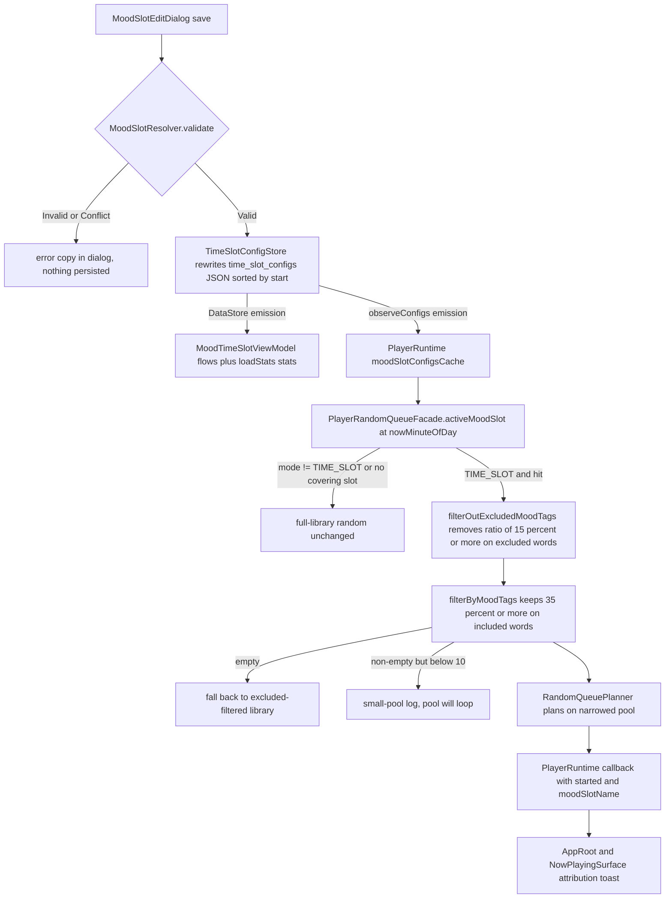

# Mood Time Slots: Include/Exclude Tags, Pool Statistics and Playback Policy

Mood time-slot anything-play ("情境化随心播放") is the **TIME_SLOT** variant of the
"随心播放增强" (anything-play enhancement) system. The enhancement is unified under the
three-state `RandomEnhanceMode` enum — **OFF / TIME_SLOT / EXPLORE** — and the states are
mutually exclusive. This page covers TIME_SLOT; EXPLORE is its own behavior (see
`/openwiki/player/random-and-infinite.md`). When the mode is TIME_SLOT and the current
minute of day falls inside a configured slot, each random draw narrows the candidate pool
along **two independent dimensions**:

1. **Exclusion** — a song whose emotion-word ratio reaches the detail-page display
   threshold (`MoodSlotPolicy.EXCLUDE_MIN_RATIO` = `EmotionGroup.MIN_RATIO` = 0.15) for any
   of the slot's `excludedTags` is removed outright.
2. **Inclusion** — of what remains, a song is kept when some word from the slot's `tags`
   covers at least `MoodSlotPolicy.MATCH_MIN_RATIO` (0.35) of the whole song.

Everything else — tiered uniform-random preemption, recent-play eviction, infinite refill
— is reused unchanged, because filtering happens **at the planner entry**, never inside the
planners. The feature is the one-phase ("一期") subset of the product proposal in
`docs/architecture/MOOD_TIME_SLOT_PLAYBACK.md`: time slots × emotion tags only, no scene
abstraction. The exclusion dimension is an implementation addition on top of that design
doc, motivated by user control ("I do not want this emotion at this hour").

## The central invariant: two thresholds, two meanings

The feature deliberately uses **different** thresholds for its two directions. This is the
single most important thing to keep intact when changing anything downstream of the ratio
map:

| Direction | Constant | Value | Why this value |
| --- | --- | --- | --- |
| Include | `MoodSlotPolicy.MATCH_MIN_RATIO` | 0.35 | Empirically calibrated p25 of the whole-library ratio distribution (0.345 in the KDoc evidence). Pure OR matching put 182 songs in the 「emo 时刻」 pool of which only ~30 % were confident; the 0.35 cut leaves a 40-song pool that is ~70 % confident. |
| Exclude | `MoodSlotPolicy.EXCLUDE_MIN_RATIO` | `EmotionGroup.MIN_RATIO` (0.15) | Identity with the detail page's display threshold. Exclusion is "I explicitly do not want this emotion", and the user's evidence is what the song detail page shows. Reusing 0.35 would let a song the detail page labels 「躁」 at 27 % still play, contradicting the UI. |

Two consequences follow, and both are load-bearing:

- **What the detail page shows is what exclusion honors.** `EXCLUDE_MIN_RATIO` is written
  as `EmotionGroup.MIN_RATIO` rather than a literal so the two cannot drift.
- **Exclusion applies to the full ratio distribution, not the truncated display list.**
  Both `filterOutExcludedMoodTags` and `MoodPoolStats.from` read the complete per-word map
  (`emotionMatchRatiosOf`, no topN=4 truncation), so a word ranked fifth still excludes a
  song. Only the *threshold* is borrowed from the display layer, not its topN.

Ordering is also part of the invariant: exclusion runs **before** inclusion, and a song
removed by exclusion is never counted as included (`MoodPoolStats.from` skips it with
`return@forEach`). Exclusion therefore can never be "undone" by a later stage — an empty
include pool falls back to the **excluded-filtered** library, not the raw library.

## End-to-end flow



*Config save to runtime consumption to attribution: exclusion is applied to the library
first, inclusion second, and the empty-pool fallback still respects exclusion.*

## The mode switch: `RandomEnhanceMode`

Since explore playback landed, the plain `moodTimeSlotEnabled` boolean is a **derived
view** of a single three-state enum:

```kotlin
enum class RandomEnhanceMode { OFF, TIME_SLOT, EXPLORE }
```

- `PlayerSettingsRepository.randomEnhanceMode` prefers the `random_enhance_mode` DataStore
  string key; for legacy users who never wrote it, it falls back to the old
  `mood_time_slot_enabled` boolean (`true → TIME_SLOT`, else `OFF`).
- `moodTimeSlotEnabled: Flow<Boolean>` is `randomEnhanceMode.map { it == TIME_SLOT }` — not
  an independent persisted bit.
- `setRandomEnhanceMode(mode)` writes **both** keys in one `edit`: `random_enhance_mode` is
  set to `mode.name` and `mood_time_slot_enabled` is re-written as
  `mode == RandomEnhanceMode.TIME_SLOT`. `setMoodTimeSlotEnabled(enabled)` is a thin
  wrapper over it.
- The mode is observed in three places that all converge on the one persisted enum:
  `PlayerRuntime.observeMoodSlotCaches` (drives `isExploreModeActive` and exits an explore
  session when the mode leaves `EXPLORE`), `MoodTimeSlotViewModel.randomEnhanceMode`, and
  the facade's per-draw lambdas. Those lambdas read `@Volatile randomEnhanceModeCache`
  (seeded once in `start()` to close the race between the user tapping 随心播放 and the
  subscription finishing), so per-draw mode evaluation is zero-IO.

`PlayerRandomQueueFacade` receives the mode as two lambdas, `moodSlotEnabled` and
`exploreModeEnabled`; because the enum is single-valued, at most one is ever true. In
`playRandomQueue`, `val explore = exploreModeEnabled()` and
`val mood = if (explore) null else activeMoodSlot()` — explore skips the mood filter
entirely and plans with `ExplorePlaybackPolicy.INITIAL_BATCH_SIZE` (10 songs).
`startInfinitePlay` is blocked while an explore session runs (`current.isExplorePlay`).
OFF reproduces the pre-enhancement chain bit-for-bit.

## Configuration model: `TimeSlotConfig`

`core/model/TimeSlotConfig.kt` is the unit of configuration — six flat fields designed for
a future Room migration:

- `id: Long` — the edit dialog generates it as `System.currentTimeMillis()`; save treats
  an equal id as an update, not a duplicate;
- `name: String` — display name such as "深夜静谧";
- `startMinutes` / `endMinutes: Int` — minutes of day, 0–1439;
- `tags: List<String>` — included emotion words; may be empty **only if** `excludedTags`
  is non-empty;
- `excludedTags: List<String> = emptyList()` — excluded emotion words; default empty, and
  must not intersect `tags`.

Interval semantics are half-open `[startMinutes, endMinutes)`. `endMinutes <= startMinutes`
is a **cross-midnight** slot (`crossesMidnight`) covering `[start, 24:00) ∪ [0, end)` —
e.g. 22:00–06:00. `startMinutes == endMinutes` is zero-length and rejected.
`covers(minuteOfDay)` normalizes the input modulo 1440 and switches to
`m >= start || m < end` for cross-midnight slots, so `22:00`, `00:00`, and `05:59` hit a
22:00–06:00 slot while `06:00` and `21:59` do not. `timeRangeText` / `formatMinutes`
provide the 24-hour display form used by the config UI.

## Resolution and validation: `MoodSlotResolver`

`domain/playback/MoodSlotResolver.kt` is the Android-free domain home of three things: the
`MoodPoolStats` value type, the `MoodSlotPolicy` constants object, and the resolver itself.

| Constant | Value | Used by |
| --- | --- | --- |
| `POOL_WARN_THRESHOLD` | 10 | `filterByMoodTags` "will loop" log; mirrored by the config UI's own `MOOD_POOL_WARN_THRESHOLD = 10` |
| `MATCH_MIN_RATIO` | 0.35f | include-side filtering and `MoodPoolStats.matched` |
| `EXCLUDE_MIN_RATIO` | `EmotionGroup.MIN_RATIO` = 0.15f | exclude-side filtering and `MoodPoolStats.excluded`; equals the detail page's display threshold |
| `NAME_MAX_LENGTH` | 20 | `validate` (`NAME_TOO_LONG`); the dialog marks the name field in error |
| `MAX_SLOTS` | 10 | Declared as a soft per-user limit; no code path currently enforces it |

Resolution semantics:

- `activeTags(configs, enabled, minuteOfDay)` returns `null` when the switch is off, there
  are no configs, or no slot covers the minute. With a hit it returns the slot's **included**
  tags as a `Set`.
- `hitSlot(configs, minuteOfDay)` filters by `covers(minuteOfDay)` and picks
  `minByOrNull { it.startMinutes }`. For **validated** (pairwise non-overlapping) configs
  this is at most one slot per minute; on invalid data the earliest-start slot wins,
  keeping the result deterministic.
- The runtime facade calls `hitSlot` directly because it needs the slot name (attribution)
  plus both tag sets.

Validation (`validate(candidate, existing)` → sealed `SlotValidation`), in evaluation order:

1. `Invalid(EMPTY_NAME)` for a blank name;
2. `Invalid(NAME_TOO_LONG)` above `NAME_MAX_LENGTH` (20);
3. `Invalid(NO_TAGS)` when `tags` **and** `excludedTags` are both empty — at least one
   dimension is required, so an exclude-only slot is legal (it randomises over the
   excluded-filtered library);
4. `Invalid(EXCLUDED_TAG_OVERLAP)` when any included word also appears in `excludedTags`;
5. `Invalid(ZERO_LENGTH)` when `startMinutes == endMinutes`;
6. `Conflict(conflicting)` when the candidate overlaps an existing config **with a
   different id** — editing a slot to expand its own range is not a self-conflict.

Overlap is `overlaps`, a ring-timeline pairwise intersection: each interval is split into
linear segments (`[start, 1440)` and `[0, end)` when crossing midnight; an empty list for
zero length), and any segment pair intersecting under half-open arithmetic
(`aStart < bEnd && bStart < aEnd`) counts. Touching endpoints do **not** overlap.

Both `TimeSlotConfigStore.save` and `MoodSlotEditDialog` call this same `validate`, so
overlap and tag rules have a single implementation across persistence and UI.

## Pool statistics: `MoodPoolStats`

`MoodPoolStats.from(ratiosBySong, tags, excludedTags, librarySize)` is the only place that
answers "how many songs will this configuration actually play?" It walks the **ratio map**
(`songId → (word → fraction of the whole song)`) once and produces three numbers:

| Field | Exact meaning |
| --- | --- |
| `excluded` | Songs in the ratio map having **any** word from `excludedTags` with `ratio >= EXCLUDE_MIN_RATIO` (0.15). Full-library scope; unanalyzed songs have no words and are never counted here. |
| `matched` | Of the **non-excluded** songs, those having any word from `tags` with `ratio >= MATCH_MIN_RATIO` (0.35). |
| `available` | `(librarySize - excluded).coerceAtLeast(0)` — the pool playback falls back to when the include side matches nothing. **Unanalyzed songs remain eligible** and are included in this number. |

Two implementation properties matter:

- **Counts come from the ratio map, so a song counts once.** Counting per tag and summing
  would double-count a song carrying several selected words, and after ratio thresholds
  "carries the word" is no longer the same predicate as "will match". Iterating
  `ratiosBySong.values` also gives the exclusion-then-inclusion ordering for free: an
  excluded song `return@forEach`s before the include test, so the two counters are disjoint.
- **Cached by `(tags, excludedTags, librarySize)`.** `MoodTimeSlotViewModel.poolStats`
  keeps a synchronized `HashMap<Triple<Set<String>, Set<String>, Int>, MoodPoolStats>`; a
  cache hit returns without a full-library scan. `loadStats()` clears the cache whenever it
  replaces the ratio table, and the library size is part of the key so a rescan that finds
  more songs cannot serve a stale total. `matchCount(tags, excludedTags)` is a thin
  accessor returning `poolStats(...).available`.

The UI contract is that these numbers are produced by the same judgement playback uses:
same two thresholds, same ordering, same full-distribution map. So "合计可随机" on a card
and "合计 X / N 首" in the dialog are real pool sizes — the count playback can draw from
when the include side matches nothing — and `matched` is the strict include pool. Neither
is a per-word sum or a display-list artefact.

## Storage: `TimeSlotConfigStore` (DataStore JSON)

`data/repository/TimeSlotConfigStore.kt` implements `TimeSlotConfigRepository`
(`observeConfigs`, `currentConfigs`, `save`, `delete`). Slot counts are single-digit to
low-double-digit, so one JSON string key in a Preferences DataStore is used instead of a
Room schema change:

- File: `mood_time_slot` (`Context.timeSlotConfigDataStore`, provided by `DataStoreModule`
  under the `@TimeSlotConfigStore` qualifier; `RepositoryModule` binds it as the domain
  interface). Like the other DataStore domains, its `.preferences_pb` file is on the
  backup-exclusion checklist (see `/openwiki/architecture/data-persistence.md`).
- Key: `time_slot_configs`, a `JSONArray` of objects shaped
  `{"id":1,"name":"深夜静谧","start":1320,"end":360,"tags":["静谧","禅"],"excludedTags":["躁"]}`.
  `excludedTags` is always written; a config without exclusions stores an empty array.
- `save` runs `resolver.validate(config, currentConfigs())` **before** touching the store.
  `Valid` rewrites the whole key with the candidate merged (same id replaced) and the list
  sorted by `startMinutes`; `Invalid` throws `IllegalArgumentException(error.name)`;
  `Conflict` throws `IllegalArgumentException("与「${name}」时间段重叠")`. These messages are
  user-readable UI copy, not debug strings — `MoodTimeSlotViewModel.save` catches
  `IllegalArgumentException` and hands `e.message` straight to the toast callback.
- `delete(id)` rewrites the key without the matching entry.
- `observeConfigs` maps the DataStore flow through `parse`; `currentConfigs` is
  `observeConfigs().first()`.

Parse tolerance is two-layered so corrupt data never takes the feature down, and it also
makes `excludedTags` a backward-compatible optional field:

1. The outer `runCatching` wraps `JSONArray(json)` and returns an empty list if the whole
   key is unreadable.
2. The inner per-item `runCatching` skips one corrupted entry with
   `"skip corrupted time slot config at #i"` and preserves the rest of the list.
3. `excludedTags` is read with `optJSONArray`, so configs written by older builds (no such
   key) parse as an empty exclusion list instead of failing the row.

## Live data path: runtime caches and ViewModel state

Both the config page and the player continuously observe repository flows, which is what
makes saves/deletes/analysis take effect on the next draw with no refresh step:

- `PlayerRuntime.observeMoodSlotCaches()` (started from `start()`, after the startup
  sequence, low-frequency and non-blocking) launches collectors:
  - `timeSlotConfigRepository.observeConfigs()` → `@Volatile moodSlotConfigsCache`;
  - `songEmotionRepository.observeAll()` — a Room invalidation stream — mapped per song in a
    single pass on `flowOn(dispatchers.default)` into **two** ratio maps:
    `moodEmotionRatiosCache` via `emotionMatchRatiosOf` (full distribution; feeds slot
    matching, **exclusion** and refill filtering) and `exploreVoteRatiosCache` via
    `emotionVoteRatiosOf` (threshold-gated; explore vote tallying). They are kept separate
    because matching must be able to hit a word ranked fifth, while vote tallying should
    only credit the emotions the detail page shows;
  - `wordPreferenceRepository.observeAll()` → `@Volatile wordPreferenceCache`;
  - `playerSettingsRepository.randomEnhanceMode` → `@Volatile randomEnhanceModeCache`,
    `isExploreModeActive`, and `stopExplorePlay()` when the mode leaves `EXPLORE`.
- `PlayerRandomQueueFacade` is constructed with `moodSlotConfigs = { moodSlotConfigsCache }`,
  `moodEmotionTagsOf = { song -> moodEmotionRatiosCache[song.id]?.keys ?: emptySet() }`
  (zero-allocation `Set` key view), `moodEmotionTagRatiosOf = { song ->
  moodEmotionRatiosCache[song.id].orEmpty() }` (the map both filters read), and
  `moodSlotEnabled`/`exploreModeEnabled` reading `randomEnhanceModeCache`.
- `MoodTimeSlotViewModel` exposes `configs`, `randomEnhanceMode`, `moodTimeSlotEnabled`,
  and `wordPreferences` as `stateIn(viewModelScope, WhileSubscribed(5_000), …)` StateFlows
  over the same repository flows (initial values cover only the first frame), so the config
  page and the player converge within one DataStore emission.

The one deliberate non-stream is statistics. `loadStats()` is a one-shot snapshot computed
on `Dispatchers.IO`: one `songEmotionRepository.getAll()` pass yields both the per-word song
counts (via `emotionTagsOf`, driving chip badges) and the per-song
`emotionMatchRatiosOf` map stored in a `@Volatile emotionRatios` field, plus
`songRepository.countSongs()`. On success it stores the ratio map, **clears
`poolStatsCache`**, then publishes `tagCounts` and `librarySize`; on failure it degrades
`tagCounts` to an empty list (badges show 0) without blocking configuration. It is invoked
by `LaunchedEffect(Unit)` on entering the config route, so all composition-time pool lookups
are cache hits over an in-memory map (no full-library scan in composition).

## Random-play consumption: exclude first, then include

`PlayerRandomQueueFacade` (see `/openwiki/player/random-and-infinite.md` for the planner
contracts it sits on) owns the consumption semantics:

- `activeMoodSlot()` evaluates `moodSlotEnabled()`, then
  `moodSlotResolver.hitSlot(moodSlotConfigs(), nowMinuteOfDay())` (`nowMinuteOfDay` is an
  injectable lambda defaulting to `Calendar`, so tests run off the real clock), and caches
  the hit as `MoodSlotState(slotName, tags, excludedTags)`. `currentMoodSlot()` exposes the
  same evaluation for attribution.
- `filterOutExcludedMoodTags(songs, mood)` returns the input untouched when
  `excludedTags` is empty (no allocation, no logging); otherwise it drops every song with a
  `(word, ratio)` where `word in mood.excludedTags && ratio >= EXCLUDE_MIN_RATIO` and logs
  `"moodSlot: excluded N songs by tags=…"` when something was removed.
- `filterByMoodTags(songs, mood)` then keeps a song when any `(word, ratio)` in
  `moodEmotionTagRatiosOf(song)` has `word in mood.tags && ratio >= MATCH_MIN_RATIO`.
  Manual-tag songs carry `1.0` for every tag, so they always clear both thresholds; the
  default `moodEmotionTagRatiosOf` derives each word as `1.0` from `moodEmotionTagsOf`, so
  callers that don't inject ratios keep plain-OR behavior bit-for-bit. Then:
  - empty result → returns `null` and logs
    `"moodSlot: no songs for tags=…, fall back to full library after exclusions (N songs)"`.
    The caller falls back to the **excluded-filtered** library (`baseSongs`), never the raw
    library: an exclusion the user configured is not silently reintroduced by degradation;
  - `size < POOL_WARN_THRESHOLD` (10) → logs `"moodSlot: small pool (N) …, will loop"` and
    the pool still applies.
- `playRandomQueue()` applies both stages to `current.songs` in order:
  `baseSongs = mood?.let { filterOutExcludedMoodTags(current.songs, it) } ?: current.songs`,
  then `candidates = mood?.let { filterByMoodTags(baseSongs, it) } ?: baseSongs`, and hands
  the result to `planner.planRandomQueue`. Tiered uniform selection and recent eviction
  operate on the narrowed pool untouched, so uniform random composes for free (test-locked:
  a 0-play song still beats a 10-play song inside a mood-filtered pool). The queue starts in
  `PlayMode.SEQUENTIAL` and infinite mode is exited.
- `refillInfinitePlayQueue()` applies the same two-stage narrowing to the full library each
  draw and additionally degrades in two steps: the strict mood pool is planned with
  `allowHistoryReset = (moodPool == null)` so a small strict pool is drained without
  repeating songs; if that yields nothing and `moodPool.size < baseSongs.size`, it re-plans
  over `baseSongs` (the **non-excluded** library, unanalyzed songs included) with
  `allowHistoryReset = true`, logging
  `"refillInfinitePlayQueue: mood pool exhausted …, fall back to non-excluded library …"`.
- `startInfinitePlay()` does **not** mood-filter: it keeps the current queue and only flips
  the infinite flags, so the filter takes effect from the first refill onward. It is blocked
  entirely while an explore session is active (`current.isExplorePlay`).

Runtime-visible small-pool and empty-pool feedback is log-based; the user-facing numbers
live in the configuration UI (below), computed with the **same** thresholds and ordering.

## Attribution toasts

`PlayerRuntime.playRandomQueue(onResult)` and `startInfinitePlay(onResult)` run the suspend
facade call on the runtime scope, then re-read
`randomQueueFacade.currentMoodSlot()?.slotName` — the same `activeMoodSlot()` evaluation the
filter used — before invoking `onResult(started, moodSlotName)` on the main thread, so the
toast can never disagree with the actual filter:

- `AppRoot` lucky-play entry bar (empty queue, double-page shell):
  `已按「$slotName」为你随机播放` on success; `还没有可播放的音乐，请先导入歌曲吧~` when
  nothing was playable.
- `NowPlayingSurface` infinite-start action: `已按「$slotName」开启无限随机播放`; the
  lucky-play action wired in `HomeRouteActions` keeps the generic
  `已生成随机队列，开始播放~` toast with no mood attribution.

Both entry points end with `playlistResumeViewModel.switchSource(null, …)` as the rest of
the random chain does. Note the toast names the slot only — the exclusion dimension is
visible in configuration, not in playback attribution.

## Configuration UI data flow

The `:feature:user` + `:app` side:

- **Entry card** (`MoodTimeSlotSection` on the "我的" page) receives `configs`, `mode`, and
  `nowMinuteOfDay`. In `TIME_SLOT` it computes
  `configs.firstOrNull { it.covers(nowMinuteOfDay) }` and shows
  `「name」生效中 · timeRangeText` plus up to four included tag chips, or
  `N 个时段已配置 · 未在时段内`; in `EXPLORE` it shows
  `探索模式生效中 · 按收听习惯学习喜欢/不喜欢词条`; in `OFF` it shows
  `未配置，点击添加` / `功能未启用 · N 个时段已配置`. Excluded tags are not shown here —
  only on the slot cards. `AppNavHost` refreshes `nowMinuteOfDay` on a 30-second loop.
- **Config route** (`AppRoutes.MOOD_TIME_SLOT`): collects the ViewModel StateFlows
  (`configs`, `randomEnhanceMode`, `wordPreferences`, `tagCounts`, `librarySize`), calls
  `loadStats()` once per entry, passes
  `poolCountOf = { tags, excludedTags -> moodTimeSlotViewModel.matchCount(tags, excludedTags) }`
  into `MoodTimeSlotRouteState`, renders an always-visible mode selector card
  (关闭 / 时段模式 / 探索模式 — picking one writes through `setMode` and the NavHost toasts
  `已切换为时段模式` / `已切换为探索模式` / `已关闭随心播放增强`), and then:
  - in `EXPLORE`: an explore info card plus the learned like/neutral/dislike word card
    ("重新探索" → `clearWordPreferences()`);
  - in `TIME_SLOT` with no configs: an empty state; with configs: a "时段模式生效中" hint
    (which explicitly states that excluded words keep songs out of the slot pool), a 24h
    timeline (cross-midnight slots drawn as two segments, the covered one highlighted), and
    per-slot cards. `configs2Items` maps each config to
    `state.poolCountOf(config.tags.toSet(), config.excludedTags.toSet())` — memoized with
    `remember(state.configs, state.tagCounts)` outside the `LazyColumn` scope. Each card
    shows the first six included chips, a red `不包含：a / b` line when exclusions exist,
    `合计 N 首可随机`, and `歌曲较少，将循环播放` when `N < MOOD_POOL_WARN_THRESHOLD` (10,
    the UI-local mirror of `MoodSlotPolicy.POOL_WARN_THRESHOLD`). The "添加时段" FAB is
    shown only in TIME_SLOT mode and hidden while the dialog is open. Save success toasts
    `已保存时段配置`, failure toasts the repository/validation message, delete toasts
    `已删除时段配置`.
- **Edit dialog** (`MoodSlotEditDialog`) holds `tags` and `excludedTags` as separate local
  sets and keeps them disjoint in the UI: choosing an include chip removes that word from
  the exclude set, and the exclude row is built from `availableTags.take(12)` minus the
  include tags. It validates locally while typing (blank name, both tag sets empty,
  included∩excluded non-empty, `start == end`) for inline feedback and disables save while
  an inline error exists, then runs the **same** `MoodSlotResolver.validate` on save,
  mapping each `SlotError` and `Conflict` to copy (`时段名过长`,
  `请至少选择包含或排除词条`, `排除词条不能与包含词条相同`, `开始与结束时间不能相同`,
  `时间段与「name」重叠，请调整`). Times use the system `TimePicker` forced to 24-hour with
  storage as minutes-of-day, and the interval explainer switches to a cross-midnight
  description when `end <= start`.
- **Dialog pool preview** is three-layer: the caller supplies
  `poolStatsOf = { tags, excludedTags -> moodTimeSlotViewModel.poolStats(tags, excludedTags) }`,
  and the dialog shows `排除 X 首 · 情绪词条满足 Y 首` with `合计 Z / librarySize 首`, an
  explainer that spells out the 35 % include threshold and "合计含未分析歌曲", and — when
  only exclusions are selected — `未选择包含词条：将在排除后的全库随机`. The call is
  memoized with `remember(tags, excludedTags)` (M-15), so typing a name into the
  `OutlinedTextField` never re-runs a full-library scan, and an empty tag pair short-circuits
  to `MoodPoolStats(0, 0, 0)` without touching the ViewModel.

## Tests that lock the semantics

- `domain/src/test/.../MoodSlotResolverTest.kt` — half-open boundary hits/misses; the full
  overnight window (22:00/23:41/00:00/05:59 hit; 06:00/21:59/noon miss); a per-minute sweep
  proving at most one hit for valid configs; deterministic earliest-start resolution on
  invalid overlapping data; disabled-switch and empty-config inactivity; name validation
  including the 20-character boundary; **include-only and exclude-only configs are valid
  while both-empty returns `NO_TAGS`**; `EXCLUDED_TAG_OVERLAP` when a word is in both sets;
  overlap/`Conflict` behaviour including touching endpoints and same-id edits without
  self-conflict; ring `overlaps` symmetry cases.
- `domain/src/test/.../MoodPoolStatsTest.kt` — the three counters over a mixed ratio map:
  two songs excluded by a 27 % 「躁」, one song matched after exclusion (a 20 % 「静谧」
  song fails the 0.35 include threshold), `available` = 10 − 2 with the five unanalyzed
  songs still eligible; and an exclude-only configuration (`tags` empty) that still counts
  exclusions and reports `matched = 0`.
- `feature/player/src/test/.../PlayerRandomQueueFacadeTest.kt` — the consumption floor:
  include-side narrowing to tagged songs, empty-pool fallback (log contains
  "fall back to full library"), inactivity outside the slot and with the switch off,
  uniform-random compatibility under the mood filter (`listOf(4, 3)`), threshold gating
  (`moodFilterRequiresTheWordToDominateEnoughOfTheSong`: 0.70 hits, 0.16 misses) and the
  plain-OR fallback when no ratios are injected. Exclusion is covered by
  `moodExcludedTagsRemoveSongsFromPool`,
  `moodExcludedTagBelowDisplayThresholdDoesNotExclude` (10 % is not excluded),
  `moodExcludedTagAtDisplayThresholdExcludes` (27.4 % is, the real-data case the threshold
  was chosen for), `moodExcludedTagsStayAppliedWhenIncludedPoolFallsBack` (fallback keeps
  excluded songs out and logs "fall back to full library after exclusions"), plus
  `infiniteRefillSkipsExcludedMoodTags` and
  `infiniteRefillFallsBackToNonExcludedLibraryWhenMoodPoolIsExhausted` (the refill degrades
  to the non-excluded library, unanalyzed songs included). Explore-mode exclusivity tests
  (10-song generation, blocking infinite, liked-and-no-disliked refill tiers) live in the
  same file.

## Related pages

- `/openwiki/player/random-and-infinite.md` — the planner chain this feature filters, the
  facade's queue/infinite mechanics, and the mutually-exclusive EXPLORE mode.
- `/openwiki/concepts/emotion-model.md` — `EmotionGroup` vocabulary, `emotionMatchRatiosOf`
  vs `emotionTagRatiosOf` (full distribution vs display topN), and why `MIN_RATIO` is 15 %.
- `/openwiki/architecture/data-persistence.md` — the `mood_time_slot` DataStore domain, the
  suspend-first repository pattern, backup exclusions, and tolerant JSON parsing.
- `/openwiki/architecture/app-shell-navigation.md` — the config route wiring and the
  Activity-scoped ViewModel that feeds both the page and the dialog.
- `/openwiki/testing/test-map.md` — where the resolver, pool-statistics and facade tests sit
  in the verification matrix.
