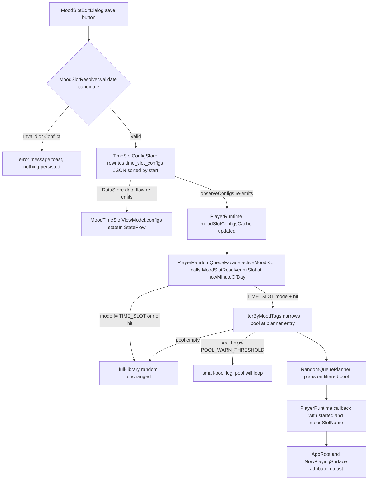

# Mood Time-Slot Anything-Play (Time-of-Day × Emotion Tags)

Mood time-slot anything-play ("情境化随心播放") is the **TIME_SLOT** variant of the
"随心播放增强" (anything-play enhancement) system. The enhancement is unified under the
three-state `RandomEnhanceMode` enum — **OFF / TIME_SLOT / EXPLORE** — and the three states
are mutually exclusive: exactly one can be active. This page covers TIME_SLOT; EXPLORE is
its own behavior (see `/openwiki/player/random-and-infinite.md`). When the master switch is
in TIME_SLOT mode and the current minute of day falls inside a configured time slot, the
random candidate pool is narrowed to songs carrying one of that slot's emotion tags.
Everything else — tiered uniform-random preemption, recent-play eviction, infinite refill —
is reused unchanged, because the filtering happens **at the planner entry**, never inside
the planners. The feature is the one-phase ("一期") subset of the product proposal in
`docs/architecture/MOOD_TIME_SLOT_PLAYBACK.md`: time slots × emotion tags only, no scene
abstraction.

The whole loop is: config UI saves a `TimeSlotConfig` → `TimeSlotConfigStore` validates
and rewrites a JSON key in the `mood_time_slot` DataStore → two independent observers
(the config page's `StateFlow`s and `PlayerRuntime`'s `@Volatile` caches) receive the
same emission → each random draw re-evaluates the active slot via `MoodSlotResolver.hitSlot`
→ `PlayerRandomQueueFacade.filterByMoodTags` narrows the pool → the app shell toasts the
winning slot name for attribution.



*Config save to runtime consumption to attribution: the store write reaches the config
page `StateFlow`s and the player's `@Volatile` cache from the same DataStore emission;
each random draw re-evaluates the slot and filters at the planner entry.*

## The mode switch: `RandomEnhanceMode`

Since 2026-10-20 (explore playback) the plain `moodTimeSlotEnabled` boolean is a
**derived view** of a single three-state enum, `RandomEnhanceMode`:

```kotlin
enum class RandomEnhanceMode { OFF, TIME_SLOT, EXPLORE }
```

- `PlayerSettingsRepository.randomEnhanceMode` prefers the `random_enhance_mode`
  DataStore string key; for legacy users who never wrote it, it falls back to the old
  `mood_time_slot_enabled` boolean (`true → TIME_SLOT`, else `OFF`) so existing behavior
  is preserved.
- `moodTimeSlotEnabled: Flow<Boolean>` is now `randomEnhanceMode.map { it == TIME_SLOT }` —
  it is no longer an independent persisted bit.
- `setRandomEnhanceMode(mode)` writes **both** keys in one `edit`: `random_enhance_mode` is
  set to `mode.name` and `mood_time_slot_enabled` is re-written as
  `mode == RandomEnhanceMode.TIME_SLOT`, keeping the two read paths consistent.
- `setMoodTimeSlotEnabled(enabled)` is a thin wrapper mapping to
  `setRandomEnhanceMode(if (enabled) TIME_SLOT else OFF)`.
- The enhance mode is observed in three places that all converge on the single persisted
  enum: `PlayerRuntime.observeMoodSlotCaches` (drives `isExploreModeActive`, and exits an
  explore session when the mode leaves `EXPLORE`), `MoodTimeSlotViewModel.randomEnhanceMode`,
  and the random facade's per-draw lambdas.

### Mutual exclusion in the runtime facade

`PlayerRandomQueueFacade` receives two lambdas derived from the same enum:
`moodSlotEnabled` is `randomEnhanceMode.first() == TIME_SLOT` and `exploreModeEnabled` is
`== EXPLORE`. Because the enum is single-valued, at most one is ever true:

- In `playRandomQueue`, `val explore = exploreModeEnabled()` and
  `val mood = if (explore) null else activeMoodSlot()` — when explore is active the mood
  filter is skipped entirely and the queue is planned with `ExplorePlaybackPolicy.INITIAL_BATCH_SIZE`
  (10 songs).
- In `startInfinitePlay`, infinite random is **blocked** while an explore session is active
  (`current.isExplorePlay`); a user manually choosing a song exits the explore session and
  re-enables infinite. TIME_SLOT never blocks infinite — it only mood-narrows the refills.
- In `PlayerRuntime.observeMoodSlotCaches`, leaving `EXPLORE` calls
  `randomQueueFacade.stopExplorePlay()` automatically.

So TIME_SLOT and EXPLORE can never both take effect, and OFF reproduces the pre-enhancement
chain bit-for-bit (the regression invariant locked by tests).

## Configuration model: `TimeSlotConfig`

`core/model/TimeSlotConfig.kt` defines the unit of configuration — five flat fields
designed for a future Room migration (design doc R4):

- `id: Long` — the edit dialog generates it as `System.currentTimeMillis()`; save treats
  an equal id as an update, not a duplicate;
- `name: String` — display name such as "深夜静谧";
- `startMinutes` / `endMinutes: Int` — minutes of day, 0–1439;
- `tags: List<String>` — emotion tags from the `EmotionGroup` vocabulary (see
  `/openwiki/concepts/emotion-model.md`); at least one tag is required to save.

The interval semantics are half-open `[startMinutes, endMinutes)`. `endMinutes <= startMinutes`
is a **cross-midnight** slot (`crossesMidnight`), covering `[start, 24:00) ∪ [0, end)` —
e.g. 22:00–06:00. `startMinutes == endMinutes` is zero-length and rejected by validation.
`covers(minuteOfDay)` normalizes the input modulo 1440 and switches to
`m >= start || m < end` for cross-midnight slots, so `22:00`, `00:00`, and `05:59` hit a
22:00–06:00 slot while `06:00` and `21:59` do not. `timeRangeText` and `formatMinutes`
provide the 24-hour display form used by the config UI.

## Resolution and validation semantics: `MoodSlotResolver`

`domain/playback/MoodSlotResolver.kt` is a pure, Android-free domain class (independently
unit-testable) plus the `MoodSlotPolicy` constants object:

| Constant | Value | Used by |
| --- | --- | --- |
| `POOL_WARN_THRESHOLD` | 10 | `filterByMoodTags` "will loop" log; mirrored by the config UI's own `MOOD_POOL_WARN_THRESHOLD = 10` |
| `NAME_MAX_LENGTH` | 20 | `validate` (`NAME_TOO_LONG`); edit dialog marks the name field in error |
| `MAX_SLOTS` | 10 | Declared as a soft per-user limit; no code path currently enforces it |

Resolution semantics:

- `activeTags(configs, enabled, minuteOfDay)` returns `null` when the switch is off, there
  are no configs, or no slot covers the minute — i.e. "enhancement inactive". With a hit it
  returns the slot's tags as a `Set`.
- `hitSlot(configs, minuteOfDay)` filters by `covers(minuteOfDay)` and picks
  `minByOrNull { it.startMinutes }`. For **validated** (pairwise non-overlapping) configs
  this is at most one slot per minute; if invalid data ever yields multiple hits, the
  earliest-start slot wins, keeping the result deterministic.
- The runtime facade uses `hitSlot` directly because it needs the slot **name** for
  attribution in addition to the tags.

Validation (`validate(candidate, existing)` → sealed `SlotValidation`):

- `Invalid(SlotError)` for `EMPTY_NAME`, `NAME_TOO_LONG`, `NO_TAGS`, and `ZERO_LENGTH`
  (`startMinutes == endMinutes`);
- `Conflict(conflicting)` when the candidate overlaps an existing config **with a different
  id** — editing a slot to expand its own range is not a self-conflict;
- overlap is computed by `overlaps`, a ring-timeline pairwise intersection: each interval is
  split into linear segments (`[start, 1440)` and `[0, end)` when crossing midnight; an
  empty segment list for zero-length), and any segment pair intersecting under half-open
  arithmetic (`aStart < bEnd && bStart < aEnd`) counts as overlap. Touching endpoints (one
  slot's `end` equal to another's `start`) do **not** overlap.

Both the persistence layer and the config UI call this same resolver, so overlap rules have
a single implementation (design doc §4.4).

## Storage: `TimeSlotConfigStore` (DataStore JSON)

`data/repository/TimeSlotConfigStore.kt` implements the domain interface
`TimeSlotConfigRepository` (`observeConfigs`, `currentConfigs`, `save`, `delete`). Slot
counts are single-digit to low-double-digit, so a single JSON string key in a Preferences
DataStore is used instead of a Room schema change:

- File: `mood_time_slot` (`Context.timeSlotConfigDataStore`, provided by `DataStoreModule`
  under the `@TimeSlotConfigStore` qualifier; `RepositoryModule` binds the store as a
  singleton and as the domain interface). Like the other four DataStore domains, its
  `.preferences_pb` file is on the backup-exclusion checklist (see
  `/openwiki/architecture/data-persistence.md`).
- Key: `time_slot_configs`, a `JSONArray` of
  `[{"id":1,"name":"深夜静谧","start":1320,"end":360,"tags":["静谧","禅"]}]`-shaped objects.
- `save` runs `resolver.validate(config, currentConfigs())` first: `Valid` rewrites the
  whole key with the candidate merged (same id replaced) and the list **sorted by
  `startMinutes`**; `Invalid` throws `IllegalArgumentException(error.name)`; `Conflict`
  throws `IllegalArgumentException("与「${conflicting.name}」时间段重叠")` — the message is
  user-readable UI copy, not a debug string.
- `delete(id)` rewrites the key without the matching entry.
- `observeConfigs` maps the DataStore flow through `parse`; `currentConfigs` is
  `observeConfigs().first()` (the suspend-first pattern used across `:data`).

Parse tolerance is two-layered so corrupt data never takes the whole feature down:

1. The outer `runCatching` wraps `JSONArray(json)` and returns an empty list if the whole
   key is unreadable.
2. The inner per-item `runCatching` skips a single corrupted entry with a
   `"skip corrupted time slot config at #i"` warning log, preserving the rest of the list.

## Master switch and mode coalescing

The enhance mode lives in the existing player settings domain
(`PlayerSettingsRepository`), not in the slot store. The data implementation maps the
`player_settings` DataStore key `random_enhance_mode` (`PlayerSettingsKeys.RANDOM_ENHANCE_MODE`)
to a `RandomEnhanceMode`, falling back (old users) to `mood_time_slot_enabled`
(`MOOD_TIME_SLOT_ENABLED`, default false). `moodTimeSlotEnabled` is computed from it as
`== TIME_SLOT`, so a user who never touched the new key still gets legacy TIME_SLOT/OFF
behavior. `PlayerRandomQueueFacade` receives the mode as two lambdas
(`moodSlotEnabled`, `exploreModeEnabled`) and `PlayerRuntime` wires each to
`playerSettingsRepository.randomEnhanceMode.first()` equality checks, so every random draw
reads the freshest persisted value. Switch off (OFF) ⇒ `activeMoodSlot()` returns `null` and
random behavior is bit-identical to the pre-feature chain — the regression invariant locked
by tests (design doc §7, item 7).

## The M-2 live data path: runtime caches and ViewModel flows

Before review M-2 (2026-10-15) the player read slot configs and emotion tags as a startup
snapshot plus manual refresh; both sides now **continuously observe repository flows**,
which is what makes saves/deletes effective immediately with no refresh step:

- `PlayerRuntime.observeMoodSlotCaches()` (started from `start()`, after the startup
  sequence, deliberately low-frequency and non-blocking) launches collectors:
  - `timeSlotConfigRepository.observeConfigs()` → `@Volatile moodSlotConfigsCache`
    (exceptions logged, cache keeps the last value);
  - `songEmotionRepository.observeAll()` — a Room invalidation stream — mapped per song
    through `emotionTagsOf` with `flowOn(dispatchers.default)` → `@Volatile
    moodEmotionTagsCache`. Because `emotionTagsOf` prefers user-calibrated tags, a
    calibration write also reaches the next random draw without any player-side action;
  - `wordPreferenceRepository.observeAll()` → `@Volatile wordPreferenceCache`
    (explore refill's like/dislike ledger);
  - `playerSettingsRepository.randomEnhanceMode` → updates `isExploreModeActive`, and when
    the mode leaves `EXPLORE` while an explore session is running, calls
    `randomQueueFacade.stopExplorePlay()`.
- `PlayerRandomQueueFacade` is constructed with `moodSlotConfigs = { moodSlotConfigsCache }`
  and `moodEmotionTagsOf = { song -> moodEmotionTagsCache[song.id].orEmpty() }`, so the
  facade reads `@Volatile` snapshots that are at most one emission behind the store.
- `MoodTimeSlotViewModel` exposes `configs`, `randomEnhanceMode`, `moodTimeSlotEnabled`, and
  `wordPreferences` as `stateIn(viewModelScope, SharingStarted.WhileSubscribed(5_000), …)`
  `StateFlow`s over the same repository flows (initial values cover only the first frame).
  Config page and player runtime therefore always agree: a save or delete on the config page
  re-emits from the DataStore and updates both within one emission.

The one deliberate non-stream is `tagCounts`/`librarySize` on the ViewModel: `loadStats()`
is a one-shot snapshot computed on `Dispatchers.IO` (full `getAll()` +
`emotionTagsOf` counting + `countSongs()`), invoked by `LaunchedEffect(Unit)` on entering
the config route — the M-7 pattern (no composition-time computation). On failure it degrades
tag counts to an empty list (badges show 0) without blocking the configuration features.

## Random-play consumption: filter at the planner entry

`PlayerRandomQueueFacade` (see `/openwiki/player/random-and-infinite.md` for the planner
contracts it sits on) owns the consumption semantics:

- `activeMoodSlot()` evaluates `moodSlotEnabled()` then
  `moodSlotResolver.hitSlot(moodSlotConfigs(), nowMinuteOfDay())`; `nowMinuteOfDay` is an
  injectable lambda (default `Calendar`) so tests run off the real clock. The result is a
  `MoodSlotState(slotName, tags)` or `null`. `currentMoodSlot()` exposes the same
  evaluation for attribution.
- `filterByMoodTags(songs, mood)` keeps a song when any of `moodEmotionTagsOf(song)` is in
  `mood.tags` (same `emotionTagsOf` display tags the emotion pages use), then:
  - empty result → returns `null` and logs
    `"moodSlot: no songs for tags=…, fall back to full library"` — the caller falls back to
    the **full library** rather than failing to start (design doc §4.3 degradation);
  - `size < POOL_WARN_THRESHOLD` → logs `"moodSlot: small pool (N) for tags=…, will loop"`
    (normal effect continues; the pool will cycle).
- `playRandomQueue()` computes
  `val mood = if (explore) null else activeMoodSlot()` and
  `candidates = mood?.let { filterByMoodTags(current.songs, it) } ?: current.songs`, then
  passes them to `planner.planRandomQueue` — tiered uniform selection and recent eviction
  operate on the narrowed pool untouched, and uniform random composes for free (test-locked:
  a 0-play song still beats a 10-play song inside a mood-filtered pool). The queue starts in
  `PlayMode.SEQUENTIAL` and infinite mode is exited. When `explore` is true the plan uses
  `ExplorePlaybackPolicy.INITIAL_BATCH_SIZE` and the mood filter is skipped.
- `refillInfinitePlayQueue()` applies the **same** `activeMoodSlot()` +
  `filterByMoodTags` narrowing to `planInfiniteRefill`'s `allSongs`, so refills during an
  active slot keep appending only in-mood songs.
- `startInfinitePlay()` does **not** mood-filter: it keeps the current queue and only flips
  the infinite flags; the mood filter takes effect from the first refill onward. It is
  blocked entirely while an explore session is active (`current.isExplorePlay`). (The design
  doc §4.2 aspired to filter the infinite start too; the implementation filters refills only.)

Runtime-visible small-pool and empty-pool feedback is log-based; the user-facing warnings
for those conditions live in the configuration UI (below), and the only runtime attribution
surface is the slot-name toast.

## Attribution toasts (anti-"why this song?" opacity)

`PlayerRuntime.playRandomQueue(onResult)` and `startInfinitePlay(onResult)` run the suspend
facade call on the runtime scope and then re-read
`randomQueueFacade.currentMoodSlot()?.slotName` — the same `activeMoodSlot()` evaluation the
filter used — before invoking `onResult(started, moodSlotName)` on the main thread, so the
toast can never disagree with the actual filter. The app shell turns the callback into
toasts:

- `AppRoot` lucky-play entry bar (empty queue, double-page shell):
  `已按「$slotName」为你随机播放` on success; `还没有可播放的音乐，请先导入歌曲吧~` when
  nothing was playable.
- `NowPlayingSurface` infinite-start action: `已按「$slotName」开启无限随机播放`; the lucky-play
  action wired in `HomeRouteActions` keeps the generic `已生成随机队列，开始播放~` toast with
  no mood attribution.

Both entry points end with `playlistResumeViewModel.switchSource(null, …)` as the rest of
the random chain does.

## Configuration UI data flow

The `:feature:user` + `:app` side (design doc §4.6 / UI screens):

- **Entry card** (`MoodTimeSlotSection` on the "我的" page): receives `configs` and `mode`
  (`RandomEnhanceMode`). In `TIME_SLOT` it computes
  `configs.firstOrNull { it.covers(nowMinuteOfDay) }` and gates the "生效中" badge on
  **mode == TIME_SLOT + a covering slot**, mirroring `activeTags` semantics; in `EXPLORE`
  it shows `探索模式生效中 · 按收听习惯学习喜欢/不喜欢词条`; in `OFF` it shows
  `未配置，点击添加` / `功能未启用 · N 个时段已配置`. `AppNavHost` feeds it
  `moodTimeSlotViewModel.configs` / `randomEnhanceMode` and refreshes `nowMinuteOfDay` on a
  30-second loop (minute granularity is enough).
- **Config route** (`AppRoutes.MOOD_TIME_SLOT`): collects the ViewModel `StateFlow`s
  (`configs`, `randomEnhanceMode`, `wordPreferences`, `tagCounts`, `librarySize`), calls
  `loadStats()` once per entry, renders a **mode selector card** (时段 / 探索 互斥 — selecting
  one instantly turns off the other and toasts `已切换为时段模式` / `已切换为探索模式` /
  `已关闭随心播放增强`), and then:
  - in `EXPLORE`: an explore info card plus the learned like/dislike word-preferences card
    (with a "重新探索" clear action that calls `clearWordPreferences`);
  - in `TIME_SLOT` with no configs: an empty state; with configs: a "时段模式生效中" hint, a
    24h timeline (cross-midnight slots drawn as two segments, the currently covered one
    highlighted), and per-slot cards with tag-count badges and a combined "合计 N 首可随机"
    estimate (`configs2Items` sums per-tag counts — single-tag takes the direct count, a song
    carrying two chosen tags is counted twice — accepted as a preview estimate). A card shows
    `歌曲较少，将循环播放` when its total is below the UI-local
    `MOOD_POOL_WARN_THRESHOLD = 10` (mirroring `MoodSlotPolicy.POOL_WARN_THRESHOLD`). Only in
    `TIME_SLOT` mode is the "添加时段" FAB shown. Save success toasts `已保存时段配置`, failure
    toasts the repository/validation message, and delete toasts `已删除时段配置`.
- **Edit dialog** (`MoodSlotEditDialog`): validates locally while typing (blank name, no
  tags, `start == end`) and runs the **same** `MoodSlotResolver.validate` on save, mapping
  each `SlotError`/`Conflict` to its user-facing message (`时间段与「name」重叠，请调整`,
  `开始与结束时间不能相同`, …) — validation feedback happens before the repository would throw.
  Times use the system `TimePicker` (forced 24-hour; storage stays minutes-of-day), the
  explainer switches to a cross-midnight description when `end <= start`, manual-only tags
  (鬼畜/沙雕/戏谑/荒诞 — the `auto=false` group) are listed separately with a warn explainer,
  and a combined-pool explainer warns below `MOOD_POOL_WARN_THRESHOLD` songs or at zero
  ("随心播放将回退为全部歌曲随机").

## Tests that lock the semantics

- `domain/src/test/.../MoodSlotResolverTest.kt` — half-open boundary hits/misses; the full
  overnight window (22:00/23:41/00:00/05:59 hit; 06:00/21:59/noon miss); a per-minute sweep
  proving at most one hit for valid configs; deterministic earliest-start resolution on
  invalid overlapping data; disabled-switch and empty-config inactivity; every
  validation branch including touching endpoints, same-id edit without self-conflict, and
  ring `overlaps` symmetry cases.
- `feature/player/src/test/.../PlayerRandomQueueFacadeTest.kt` — the consumption floor:
  pool narrowing to tagged songs, empty-pool fallback to the full library (log contains
  "fall back to full library"), inactivity outside the slot and with the switch off
  (bit-identical legacy behavior), uniform-random compatibility under the mood filter
  (`listOf(4, 3)` — the 0-play song first), and explore-mode exclusivity: explore generates
  10 songs (`explore=true` log), blocks infinite while an explore session runs, allows
  infinite after the session ends, prefers liked-and-no-disliked refill pools before
  degrading to no-dislike then full library.

## Related pages

- `/openwiki/player/random-and-infinite.md` — the planner chain this feature filters, the
  facade's queue/infinite mechanics, and the mutually-exclusive EXPLORE mode.
- `/openwiki/concepts/emotion-model.md` — `EmotionGroup` vocabulary and `emotionTagsOf`, the
  tag source the filter and the config-page badges share.
- `/openwiki/architecture/data-persistence.md` — the `mood_time_slot` DataStore domain, the
  suspend-first repository pattern, and backup exclusions.
- `/openwiki/workflows/emotion-analysis-pipeline.md` — how tags get into `song_emotions` and
  why analysis/calibration flows into the mood caches.
