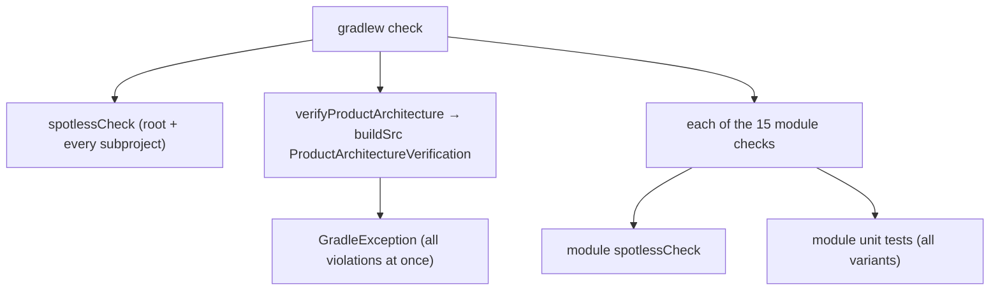
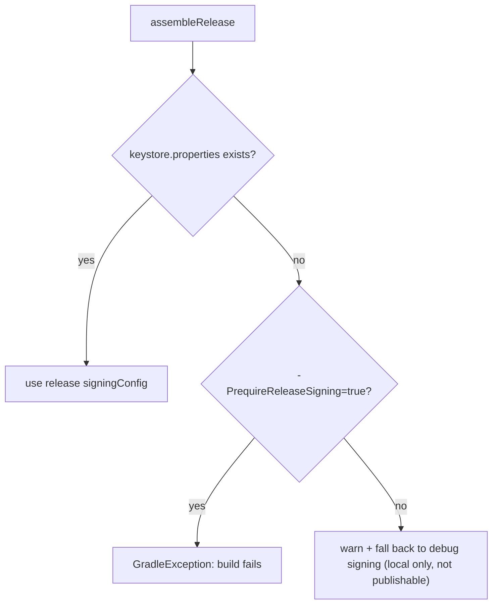

# Build, Verification & Release Operations

This page is the pre-commit and pre-release runbook for `melody-in-heart` (applicationId `cn.com.dcsgo.mihx`, current `versionName 3.15.0` / `versionCode 54`). Every quality gate is carried by two mechanisms: the **command matrix** (Gradle lifecycle tasks) and **`verifyProductArchitecture`** — a custom verification task whose rule body is the `buildSrc` object `cn.com.dcsgo.mihx.verify.ProductArchitectureVerification`, statically asserting the whole source tree on every `check`.

**Where the conventions are authoritative.** `CLAUDE.md` used to carry a long build/architecture hand-book; it is now a 5-line `OPENWIKI` stub that only points at `AGENTS.md`, so **historical CLAUDE.md prose (key-version tables, module checklists, command lists) is no longer authoritative and must not be cited as evidence**. Today the truth lives in: the Gradle files (`app/build.gradle.kts`, root `build.gradle.kts`, `settings.gradle.kts`, `gradle/libs.versions.toml`, `gradle.properties`), the gate body in `buildSrc`, the workflow files under `.github/workflows/`, `docs/` (whose `docs/README.md` index now routes build/test/architecture conventions to this page and `/openwiki/testing/test-map.md`), and `AGENTS.md`'s three operating rules (source and tests are authoritative; a brief's unknowns are verification gaps rather than requirements; prefer the narrowest quiet validation and preserve complete failure output). Design rationale for module boundaries is in `/openwiki/architecture/module-graph.md`; Room/DataStore details in `/openwiki/architecture/data-persistence.md`.

## 1. Pre-commit command matrix

All commands run from the project root; use `./gradlew` on macOS/Linux and `.\gradlew.bat` on Windows.

### 1.1 The three build types

| Variant | Definition | Key differences |
| --- | --- | --- |
| `debug` (default) | `buildTypes { debug { … } }` | No minification/shrinking; `applicationIdSuffix = ".debug"` + `versionNameSuffix = "-debug"` so it installs alongside release on the same device; keeps the full ABI set for emulator compatibility |
| `release` | `buildTypes { release { … } }` | `isMinifyEnabled = true` (R8) + `isShrinkResources = true` + `proguard-android-optimize.txt`; `ndk.abiFilters += "arm64-v8a"` ships a 64-bit-only package; `resConfigs("zh", "en")` trims dependency-library translation resources |
| `benchmark` | `create("benchmark") { … }` | `initWith(getByName("release"))` inherits all release settings but uses **debug signing** and `isDebuggable = false`; appends `x86_64` on top of the inherited `arm64-v8a` (must run on both real devices and x86_64 emulators); `matchingFallbacks += listOf("release")` |

### 1.2 Common commands

```bash
# Build APK
./gradlew :app:assembleDebug
./gradlew :app:assembleRelease
./gradlew :app:assembleBenchmark

# Single-module fast compile (no APK; fastest feedback after a change)
./gradlew :data:compileDebugKotlin
./gradlew :player:compileDebugKotlin
./gradlew :core:skin:compileDebugKotlin

# Full JVM unit tests (no device; covers debug/release/benchmark test variants)
./gradlew test

# Single module / single test class
./gradlew :core:skin:test
./gradlew :player:test --tests "cn.com.dcsgo.mihx.player.window.ControllerQueuePlannerTest"
./gradlew :data:testDebugUnitTest --tests "*MelodyDatabaseMigrationTest*"

# Tests requiring a device or emulator
./gradlew :app:connectedAndroidTest   # Compose instrumentation tests
./gradlew :benchmark:connectedCheck   # Macrobenchmark, including Baseline Profile generation

# Formatting and architecture gates
./gradlew spotlessCheck              # format check only
./gradlew spotlessApply              # auto-format
./gradlew verifyProductArchitecture  # architecture/privacy/release constraints only
./gradlew :buildSrc:test             # unit tests of the gate rule body
./gradlew check                      # full pre-commit gate
```

Prefer `./gradlew check` (or a targeted module task such as `:core:skin:test`) over ad-hoc task combinations — that is the same command CI runs, so a local pass predicts a green PR. `:app:connectedAndroidTest` and `:benchmark:connectedCheck` require a real device or emulator; MIUI real devices may be unable to run Macrobenchmark's automatic authorization/frame-confirmation steps because of ROM limitations (see `docs/refactor/PRODUCT_REFACTOR_AUDIT.md`).

### 1.3 What `check` aggregates

The root `build.gradle.kts` wires `check` to three sets of tasks: the root-level `spotlessCheck`, the root-level `verifyProductArchitecture`, and `check` for all 15 subprojects. Meanwhile the `subprojects` block makes each subproject's `check` depend on its own `spotlessCheck` (Kotlin, Kotlin-script and XML formatting rules). So a `check` failure is one of formatting, architecture assertion, or unit tests, and the `GradleException` message names the failing rule. `verifyProductArchitecture` is pure orchestration: its `doLast` calls `ProductArchitectureVerification.verify(rootDir)` and, when the returned list is non-empty, throws one `GradleException` carrying **all** collected violations at once (collection-style, not fail-fast).



*Aggregation of the commit gate: formatting, architecture assertions, and per-module unit tests all run in `check`; every `verifyProductArchitecture` rule failure aborts the build with a `GradleException` listing every violation.*

## 2. The `verifyProductArchitecture` gate

The task lives in the root `build.gradle.kts` (`tasks.register("verifyProductArchitecture")`, `group = "verification"`). Since m-10 (2026-10-15 review) the rule body itself lives in `buildSrc` as the object `ProductArchitectureVerification`, which takes the repo `File` tree and returns a list of violation strings (empty = pass). It walks `kt/kts/java/xml/toml` files skipping `build/`, `.gradle/`, `.git/`, `.idea/`, **and `buildSrc/`** (whose own sources contain the rule texts, e.g. legacy-name counterexamples, and would otherwise self-trigger). Behavior is unit-tested by `buildSrc`'s `ProductArchitectureVerificationTest`, which builds temp-directory repo fixtures to prove each rule fires, that collection does not stop at the first failure, that the safe `loadSongInfo` loader is exempt, and that the `release` block extraction survives nested braces. **There is no incremental or allowlist mode** (beyond the `android.*` baseline described in rule 15) — any newly added file or module enters the next scan.

### 2.1 Rule checklist

| # | Category | Enforced content (summary) |
| --- | --- | --- |
| 1 | Formatting infrastructure | `gradle/libs.versions.toml` must keep the Spotless plugin entry; the root build must declare `alias(libs.plugins.spotless)`; some `check` block must depend on `spotlessCheck` |
| 2 | Module inventory & `.gitignore` | `settings.gradle.kts` must contain all 15 modules (`:app`, `:core:model`, `:core:common`, `:core:ui`, `:core:skin`, `:domain`, `:data`, `:player`, six `:feature:*`, `:benchmark`); each module directory's `.gitignore` must include `/build/`, `/.cxx/`, `/.externalNativeBuild/`, `/captures/` |
| 3 | Hilt entry points | `MelodyApplication`=`@HiltAndroidApp`, `MainActivity`=`@AndroidEntryPoint`, `AppMediaSessionService` (`:player`)=`@AndroidEntryPoint`, `PlayerViewModel`=`@HiltViewModel`; the four files must exist with the annotations |
| 4 | DI module existence | `app/di/` `CoroutineModule`/`LoggerModule`/`PlayerModule` and `data/di/` `RepositoryModule`/`DatabaseModule`/`DataStoreModule` must exist, each a same-named `@Module`+`@InstallIn(SingletonComponent::class)` |
| 5 | Architecture docs presence | `docs/architecture/PLAYBACK_STATE_MACHINE.md` must document the 8 states plus `AppMediaSessionService`/`PlaybackController`/`ControllerPlaybackStateSynchronizer`/`PlayerControllerStateFacade`/`PlayerMediaEventFacade`; `docs/refactor/PRODUCT_REFACTOR_AUDIT.md` must contain `Verified`, `Still Not Fully Proven`, `.\gradlew.bat test`, `:app:assembleRelease`, `:app:assembleBenchmark`, `Macrobenchmark`, `:benchmark` |
| 6 | `:benchmark` module shape | `benchmark/build.gradle.kts` + `StartupBenchmark.kt` must exist; the build file must contain `libs.plugins.android.test`, `targetProjectPath = ":app"`, `androidx.benchmark.macro.junit4`; `StartupBenchmark` must contain `MacrobenchmarkRule`, `StartupTimingMetric`, `StartupMode.COLD`, `startActivityAndWait`, `packageName = "cn.com.dcsgo.mihx"` |
| 7 | PerformanceTrace anchors | `core/common/.../PerformanceTrace.kt` must exist; `MusicRepository` must keep `music_import_scan`/`music_import_folder`; `PlaybackController` must keep `controller_play_queue`/`controller_prepare_queue`/`controller_sync_queue`/`play_next_command` |
| 8 | Playback window shape test | `player/src/test/.../PlaybackWindowPerformanceShapeTest.kt` must exist and cover `100`, `500`, `1_000`, `71`, `WindowedControllerQueuePlanner` (controller window ≤ 71 items under 100/500/1000-song queues) |
| 9 | Legacy bans | whole repo forbids `com.dcsgo.data.model` legacy package references; `PlayerViewModelComponents`/`PlayerViewModelComponentFactory` (the old manual assembly hub, replaced by `PlayerRuntime` + injected facade/graph objects, ignoring `build.gradle.kts` files that merely mention the names); and Android Things dependency strings |
| 10 | Module dependency boundaries | `feature/**/build.gradle.kts` forbids `project(":data")`, `project(":player")` and any `project(":feature:…")`; feature/domain/player sources forbid `import cn.com.dcsgo.mihx.data.(repository|local).*`; `MusicRepository` must not declare `SongRepository`/`PlaylistRepository`/`MusicImportRepository`/`AlbumArtRepository` supertypes, and the four `*RepositoryAdapter.kt` must exist and implement the interfaces; the whole `:player` module forbids the stale `cn.com.dcsgo.mihx.data.player` package (its classes now live in `cn.com.dcsgo.mihx.player`, matching the module namespace); `:core:model` must have no res XML and no `R.(drawable\|string\|color\|dimen\|raw)`/`android.R.` references |
| 11 | Feature Route/Screen pattern | `:feature:lyrics`/`:feature:settings` must have `XxxRoute.kt`+`XxxScreen.kt`; play statistics / quick-skip songs (`:feature:home`) and version management (`:feature:user`) likewise must be Route+Screen ized; `AppOverlay.kt`/`AppOverlayHost.kt`/`OverlayRoute.kt` fail immediately if present; `:feature:home` must not directly import `cn.com.dcsgo.mihx.ui.lyrics` |
| 12 | Permission & settings policy | `PlayerStartupFacade` must not contain `Bluetooth`; `SettingsScreen` must expose「蓝牙播放监听」/「申请蓝牙权限」entries; Bluetooth playback listening / playback notification must be persisted `PlayerSettingsRepository` (`bluetoothPlaybackMonitoringEnabled`/`playbackNotificationEnabled`) → DataStore (`BLUETOOTH_PLAYBACK_MONITORING_ENABLED`/`PLAYBACK_NOTIFICATION_ENABLED`) → `PlayerUiState` settings; `AppNavHost`/`AppRoot` must not hold either state in local `remember { }`; `PermissionCoordinator` must offer a notification permission request with an `onGranted` callback; the four startup-path files (`MainActivity`/`AppRoot`/`PlayerRuntime`/`PlayerStartupFacade`) must not contain `requestNotificationPermission(`/`requestBluetoothConnectPermission(`/`POST_NOTIFICATIONS`/`BLUETOOTH_CONNECT` (permissions may only be triggered by the user in Settings) |
| 13 | LazyColumn stable keys | `app`/`core`/`feature` Kotlin files must declare `key =` within 160 chars of an `items`/`itemsIndexed` call; bare `item { }` is forbidden |
| 14 | Logging channel | apart from `AppLogger.kt` itself, direct `Log.(d\|i\|w\|e\|v\|wtf)(` calls are forbidden — all logging goes through `AppLog`/`AppLogger` |
| 15 | Pure-layer ratchet | `import android.*` in `core/model/src/main` and `domain/src/main` is banned on **new** violations via a baseline whitelist; the 5 pre-existing violations (`AlbumEntry.kt`, `ArtistEntry.kt`, `Song.kt`, `FolderImporter.kt`, `MusicImportRepository.kt`) are grandfathered until the `Uri → String` migration clears them; `androidx.compose.runtime.{Stable,Immutable}` are out of scope. When the migration lands, empty the baseline and the rule becomes a hard ban |
| 16 | `runBlocking` ban | no `runBlocking(` in any `src/main` source (any module, kt/kts/java/xml/toml); comment lines are ignored, and trailing `//` comments are stripped before matching, so historical prose about `runBlocking` does not trip the rule (M-3.1 / N-1, 2026-10-27) |
| 17 | `loadSongInfo` safety | bare `loadSongInfo(` calls in `src/main` are forbidden outside `SongInfoLoader.kt` — every call must go through `:core:ui`'s `loadSongInfoSafely`, because an uncaught Room exception inside a `LaunchedEffect`/`produceState` coroutine crashes the process (C-1 fix, 2026-10-27) |
| 18 | `PerformanceTrace.allow` call site | at least one real `PerformanceTrace.allow(` call site must exist in `src/main` (registered in `MelodyApplication.onCreate`); otherwise the release whitelist API would be dead code (M-20 / gate suggestion 4) |
| 19 | Manifest placement | the `:app` manifest must not declare `AppMediaSessionService` (the `:player` manifest must — `cn.com.dcsgo.mihx.player.AppMediaSessionService`); it must not declare `READ_EXTERNAL_STORAGE` (forbidden for SAF folder import); **`READ_MEDIA_AUDIO` IS permitted** — it is declared in the `:app` manifest so an already-granted device can fast-scan via `java.io.File`, with SAF document tree remaining the primary path and fallback |
| 20 | release/benchmark build-type shape | the `release` block must contain `isMinifyEnabled = true` and `isShrinkResources = true`; `create("benchmark")` must exist with `initWith(getByName("release"))` |
| 21 | Privacy/backup exclusions | `backup_rules.xml` and `data_extraction_rules.xml` must each contain all required exclusions (see §3.3) |
| 22 | Room schema immutability | `data/schemas/.../MelodyDatabase/` `1.json`/`2.json`/`3.json` must exist; v1 must not contain `quick_skip_short_play_counts`, v2 must contain it and must not contain `lrcUri`, v3 must contain `lrcUri`; `MelodyMigrations` must register `Migration(1, 2)` and `Migration(2, 3)`, and `DatabaseModule` must call `addMigrations(*MelodyMigrations.ALL)` |

**The `release` block is extracted by brace-pairing, not a regex** (since m-10): the old rule that grabbed up to the first closing brace truncated on nested lambdas, so `extractBracedBlock` now counts `{`/`}` and returns the balanced block — nesting inside the `release` block is safe, and `ProductArchitectureVerificationTest` locks that behavior. The signing decision (`releaseSigningConfig`) nonetheless still lives outside `buildTypes`, so a missing key can gate the build before the release block is parsed; the block keeps only flat assignments (`signingConfig = releaseSigningConfig`, `isMinifyEnabled = true`, `isShrinkResources = true`, `proguardFiles(...)`, `ndk { abiFilters += "arm64-v8a" }`). Note that the comment above `buildTypes` in `app/build.gradle.kts` still describes the *old* regex-truncation rationale; the actual gate uses brace-pairing.

Rule 22 is deliberately narrow: the gate only pins the behaviour of database versions 1–3 and the existence/registration of the first two migrations. Later schema versions are constrained by code review, the immutability convention (never edit an exported JSON), and `MelodyDatabaseMigrationTest`, not by the gate.

### 2.2 Invariants locked by focused unit tests instead

The gate does **not** scan `:core:skin` internals; those conventions are locked by unit tests:

- **`LibrarySegmentsMatchSourceTest`** (`:core:skin`) reads the `:feature:playlist` `LibraryTab` enum source and asserts the description's library-page segments match it word-for-word (including order) — a guard against the "description proves itself" trap.
- **`UserSectionsTest`** (`:feature:user`, 10 cases) asserts `UserSections` keys/`DEFAULT_ORDER` match the pre-refactor hardcoded order, that `UserSections.SKIN_SWITCHER` equals `SkinPartCatalog.SKIN_SWITCHER` literally, and that `parse` tolerates unknown/blank input.
- **`SkinSwitcherCatalogConsistencyTest`** (`:app`) keeps `UserSections.SKIN_SWITCHER` and `SkinPartCatalog.SKIN_SWITCHER` from drifting apart.

### 2.3 The 2026-10-27 remediation wave that the newest rules lock

The M3.1 Flash review (`docs/refactor/review-m-3-1-flash-2026-10-27.md`, tracked in `docs/refactor/fix-log-2026-10-27.md`) is the origin of gate rules 15–18. The items that changed day-to-day build behaviour:

- **M-5 / M-6** — schema 16→17 added `index_songs_albumId` and `index_playback_events_songId` (see §5), plus a retention policy on `playback_events`.
- **M-21** — the `Uri → String` mechanical migration was **not** performed; instead a ratchet gate (rule 15) blocks new `android.*` imports in `:core:model`/`:domain`.
- **N-1** — `runBlocking` was removed from main sources and the ban (rule 16) prevents regression.
- **C-1** — the crash-prone bare `loadSongInfo` call path was funnelled into `loadSongInfoSafely`, and rule 17 freezes the fix.
- **M-20** — `PerformanceTrace` emits through the dedicated `AppLog.performance` channel (see §4.3) and rule 18 keeps at least one production `allow()` call site, fixing the review's finding that the release whitelist produced nothing.

## 3. Release constraints

### 3.1 ABI, `largeHeap`, & resource trimming

Since `minSdk 33`, all real devices are 64-bit, so release ships only `arm64-v8a`; `resConfigs("zh", "en")` trims other languages' translated resources for the dependency libraries, shrinking `resources.arsc`. The `:app` manifest's `<application>` also sets `android:largeHeap="true"` so playback with large playlists and album-art memory stays within a larger heap. debug/benchmark keep multiple ABIs to stay compatible with x86_64 emulators.

### 3.2 R8 & ProGuard rules

Release enables R8 minification + resource shrinking. `app/proguard-rules.pro` manually keeps:

- manifest/session entry points: `MelodyApplication`, `MainActivity`, `AppMediaSessionService`;
- Hilt/Room/Media3 reflection-required attributes (`Signature`, `RuntimeVisibleAnnotations`, …);
- `MelodyDatabase` and all entity classes (so release crashes stay diagnosable);
- `FfmpegAudioDecoder`/`FfmpegLibrary` — `:player`'s `FfmpegPcmDecoder` (at `cn.com.dcsgo.mihx.player`) reflectively drives the Jellyfin FFmpeg extension's package-private decoders (`FfmpegLibraryProbe` probes with `Class.forName`); R8 renaming/trimming would break the decode path. The keep rules target the actual `androidx.media3.decoder.ffmpeg.FfmpegAudioDecoder` constructor + `getSampleRate`/`getChannelCount`/`growOutputBuffer` and `FfmpegLibrary.isAvailable`. (The manifest/session keep rule still cites the legacy `cn.com.dcsgo.mihx.data.player.AppMediaSessionService` name while the class lives at `cn.com.dcsgo.mihx.player`; the Media3 decoder keep rules, which are what matter for the decode path, use the correct `androidx.media3.decoder.ffmpeg.*` classes.)

### 3.3 Signing strategy & privacy exclusions



*Release signing decision: when `keystore.properties` (gitignored; holds `storeFile`/`storePassword`/`keyAlias`/`keyPassword`) is missing, a local build falls back to debug signing with a warning; releases/CI must pass `-PrequireReleaseSigning=true`, which fails the build without the key so a debug-signed "official" APK can't slip out. The decision is computed once outside `buildTypes` through a `releaseSigningConfig` val; `app/build.gradle.kts` reads the properties through `loadKeystoreProperties()` and creates the `release` signing config from them before `buildTypes` is evaluated. `release.yml` restores the key from the `RELEASE_KEYSTORE_B64` secret into `key/mihx`, validates it with `keytool -list`, and writes `keystore.properties` before `:app:assembleRelease` — so the CI build gets a real release signature without passing the flag.*

The privacy exclusions are rule 21's checklist. The gate's hard subset that both rule files must contain: the legacy SharedPreferences files (`music_player_prefs.xml`, `play_stats_prefs.xml`, `quick_skip_songs_prefs.xml`), the Room family (`melody.db`, `melody.db-journal`, `melody.db-shm`, `melody.db-wal`), the `datastore/player_settings.preferences_pb` and `datastore/playback_state.preferences_pb` files, and `cache/album_art/`. The source rule files go further — `data_extraction_rules.xml` also excludes `datastore/playlist_resume.preferences_pb`, `datastore/mood_time_slot.preferences_pb`, `datastore/emotion_failures.preferences_pb`, and the album-art caches (`album_art_cache/`, `album_art/`, `cache/album_art/`) in both the `cloud-backup` and `device-transfer` sections. Rationale: library/playback state is device-bound (SAF URIs become invalid off-device), so backup only adds restore load and privacy surface. **When adding a new persisted file, add it to both rule files** (and keep the gate's hard subset intact), or `verifyProductArchitecture` fails.

## 4. Baseline Profile & the `:benchmark` module

### 4.1 Baseline Profile flow

- Artifact: `app/src/main/baselineProfiles/baseline-prof.txt` (~2425 `HSPL` rules, generated on a Pixel 6 emulator per the audit doc).
- Packaging: release builds package it automatically; `androidx.profileinstaller` (1.4.1, an `app` dependency) installs it to improve cold start and first-screen scrolling.
- Regeneration: run the `:benchmark` module's `BaselineProfileGenerator` on a device or emulator (`./gradlew :benchmark:connectedCheck`); it collects startup + home/player and playlist-page scrolling paths and rewrites the same file. **No baseline-profile Gradle plugin is applied in this build**, so the `:app:generateBaselineProfile` command named in `BaselineProfileGenerator`'s KDoc has no matching task here — don't rely on it. Regenerate after changing the startup path or home-list implementation.

### 4.2 The `:benchmark` module

| Class | Metric / rule | Behavior |
| --- | --- | --- |
| `StartupBenchmark` | `StartupTimingMetric`, `StartupMode.COLD`, 5 iterations per test | Two cold-start tests: `coldStartupWithoutBaselineProfile` (`CompilationMode.None()`) vs `coldStartupWithBaselineProfile` (`CompilationMode.Partial(baselineProfileMode = BaselineProfileMode.Require)`); each does `pressHome()` then `startActivityAndWait()` |
| `ScrollBenchmark` | `FrameTimingMetric` (P50/P90/P95 frame times), cold start, 5 iterations | Swipes the home screen down and up 3 times each, covering LazyColumn item creation/reuse paths |
| `BaselineProfileGenerator` | `BaselineProfileRule.collect` | Startup + scroll collection; writes back to `baseline-prof.txt` |

Module shape: `com.android.test` plugin, `targetProjectPath = ":app"`, `android.experimental.self-instrumenting = true`, only the `benchmark` variant enabled (`androidComponents.beforeVariants` filter), debug signing, and `testInstrumentationRunnerArguments["androidx.benchmark.suppressErrors"] = "EMULATOR"` (emulator results are flagged as warnings, not aborted). Running requires a real device/emulator; the audit records an emulator cold-start median of ~810 ms (software-rendered) and notes real-device acceptance is still incomplete.

### 4.3 `PerformanceTrace` anchor strategy

`core/common`'s `PerformanceTrace` is a deliberate observability switch, not a logging side effect:

- `isEnabled` initial value = `BuildConfig.DEBUG`: **debug defaults to on, release stays silent** (privacy + volume decision);
- `allow(operation)`/`disallow(operation)` provide a release allowlist so key playback paths keep emitting in production; `MelodyApplication.onCreate` registers `play_next_command`, `controller_play_queue`, `controller_prepare_queue`, `controller_sync_queue`;
- **As of M-20 traces no longer flow through `AppLog.info`** — they use the dedicated `AppLog.performance` channel, wired to `AndroidAppLogger`'s independent `performanceLoggingEnabled` flag that is **not** gated by `BuildConfig.DEBUG`. `MelodyApplication` and `LoggerModule` both construct `AndroidAppLogger(BuildConfig.DEBUG, performanceLoggingEnabled = true)`, so release builds actually emit allowlisted operations;
- `measure { }`/`log { }`/`logLazy { }` output through `AppLog.performance`, with metadata going through `redactSensitiveValuesForLog()` first; `logLazy`/`measure(operation) { metadata }` only construct metadata when the trace will actually be emitted;
- `core/common` explicitly turns on `buildFeatures { buildConfig = true }` for this.

Anchors (locked by gate rules 7, 8 and 18): `MusicRepository`'s `music_import_scan`/`music_import_folder`, `PlaybackController`'s `play_next_command`/`controller_play_queue`/`controller_prepare_queue`/`controller_sync_queue`, and at least one `PerformanceTrace.allow(` call site. Deleting or renaming these string literals fails `verifyProductArchitecture`. The companion `PlaybackWindowPerformanceShapeTest` locks the window shape (51–71 items) of 100/500/1000-song queues at the JVM layer.

## 5. Room schema flow

`:data` exports schemas via KSP: `ksp { arg("room.schemaLocation", "$projectDir/schemas") }`, with `MelodyDatabase` declaring `version = 20, exportSchema = true`; historical snapshots live in `data/schemas/cn.com.dcsgo.mihx.data.local.MelodyDatabase/1.json…20.json`. Recent versions: v11 added the `word_preferences` emotion-word voting table (`WordPreferenceEntity`) via `MIGRATION_10_11`; v15/v16 handled emotion coordinates and vote scaling; **v17 (M-5/M-6) added two indexes** — `index_songs_albumId` (album-catalog query & orphan-album cleanup) and `index_playback_events_songId` (retention cleanup filters by songId, previously a full-table scan); v18 added `songs.bitDepth`; v19 added the quality/spatial-audio columns (`bitRateKbps`, `channelCount`, `audioCodec`, `spatialAudio`); and **v20 (`MIGRATION_19_20`) deletes all rows of `song_group_overrides`** because the `groupKey` semantics changed in 2026-11 (`titleOverride ?: title` → `titleOverride ?: title + artist + album`), so old manual grouping cannot be mapped and is cleared once on upgrade.

Workflow for any entity/DAO change:

1. Modify the entity/DAO under `data/src/main/java/cn/com/dcsgo/mihx/data/local/{entity,dao}`.
2. Bump `MelodyDatabase` version by 1 (currently 20).
3. Build `:data` once — KSP auto-generates the new-version JSON in `data/schemas/.../` (don't hand-write it). The `merge*UnitTestAssets` tasks are wired to depend on `ksp*variant*Kotlin` so `MigrationTestHelper` reads the freshly generated JSON instead of a cached older asset set (v11→v12 first hit this: the merge task was UP-TO-DATE for pre-existing schemas and never re-ran when a new file appeared).
4. Add `Migration(N, N+1)` in `data/.../local/migration/MelodyMigrations.kt`, appending it to the trailing `ALL: Array<Migration>` array (declared last so object properties initialize in order — currently 19 migrations, `MIGRATION_1_2` … `MIGRATION_19_20`). Migrations were extracted from `DatabaseModule` (m-4) into this public object so `MelodyDatabaseMigrationTest` references the exact same instances as production — no "test migrations" vs "live migrations" drift.
5. `DatabaseModule` registers them with `addMigrations(*MelodyMigrations.ALL)`.
6. Add a focused unit test for complex migrations; the migration regression runs on the JVM through Robolectric (`isIncludeAndroidResources = true`, schemas exposed as test assets in `data/build.gradle.kts`).
7. **Never modify an already-exported schema JSON** — they are immutable snapshots; gate rule 22 detects tampering in v1/v2/v3, and later versions are protected by review only.

The full migration history is in `/openwiki/architecture/data-persistence.md`.

## 6. Key versions & compatibility constraints

| Item | Value | Constraint |
| --- | --- | --- |
| Kotlin | 2.0.21 | Compose compiler is built into Kotlin 2.0+; modules must apply `org.jetbrains.kotlin.plugin.compose` (the `kotlin-compose` alias); **the old `composeOptions { kotlinCompilerExtensionVersion }` block is forbidden** — it is ineffective under the new plugin |
| KSP | 2.0.21-1.0.28 | Prefix must match the Kotlin version exactly; upgrading Kotlin requires a synchronized KSP upgrade |
| AGP | 8.13.2 | `compileSdk 36`; `:benchmark` uses `com.android.test` at the same version |
| Compose BOM | 2025.09.01 | Compose versions are centralized via the BOM |
| Media3 | 1.9.0 + Jellyfin FFmpeg `1.9.0+1` | FFmpeg decoding is reflective (see §3.2 keep rules); after a Media3 upgrade, verify `FfmpegLibraryProbe` still hits |
| Room / Hilt / DataStore | 2.6.1 / 2.52 / 1.1.1 | Room schema export per §5 (database currently v20) |
| minSdk / compileSdk / targetSdk | 33 / 36 / 36 | Java 11 bytecode (`compileOptions`/`jvmTarget` set to `VERSION_11` repo-wide) |
| versionName / versionCode | 3.15.0 / 54 | Authoritative in `app/build.gradle.kts`; bumping them is the one commit class that may skip CI (see §7) |
| LiteRT / WorkManager / Coroutines | 1.4.1 / 2.9.1 / 1.9.0 | Emotion-analysis model runtime + background work |
| Spotless / Robolectric | 6.25.0 / 4.14.1 | Formatting gate; JVM migration/unit tests |
| buildSrc JVM target | 17 | `buildSrc` compiles at Java 17 so the same artifact loads on JDK 17 and JDK 21 daemons (CI uses 17) |

`app/build.gradle.kts` and `gradle/libs.versions.toml` are authoritative for every row. Treat any table found in old Markdown (including the retired `CLAUDE.md` Key Versions table) as historical.

### 6.1 Deterministic Windows build config

`gradle.properties` is the prerequisite for reproducible local verification:

- `kotlin.compiler.execution.strategy=in-process`: Kotlin compilation runs inside the Gradle daemon. Previously the Kotlin daemon failed on Windows over client-marker file permissions and fell back mid-build, making incremental results unstable; in-process removes that failure source, which also means **`org.gradle.jvmargs` (`-Xmx2048m`) is the heap compilation actually has available** (`kotlin.daemon.jvmargs=-Xmx1536m` only affects out-of-process daemons).
- `org.gradle.parallel=true` + `org.gradle.caching=true`: multi-module parallel build + build cache.
- `android.nonTransitiveRClass=true`: each module's R class holds only its own declared resources, so **R classes must not be used to reference resources across modules** (complementing rule 10's `:core:model` purity check).

### 6.2 Skin module boundaries

`:core:skin` deliberately carries **no UI dependency**: it depends only on `org.json` and `:core:model` (for `ThemeVariant`), and holds no routing knowledge — the description must be headlessly parseable and validate on-device without UI (also what makes it unit-testable). Only `:app` and `:feature:user` depend on it; the part → host-artifact mapping (routes, drawable ids, section order) happens in `:app`'s `SkinShellResolver`, and `:feature:user` owns both the `UserSections` partition metadata and the skin-switcher section. `:core:skin`'s `build.gradle.kts` must not add a Compose dependency or `R.*`/`AppRoutes` references.

## 7. CI workflows & OpenWiki conventions

Two GitHub Actions workflows live in `.github/workflows/` (`pr-check.yml` and `release.yml`). AGENTS.md's mention of a *scheduled* OpenWiki refresh is not represented by a workflow file in this repository tree.

- **`pr-check.yml`** runs on pull requests and on pushes to `main` (both trigger blocks ignore `docs/**`, `openwiki/**`, `**.md`), with `permissions: contents: read` and concurrency group `pr-check-${{ github.ref }}` (`cancel-in-progress: true`).
  - **Version-only fast path (2026-10-29).** A single `Detect version-only push (fast path)` step sets `skip=true` and the heavy steps are `if:`-gated on it. It is deliberately conservative: only `push` events qualify; a missing/zero `github.event.before` (new branch, force push) means full check; both `before` and `after` commits must exist locally (hence `fetch-depth: 0`); the changed-file set must be exactly `app/build.gradle.kts` (an empty set does not count); every added/removed line must match `versionCode =` / `versionName =`. Pull requests, new branches/force pushes, multi-commit pushes, any other touched file, or any edit beyond the two version lines all run the full check. The rationale is that a version bump differs from its parent by a few lines, so the gate verdict cannot change — and the real pre-release gate is `release.yml`, which re-runs the whole check on the commit being released.
  - The heavy path: JDK 17 (temurin), `gradle/actions/setup-gradle` cache, then `./gradlew check :app:assembleDebugAndroidTest :buildSrc:test --no-daemon --stacktrace` on `ubuntu-24.04` (40-minute timeout). `:app:assembleDebugAndroidTest` only compiles the instrumentation test sources (no device, catching UI signature drift) and `:buildSrc:test` unit-tests the `verifyProductArchitecture` rule body. Test/lint reports are uploaded as `check-reports` on failure.
- **`release.yml`** responds to `v*` tag pushes or `workflow_dispatch` (required `tag` input). Its `check` job checks out `ref: ${{ inputs.tag || github.ref }}` with `fetch-depth: 0`/`fetch-tags: true` and runs the same `./gradlew check :app:assembleDebugAndroidTest :buildSrc:test` gate, so the released commit is always fully verified even if `pr-check` took the fast path. `build-release` (`needs: check`) then: validates the tag against `^v[0-9]+\.[0-9]+\.[0-9]+(-[a-zA-Z0-9._-]+)?$` (tag injected via `env`, never interpolated straight into `run:`); restores `RELEASE_KEYSTORE_B64` to `key/mihx` and validates it with `keytool -list`; writes `keystore.properties` (`storeFile=key/mihx`); runs `./gradlew :app:assembleRelease --no-daemon --stacktrace`; verifies the APK with `$ANDROID_HOME/build-tools/36.0.0/apksigner verify --print-certs`; renames it `melody-heart-<tag>-arm64.apk`; uploads it as a 14-day artifact; and creates/updates the GitHub Release with `gh release create --notes-from-tag` + `gh release upload --clobber`. The release build relies on the written `keystore.properties` rather than passing `-PrequireReleaseSigning=true`.
- **Prefer changing source and `docs/`, don't hand-edit generated pages.** `openwiki/` is generated from source; AGENTS.md says to treat source code and tests as authoritative and to let OpenWiki regenerate (hand-edits are overwritten on the next run). Architecture facts belong in `docs/architecture/*.md` — several of them are gate-locked (rules 5 and 7) — and `docs/README.md` is the documentation index.
- **New logging must go through `AppLog`/`AppLogger`** (rule 14). `AndroidAppLogger` gates `debug`/`info`/`warning` behind `BuildConfig.DEBUG`; `error` always emits, but it appends the (redacted) stack trace only when debug logging is enabled — so a release crash log carries the message line, not the stack. Every message and stack trace passes through `redactSensitiveValuesForLog()` (`content://` and `file://` URIs, Bluetooth MACs, device names, Windows/POSIX paths replaced with placeholders). The class also carries the independent `performance(tag, message)` channel (`performanceLoggingEnabled`, default `false` so the no-op default delegate stays JVM-test safe, opened `true` in `MelodyApplication`/`LoggerModule`), which is what lets release allowlisted `PerformanceTrace` operations reach the platform log. `AppLog.install(...)` runs in `MelodyApplication.onCreate`, and the uncaught-exception handler also logs through `AppLog`.
- **Prefer the narrowest quiet validation** (AGENTS.md): compile/test only the module you changed — e.g. `./gradlew :core:skin:test` — and leave the full `check` for pre-commit; preserve complete failure output without truncation.

## Related pages

- `/openwiki/architecture/module-graph.md` — full derivation of module layering and dependency boundaries (design background for rule 10 and §6.2)
- `/openwiki/architecture/data-persistence.md` — Room/DataStore persistence details and the complete migration history (§5's expansion)
- `/openwiki/quickstart.md`, `/openwiki/testing/test-map.md` — quick start and test map
