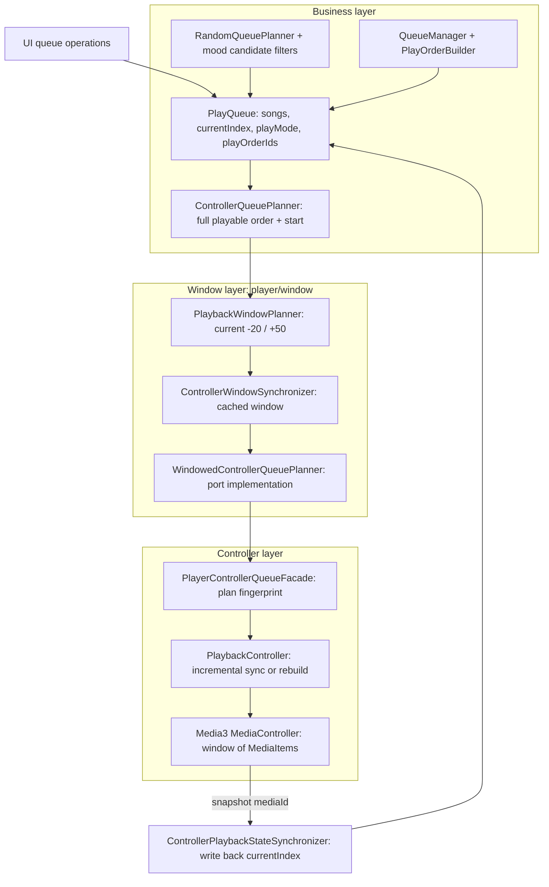
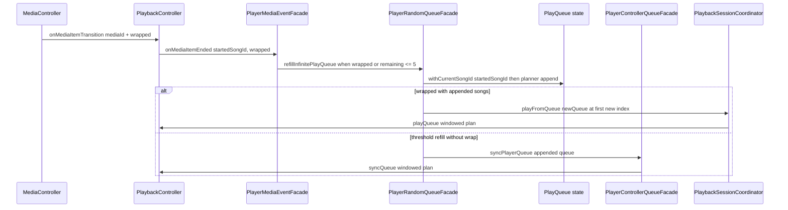

# Queue architecture and windowed sync

The player runs a **dual-queue model**. `PlayQueue` (in `core/model`) owns the complete business queue and the UI state that goes with it — what the user sees, highlights, and edits. The Media3 `MediaController`'s `MediaItem` list owns the *actual* playback order. A windowed planning layer in `player/window` converts the first into the second, so a 1000-song library plays from a controller queue of at most ~71 lightweight items while the UI still shows the full queue.

Windowed play is augmented in place: as the queue approaches its tail, explore play and infinite random append freshly picked songs, and time-slot (mood) enhancement narrows the candidate pool those pickers draw from. Neither addition bypasses the planning pipeline, and both keep the business queue as the complete, UI-visible record.

## Two queues and where the boundary sits

| | `PlayQueue` (business queue) | `MediaController` queue (playback queue) |
| --- | --- | --- |
| Owner | `core/model/PlayQueue.kt`, held in `PlayerUiState` | `PlaybackController` → Media3 `MediaController` |
| Contents | full `songs` list (duplicates allowed), `currentIndex`, `playMode`, `playOrderIds` | only the planned window of `MediaItem`s (current −20 / +50) |
| Purpose | UI display, queue edits, persistence, highlighting | real playback order; next/previous; notification, lock screen and Bluetooth control |

Three invariants define the relationship:

1. **`MediaController` is the final source of truth for playback order.** In-app next/previous buttons, notification-bar buttons, lock-screen controls, and headset/Bluetooth keys all act on the same controller queue. `PlaybackController.playNext()`/`playPrevious()` call `seekToNextMediaItem()`/`seekToPreviousMediaItem()` (with safe fallbacks — `seekToDefaultPosition(0)` or `seekTo(0)` — when there is no next/previous item).
2. **`PlayQueue` makes no next/previous navigation decisions.** The old `nextIndex()`/`previousIndex()` domain APIs were removed on purpose and must not be reintroduced. What plays next is whatever follows the current item in the controller queue.
3. **All track changes go through `seekToNextMediaItem`.** UI and system-side skips never recompute a "next song" in business code; adding to next simply reshapes the controller queue so that `seekToNextMediaItem()` lands on the right item.

### Queue identity is `Song.id`, never the `Song` record

`SongMediaItemMapper` fixes `MediaItem.mediaId = song.id.toString()` (and drops songs without a `uri`). Everything downstream keys on that id: `playOrderIds`, the facade/controller plan fingerprint (`songIds + startIndex`), `infinitePlayedSongIds`, and playback statistics.

`Song` has since grown display/persistence-only fields — audio spec (`sampleRate`, `bitDepth`, `bitRateKbps`, `channelCount`, `audioCodec`, `spatialAudio`), `durationMs`, `fileFingerprint`, and grouping fields (`titleOverride`, derived `groupKey`). None of them renumbers or rewrites ids: grouping/versioning only changes how a song is *grouped* (`ControllerPlaybackStateSynchronizer.sameNameSongs` filters by `groupKey` to offer alternate versions), never queue membership, order, or window planning. That is why window sync, mediaId write-back, and per-id statistics stay stable across lyric/emotion/spec additions.

## `PlayQueue`: the business queue

`PlayQueue` is an immutable data class; every operation returns a new instance:

- `songs` — the complete business queue in UI display order. Duplicates are allowed and meaningful.
- `currentIndex` — the current song's index **into `songs`**. It is never a controller-queue index; `MediaController.currentMediaItemIndex` must not be used to locate items in the business list.
- `playMode` — `SEQUENTIAL`, `REVERSE`, or `SHUFFLE` (all modes wrap around).
- `playOrderIds` — the expected playback order as a list of `Song.id`s. Empty means "derive from `playMode`".

### Duplicate queue items and occurrence-based play order

`playOrderIds` must be interpreted **by occurrence count**: the same id appearing twice means two distinct queue items (a song appended twice through batch append). It is a modeling error to collapse it with `distinct()` or `associateBy { id }` — that loses queue items from planning, removal, UI keys, and persistence.

- `currentPlayOrderIds(sourceSongs)` is the repair/normalization step: it walks `playOrderIds` decrementing a per-id remaining count, appends items present in `songs` but missing from the order, and falls back to `buildPlayOrderIds(...)` when nothing survives. A stale or partial persisted order therefore cannot shrink the queue.
- `currentPlayOrderIndices()` is the sanctioned conversion back to song indices. It resolves every occurrence to a *distinct* index — for `SHUFFLE` it pre-builds an id → index deque map (amortized O(n) instead of the old O(n²) rescan) and prefers `currentIndex` for the first order entry when that entry is the current song; any indices left over are appended. `SEQUENTIAL` returns `songs.indices` and `REVERSE` the reversed indices directly, so only `SHUFFLE` actually consumes `playOrderIds` during expansion.

### The ordering seam: `QueueManager.PlayOrderBuilder`

`PlayQueue.buildPlayOrderIds(...)` keeps only the default rules — sequential, reverse, and plain shuffle with the current item first. **Random strategies that need settings or play counts must not be added to `PlayQueue`**: it is a pure model layer and cannot read repositories. Such ordering is injected from the assembly layer through `QueueManager.PlayOrderBuilder`, a `fun interface (songs, startIndex, mode) -> List<Int>` that `QueueManager.createQueue/setPlayMode/withCurrentIndex` apply on top of the queue, so a builder can implement uniform-random weighting (fewest-play-count buckets first) without `PlayQueue` knowing about settings — see `/openwiki/player/random-and-infinite.md`.

In today's production wiring `app/di/PlayerModule` builds `PlaybackQueueActionPlanner` with `QueueManager.defaultPlayOrderBuilder` (which delegates back to `PlayQueue.buildPlayOrderIds`, i.e. pure shuffle), while uniform-random weighting is applied by `RandomQueuePlanner`/`UniformRandomPlanner` in the random-queue and infinite-refill paths. The `PlayOrderBuilder` seam is the extension point if `SHUFFLE` mode itself should ever become settings-aware (`PlaybackQueueActionPlannerTest` locks the injection behavior).

### Shuffle stability on index changes

`PlayQueue.withCurrentIndex(index)` in `SHUFFLE` mode with a complete play order **rotates** the existing `playOrderIds` so the target song leads (`orderCoversSongs` checks counts, not just size) instead of reshuffling. This is deliberate: reshuffling on every sync/track change generated a new random order each time, which replaced the controller list over and over (a sync feedback loop).

## The windowed planning pipeline

Windowing is layered, and the boundaries must stay inside `player/window` — window logic must not leak into UI or individual ViewModel methods.

1. **`ControllerQueuePlanner`** (`domain/playback`, pure, Media3-free). Expands the complete business queue into the complete *playable* controller order. `plan()` calls `currentPlayOrderIndices()` **once** and reuses that list for both the song list and the start mapping (an earlier version computed it twice, paying 2 × O(n²) per window plan in `SHUFFLE`). The requested business index is located inside the ordered index list (`indexOf`, falling back to `0`), every song is filtered by `isPlayable` (default `it.uri != null`), and the start position is the exact playable match, else the next playable item after it, else the last playable item. It returns `null` for an empty queue, an empty ordered list, or a queue with no playable songs. The result is `ControllerQueuePlan(songs, startIndex)` with `remainingAfterStart = songs.size - startIndex - 1` for tail detection.
2. **`PlaybackWindowPlanner`** (`player/window`). Slices the full playable order into a window: `DEFAULT_PREVIOUS_COUNT = 20` items before the current item and `DEFAULT_NEXT_COUNT = 50` after it (clamped at both ends), producing `PlaybackWindowState(songs, controllerStartIndex, fullQueueStartIndex, fullQueueCurrentIndex)`. `fullQueueStartIndex`/`fullQueueEndExclusive` are offsets into the *playable* order, while `fullQueueCurrentIndex` records the queue's business `currentIndex` — the two coincide only when nothing was filtered out.
3. **`ControllerWindowSynchronizer`** (`player/window`). Caches the most recent window. `planIfNeeded` returns `null` (no replan) while the current song id is still inside the cached window; `planControllerQueue(force = true)` invalidates first. It maps the window into a `ControllerQueuePlan` whose `startIndex` is the current song's position *inside the window* (falling back to `controllerStartIndex`) — the bridge between business and window coordinates.
4. **`WindowedControllerQueuePlanner`** implements `ControllerQueuePlannerPort`: `plan(queue, requestedIndex)` moves the cursor with `queue.withCurrentIndex(requestedIndex)` and **forces** a fresh window. Hilt (`PlayerModule.provideControllerQueuePlanner`) binds it as the singleton port consumed by `PlayerRuntime` — `PlayerControllerQueueFacade.syncPlayerQueue` for resyncs and `PlaybackSessionCoordinator.startQueuePlayback/prepareQueue` for (re)starts.

Two fingerprint layers then suppress redundant writes: `PlayerControllerQueueFacade.syncPlayerQueue` skips a plan identical to the last one it sent (`songIds + startIndex`, cleared by `clearControllerPlaylist`), and `PlaybackController.syncQueue` keeps its own last-synced fingerprint.

`PlaybackController.syncQueue` optimizes most accepted writes into an **incremental sync** (`planIncrementalQueueSync`): when the current controller item's id still equals the plan's item at `startIndex` and the controller is `STATE_READY`/`STATE_BUFFERING`, it finds the largest head trim (never removing the current item), removes the trimmed head and any surplus tail via `removeMediaItems`, and appends only the new tail via `addMediaItems` — no position reset, no re-buffer, no `playWhenReady` change. That is what lets refill-driven window scrolling happen at track-change time without yanking the freshly started song back. Incremental is skipped while `pendingQueueMutation` is set (any in-flight queue mutation, cleared by `onTimelineChanged`); without an alignment it falls back to a full `setMediaItems` rebuild that preserves the current position and, when it was playing, resumes `play()`.

*Layer boundaries: the business queue stays complete, only the window layer slices it, and only the controller layer talks to Media3 — while the controller's current item is written back by `mediaId`.*

## Operation-by-operation synchronization

### Start playback (five steps)

1. The UI passes a context song list and a target song. `PlayerQueueFacade.setPlayQueue` runs `PlaybackQueueActionPlanner.replaceQueue` → `QueueManager.createQueue`.
2. `PlayQueue.setQueue(...)` stores the complete business queue and builds `playOrderIds` for the mode (a settings-aware random mode would rebuild the order through the injected `PlayOrderBuilder` here).
3. `PlaybackQueueActionPlanner` returns a `PlayQueueIndex(startIndex)` action; `PlayerQueueFacade.applyPlan` runs `playFromQueue`, and `PlaybackSessionCoordinator.startQueuePlayback` plans the window and hands it to the controller.
4. `PlaybackController.playQueue(plan)` sets `REPEAT_MODE_ALL` and calls `MediaController.setMediaItems(plan.toMediaItems(), plan.startIndex, 0L)` (granting artwork read permission first).
5. `prepare()` + `play()` start playback.

The same port is reused by restore (`prepareQueue`), which prepares to a position without autoplay and is the only path guarded against overwriting a live session.

### Switching play mode

1. `PlaybackQueueActionPlanner.setPlayMode` → `QueueManager.setPlayMode` rebuilds `playOrderIds` from the current song and the new mode, applying the injected `PlayOrderBuilder` (this is where a uniform-random builder would take effect; the default builder keeps pure shuffle).
2. The plan's action is `SyncQueue`: `syncPlayerQueue(...)` re-plans the controller queue.
3. The `MediaController.mediaItems` order becomes the new real playback order — `MediaController` is the truth, not the freshly built `playOrderIds`.

### Add to next

1. `PlayQueue.addSongAsNext / addSongsAsNext` updates the business queue and `playOrderIds`. Batch input is **deduplicated by song id**; a target already in the queue is *moved* to directly after the current song — the current item itself stays as the anchor, so repeating "add to next" always takes immediate effect. The result forces `SEQUENTIAL` mode and reports the inserted count; an empty queue makes the deduplicated input the new queue starting at index 0.
2. `syncPlayerQueue(...)` rebuilds the current window (forced replan); the target lands inside the new window as the next item (`ControllerWindowSynchronizerTest.forcedPlanAfterAddNextInvalidatesWindow` locks this).
3. What actually plays next is decided by `MediaController.seekToNextMediaItem()` — in-app, notification, and headset "next" all hit the same item. The facade also records `nextPlaySongId`/`playModeBeforeNext` so the pre-next play mode is restored after the skip.
4. While infinite play is active the plan sets `skipNextRefill`, so the *next* press consumes that flag (`PlaybackCommandPlanner.planNext` → `ConsumeSkipRefill`) instead of refilling the tail first: the user-inserted song plays immediately, and threshold/wrap refills resume on the following track change.

### Batch append to tail

Single-song "add to queue" stays deduplicated (`addSong` ignores an id already present). Batch "add to tail" (`addSongs`, playlist wholesale append) **allows duplicates on purpose**. After appending, `PlayQueue.songs`, `playOrderIds`, the persisted JSON, and the controller queue must all keep the duplicate items; the queue panel therefore removes a specific item **by queue index**, never "first/all occurrences of id".

### Removing by queue index

`removeSongAt(index)` deletes one occurrence: removing an item before the current one decrements `currentIndex`, removing the current one keeps the position clamped to the new bounds. `PlaybackQueueActionPlanner.removeSongAt` maps outcomes to actions: non-current removal → `SyncQueue`; removal of the current song → replay from the new `currentIndex` (`PlayQueueIndex`); queue emptied → `ClearController` (plus clearing current-song UI state). The index-based removal is what keeps duplicate queue items independently removable.

## Write-back: following the controller

System-side track changes (headset, lock screen, notification) mutate the controller queue directly:

1. `PlaybackController`'s `Player.Listener.onEvents(...)` emits a `ControllerPlaybackSnapshot` (`mediaId`, playing state, position, duration) on every event batch.
2. `ControllerPlaybackStateSynchronizer.sync` resolves the song by parsing `mediaId` back to `Song.id` (searching the library, then the business queue) and updates `currentSong` and `PlayQueue.currentIndex` so the bottom bar, playlist highlight, and queue panel follow the actually playing item.
3. Duplicate-safe: if the current business index already points at a song with the same id, the synchronizer keeps that index instead of jumping to the first occurrence — duplicate items share one `mediaId`, so naive lookup would snap back to the first entry.

Track-change events themselves are routed from `onMediaItemTransition` for `AUTO`, `SEEK` and `REPEAT` reasons only; `PLAYLIST_CHANGED` is ignored because it is the app's own window rebuild. Window-tail wrap detection is part of the same write-back path: under `REPEAT_MODE_ALL`, wrapping from the last window item to index 0 is detected **by index** (`isMediaItemWrap`: new index 0, previous index at the window tail), because Media3 reports wraps as `SEEK`/`AUTO` transitions — `MEDIA_ITEM_TRANSITION_REASON_REPEAT` only means single-item repeat. The wrap flag tells the infinite-play refill logic that the window is exhausted (see below).

A single-item controller queue never fires a transition when it loops, so `isSingleItemLoopRewind` detects that case from an `AUTO` position discontinuity (index 0 → 0, position rewinding from near the end) and synthesizes one `onMediaItemEnded` so settlement and refill logic still run.

## Refill and contextual candidate selection

None of what follows replaces the windowing invariant; every refill still flows through the same `QueueManager` → windowed planner → facade-fingerprinted `setMediaItems` pipeline, preserving position and playing state (the wrap-advance branch deliberately starts a fresh queue at the appended songs instead).

### Auto-refill as the queue nears the end

Both augmented modes observe `remainingMediaItems()`, derived from the controller as `mediaItemCount - currentMediaItemIndex - 1` and falling back to `plan.remainingAfterStart` when the controller holds no items. `PlayerMediaEventFacade.handleMediaItemEnded` runs on every user or system track change:

- **Infinite random** refills when `remaining <= DEFAULT_REFILL_THRESHOLD` (5) **or** when the transition `wrapped` (window tail → head). `PlayerRandomQueueFacade.refillInfinitePlayQueue` asks `RandomQueuePlanner.planInfiniteRefill` for unplayed, playable, not-yet-queued songs; on wrap (`advanceAfterWrap`) it points the current item at the first newly appended song and replays from there (`playFromQueue(newQueue, firstNewIndex)`) so the user keeps hearing new music instead of the recycled old window head. If nothing new can be appended on wrap, it falls back to `queue.withCurrentIndex(0)` and plays from the **business** queue head — otherwise playback would restart at the controller window's first item, which is actually the 20th business item. `startInfinitePlay` refills immediately when it starts already at the tail.
- **Explore play** refills when the just-ended song was the **second-to-last** (`remaining <= ExplorePlaybackPolicy.REFILL_THRESHOLD`, i.e. 0 after the transition), appending `REFILL_COUNT` (5) songs. Refilling a third-to-last song caused a `currentIndex`-sync pull-back that replayed the old song — fixed earlier and kept as a regression guard. Explore refill also requires `isExplorePlay && isExploreModeActive`, so a stale session flag cannot learn or refill after the mode was switched off.

Both refills correct `PlayQueue.currentIndex` to the freshly started song (`withCurrentSongId(startedSongId)` / `queue.withCurrentIndex`) **before** appending and syncing, so the sync does not snap back to the stale previous current item. The same `skipNextRefill` flag from "add to next" suppresses the pre-next refill path in `PlayerPlaybackFacade.playNext`.

*Refill at track-change time: the business current item is corrected first, then either the window is resynced in place or playback restarts at the first appended song after a wrap.*

### Explore play: word-tokenized refill and learning

Explore play is a `RandomEnhanceMode.EXPLORE` session (`PlayerUiState.isExplorePlay` + `isExploreModeActive`). "Casual play" (`PlayerRandomQueueFacade.playRandomQueue`) generates a fixed `INITIAL_BATCH_SIZE` (10) queue instead of the default 20. While a session is live, infinite random is blocked (`startInfinitePlay` returns false); manually replacing the queue (`PlayerQueueFacade.setPlayQueue` with `exitInfinitePlay`) exits the session, while plain tail appends keep it.

Refill candidates are built from per-word vote tallies (`WordPreferenceRepository`, `wordPreferenceOf`) with graceful degradation in `buildExploreRefillPool`. The degradation criterion is **"can this pool fill `REFILL_COUNT`?"**, not "is the pool non-empty" — a non-empty but too-small pool used to self-lock (every refill found its few songs already queued, so refills stopped forever):

1. songs containing ≥1 liked word and no disliked word;
2. songs with no disliked word;
3. the full library.

Already-queued ids are excluded before the tiers are evaluated. When a song finishes, its actual listen time is settled (`onExploreSongSettled`): a quick skip (`ExplorePlaybackPolicy.isSkipped`: <30 s or <¼ of duration) casts weighted **dislike** votes on the song's emotion tokens, otherwise weighted **like** votes; only words clearing `VOTE_MIN_RATIO` (the same 15% display gate) and the top-N cap vote, weighted by each word's share of the song. Emotion tokens are derived once per refill from the cached ratio map.

### Contextual time-slot filtering (mood slots)

`MoodSlotResolver` (domain, pure) decides which enhancement is active. A `TimeSlotConfig` is a half-open `[startMinutes, endMinutes)` daily interval, crossing midnight when `end <= start`, with `tags` (inclusion) and `excludedTags` (exclusion). `hitSlot` picks the covering slot, deterministically choosing the earliest start when illegal overlapping data produces several hits. `validate` rejects blank or oversized names, an empty inclusion *and* exclusion set, an exclusion tag that also appears in `tags`, zero-length intervals, and overlaps (`overlaps` compares the segments of a circular day); overlaps surface as `SlotValidation.Conflict`. `MoodSlotPolicy` centralises `MATCH_MIN_RATIO = 0.35f`, `EXCLUDE_MIN_RATIO` (= `EmotionGroup.MIN_RATIO`, the 15% detail-page display gate), `POOL_WARN_THRESHOLD = 10` and `NAME_MAX_LENGTH`; `MoodPoolStats.from` reuses both ratio gates so the configuration screen's counts match playback.

`PlayerRuntime` caches the mode, the slot configs and one ratio map per song (word → share of the track) from repository flows and injects them into `PlayerRandomQueueFacade`. When `randomEnhanceMode == TIME_SLOT` and a slot is hit, `activeMoodSlot()` produces `MoodSlotState(slotName, tags, excludedTags)` and two filters run in order:

1. `filterOutExcludedMoodTags` drops any song whose excluded-tag share is ≥ `EXCLUDE_MIN_RATIO` (so the pool never contradicts what the detail page shows);
2. `filterByMoodTags` keeps songs whose included-tag share is ≥ `MATCH_MIN_RATIO`, returning `null` when nothing matches (logged) and warning when the pool falls below `POOL_WARN_THRESHOLD`.

The same pair applies to `playRandomQueue` and to `refillInfinitePlayQueue`; explore-mode selections skip mood slots entirely and use word preferences instead. The slot name is surfaced for attribution through `currentMoodSlot()` (used by `PlayerRuntime` for the launch toast).

#### Filtering happens before planning

Mood inclusion/exclusion is applied to the **candidate list at the facade boundary**, never inside `RandomQueuePlanner` or `ControllerQueuePlanner`:

- `playRandomQueue` passes the filtered `candidates` into `planRandomQueue` and queries `rawPlayCounts` for those candidate ids only, so `UniformRandomPlanner`'s low-play-count tiering still preempts within whatever pool survives.
- `recentPlayedSongIds` eviction and `trimToLimit` are untouched: they operate on the filtered pool, so a small pool intentionally loops instead of reaching outside the slot.
- Infinite refill runs `planInfiniteRefill` on the strict mood pool with `allowHistoryReset = false` — it appends only the songs actually left in the pool instead of resetting play history and recycling already-played mood songs. Once that pool is exhausted (nothing appendable and `moodPool.size < baseSongs.size`), the facade degrades to the non-excluded library with `allowHistoryReset = true`; unanalyzed songs have no tags, so they enter that fallback and infinite play never stalls.

#### An empty pool degrades, it never produces an empty window

The degradation chain is explicit, and no step yields a zero-item controller queue:

- included-tag pool empty → `filterByMoodTags` returns `null`, logging "fall back to full library after exclusions"; the *exclusion-filtered* base is used, so excluded songs are never reintroduced (`moodExcludedTagsStayAppliedWhenIncludedPoolFallsBack`).
- the base pool is empty as well → the inclusion filter and planner see an empty song list; `planRandomQueue` returns `null` and `playRandomQueue` returns `false` without starting a queue (the previous queue keeps playing) rather than installing an empty window.
- refill with no appendable songs → `plan.addedSongs` empty: without wrap it is a no-op (log only), with wrap it falls back to the business queue head as described above.
- `RandomQueuePlanner.planInfiniteRefill` / `planExploreRefill` return `null` only when the playable library itself is empty.

## Duplicates across persistence

`PlaybackStateStore` + `PlaybackStateSnapshotSerializer` persist `songIds`, `currentIndex`, `playMode`, and `playOrderIds` as JSON arrays **by occurrence** — encoding calls `currentPlayOrderIds()`, and restoration maps `songIds` through a `songMap` one entry at a time (duplicates preserved), filters the persisted order to ids still present and does *not* deduplicate it, then tops it up with `currentPlayOrderIds()` and truncates to the restored size. `isInfinitePlay`, `infinitePlayedSongIds` (intersected with the current library) and `isExplorePlay` round-trip with the queue. Save/restore of duplicate-heavy queues therefore keeps every queue item.

The restore is applied through the same windowed pipeline: `PlayerPersistenceGraph`/`PlayerPersistenceFacade.applyRestoreResult` rehydrates the full business `PlayQueue` and, when there is **no live session**, pushes it into the controller via `prepareQueue` (a windowed `ControllerQueuePlan` prepared to the snapshot position, not autoplayed). When a live MediaSession session already holds media items, the restore deliberately skips rebuilding the controller queue and only fills the UI-side `songs`/`currentSong`/`sameNameSongs` — the real position and playing state are taken from the controller snapshot sync, so the running session is never overwritten or rewound to the snapshot position. `PlayerPersistenceFacadeTest` locks the live-session-restores-UI-only branch.

## Invariants to keep

- `PlayQueue.currentIndex` is a business index into `PlayQueue.songs`; `MediaController.currentMediaItemIndex` is a controller-window index. Never use one as the other.
- `Song.id` ↔ `MediaItem.mediaId` are one-to-one (`SongMediaItemMapper` sets `mediaId = Song.id.toString()` and requires `song.uri`). New `Song` fields may change display, grouping, or analysis, but never the id — window sync, fingerprints and statistics depend on that.
- `PlayQueue.songs` may contain duplicates: planning, persistence, UI keys, and removal must work per queue item/index, never assuming ids are unique.
- Unplayable songs never enter the controller queue, but stay in the full business queue for UI display and error reporting (e.g. `PlayerErrorFacade` reports the missing file).
- Any play-order change must reach `MediaController` through `WindowedControllerQueuePlanner` (or a same-layer planner) before playback reflects it; facade and controller both fingerprint plans (`songIds + startIndex`) to skip redundant writes, and a real rebuild preserves position and playing state. Explore/infinite refills are no exception: appended songs are synced through the same path after correcting `currentIndex` to the started song, or started as a fresh queue only in the wrap-advance branch.
- Wrap detection is index-based (`isMediaItemWrap`), and after a wrap the refill either advances to the first appended song or corrects to business queue index 0 — never to the controller window head.
- Mood inclusion/exclusion belongs in the facade's candidate filtering, before the planners; planners, `recentSongIds` eviction and uniform-random tiering must stay pool-agnostic, and an empty pool must degrade (fallback pool, no-op refill, or `playRandomQueue() == false`) instead of installing an empty window.
- Do not reintroduce `PlayQueue.nextIndex()`/`previousIndex()`, and do not move settings- or play-count-aware random ordering into `PlayQueue` — inject it via `QueueManager.PlayOrderBuilder` from the assembly layer.
- Window boundaries, cache invalidation, and window→full-queue mapping stay in `player/window`.

## Test anchors

Window semantics are locked by tests; changing the pipeline without updating these is a regression:

- `player/src/test/.../window/ControllerWindowSynchronizerTest.kt` — window contents and start index for 100-song queues, clamping at both ends, reverse and stable-shuffle ordering, non-forced reuse that moves the start to the current song, forced invalidation after add-next, `null` for empty queues.
- `player/src/test/.../window/PlaybackWindowPlannerTest.kt` — window bounds and `PlaybackWindowState` fields (`fullQueueStartIndex`, `controllerStartIndex`).
- `player/src/test/.../window/PlaybackWindowPerformanceShapeTest.kt` — the controller queue stays bounded (71 items mid-queue, ≤71 overall, 51 for a 1000-song queue) for 100/500/1000-song libraries at start/middle/end, and a shuffled window keeps the current song first instead of expanding to the full queue.
- `player/src/test/.../IncrementalQueueSyncPlanTest.kt` — incremental acceptance: pure tail append, window scroll with tail append, identical queue as a zero operation, tail shrink, `BUFFERING` allowed, `IDLE` falls back to a full rebuild.
- `player/src/test/.../MediaItemWrapDetectionTest.kt` — the index-based wrap rule (window tail → index 0), including the tiny-window and empty/single-item edge cases.

`ControllerQueuePlannerTest` (domain and player modules) additionally locks order expansion, stable shuffle, and unplayable-song skipping.

The augmented paths are locked by facade and planner tests:

- `PlayerMediaEventFacadeTest` — infinite refill at `remaining = 5`, refill forced by `wrapped` even with 50 items left, no refill outside infinite mode; explore refill only when the ended song was second-to-last (`remaining = 0`), not third-to-last (`remaining = 1`) and not with 4 remaining; settle skipped when no song was tracked; `startedSongId` forwarded to the refill; play-mode restoration after add-next.
- `PlayerRandomQueueFacadeTest` — mood pool filtering, disabled/outside-slot no-ops, exclusion by `excludedTags` at the display threshold, inclusion threshold gating, fallback to the post-exclusion library, strict mood-pool refill that neither repeats nor resets history, exhaustion fallback to the non-excluded library, uniform-random compatibility, explore 10-song batch, explore blocking infinite play, the three-tier refill pool with the "must fill 5" criterion, wrap advancement, and keeping the started song current after a stale-index sync.
- `PlayerControllerQueueFacadeTest` — fingerprint de-duplication of identical plans and re-allowance after `clearControllerPlaylist`.
- `PlayerQueueFacadeTest` — duplicates on batch append, per-index removal of one duplicate, and `setPlayQueue` exiting an explore session while tail appends keep it.
- `RandomQueuePlannerTest`, `MoodSlotResolverTest`, `MoodPoolStatsTest`, `ExplorePlaybackPolicyTest` — the pure planning/policy layer: recent-play eviction and its reset, uniform-random tiering, midnight-crossing and half-open boundaries, deterministic earliest-start choice on illegal overlap, validation errors, pool statistics, and skip/vote weighting rules.

## Related pages

- `/openwiki/player/random-and-infinite.md` — uniform random, infinite-play and explore-play refill, contextual time-slot filtering, and the `PlayOrderBuilder` injection point.
- `/openwiki/concepts/mood-time-slot.md` — the time-slot × emotion configuration model and its policy thresholds.
- `/openwiki/player/service-and-controller.md` — `PlaybackController`, MediaSession service, and system-side control paths.
- `/openwiki/player/state-machine.md` — playback state transitions driven by controller snapshots.
- `/openwiki/workflows/playback-session-lifecycle.md` — startup, restore and teardown around the queue pipeline.
