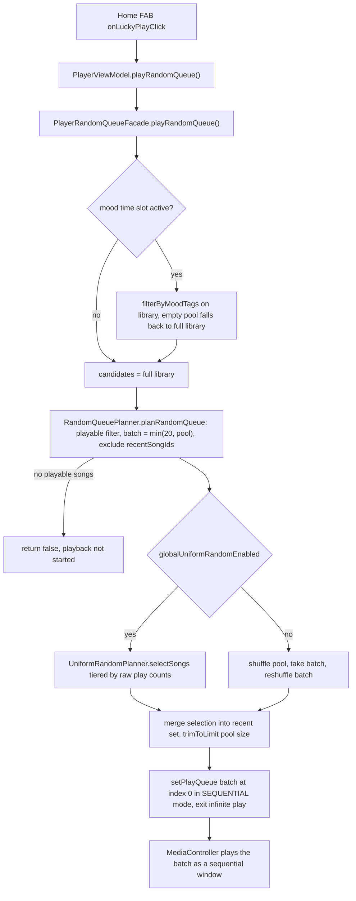
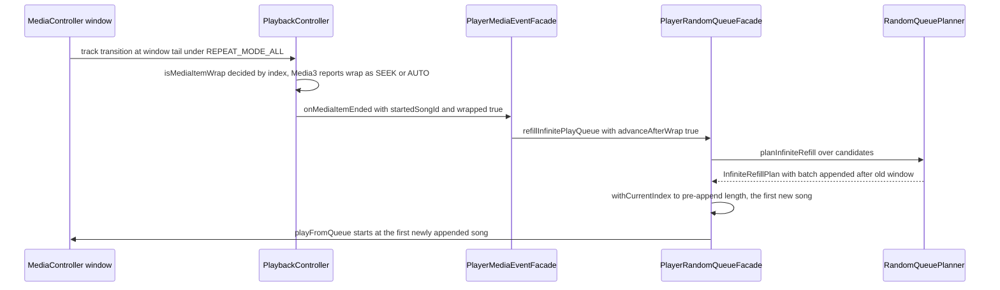
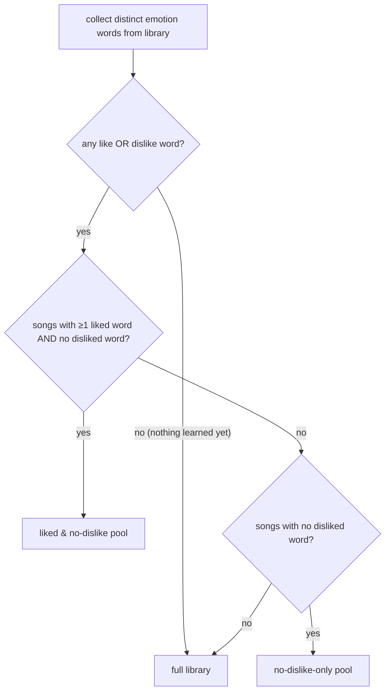
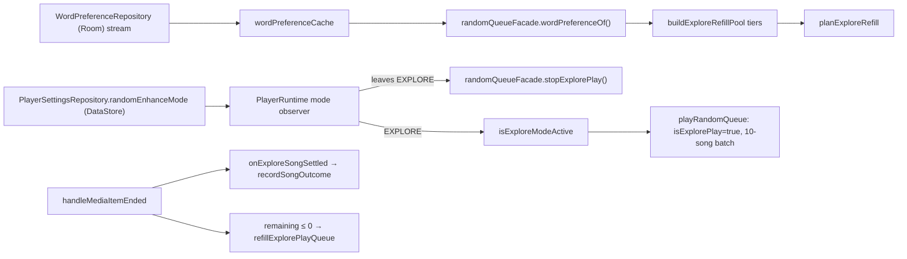

# Random Playback and Infinite Random

Lucky play (random queue) and infinite random are two planner-driven entry points over the same domain core. `RandomQueuePlanner` (in `domain/playback`) is a pure decision maker: it filters playables, batches, evicts recently played songs, and, when uniform random is on, delegates selection to `UniformRandomPlanner`. The feature layer (`PlayerRandomQueueFacade`) owns the stateful side — the in-memory recent-played set, infinite-play flags, explore session state, and the calls that push a plan into `setPlayQueue` / `syncPlayerQueue` / `playFromQueue`. `PlayerMediaEventFacade` and `PlayerPlaybackFacade` are the trigger points that keep an infinite queue topped up as the window drains.

Since **v3.11.0** the random chain is configurable through `RandomEnhanceMode` (`OFF`, `TIME_SLOT`, `EXPLORE`) — mood time-slot filtering and explore playback are mutually exclusive enhancements layered on the same planner core. **Explore playback** is the new headline: `playRandomQueue` generates a fixed 10-song batch and sets `isExplorePlay`; infinite random is disabled while an explore session is active; when the queue drains to its last song the facade learns the listener's word preferences from skip/full-hearing outcomes and refills it with a word-preference-filtered 5-song batch.

The windowed-queue plumbing the plans feed into (controller windows, `REPEAT_MODE_ALL`, fingerprinted syncs) is described in `/openwiki/player/queue-architecture.md`; the facade wiring itself is catalogued in `/openwiki/player/runtime-facades.md`.

## Key injection points

Three dependencies decide how random the chain actually is, and all of them are injected rather than hard-wired:

- **`rawPlayCounts`** — a `(List<Int>) -> Map<Int, Int>` callable on `PlayerRandomQueueFacade` (default `{ emptyMap() }`). `PlayerRuntime` wires it to `playStatsRepository::getRawPlayCounts`, the Room-backed *raw* play count (distinct from the "effective" count used for sorting). Both `playRandomQueue` and `refillInfinitePlayQueue` query it per candidate pool at call time.
- **`globalUniformRandomEnabled`** — carried on `PlayerUiState` (default `true`), persisted via `PlayerSettingsRepository` (DataStore, legacy-SharedPreferences fallback `true`), loaded at `PlayerRuntime.start()` into the UI state, and toggled from the Settings screen through `setGlobalUniformRandomEnabled`. The planners read the flag from the current state at each call, so **changing the setting never reshuffles the live queue or its `playOrderIds`** — it only influences later queue builds: the next lucky play, the next infinite refill batch, and any future rebuild.
- **`QueueManager.PlayOrderBuilder`** — the seam for play-mode ordering. Production wiring in `app/di/PlayerModule` deliberately installs `QueueManager.defaultPlayOrderBuilder`, i.e. the `SHUFFLE` play mode stays *pure* shuffle and is independent of uniform random. `UniformRandomPlanner.buildPlayOrderIds`/`orderSongs` already implement the count-tiered ordering a settings-aware builder would apply; they are exercised by tests but not wired into queue operations today.

The explore-mode enhancement adds **mode-deciding injections** on `PlayerRandomQueueFacade` (all defaulted so the existing mood behavior is unchanged):

- **`RandomEnhanceMode`** — the mode switch. `PlayerRuntime` reads `playerSettingsRepository.randomEnhanceMode` as a stream: `TIME_SLOT` drives `moodSlotEnabled` and `EXPLORE` drives both `exploreModeEnabled` and (via `isExploreModeActive` on `PlayerUiState`) gating. Mode is mutually exclusive — when the stream moves to `EXPLORE` out of `TIME_SLOT` (or vice-versa), or to `OFF`, mood filtering and explore refill disable together. Both `moodSlotEnabled` and `exploreModeEnabled` read a cached `@Volatile randomEnhanceModeCache` (kept fresh by the same stream observer in `observeMoodSlotCaches()`) rather than doing a DataStore read per call. At startup `PlayerRuntime.start()` also reads the mode once to close the race window before the subscription is live. See `/openwiki/concepts/mood-time-slot.md` for the config UI.
- **`moodEmotionTagsOf` / `moodEmotionTagRatiosOf`** — song→emotion-tag set (zero-allocation view of the cached ratio map keys) and song→tag→ratio map. `filterByMoodTags` matches by **ratio gate**, not mere presence: a tag counts as a hit only when `ratio >= MoodSlotPolicy.MATCH_MIN_RATIO` (0.35), so a tag the model isn't confident about (e.g. 16% share) no longer matches. The default ratio derives 1.0 per tag from `moodEmotionTagsOf`, preserving old plain-OR behavior when ratios aren't injected. User-manual tags carry no ratio and are treated as a strong 1.0 match.
- **`wordPreferenceOf: (String) -> WordPreference`** — per-word vote summary (`likeVotes` / `dislikeVotes`), resolved from the `wordPreferenceCache` derived from the Room-backed `WordPreferenceRepository` stream. `WordPreference.kind` (`LIKE` / `DISLIKE` / `NEUTRAL`) is the vote-majority winner that `buildExploreRefillPool` uses to tier its candidate pool.
- **`exploreModeEnabled: suspend () -> Boolean`** — the mode gate that `playRandomQueue` checks to switch generation to a fixed `INITIAL_BATCH_SIZE = 10` batch; it is **not** consulted by `startInfinitePlay`, which only checks the *session* flag `isExplorePlay` (see below).

## RandomQueuePlanner: batch selection with recent-play eviction

`planRandomQueue(songs, recentSongIds, uniformRandomEnabled, playCounts)`:

1. **Playable filter** — only songs passing `isPlayable` (default `song.uri != null`) enter the pool. If nothing is playable the plan is `null`; `PlayerRandomQueueFacade.playRandomQueue` turns that into `false` ("nothing to play"), and the UI shows the import hint instead of starting playback.
2. **Batch sizing** — `neededSize = minOf(batchSize, playableSongs.size)` with `DEFAULT_BATCH_SIZE = 20`. A library smaller than the batch simply yields everything playable.
3. **Recent-play eviction** — candidates already in `recentSongIds` are excluded. If that leaves fewer songs than the batch, the recent set is cleared, the whole playable pool is used again, and `resetHistory = true` is reported (the facade logs "reset recent history"). The eviction set is capped to the playable library size via `trimToLimit`, which drops the earliest-inserted ids first — so on huge libraries the memory of "what was played" cycles through roughly one full pass before repeats are allowed again.
4. **Selection** — with uniform random off, the pool is shuffled, the batch is taken, and the batch is shuffled *again* so queue order is not biased toward pool order. With uniform random on, selection is delegated to `UniformRandomPlanner.selectSongs` (see below); note the returned order is tier-ordered (lowest-count tier first, shuffled within tier).
5. The plan returns the selected songs plus the updated `recentSongIds` (previous set + new selections, trimmed).

The planner also carries the infinite-mode plans: `planInfiniteStart` and `planInfiniteRefill` (below) share the same playable filter and batch sizing.

## UniformRandomPlanner: play-count tiered preemption

`selectSongs(songs, neededSize, uniformRandomEnabled, playCounts)` short-circuits to plain shuffle when the flag is off. When enabled it uses **dynamic tiering** by raw play count:

- Songs are grouped by `playCounts[id] ?: 0` and the groups are sorted ascending. Tier 0 is the smallest-count group, tier 1 the next, and all remaining groups flatten into a fallback tier.
- **Quota preemption**: iterate tiers in priority order; within a tier, shuffle and take up to the remaining quota. A lower tier with enough songs is never crossed into higher tiers.
- Thresholds are *derived from the distribution*, not fixed: the lowest tier is whatever the smallest play count currently is, so tiering keeps working even when every song has been played past any fixed threshold (e.g. "prefer 0-play" would die once nothing is unplayed). If all counts are equal there is a single tier and the behavior degenerates to pure shuffle — by design.

`orderSongs` groups a whole list by count and shuffles within each group; `buildPlayOrderIds` composes that with the current song first for `PlayMode.SHUFFLE` (sequential and reverse pass through unchanged). These are the ready-made bodies for a settings-aware `PlayOrderBuilder` should `SHUFFLE` mode ever become count-aware.

## playRandomQueue: the lucky-play flow

*The lucky-play chain from UI click to a sequential 20-song controller window.*

On success the facade:

1. Exits infinite mode (`isInfinitePlay = false`, `infinitePlayedSongIds = emptySet()`).
2. Replaces its in-memory `recentPlayedSongIds` with the plan's set.
3. Calls `setPlayQueue(plan.songs, 0, PlayMode.SEQUENTIAL)` — the random batch plays as a **sequential** queue from index 0 (further skips simply walk the batch; `REPEAT_MODE_ALL` on the controller loops it). `setPlayQueue`'s default `exitInfinitePlay = true` would also end infinite mode, but the facade clears it explicitly first.
4. Sets `isExplorePlay = explore` — `true` in explore mode, `false` otherwise — so the batch becomes an *explore session* that enables word learning and refill (below).

### Explore branching inside `playRandomQueue`

When `exploreModeEnabled()` is true, exploration *replaces* mood filtering and fixes the batch:

- `mood = if (explore) null else activeMoodSlot()` — in explore mode the mood-slot filter is **bypassed** entirely (the two enhancements are mutually exclusive); candidates are always the full library.
- The plan is generated with `batchSize = ExplorePlaybackPolicy.INITIAL_BATCH_SIZE = 10` (instead of the default 20). Recent-skip eviction and the uniform-random flag still apply within that batch.
- On success `isExplorePlay = true` is written to `PlayerUiState`; this flag (not the settings mode) is what disables infinite play and enables the refill + word-learning path. A `false` is written on every non-explore lucky play, cleanly ending any previous session.

## Infinite random: start, refill, and wrap handling

### Starting: keep the queue, seed coverage

`startInfinitePlay` deliberately does **not** build a new queue. `planInfiniteStart` only records which of the queued songs are playable — that set becomes `infinitePlayedSongIds`, the coverage set refill excludes. An empty queue is legal: infinite mode starts "armed" with no coverage and waits for refills.

One proactive fix: if the controller is already near the tail when infinite play is enabled (`remainingMediaItems() <= 5` — remaining items under the cursor; the controller reports `mediaItemCount − currentMediaItemIndex − 1`, with a business-queue fallback when the controller has no items), the facade refills immediately. Otherwise the current song is still the window's last item: when it ends, or when the *system* media keys (headset / lock screen / notification) trigger "next", Media3 wraps under `REPEAT_MODE_ALL` to the old window's first song — and new songs appended after that old song would not be reached until the entire old window replayed. The in-app next button is unaffected because `playNext` refills before advancing.

### Refill triggers and planning

Three paths all funnel into `refillInfinitePlayQueue(startedSongId, advanceAfterWrap)` (through `PlayerPlaybackBridgeFacade`):

1. `PlayerMediaEventFacade.handleMediaItemEnded(startedSongId, wrapped)` — fired on every track transition (natural end, manual/seek next & previous, repeat). It refills when `wrapped` **or** remaining items ≤ `DEFAULT_REFILL_THRESHOLD = 5`, passing `advanceAfterWrap = wrapped`.
2. `PlayerPlaybackFacade.playNext` — when `PlaybackCommandPlanner.planNext` returns `RefillInfiniteQueue` (infinite mode and remaining ≤ 5). The one-shot `skipNextRefill` flag (set by "add to next") is consumed instead, so a just-inserted next song is not pushed further back by appended songs.
3. The tail check inside `startInfinitePlay` described above.

`refillInfinitePlayQueue` is a no-op outside infinite mode, and first corrects the business queue's `currentIndex` to `startedSongId` (`withCurrentSongId`) so planning and syncing are anchored to the actually-playing item. Planning (`planInfiniteRefill`) then:

- Sizes the batch the same way (`minOf(20, playable pool)`).
- Excludes everything in `playedSongIds` **and** everything already in the queue, so refills never duplicate queue items. If the unplayed remainder drops below the batch size, the coverage set is cleared (`resetHistory = true`, logged) and the whole playable pool becomes available again — the loop over the library.
- Selects **always** through `UniformRandomPlanner.selectSongs`; the uniform flag inside decides between count-tiered selection and plain shuffle (an asymmetry with `planRandomQueue`, which branches itself).
- If the filtered pool yields nothing, the plan reports an empty `addedSongs` and the queue is left untouched (this also guards `advanceAfterWrap` against jumping to a nonexistent song).
- Appends via `queue.withSongs(queue.songs + selectedSongs)`, which preserves the current item's index.

The new songs are added to `infinitePlayedSongIds`, and the updated queue reaches the controller either via `syncPlayerQueue(plan.queue)` (plain extension) or via the wrap-correction path below.

### The wrap pitfall and `advanceAfterWrap`

*Tail-wrap refill: the cursor jumps past the replayed old window to the first appended song.*

`PlaybackController` detects a wrap **by index** (`isMediaItemWrap`: new index 0, previous index was the last item) because Media3 reports a `REPEAT_MODE_ALL` tail wrap as `SEEK` (manual next) or `AUTO` (natural end) — `MEDIA_ITEM_TRANSITION_REASON_REPEAT` only means single-item repeat. All three transition reasons route to `onMediaItemEnded`, so system-side skips refill too. `MediaItemWrapDetectionTest` locks the edge cases (tiny windows treat backward-to-0 as wrap; empty/single-item windows cannot wrap).

Without correction, a wrap would leave the cursor on the old window's first song — the user hears the old window replayed instead of the new songs. With `advanceAfterWrap = true`, the facade sets the new current index to the **pre-append queue length** (i.e. the first newly appended song, since appends are at the tail) and starts playback through `playFromQueue` (which routes to the error-checked queue start), not through `syncPlayerQueue`. When no new songs were added, the current song is kept and nothing is played or synced.

## Mood-slot filtering and attribution

When the mood time-slot enhancement is active (`moodSlotEnabled` + a `TimeSlotConfig` covering the current minute), `activeMoodSlot()` resolves the slot (`MoodSlotResolver.hitSlot`) and `filterByMoodTags` narrows the candidate pool to songs whose emotion tags intersect the slot's tags **at or above a ratio gate**. Mood-slot filtering is mutually exclusive with explore mode: `playRandomQueue` and `refillInfinitePlayQueue` both derive `mood` as `null` whenever the current enhance mode is `EXPLORE`, so explore playback always randomizes over the full library regardless of time-slot config. Key semantics:

- Filtering happens **at the planner entry**, not inside the planners — tiered selection and recent eviction are reused unchanged on the smaller pool (and `neededSize = minOf(20, pool)` protects it). Uniform random composes: the filtered pool is still tiered by raw play count.
- **Matching is ratio-gated**: `filterByMoodTags` uses `moodEmotionTagRatiosOf(song)`, keeping a song only when at least one of the slot's tags has `ratio >= MoodSlotPolicy.MATCH_MIN_RATIO` (0.35). This replaces the original plain-OR "has the tag" match, which treated a 16% emo song and a 70% emo song as identical; a tag the model isn't confident about no longer qualifies the song for the slot pool. User-manual tags match at 1.0.
- An empty filtered pool returns `null` → **fallback to full-library random** rather than a failed start (logged as "fall back to full library"). A pool below `MoodSlotPolicy.POOL_WARN_THRESHOLD = 10` logs a "will loop" warning.
- Slot configs, the full match-distribution, and the separate vote-distribution are `@Volatile` snapshots on `PlayerRuntime` (kept fresh by a continuous Room/DataStore stream subscription, computed on the Default dispatcher, refreshed on config edits); `nowMinuteOfDay` is injectable for tests.

### UI entry and attribution toasts

The two entry points are wired in the app shell rather than the domain/feature layer:

- **`NowPlayingSurface`** (the player surface shared by the Home tab and the global drawer) wires `onLuckyPlayClick` → `playerViewModel.playRandomQueue { started, moodSlotName -> ... }` and `onStartInfinitePlay` → `playerViewModel.startInfinitePlay { started, moodSlotName -> ... }`. The facades are **async with a result callback** (raw-play-count querying runs off the main thread on `scope.launch`); the callback receives `started` and the hit mood-slot name, and the caller shows the toast. On lucky-play success (`started`) the attribution toast `"已按「$slotName」为你随机播放"` appears when a slot is active; on infinite-start success `"已按「$slotName」开启无限随机播放"`; failure shows the import hint `"还没有可播放的音乐，请先导入歌曲吧~"`. Both actions end with `playlistResumeViewModel.switchSource(null, ...)`, resetting the playlist-resume source.
- **`AppRoot`** duplicates the lucky-play wiring for the empty-queue entry bar (`LuckyPlayEntryBar`, the double-page style mini-bar slot when the queue is empty), calling `playerViewModel.playRandomQueue { started, moodSlotName -> ... }` with the same attribution toast and catch-all import hint.
- **`HomeRouteActions`** (`feature/home`) exposes the `onLuckyPlayClick` / `onStartInfinitePlay` / `onStopInfinitePlay` callback trio (typed `() -> Unit`); the *implementations* live in the app shell (`NowPlayingSurface`/`AppRoot`), which supply the toasts and the `switchSource` reset. `HomeRoute` itself composes the infinite-play button and, while an explore session is active (`isExplorePlay`), routes the button to a hint dialog telling the user to switch the enhancement mode or tap a song to exit explore; while `isInfinitePlay` it toggles stop instead.

`currentMoodSlotName()` on `PlayerViewModel` delegates to `PlayerRuntime.currentMoodSlot()` → the facade's `currentMoodSlot()` — the **same** `activeMoodSlot()` evaluation the random decision used, so the toast attributing "why this song" can never disagree with the actual filter. The configuration UI side (slots, tags, counts) is covered in `/openwiki/concepts/mood-time-slot.md`.

## Explore playback (`ExplorePlaybackPolicy`) — word-preference learning with word-based refill

Explore play is the v3.11.0 enhancement built on the same planner core, gated by `RandomEnhanceMode.EXPLORE`. Its pure policy lives in `ExplorePlaybackPolicy` (JVM-testable, no Android deps) and constrains the whole flow:

| Constant | Value | Meaning |
|---|---|---|
| `INITIAL_BATCH_SIZE` | `10` | size of the lucky-play batch that opens an explore session |
| `REFILL_COUNT` | `5` | songs appended at each refill |
| `REFILL_THRESHOLD` | `0` | remaining songs after a track change that triggers refill (ended song was second-to-last) |
| `MIN_LISTEN_MS` | `30_000L` | minimum "really listened" duration |
| `MIN_LISTEN_RATIO` | `0.25f` | minimum fraction of total duration for "really listened" |
| `VOTE_MIN_RATIO` | `EmotionGroup.MIN_RATIO` (0.15) | a word shares ≥ this ratio to participate in voting — same threshold as the detail-page display, so skipping a song votes only on the tags the user actually saw |
| `VOTE_MAX_TAGS` | `EmotionGroup.MAX_TAGS` (4) | vote at most this many words per song, matching the display |
| `VOTE_WEIGHT_SCALE` | `100` | votes are integer ratios ×100 (no schema change; a one-time history ×100 migration kept scale) |

`ExplorePlaybackPolicy.isSkipped(playedMs, durationMs)` returns true (→ dislike vote) when the listener heard less than 30 s **or** less than ¼ of the total duration; with an unknown duration (`<= 0`) it applies only the 30-second rule.

### Closing the loop: learning word preferences from outcomes

The word preference store is a **vote-accumulating** model (`WordPreference`), not a boolean toggle. Each emotion word independently accumulates like/dislike votes; `kind` (`LIKE` / `DISLIKE` / `NEUTRAL`) is the vote-majority winner. Because the word can never be on both sides at once and a single skip never flips a previously-liked word immediately, the model naturally resolves "same song already liked A/B and disliked C/D" conflicts across the whole library.

`handleMediaItemEnded` is the learning trigger. It reads the *just-ended* song's actual listen time (through `trackedSongId()` / `currentPlayedMs()` **before** `stopPlaybackTracking()` clears them), then — only when both `isExplorePlay` **and** `isExploreModeActive` are set (a double guard for restore/toggle timing where a session flag may linger a beat after the mode is turned off) — calls `onExploreSongSettled(songId, playedMs)`. In `PlayerRuntime.handleExploreSongSettled`, `isSkipped` decides the direction and the vote is **ratio-gated and ratio-weighted**: it reads the song's *vote* distribution (`exploreVoteRatiosCache`, kept separate from the full match distribution), keeps only words at or above `VOTE_MIN_RATIO` (top-`VOTE_MAX_TAGS`, the same tags the detail page displays), converts each ratio to an integer vote weight via `votesOf` (`round(ratio × VOTE_WEIGHT_SCALE)`, dropping zero weights), and calls `wordPreferenceRepository.recordSongOutcome(votes, liked = !skipped)`. A full listen casts like votes on the displayed tags; a fast skip casts dislike votes on those same tags — so a "skipped" song negates exactly the words the user saw on the detail page, not a 6-word full distribution.

### Refilling the explore queue from the learned pool

The same `handleMediaItemEnded` computes `remainingSongs = remainingMediaItems()` after the track change and, when `remainingSongs <= REFILL_THRESHOLD (0)`, calls `refillExplorePlayQueue(startedSongId)`. The threshold is measured **after** the song change: 0 remaining means the ended song was second-to-last. 1 remaining (ended song was third-to-last) does **not** refill — refilling that early would, because the business queue's `currentIndex` is not yet synced to the controller (2026-10-20 regression fix), risk re-pulling to the old song. The refill threshold is injected separately (`exploreRefillThreshold`) from the infinite one.

`refillExplorePlayQueue` is a no-op outside an explore session. It first corrects the business queue's current item to `startedSongId` (`withCurrentSongId`, the same correction infinite refill uses — otherwise the sync would yank playback back to the old song), then builds the candidate pool and plans.

**`buildExploreRefillPool`** tiers the library by learned preference, in strict fallback order:

1. Collect the library's distinct emotion words and classify each via `wordPreferenceOf(word).kind`. If neither liked nor disliked words exist (nothing learned yet), the full library is used.
2. **Liked & no-dislike** — songs carrying ≥1 liked word and no disliked word. If this pool has at least `REFILL_COUNT` songs, it is the pool.
3. **No-dislike only** — songs carrying no disliked word, if it has at least `REFILL_COUNT` songs.
4. **Full library** — last-resort fallback.

The **fallback criterion is "can this pool fill `REFILL_COUNT` songs", not "is it non-empty"** (2026-10-25 fix). The old non-empty test self-locked: a user who skips everything quickly turns every word `DISLIKE`, so the only "no-dislike" songs left are those with no emotion analysis (no words); that pool shrinks below 5, refills under-fill, those songs land in the queue, and the next refill finds "no more songs outside queue" — a permanent stall. Gating on `REFILL_COUNT` sufficiency guarantees that as long as the library has ≥5 songs outside the queue, the refill always tops up.

`planner.planExploreRefill(pool, queue, count = REFILL_COUNT)` then takes `count` songs randomly from the pool, excluding anything already in the queue, and appends them via `queue.withSongs` (preserving the current index). An empty pool yields an empty `addedSongs` and the queue is left untouched; appended queues reach the controller through `syncPlayerQueue` (explore refill has no wrap-jump because explore batches are generated as one sequential window and refills happen only near the end, so the in-between element never wraps). Unlike `planInfiniteRefill`, `planExploreRefill` does **not** consult uniform random or play counts — it is a plain shuffle over the preference-tiered pool.

### Explore-session lifecycle

- **Entering**: `playRandomQueue` with the explore mode active sets `isExplorePlay = true` and starts a 10-song sequential batch. `startInfinitePlay` **refuses** to start while `isExplorePlay` is true ("blocked by explore session") — infinite random is *the* disabled feature during an explore session.
- **Exiting by started-flag semantics**: `isExplorePlay` governs, not the settings mode. A user selecting a song replaces the queue through `PlayerQueueFacade.applyPlan`, which clears `isExplorePlay = false` for any queue-replacing plan with `exitInfinitePlay = true` (2026-10-21) — so manual playlist/top/artist/album selection exits the session, the player button reverts to "infinite random", and explore refill stops; a later `playRandomQueue` re-enters explore per the settings mode.
- **Exiting on mode switch**: `PlayerRuntime` observes `randomEnhanceMode`; when the mode leaves `EXPLORE` while a session is running, it calls `randomQueueFacade.stopExplorePlay()` (which clears `isExplorePlay`). A `stopExplorePlay()` after the session has already been cleared is harmless.
- **After exit, infinite play re-arms**: since `startInfinitePlay` keys on the *session* flag, once the user has manually left the explore session (`isExplorePlay = false`) `startInfinitePlay` succeeds **even if the settings mode is still `EXPLORE`** (asserted by `exploreSessionEndedAllowsInfinitePlay`).
- **Restore/switch safety**: `handleMediaItemEnded` requires both `isExplorePlay` and `isExploreModeActive` so that a restore or toggle transient never casts a misleading vote or refills a queue the user has already left. `isExplorePlay` is persisted to `PlaybackStateStore` (`IS_EXPLORE_PLAY`) alongside the queue JSON, so a process restart mid-explore re-enters the session (and, with it, the word-learning + refill behaviour); the settings-derived `isExploreModeActive` re-arms from the `randomEnhanceMode` stream. The persisted infinite-model flags (`isInfinitePlay` / `infinitePlayedSongIds`) do not apply to an explore session.

### Explore in the persistence and wiring layers

The mode switch is read as a stream so mode toggles are reflected live (both turning explore on and exiting the session when it turns off). Word preferences are a Room-backed stream cached volitilely on `PlayerRuntime` and consulted through the `wordPreferenceOf` injection whose default returns a zero-vote (neutral) preference for unseen words.

## State, lifecycle, and persistence

- `recentPlayedSongIds` lives **in memory** on the facade instance — lucky-play eviction history is not persisted; a process restart starts with a clean slate. `infinitePlayedSongIds` and `isInfinitePlay` **are persisted**: `PlayerPersistenceFacade` saves them through `PlaybackStateStore` (`IS_INFINITE_PLAY` / `INFINITE_PLAYED_IDS` alongside the queue JSON) and restore re-applies both, with saved played-ids filtered to songs still present in the library; an empty queue is allowed to restore while infinite mode is on (`allowEmpty = isInfinitePlay`). Infinite play therefore survives process death.
- **Explore session state is persisted**: the active-session flag `isExplorePlay` is written to `PlaybackStateStore` under `IS_EXPLORE_PLAY` (alongside `IS_INFINITE_PLAY` / `INFINITE_PLAYED_IDS` and the queue JSON) on every `save` and restored with `allowEmpty` applicable, so a mid-explore process restart resumes the explore session rather than silently dropping it. `isExploreModeActive` (the settings-derived mode flag) is *not* stored; it re-arms from the `randomEnhanceMode` DataStore stream at startup.
- **Word preferences are persisted**: `WordPreferenceRepository` is a Room-backed stream (`observeAll()`) that survives restarts, so the liked/disliked-word model built during exploration carries across sessions and keeps shaping `buildExploreRefillPool` on future runs. The set-enhancement screen offers a **"重新探索" (reset) action** (`wordPreferenceRepository.clearAll()`) that clears all like/dislike tallies.
- **Save path**: `PlayerPersistenceFacade` captures the position and full state snapshot on the caller thread and only then moves the DataStore write to IO via the injected suspending `launchIo` (`savePlaybackStateAsync` → `savePlaybackState(snapshot, positionMs)`). The position is read up front by the default `currentPlaybackPositionMs()` argument and threaded into the snapshot, so an IO-thread save cannot read a stale position or a queue swapped mid-save. `PlaybackStateStore.save(...)` also skips writing an empty-session queue that would clobber an existing snapshot (keeps the queue, updates song+position only).
- Exit paths: `stopInfinitePlay` clears the flags; any queue replacement via `setPlayQueue` (default `exitInfinitePlay = true`) exits too; `playRandomQueue` exits explicitly as above.
- `playRelatedSongs` is the exception that keeps infinite mode alive: it replaces the queue with current + related songs (`exitInfinitePlay = false`) and re-seeds `infinitePlayedSongIds` with exactly those ids so the next refill reaches *outside* the new queue.

## Test anchors — the regression floor

Changing anything in this chain requires these suites green; they encode the planner contracts above:

- `domain/src/test/.../RandomQueuePlannerTest.kt` — recent skip + selection recording, `resetHistory` on shortage, uniform selection after the recent filter, infinite start/refill exclusions, unplayable filtering, `null` when nothing is playable.
- `domain/src/test/.../UniformRandomPlannerTest.kt` — injected shuffle when disabled, tier-0-only and fallback-to-tier-1 preemption, dynamic tiering beyond fixed thresholds, equal counts degenerating to uniform, skewed distributions, `orderSongs` grouping, SHUFFLE current-first ordering.
- `feature/player/src/test/.../PlayerRandomQueueFacadeTest.kt` — sequential start + infinite exit, uniform toggle effect, no-playable `false`, start keeping the queue, tail refill on start, refill appends + sync, `startedSongId` correction, outside-infinite no-op, `advanceAfterWrap` jump and no-new-songs guard, and the mood-filter scenarios (pool narrowing, full-library fallback, slot inactive, enhancement disabled, uniform-compatible tiering, **ratio-gate: a tag under `MATCH_MIN_RATIO` no longer matches**, and the backward-compatible fallback to plain tag match when no ratios are injected).
- `feature/player/src/test/.../PlayerMediaEventFacadeTest.kt` — refill near tail, refill on wrap even when not near tail, no refill outside infinite mode. Also locks the explore settle/refill triggers: settled on ended song with actual played-ms, refill only when the ended song was second-to-last (remaining ≤ 0), no refill when remaining is 1 or more, and settle skipped when `trackedSongId()` is null.
- `feature/player/src/test/.../PlayerRandomQueueFacadeTest.kt` (explore cases) — 10-song generation + session flag + infinite-exit + cleared coverage, session blocks infinite start, session-ended re-arms infinite, refill tiering preferring liked & no-dislike with the `REFILL_COUNT`-sufficiency fallback (undersized preferred pools degrade to no-dislike-only then full library), no-op outside a session, and `startedSongId` current-index correction before sync.
- `player/src/test/.../MediaItemWrapDetectionTest.kt` — the index-based wrap rule and its edge cases.

## Related pages

- `/openwiki/player/queue-architecture.md` — the windowed dual-queue pipeline these plans feed, `playOrderIds` semantics, and the `PlayOrderBuilder` injection point. Also covers the `onExploreSongSettled` learning hook and `planExploreRefill`.
- `/openwiki/player/runtime-facades.md` — `PlayerRuntime` composition root and facade responsibilities.
- `/openwiki/concepts/mood-time-slot.md` — mood time-slot configuration, slot resolution, and the attribution design; the mood-slot enhancement that is mutually exclusive with explore mode.
- `/openwiki/concepts/emotion-model.md` — emotion-word tagging across songs; the words `WordPreference` votes on.
- `/openwiki/workflows/playback-session-lifecycle.md` — the session lifecycle surrounding explore/infinite states.
