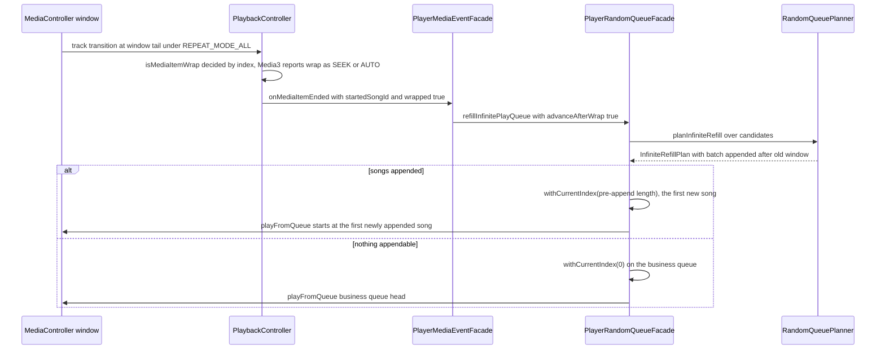
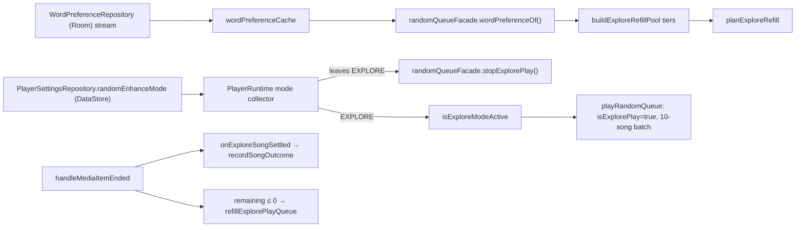

# Random Playback and Infinite Random

Lucky play (random queue, 「随心播放」) and infinite random are two planner-driven entry points over the same domain core. `RandomQueuePlanner` (in `domain/playback`) is a pure decision maker: it filters playables, batches, evicts recently played songs and, when uniform random is on, delegates selection to `UniformRandomPlanner`. The feature layer (`PlayerRandomQueueFacade`) owns the stateful side — the in-memory recent-played set, infinite coverage set, explore session flag, and the calls that push a plan into `setPlayQueue` / `syncPlayerQueue` / `playFromQueue`. `PlayerMediaEventFacade` and `PlayerPlaybackFacade` are the trigger points that keep an infinite queue topped up as the window drains.

Since **v3.11.0** the chain is configurable through `RandomEnhanceMode` (`OFF`, `TIME_SLOT`, `EXPLORE`). Time-slot mood filtering and explore playback are mutually exclusive enhancements layered on the same planner core: the mode is a single enum value, so at most one is active. Explore playback is the headline: `playRandomQueue` generates a fixed 10-song batch and sets `isExplorePlay`; infinite random is blocked while that session is live; when the queue drains to its last song the facade learns word preferences from skip/full-hearing outcomes and refills with a preference-tiered 5-song batch.

The windowed-queue plumbing the plans feed into (controller windows, `REPEAT_MODE_ALL`, fingerprinted syncs, planner-internal weighting math) is described in `/openwiki/player/queue-architecture.md`; the facade wiring itself is catalogued in `/openwiki/player/runtime-facades.md`.

## The chain at a glance

Candidate filtering is a **facade** concern; the planners only ever see the pool they are handed. The order of the stages is fixed:

<!-- openwiki: mermaid parse failed and this diagram was converted to a text fence so it does not break rendering. Fix the diagram source and restore the mermaid fence. Parser error: Heuristic: an unescaped angle bracket inside a label breaks rendering; rephrase the label. -->
```text
flowchart LR
    LIB["library: PlayerUiState.songs"] --> MOOD{"mood slot active? (TIME_SLOT + hitSlot)"}
    MOOD -- "no / explore" --> POOL["candidates = full library"]
    MOOD -- "yes" --> EXC["filterOutExcludedMoodTags<br/>drop song if excluded word ratio ≥ EXCLUDE_MIN_RATIO = 0.15"]
    EXC --> BASE["base = library minus excluded"]
    BASE --> INC["filterByMoodTags<br/>keep song if included word ratio ≥ MATCH_MIN_RATIO = 0.35"]
    INC -- "empty" --> FB["log fallback, return null → base"]
    INC --> POOL
    FB --> POOL
    POOL --> EVICT["RandomQueuePlanner: playable filter → batch size → recent-play eviction / trimToLimit"]
    EVICT --> UR{"uniform random on?"}
    UR -- "yes" --> TIER["UniformRandomPlanner: lowest raw play-count tier first"]
    UR -- "no" --> SHUF["shuffle, take batch, shuffle again"]
    TIER --> QUEUE["lucky: setPlayQueue(SEQUENTIAL, 0)<br/>refill: withSongs + syncPlayerQueue / playFromQueue"]
    SHUF --> QUEUE
```

*Every pool narrowing happens before planning, so eviction and low-play-count tiering operate only inside what survives the mood filters.*

## Key injection points

Three dependencies decide how random the chain is, and all of them are injected rather than hard-wired:

- **`rawPlayCounts`** — a `suspend (List<Int>) -> Map<Int, Int>` on `PlayerRandomQueueFacade` (default `{ emptyMap() }`). `PlayerRuntime` wires it to `playStatsRepository::getRawPlayCounts`, the Room-backed *raw* play count (distinct from the "effective" count used for sorting). Both `playRandomQueue` and `refillInfinitePlayQueue` query it per candidate pool at call time, including the fallback pool of an infinite refill.
- **`globalUniformRandomEnabled`** — carried on `PlayerUiState` (default `true`), persisted via `PlayerSettingsRepository` (DataStore, legacy-SharedPreferences fallback `true`), loaded at `PlayerRuntime.start()` into the UI state, and toggled from the Settings screen through `setGlobalUniformRandomEnabled`. The planners read the flag from the current state at each call, so **changing the setting never reshuffles the live queue or its `playOrderIds`** — it only influences later queue builds: the next lucky play, the next infinite refill batch, and any future rebuild.
- **`QueueManager.PlayOrderBuilder`** — the seam for play-mode ordering. Production wiring in `app/di/PlayerModule` deliberately installs `QueueManager.defaultPlayOrderBuilder`, i.e. the `SHUFFLE` play mode stays *pure* shuffle and independent of uniform random. `UniformRandomPlanner.buildPlayOrderIds`/`orderSongs` already implement the count-tiered ordering a settings-aware builder would apply; they are exercised by tests but not wired into queue operations today.

The enhancement injections (all defaulted so plain random behaves unchanged):

- **`RandomEnhanceMode`** — the mutual-exclusion switch. `PlayerRuntime` reads `playerSettingsRepository.randomEnhanceMode` as a stream and keeps it in `@Volatile randomEnhanceModeCache`; `moodSlotEnabled` is `cache == TIME_SLOT`, `exploreModeEnabled` is `cache == EXPLORE`. Reading the cache instead of `.first()` on the DataStore flow means zero disk IO per random draw, and it matches what `isExploreModeActive` publishes. `PlayerRuntime.start()` also reads the mode once at startup to close the race window before the subscription is live (see `/openwiki/concepts/mood-time-slot.md` for the configuration UI).
- **`moodEmotionTagsOf` / `moodEmotionTagRatiosOf`** — a song→emotion-tag `Set` (the cached `Map.keys` view, zero allocation) and a song→tag→ratio map. `filterByMoodTags` matches by **ratio gate**, not mere presence; the default ratio derives `1.0` per tag from `moodEmotionTagsOf`, preserving the old plain-OR behavior when ratios are not injected.
- **`wordPreferenceOf: (String) -> WordPreference`** — per-word vote summary (`likeVotes` / `dislikeVotes`), resolved from `wordPreferenceCache` fed by the Room-backed `WordPreferenceRepository` stream. `WordPreference.kind` (`LIKE` / `DISLIKE` / `NEUTRAL`) is the vote-majority winner that `buildExploreRefillPool` uses to tier its candidate pool.
- **`nowMinuteOfDay`** — injectable clock for slot resolution, so facade tests never depend on the wall clock.

`PlayerRuntime.observeMoodSlotCaches()` keeps every snapshot `@Volatile` and fresh from a continuous subscription: time-slot configs, one song-emotion subscription that computes **two** ratio maps per song (`emotionMatchRatiosOf` for mood matching — untruncated, so a target word ranked 5th still matches — and `emotionVoteRatiosOf(minRatio = VOTE_MIN_RATIO, topN = VOTE_MAX_TAGS)` for explore votes), word preferences, and the enhancement mode.

## playRandomQueue: the lucky-play flow

`playRandomQueue` resolves the mode first, then the candidate pool, then hands the pool to the planner:

1. `explore = exploreModeEnabled()`; `mood = if (explore) null else activeMoodSlot()` — explore mode bypasses mood filtering entirely.
2. `baseSongs = mood?.let { filterOutExcludedMoodTags(current.songs, it) } ?: current.songs`; `candidates = mood?.let { filterByMoodTags(baseSongs, it) } ?: baseSongs`.
3. `planner.planRandomQueue(candidates, recentPlayedSongIds, current.globalUniformRandomEnabled, rawPlayCounts(candidates.map { it.id }))`, with `batchSize = ExplorePlaybackPolicy.INITIAL_BATCH_SIZE` (10) when exploring and the planner default (`DEFAULT_BATCH_SIZE = 20`) otherwise. A `null` plan means nothing playable: the method returns `false` and no queue is installed (the previous queue keeps playing; the UI shows the import hint).
4. On success it calls `setPlayQueue(plan.songs, 0, PlayMode.SEQUENTIAL)` (the batch plays as a sequential window from index 0), then updates state in one shot: `isInfinitePlay = false`, `infinitePlayedSongIds = emptySet()`, `isExplorePlay = explore`. The explicit infinite reset matters even though `setPlayQueue` also exits infinite by default.
5. It replaces the in-memory `recentPlayedSongIds` with the plan's set (clear + addAll), logging `playRandomQueue: reset recent history` when the plan reported a reset, and finishes with a summary line `playRandomQueue: songs=…, recent=…, mood=<slot name>, explore=<bool>` (asserted by the explore test through `explore=true`).

### Explore branching inside `playRandomQueue`

- In explore mode the mood-slot filter is **bypassed** (`mood` is null), so candidates are always the full library — the two enhancements cannot both narrow the pool.
- The 10-song batch comes from the planner's explicit `batchSize` override; recent-skip eviction and the uniform-random flag still apply within it.
- On success `isExplorePlay = true` is written to `PlayerUiState`; that flag (not the settings mode) is what blocks infinite play and enables refill + word learning. Every non-explore lucky play writes `false`, cleanly ending a previous session.

## Uniform-random preference and recent history are pool-agnostic

Two independent mechanisms run inside the planner on whatever pool the facade passed; neither knows about mood slots or explore tiers:

- **Recent-play eviction.** Songs in `recentPlayedSongIds` are excluded; if that leaves fewer than the batch, the set is cleared, `resetHistory = true` is reported and the whole playable pool is available again. The set is trimmed to the playable library size via `trimToLimit`, which drops the earliest-inserted ids first, so on large libraries "what was played" cycles through roughly one pass before repeats are allowed. The history lives in memory only.
- **Low-play-count preference (uniform random).** When `globalUniformRandomEnabled` is on, `UniformRandomPlanner.selectSongs` groups the pool by raw play count and fills the quota from the lowest-count tier outward, shuffling within a tier — see `/openwiki/player/queue-architecture.md` for the tiering details and its dynamic-threshold rationale. When it is off, the planner shuffles, takes the batch, and shuffles the batch again.

Mood/exclusion filtering composes with both: the filtered pool is still evicted and still tiered, and `neededSize = minOf(batchSize, playableSongs.size)` keeps a small pool from failing. `PlayerRandomQueueFacadeTest.moodFilterCompatibleWithUniformRandom` pins the composition (a 0-play tagged song is picked ahead of a 10-play tagged song).

## Mood-slot filtering: exclusion first, inclusion second

When the time-slot enhancement is active (`moodSlotEnabled` and a `TimeSlotConfig` covering the current minute), `activeMoodSlot()` resolves the slot through `MoodSlotResolver.hitSlot` and returns `MoodSlotState(slotName, tags, excludedTags)`. Both filters then run on the full ratio distribution, in this order:

1. **Exclusion** (`filterOutExcludedMoodTags`) removes any song carrying an excluded word at `ratio >= MoodSlotPolicy.EXCLUDE_MIN_RATIO` — `EmotionGroup.MIN_RATIO` = **0.15**, the same gate the detail page uses to display a word. Rationale: the user's evidence for "not this emotion" is what the detail page showed them. It logs the removed count: `moodSlot: excluded N songs by tags=[…]`.
2. **Inclusion** (`filterByMoodTags`) keeps songs with an included word at `ratio >= MoodSlotPolicy.MATCH_MIN_RATIO` = **0.35**, so a word the model isn't confident about (e.g. 16% share) no longer qualifies a song. A filtered pool below `MoodSlotPolicy.POOL_WARN_THRESHOLD = 10` logs a "will loop" warning.
3. **Empty include pool degrades to the exclusion-filtered library**, not to the raw library: `filterByMoodTags` logs `moodSlot: no songs for tags=…, fall back to full library after exclusions (N songs)` and returns `null`, and the caller uses `baseSongs`. Excluded songs are therefore never reintroduced by a fallback, and only if `baseSongs` is itself empty does the planner see nothing and `playRandomQueue` return `false`.

Filtering is applied to the **candidate list at the facade boundary**, and only that list reaches the planner (with `rawPlayCounts` queried for those ids). Slot configs, the mode and the ratio maps are `@Volatile` snapshots on `PlayerRuntime`; `nowMinuteOfDay` is injectable. User-manual tags carry no ratio and are treated as a strong `1.0` match, and when no ratio map is injected the default derives `1.0` per tag, so behavior is unchanged in tests/setups without ratios.

Test-visible contract in `PlayerRandomQueueFacadeTest`:

| Test | Pins |
|---|---|
| `moodExcludedTagsRemoveSongsFromPool` | Excluded song dropped, `excluded 1 songs by tags` logged |
| `moodExcludedTagBelowDisplayThresholdDoesNotExclude` | 10% excluded-word share is below 0.15, song stays |
| `moodExcludedTagAtDisplayThresholdExcludes` | A real 27.4% share is excluded (detail page would show it) |
| `moodExcludedTagsStayAppliedWhenIncludedPoolFallsBack` | Empty include pool falls back to the post-exclusion library; log contains `fall back to full library after exclusions` |
| `moodFilterRequiresTheWordToDominateEnoughOfTheSong` | 70% matches, 16% does not |
| `moodFilterFallsBackToPlainTagMatchWhenNoRatiosAreInjected` | Backward-compatible plain tag match |
| `moodFilterLimitsRandomPoolToTaggedSongs`, `moodFilterInactiveOutsideSlotTime`, `moodFilterDisabledKeepsOriginalBehavior`, `moodFilterFallsBackToFullLibraryWhenNoTaggedSongs` | Active / out-of-slot / disabled / empty-pool degradation |

### UI entry and attribution toasts

The entry points are wired in the app shell rather than the domain/feature layer:

- **`NowPlayingSurface`** (the player surface shared by the Home tab and the global drawer) wires `onLuckyPlayClick` → `playerViewModel.playRandomQueue { started, moodSlotName -> … }` and `onStartInfinitePlay` → `playerViewModel.startInfinitePlay { started, moodSlotName -> … }`. `PlayerRuntime.playRandomQueue` / `startInfinitePlay` are async with a result callback (`scope.launch`, since the raw play-count query suspends); the callback receives `started` plus the hit slot name. On success the attribution toast `"已按「$slotName」为你随机播放"` appears when a slot is active, on infinite-start `"已按「$slotName」开启无限随机播放"`, and failure shows the import hint `"还没有可播放的音乐，请先导入歌曲吧~"`. Both actions end with `playlistResumeViewModel.switchSource(null, …)`, resetting the playlist-resume source.
- **`AppRoot`** duplicates the lucky-play wiring for the empty-queue entry bar (`LuckyPlayEntryBar`), with the same toast and catch-all import hint.
- **`HomeRouteActions`** (`feature/home`) exposes the `onLuckyPlayClick` / `onStartInfinitePlay` / `onStopInfinitePlay` callback trio (typed `() -> Unit`); implementations live in the app shell. `HomeRoute` composes the infinite-play button and, while an explore session is active (`isExplorePlay`), routes the button to a hint dialog telling the user to switch the enhancement mode or tap a song to exit explore; while `isInfinitePlay` it toggles stop instead.

`currentMoodSlotName()` on `PlayerViewModel` delegates to `PlayerRuntime.currentMoodSlot()` → the facade's `currentMoodSlot()` — the **same** `activeMoodSlot()` evaluation the random decision used, so the attribution can never disagree with the actual filter.

## Infinite random: start, refill, and wrap handling

### Starting: keep the queue, seed coverage

`startInfinitePlay` deliberately does **not** build a new queue. `planInfiniteStart` only records which of the queued songs are playable — that set becomes `infinitePlayedSongIds`, the coverage set refill excludes. An empty queue is legal: infinite mode starts "armed" with no coverage and waits for refills. A live explore session blocks the start entirely (`startInfinitePlay: blocked by explore session`).

One proactive fix: if the controller is already near the tail when infinite play is enabled (`remainingMediaItems() <= PlayerMediaEventFacade.DEFAULT_REFILL_THRESHOLD = 5`), the facade refills immediately. Otherwise the current song is the window's last item: when it ends, or when the *system* media keys (headset / lock screen / notification) trigger "next", Media3 wraps under `REPEAT_MODE_ALL` to the old window's first song — and new songs appended after that old song would not be reached until the entire old window replayed. The in-app next button is unaffected because `playNext` refills before advancing.

### Refill triggers and planning

Three paths funnel into `refillInfinitePlayQueue(startedSongId, advanceAfterWrap)` through `PlayerPlaybackBridgeFacade`:

1. `PlayerMediaEventFacade.handleMediaItemEnded(startedSongId, wrapped)` — fired on every track transition (natural end, manual/seek next & previous, repeat). It refills when `wrapped` **or** remaining items ≤ `DEFAULT_REFILL_THRESHOLD = 5`, passing `advanceAfterWrap = wrapped`.
2. `PlayerPlaybackFacade.playNext` — when `PlaybackCommandPlanner.planNext` returns `RefillInfiniteQueue` (infinite mode and remaining ≤ 5). The one-shot `skipNextRefill` flag (set by "add to next") is consumed instead, so a just-inserted next song is not pushed further back by appended songs.
3. The tail check inside `startInfinitePlay` described above.

`refillInfinitePlayQueue` is a no-op outside infinite mode and first corrects the business queue's `currentIndex` to `startedSongId` (`withCurrentSongId`) so planning and syncing are anchored to the actually-playing item. It then builds a **tiered** candidate plan:

- `mood = activeMoodSlot()`; `baseSongs` = library minus excluded words; `moodPool` = `filterByMoodTags(baseSongs, mood)`.
- `primaryPool = moodPool ?: baseSongs`. Planning runs `planInfiniteRefill(primaryPool, queue, current.infinitePlayedSongIds, uniformRandomEnabled, rawPlayCounts(primaryPool ids), allowHistoryReset = moodPool == null)`:
  - batch sizing is the lucky-play one (`minOf(20, playable pool)`);
  - coverage set **and** songs already in the queue are excluded, so refills never duplicate queue items;
  - `allowHistoryReset` decides the loop: with a **strict mood pool** it is `false`, so a remainder smaller than a batch appends only those remaining songs instead of clearing history and recycling played mood songs; for plain infinite play (or an already-degraded pool) it is `true`, so coverage is cleared when the unplayed remainder drops below the batch (`resetHistory`, logged as `refillInfinitePlayQueue: reset played history`) and the loop over the library resumes;
  - selection always goes through `UniformRandomPlanner.selectSongs`; the uniform flag decides tiered vs plain shuffle (an asymmetry with `planRandomQueue`, which branches itself);
  - an empty selection yields an empty `addedSongs` with the queue untouched;
  - appended songs go through `queue.withSongs(queue.songs + selectedSongs)`, preserving the current item's index.
- **Strict-pool exhaustion degrades to "library minus excluded"**: if the strict pool produced nothing appendable and `moodPool.size < baseSongs.size`, a second `planInfiniteRefill` runs on `baseSongs` with `allowHistoryReset = true`, logging `refillInfinitePlayQueue: mood pool exhausted (N), fall back to non-excluded library (M)`. Unanalyzed songs have no tags, so they are never excluded and remain eligible — infinite random therefore never stalls on a mood slot. The `fallback=` flag is recorded in the final `refillInfinitePlayQueue: added=… fallback=…` log line.

### The wrap pitfall and `advanceAfterWrap`



*Tail-wrap refill: the cursor jumps past the replayed old window to the first appended song, or to the business queue head when nothing new exists.*

`PlaybackController` detects a wrap **by index** (`isMediaItemWrap`: new index 0, previous index was the last item) because Media3 reports a `REPEAT_MODE_ALL` tail wrap as `SEEK` (manual next) or `AUTO` (natural end) — `MEDIA_ITEM_TRANSITION_REASON_REPEAT` only means single-item repeat. All three transition reasons route to `onMediaItemEnded`, so system-side skips refill too. `MediaItemWrapDetectionTest` locks the edge cases (tiny windows treat backward-to-0 as wrap; empty/single-item windows cannot wrap).

With `advanceAfterWrap = true` and songs appended, the facade sets the new current index to the **pre-append queue length** (the first newly appended song, since appends are at the tail), writes queue + coverage into state, and starts playback through `playFromQueue` (the error-checked queue start) rather than `syncPlayerQueue` — otherwise the user would hear the replayed old window. When nothing new could be appended it still jumps: it sets `currentIndex = 0` on the business queue and plays from there, so a wrap lands on business queue head rather than the controller window's first item (which is actually around the 20th business item). Without a wrap and with nothing appended, it only logs `refillInfinitePlayQueue: no new songs` and leaves state untouched.

`PlayerRandomQueueFacadeTest` pins all three branches: `refillInfinitePlayQueueAdvanceAfterWrapJumpsToFirstNewSong` (index 4 for a 4-song queue, `playFromQueue`, no sync), `refillInfinitePlayQueueWrapsToQueueHeadWhenNoNewSongs` (index 0, no sync), `refillInfinitePlayQueueAppendsSongsAndSyncsControllerQueue` + `refillInfinitePlayQueueUsesStartedSongAsCurrentIndexBeforeSyncing` (plain append/sync path).

## Explore playback (`ExplorePlaybackPolicy`)

Explore play is the enhancement gated by `RandomEnhanceMode.EXPLORE`. Its pure policy lives in `ExplorePlaybackPolicy` (JVM-testable, no Android deps):

| Constant | Value | Meaning |
|---|---|---|
| `INITIAL_BATCH_SIZE` | `10` | size of the lucky-play batch that opens an explore session |
| `REFILL_COUNT` | `5` | songs appended at each refill, and the sufficiency bar every refill tier must clear |
| `REFILL_THRESHOLD` | `0` | remaining songs after a track change that triggers refill (ended song was second-to-last) |
| `MIN_LISTEN_MS` | `30_000L` | minimum "really listened" duration |
| `MIN_LISTEN_RATIO` | `0.25f` | minimum fraction of total duration for "really listened" |
| `VOTE_MIN_RATIO` | `EmotionGroup.MIN_RATIO` (0.15) | a word shares ≥ this ratio to participate in voting — same threshold as the detail-page display, so skipping a song votes only on the tags the user actually saw |
| `VOTE_MAX_TAGS` | `EmotionGroup.MAX_TAGS` (4) | vote at most this many words per song, matching the display |
| `VOTE_WEIGHT_SCALE` | `100` | votes are integer ratios ×100 (no schema change; a one-time history ×100 migration kept the scale) |

`isSkipped(playedMs, durationMs)` returns true (→ dislike vote) when the listener heard less than 30 s **or** less than ¼ of the total duration; with an unknown duration (`<= 0`) only the 30-second rule applies. `voteWeightOf(ratio) = round(ratio × VOTE_WEIGHT_SCALE)` and `votesOf(ratios)` maps a ratio table to integer weights, dropping zero-weight words (a sub-0.5% share casts no vote).

### Closing the loop: learning word preferences from outcomes

The word preference store is a **vote-accumulating** model (`WordPreference`), not a boolean toggle. Each emotion word independently accumulates like/dislike votes; `kind` (`LIKE` / `DISLIKE` / `NEUTRAL`) is the vote-majority winner. Because a word cannot be on both sides at once and a single skip never flips a previously-liked word immediately, the model resolves "same song already liked A/B and disliked C/D" conflicts across the library.

`handleMediaItemEnded` is the learning trigger. It reads the *just-ended* song's actual listen time (`trackedSongId()` / `currentPlayedMs()`) **before** `stopPlaybackTracking()` clears them, then — only when both `isExplorePlay` **and** `isExploreModeActive` are set (a double guard for restore/toggle timing where a session flag may linger a beat after the mode is turned off) — calls `onExploreSongSettled(songId, playedMs)`; a null tracked id skips settlement.

In `PlayerRuntime.handleExploreSongSettled` the direction comes from `isSkipped`, and the vote is **ratio-gated and ratio-weighted** using the *vote* distribution, not the match distribution:

- it reads `exploreVoteRatiosCache[songId]` (computed once per song by the same `songEmotionRepository` subscription, already thresholded to `VOTE_MIN_RATIO` and capped at `VOTE_MAX_TAGS`) instead of `moodEmotionRatiosCache` (the untruncated match map) — so a skip negates exactly the words the detail page displayed, not the whole 6-word distribution;
- an empty map or an all-zero weight table short-circuits with a debug log ("no emotion words to learn" / "no word with meaningful share") and writes nothing;
- `ExplorePlaybackPolicy.votesOf(ratios)` converts shares to integer votes, and `wordPreferenceRepository.recordSongOutcome(votes, liked = !skipped)` accumulates them in a `scope.launch` (like votes for a full listen, dislike votes for a fast skip), followed by an info log with the per-word votes and a re-read preference snapshot.

### Refilling the explore queue from the learned pool

The same `handleMediaItemEnded` computes `remainingSongs = remainingMediaItems()` after the track change and, when `remainingSongs <= exploreRefillThreshold` (`ExplorePlaybackPolicy.REFILL_THRESHOLD = 0`, injected separately from `refillThreshold`), calls `refillExplorePlayQueue(startedSongId)`. The threshold is measured **after** the song change: 0 remaining means the ended song was second-to-last. 1 remaining (ended song was third-to-last) does **not** refill — refilling that early would, because the business queue's `currentIndex` is not yet synced to the controller (2026-10-20 regression fix), risk re-pulling to the old song. `PlayerMediaEventFacadeTest` locks the `remaining = 0` trigger, the no-refill cases at 1 and at 4 remaining, and the null-tracked-song case.

`refillExplorePlayQueue` is a no-op outside an explore session. It first corrects the business queue's current item to `startedSongId` (`withCurrentSongId`, the same correction infinite refill uses — otherwise the sync would yank playback back to the old song), then builds the candidate pool and plans.

**`buildExploreRefillPool`** derives each song's emotion words once from the cached tag set, classifies every distinct word through `wordPreferenceOf(word).kind` (logging the three word lists), removes already-queued ids, and tiers the remainder in strict fallback order:

<!-- openwiki: mermaid parse failed and this diagram was converted to a text fence so it does not break rendering. Fix the diagram source and restore the mermaid fence. Parser error: Heuristic: an unescaped angle bracket inside a label breaks rendering; rephrase the label. -->
```text
flowchart TD
    A["collect distinct emotion words from library (tags derived once)"] --> EX["candidates = songs not already in queue"]
    EX --> B{"any like OR dislike word?"}
    B -- "no (nothing learned yet)" --> F["full library (candidates)"]
    B -- "yes" --> C{"songs with ≥1 liked word AND no disliked word:<br/>size ≥ REFILL_COUNT?"}
    C -- "yes" --> P1["liked & no-dislike pool"]
    C -- "no" --> D{"songs with no disliked word:<br/>size ≥ REFILL_COUNT?"}
    D -- "yes" --> P2["no-dislike-only pool"]
    D -- "no" --> F
```

The **fallback criterion is "can this pool fill `REFILL_COUNT` songs", not "is it non-empty"** (2026-10-25 fix). The old non-empty test self-locked: a user who skips everything quickly turns every word `DISLIKE`, so the only "no-dislike" songs left are those with no emotion analysis; that pool shrinks below 5, refills under-fill, those songs land in the queue, and the next refill finds "no more songs outside queue" — a permanent stall. Gating on `REFILL_COUNT` sufficiency guarantees that as long as the library has ≥5 songs outside the queue, the refill always tops up. The chosen tier is logged (`explore refill: pool=N (liked & no-dislike)`, `… (no-dislike only, no liked match)`, or the "preferred pools too small … -> fall back to full library" summary).

`planner.planExploreRefill(pool, queue, count = REFILL_COUNT)` then takes `count` songs randomly from the pool, excluding anything already in the queue, and appends them via `queue.withSongs` (preserving the current index). An empty pool yields a `null` plan or an empty `addedSongs`, and the queue is left untouched (`refillExplorePlayQueue: no more songs outside queue`); a successful refill updates state and reaches the controller through `syncPlayerQueue` (explore refill has no wrap-jump because explore batches are generated as one sequential window and refills happen only near the end). Unlike `planInfiniteRefill`, `planExploreRefill` does **not** consult uniform random or play counts — it is a plain shuffle over the preference-tiered pool.

### Explore-session lifecycle

- **Entering**: `playRandomQueue` with the explore mode active sets `isExplorePlay = true` and starts a 10-song sequential batch. `startInfinitePlay` **refuses** to start while `isExplorePlay` is true ("blocked by explore session") — infinite random is *the* disabled feature during an explore session.
- **Exiting by started-flag semantics**: `isExplorePlay` governs, not the settings mode. A user selecting a song replaces the queue through `PlayerQueueFacade.applyPlan`, which clears `isExplorePlay = false` for any queue-replacing plan with `exitInfinitePlay = true` (2026-10-21) — so manual playlist/top/artist/album selection exits the session, the player button reverts to "infinite random", and explore refill stops; a later `playRandomQueue` re-enters explore per the settings mode.
- **Exiting on mode switch**: the `randomEnhanceMode` stream collector on `PlayerRuntime` publishes `isExploreModeActive = (mode == EXPLORE)` and, when the mode leaves `EXPLORE` while a session is running (`!explore && isExplorePlay`), calls `randomQueueFacade.stopExplorePlay()` (which clears `isExplorePlay`). A `stopExplorePlay()` after the session has already been cleared is harmless.
- **After exit, infinite play re-arms**: since `startInfinitePlay` keys on the *session* flag, once the user has manually left the explore session (`isExplorePlay = false`) `startInfinitePlay` succeeds **even if the settings mode is still `EXPLORE`** (`exploreSessionEndedAllowsInfinitePlay`).
- **Restore/switch safety**: `handleMediaItemEnded` requires both `isExplorePlay` and `isExploreModeActive`, so a restore or toggle transient never casts a misleading vote or refills a queue the user has already left. `isExplorePlay` is persisted to `PlaybackStateStore` (`IS_EXPLORE_PLAY`) alongside the queue JSON, so a process restart mid-explore re-enters the session (with word learning + refill); the settings-derived `isExploreModeActive` re-arms from the `randomEnhanceMode` stream. Persisted infinite-model flags do not apply to an explore session.
- **Mutual exclusivity with `TIME_SLOT`**: `RandomEnhanceMode` holds one value at a time, and both facades additionally derive `mood = null` whenever explore is the mode — so an explore session always randomizes over the full library regardless of slot configs.

### Explore in the persistence and wiring layers



The refill and settle hooks are wired in `PlayerRuntime`'s `PlayerMediaEventFacade` construction: `refillExplorePlayQueue` launches on the runtime scope (the pool build touches the cached preferences), and `onExploreSongSettled` points at `handleExploreSongSettled`. Word preferences are a Room-backed stream cached `@Volatile`ly on `PlayerRuntime`, consulted through `wordPreferenceOf` whose default returns a zero-vote (neutral) preference for unseen words.

## State, lifecycle, and persistence

- `recentPlayedSongIds` lives **in memory** on the facade instance — lucky-play eviction history is not persisted; a process restart starts with a clean slate. `infinitePlayedSongIds` and `isInfinitePlay` **are persisted**: `PlayerPersistenceFacade` saves them through `PlaybackStateStore` (`IS_INFINITE_PLAY` / `INFINITE_PLAYED_IDS` alongside the queue JSON) and restore re-applies both, with saved played-ids filtered to songs still present in the library; an empty queue is allowed to restore while infinite mode is on (`allowEmpty = isInfinitePlay`). Infinite play therefore survives process death.
- **Explore session state is persisted**: `isExplorePlay` is written to `PlaybackStateStore` under `IS_EXPLORE_PLAY` on every save and restored with `allowEmpty` applicable, so a mid-explore restart resumes the session instead of silently dropping it. `isExploreModeActive` is *not* stored; it re-arms from the `randomEnhanceMode` DataStore stream at startup.
- **Word preferences are persisted**: `WordPreferenceRepository` is a Room-backed stream (`observeAll()`) that survives restarts, so the liked/disliked-word model built during exploration keeps shaping `buildExploreRefillPool` on future runs. The set-enhancement screen offers a **"重新探索" (reset) action** (`wordPreferenceRepository.clearAll()`).
- **Save path**: `PlayerPersistenceFacade` captures the position and full state snapshot on the caller thread and only then moves the DataStore write to IO via the injected suspending `launchIo` (`savePlaybackStateAsync` → `savePlaybackState(snapshot, positionMs)`). The position is read up front by the default `currentPlaybackPositionMs()` argument and threaded into the snapshot, so an IO-thread save cannot read a stale position or a queue swapped mid-save. `PlaybackStateStore.save(...)` also skips writing an empty-session queue that would clobber an existing snapshot (keeps the queue, updates song+position only).
- Exit paths: `stopInfinitePlay` clears the flags; any queue replacement via `setPlayQueue` (default `exitInfinitePlay = true`) exits infinite and explore; `playRandomQueue` exits explicitly as above.
- `playRelatedSongs` is the exception that keeps infinite mode alive: it replaces the queue with current + related songs (`exitInfinitePlay = false`) and re-seeds `infinitePlayedSongIds` with exactly those ids so the next refill reaches *outside* the new queue.

## Test anchors — the regression floor

Changing anything in this chain requires these suites green; they encode the contracts above:

- `domain/src/test/.../RandomQueuePlannerTest.kt` — recent skip + selection recording, `resetHistory` on shortage, uniform selection after the recent filter, infinite start/refill exclusions, unplayable filtering, `null` when nothing is playable, `planRandomQueue` honoring an explicit `batchSize`, and `planExploreRefill` (exactly `count` songs, excluding the existing queue, `null`/empty-`addedSongs` edge cases).
- `domain/src/test/.../UniformRandomPlannerTest.kt` — injected shuffle when disabled, tier-0-only and fallback-to-tier-1 preemption, dynamic tiering beyond fixed thresholds, equal counts degenerating to uniform, skewed distributions, `orderSongs` grouping, SHUFFLE current-first ordering.
- `feature/player/src/test/.../PlayerRandomQueueFacadeTest.kt` — sequential start + infinite exit, uniform toggle effect, no-playable `false`, start keeping the queue, tail refill on start, refill appends + sync, `startedSongId` correction, outside-infinite no-op, `advanceAfterWrap` jump and the no-new-songs jump to queue head, the mood-filter scenarios listed in the table above (pool narrowing, fallback messages and their counts, exclusion at the 0.15 display gate, inclusion at 0.35, uniform compatibility), and the explore cases: 10-song generation + session flag + infinite-exit + cleared coverage (`explore=true` logged), session blocks infinite start, session-ended re-arms infinite, the three-tier refill pool with the `REFILL_COUNT`-sufficiency fallback, no-op outside a session, and `startedSongId` current-index correction before sync.
- `feature/player/src/test/.../PlayerMediaEventFacadeTest.kt` — refill near tail, refill on wrap even when not near tail, no refill outside infinite mode. Also locks the explore settle/refill triggers: settled on the ended song with its actual played-ms, refill only when the ended song was second-to-last (remaining ≤ 0), no refill when remaining is 1 or more (and not with 4 remaining), and settle skipped when `trackedSongId()` is null.
- `player/src/test/.../MediaItemWrapDetectionTest.kt` — the index-based wrap rule and its edge cases.

## Related pages

- `/openwiki/player/queue-architecture.md` — the windowed dual-queue pipeline these plans feed, `playOrderIds` semantics, `PlayOrderBuilder`, planner tiering math, the facade-level filter order, and the refill/wrap plumbing.
- `/openwiki/player/runtime-facades.md` — `PlayerRuntime` composition root and facade responsibilities.
- `/openwiki/concepts/mood-time-slot.md` — slot configuration, include/exclude thresholds and pool statistics; the enhancement that is mutually exclusive with explore mode.
- `/openwiki/concepts/emotion-model.md` — emotion-word tagging and the match/vote ratio derivations the filters and votes consume.
- `/openwiki/workflows/playback-session-lifecycle.md` — the session lifecycle surrounding explore/infinite states.
- `/openwiki/testing/test-map.md` — where these suites sit in the overall test map.
