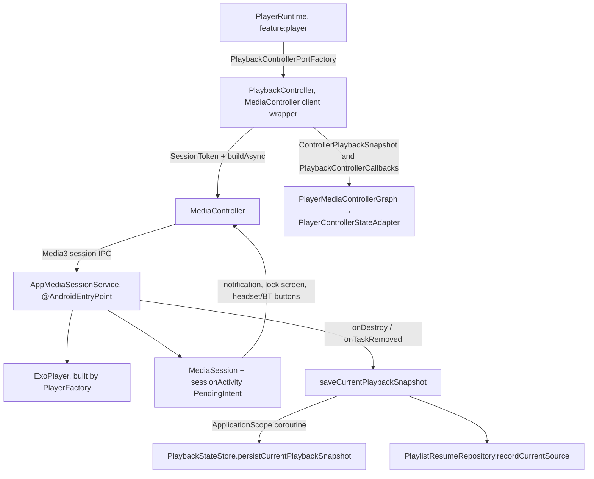
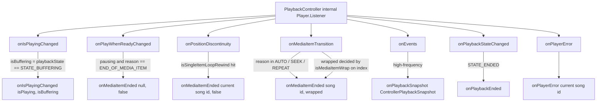

# Playback Service & Controller

The `:player` module is the only layer in the chain that directly touches Android media APIs. Inside it is a **two-component architecture**: the server side `AppMediaSessionService` owns the real `ExoPlayer` instance and publishes it through a Media3 `MediaSession`; the client side `PlaybackController` connects asynchronously to a `MediaController` via `SessionToken`, forwards UI playback commands to the service, and translates Media3 callbacks into the `PlaybackControllerCallbacks` defined in `:domain`. The two sides communicate over in-process IPC (the Media3 session binder), so **the MediaController's media-item window is the final authority on the real playback order** — how the business queue stays in sync with it is covered in `/openwiki/player/queue-architecture.md`, and how the facade layer orchestrates these callbacks in `/openwiki/player/runtime-facades.md`.

## Two-component architecture overview

*Two-component architecture: the server holds the ExoPlayer and MediaSession; the client `PlaybackController` remote-controls it through `MediaController` and translates callbacks into domain snapshots; on service teardown the snapshot write is hung off the process-level `ApplicationScope`.*

Wiring happens in `app/di/PlayerModule` (Hilt `SingletonComponent`):

- `providePlaybackControllerPortFactory` binds `PlaybackControllerPort` to `PlaybackController(context, AppMediaSessionService::class.java, callbacks)` — `:feature:player` depends only on the `:domain` interface and never imports the `:player` implementation;
- `providePlaybackStateStore` provides `PlaybackStateStore` (used by the service injection), and `providePlaybackStateStorageFactory` hands the restore path a second binding;
- `provideBluetoothPlaybackMonitorFactory` creates a `BluetoothPlaybackCoordinator` per call (see the Bluetooth section below).

## AppMediaSessionService: server lifecycle and snapshot persistence

`AppMediaSessionService` extends Media3 `MediaSessionService`, is annotated `@AndroidEntryPoint`, and injects four dependencies: `AppLogger`, `PlaybackStateStore`, `PlaylistResumeRepository`, and the process-level `@ApplicationScope` `CoroutineScope`. It implements no custom transport control — a comment states it "lets Media3 handle standard transport commands against the playlist provided by the UI controller" — so notification/lock-screen/headset play-pause-skip is handled by the MediaSession default lifecycle, and the queue is pushed by the client. The service only attaches a `Player.Listener` that does debug logging (business-event translation happens entirely on the client `PlaybackController`, so the server side stays a dumb terminal).

### ExoPlayer and MediaSession construction

`onCreate` → `createExoPlayer()`:

1. `PlayerFactory.create(this)` builds the ExoPlayer: `DefaultRenderersFactory` with `EXTENSION_RENDERER_MODE_ON`, float output disabled, decoder fallback, and a `MimeExcludingMediaCodecSelector` routing ALAC to the FFmpeg extension (see the decode-path section below); `DefaultLoadControl` buffers 4000/10000/2000/2500 ms; audio attributes `AUDIO_CONTENT_TYPE_MUSIC` + `USAGE_MEDIA` with audio-focus takeover; `handleAudioBecomingNoisy = true` (headphone-unplug pause); `setPauseAtEndOfMediaItems(false)` (infinite loop does not depend on it).
2. `createMediaSession()` wraps the player with a `MediaSession.Builder` and sets `sessionActivity` to a `PendingIntent` for the launch intent (`FLAG_ACTIVITY_SINGLE_TOP` + `FLAG_IMMUTABLE`, falling back to `ACTION_MAIN`) — the entry point that returns to the app from the notification.
3. `setupPlayerListener()` attaches a `Player.Listener` that only logs (`onIsPlayingChanged`/`onMediaItemTransition`/`onPlaybackStateChanged`); business event translation is entirely on the client `PlaybackController`, so the server stays a dumb terminal.

`onGetSession` returns that single `MediaSession`. The service is declared in the `:player` manifest (`android:exported="false"`, `foregroundServiceType="mediaPlayback"`, intent-filter `androidx.media3.session.MediaSessionService`), and the architecture gate forbids re-declaring it in the `:app` manifest.

### Snapshot persistence: synchronous read + process-level async write

`onDestroy` and `onTaskRemoved` both call `saveCurrentPlaybackSnapshot()`, whose threading model is a deliberate two-phase split:

- **Synchronous read**: `currentMediaItem.mediaId.toIntOrNull()` resolves the songId and reads `currentPosition`. The comment states "the snapshot (song and position) must be read synchronously on the calling thread — ExoPlayer is only accessible on its application thread."
- **Asynchronous write**: `applicationScope.launch` calls `playbackStateStore.persistCurrentPlaybackSnapshot(songId, positionMs)` (the suspending overload, `withContext(Dispatchers.IO)`), then `playlistResumeRepository.recordCurrentSource(songId)` — if the current queue came from a playlist, it records the actually-playing song as that playlist's resume point and clears the source marker. DataStore writes never block the main-thread `onDestroy`.

`ApplicationScope` is provided by `AppCoroutineScopeModule`: a process-level singleton `CoroutineScope(SupervisorJob() + Dispatchers.IO)`. Its KDoc states the contract: "for teardown work that must not be cancelled with the component (Service/ViewModel) that initiated it… never hang routine business coroutines on this scope" — the persistence coroutine must survive the service instance being destroyed, hence it cannot be bound to the service's own lifecycle.

`PlaybackStateStore.persistCurrentPlaybackSnapshot` storage semantics: **it keeps the existing `PLAY_QUEUE_JSON`** (falling back to legacy SharedPreferences, then an empty queue) and only overwrites `CURRENT_SONG_ID` and `PLAY_POSITION_MS`. On restore this snapshot corrects `currentIndex` and position — `PlaybackStateStoreTest.restoreUsesCurrentSongSnapshotToCorrectQueueIndexAndPosition` and `restoreCurrentSongSnapshotCreatesQueueWhenSongWasNotInSavedQueue` lock the "snapshot song not in the saved queue falls back to a single-song queue" behavior. UI-side routine saves use the blocking `save` (`runBlocking(Dispatchers.IO)`); the service-teardown path must use the suspending overload.

### The startService FGS ANR fix

`PlaybackController.startService()` calls `context.startService(...)` rather than `startForegroundService(...)`. The code comment records the reason (2026-09-03 ANR regression fix): `startForegroundService` forces the service to call `startForeground()` within 5 seconds, but `MediaSessionService` only publishes the notification and calls `startForeground()` when the player has media items or active playback — a cold-start empty session never satisfies the contract, so the system flags an FGS timeout ANR (real-device log "did not then call Service.startForeground()"). The only call chain is a foreground UI cold start, where `startService` is legal and carries no FGS contract; even if a background start path appeared later, `connect()`'s `SessionToken` mechanism can still bind-start the service.

## PlaybackController: connection, pending actions, command semantics

`PlaybackController` implements `:domain`'s `PlaybackControllerPort` (composing `PlaybackSessionController`) with constructor params `(context, serviceClass, callbacks)`. It is the only command/event channel between the UI and the service.

### Connection and the pending-action queue

`connect(onConnected)` connects asynchronously via `SessionToken(context, ComponentName(serviceClass))` + `MediaController.Builder.buildAsync()`, with the completion listener registered on `ContextCompat.getMainExecutor(context)`:

- **Success**: holds the controller, `addListener(listener)`, `drainPendingActions(connectedController)` (FIFO execution of backlogged actions; a single failing action is logged without aborting the drain), then `onConnected(snapshot)` reports the first snapshot.
- **Failure** (`ExecutionException` or other): logs and `abortPendingActions("播放服务连接失败")`.

`runWhenConnected(action)` is the single entry point for all commands: it executes immediately if connected, otherwise appends the lambda to `pendingActions` (an `ArrayDeque`). There is a hard resource bound:

- **`MAX_PENDING_ACTIONS = 64`**. If connection fails or stays unready, every UI tap appends a pending action; the captured song lists grow without bound, so at capacity the queue **FIFO-drops the oldest action** (`removeFirst`), logs a warning, and calls `callbacks.onControllerUnavailable(1, "播放服务尚未就绪")`.
- **Connection failure discards everything rather than replay**: `abortPendingActions` clears the queue and reports the dropped count — the comment explains "if we kept them they would be batch-replayed on the next successful connect, producing play/skip behavior the user already abandoned."

The upper layer consumes `onControllerUnavailable` in `PlayerRuntime.handleControllerUnavailable`: writes a warning, still calls `persistenceGraph.onControllerReady()` (a startup connection failure must still let the restore decision through, otherwise `pendingRestore` hangs forever and the UI queue never recovers), then writes the reason and dropped count into `PlayerUiState.errorMessage`. On the success path, `PlayerMediaControllerGraph.connect` first syncs `controllerStateAdapter` with the first snapshot, then triggers the `onConnected` → `persistenceGraph.onControllerReady()` restore handshake (see `/openwiki/player/runtime-facades.md`).

### Command surface and fingerprint sync

`PlaybackControllerPort` commands: `pause/play/seekTo` pass straight through (position coerced to ≥0); `playPrevious` falls back to `seekTo(0)` when there is no previous item; `playNext` falls back to `seekToDefaultPosition(0)` when there is no next item but the queue is non-empty, and logs the `PerformanceTrace` anchor `play_next_command`; `clearPlaylist` clears the fingerprint first, then `stop()` + `clearMediaItems()`. Queries: `snapshot()`/`queueInfo()`/`hasCurrentMediaItem`/`isPlaying`/`currentPositionMs(fallback)`/`durationMs(fallback)` (`C.TIME_UNSET` maps to the fallback) — `PlayerRuntime.liveSessionActive()` uses `queueInfo()?.mediaItemCount > 0` to detect a live server session.

The queue operations' guard rules are the easiest way to trip on this API:

| Method | Fingerprint | repeatMode | Autoplay | Live-session guard |
| --- | --- | --- | --- | --- |
| `playQueue(plan)` | records `plan.fingerprint()` | `REPEAT_MODE_ALL` | `prepare()` + `play()` | **forbidden** (KDoc: "as long as the service is playing, mediaItemCount > 0, so adding one would silently swallow all user song requests and keep playing the old song") |
| `prepareQueue(plan, positionMs)` | records | `REPEAT_MODE_ALL` | only `prepare()`, no play | **the only allowed place**: skips when `mediaItemCount > 0`, so a restore cannot overwrite a playing session |
| `syncQueue(plan)` | returns early on identical fingerprint | `REPEAT_MODE_ALL` | `play()` only if `wasPlaying` | none (captures current position/play state before rebuilding) |

`prepareQueue`'s only business caller is `PlayerPersistenceFacade.applyRestoreResult` (the restore path); `positionMs.coerceAtLeast(0)` is fed back into the controller as the start position but does not autoplay. `playSingle(song)` runs alone in `REPEAT_MODE_OFF` + `setMediaItem`, returning false when the mapper cannot map the song (no uri). All three paths carry `PerformanceTrace` anchors (`controller_play_queue`/`controller_prepare_queue`/`controller_sync_queue`), which the architecture gate requires not to be removed.

### Incremental queue sync

`syncQueue` no longer always rebuilds the whole window. After the fingerprint check it compares the controller's current media-item ids against the plan's song ids and, when the two share an aligned common segment and `currentMediaItemIndex` still points at the plan's `startIndex` song, applies `planIncrementalQueueSync` to trim the window head and append/remove the tail via `removeMediaItems`/`addMediaItems` instead of a full `setMediaItems`. The incremental path does not touch the currently-playing item, so it produces no position reset, no rebuffer, and no `playWhenReady` change. The full rebuild path — used when the shapes are incompatible or when a queue mutation is pending — captures `positionMs` and `wasPlaying`, then `setMediaItems(plan, startIndex, positionMs)`, `prepare()`, and `play()` only if `wasPlaying`.

Incremental decisions are gated by the `pendingQueueMutation` flag: set to true whenever a queue-mutation command (`playQueue`, `clearPlaylist`, `playSingle`, or a mutating `syncQueue`) is issued and cleared by the `onTimelineChanged` callback, which is the server acknowledgment that the media-item list has refreshed. While `pendingQueueMutation` is true the local timeline mirror may be stale, so `syncQueue`'s incremental path is unavailable and the sync falls back to a full rebuild — otherwise `remove`/`add` indices would be emitted against an obsolete list.

### Cross-process album-art URI granting (ArtworkUriAccess)

Album art URIs go through a FileProvider `content://` URI produced by `:data`'s `AlbumArtProvider`. The platform's `MediaSessionRecord.sanitizeMediaMetadata()` only **validates** that the artwork URI is grantable (`checkGrantUriPermission`) — AOSP never grants it. Cross-process consumers (SystemUI media-control card, platform media notification, car head unit, Android Auto) therefore get a `SecurityException: Permission Denial: reading ... requires the provider be exported, or grantUriPermission()` unless the app explicitly grants read access.

`core/common`'s `ArtworkUriAccess` centralizes the grant and is exercised from **two points, both required**:

- **At mint time** (`:data` `AlbumArtProvider.toProviderUri`) — a freshly-written cover is authorized immediately, during import, off the playback path.
- **At publish time** (`:player` `PlaybackController.grantArtworkRead`, which `playQueue`/`prepareQueue`/`syncQueue` call right before `setMediaItems`) — legacy URIs (never minted in this process; written into Room by a previous run) must be authorized too, or that path is always rejected.

The publish-time grant must happen **before the metadata push**: a cross-process consumer reads the cover as soon as it receives the metadata, so granting in `onMediaItemTransition` would be too late (read precedes grant → first frame cover is blank). `grantArtworkRead` de-duplicates by URI because the N songs of one album share the same content-hashed cover URI.

`ArtworkUriAccess.grantRead` targets only `com.android.systemui` and `android` — on AOSP both are uid 1000 (system), and the frame also builds the media notification inside system_server (uid 1000), so one grant covers both the control card and the notification. It keeps a process-local `grantedUris` set for de-duplication (a grant is a per-uid runtime grant that survives the process, so a URI only ever needs granting once per run). It only grants URIs that are the app's own provider's (`isOwnArtworkUri`); MediaStore `content://media/external/audio/albumart/<id>` URIs are readable cross-process already and deliberately skipped to avoid `SecurityException` noise.

### release

`release()` clears in order: removes the listener, nulls the controller, clears `pendingActions`, `MediaController.releaseFuture(controllerFuture)`. The `PlayerLifecycleFacade.onCleared` teardown order (snapshot first, then `releasePlaybackController`) is orchestrated at the facade layer.

## Event translation: Media3 callbacks → PlaybackControllerCallbacks

`PlaybackController`'s internal `Player.Listener` is the boundary between the Media3 world and the `:domain` world, with one translation per rule (`PlaybackControllerCallbacks` shape is defined in `domain/playback/PlaybackControllerPort.kt`):

*Event translation: play/pause semantics, the two "finished" signals (END_OF_MEDIA_ITEM and single-item loop rewind), the window-wrap flag, and the high-frequency/terminal/error events each map to a specific `PlaybackControllerCallbacks` callback.*

- **`onIsPlayingChanged(isPlaying)`** → `onIsPlayingChanged(isPlaying, controller.playbackState == STATE_BUFFERING)`. **Buffering must be distinguished**: downstream `ControllerPlaybackStateSynchronizer.isPlayingTransition` only pauses the timer and counts stats on a true pause (isPlaying false without buffering), so buffering jitter is not counted as a pause.
- **`onPlayWhenReadyChanged`** → only when `!playWhenReady && reason == PLAY_WHEN_READY_CHANGE_REASON_END_OF_MEDIA_ITEM` emits `onMediaItemEnded(null, false)`: Media3's signal that the queue has no next item and stopped naturally.
- **`onPositionDiscontinuity`** → single-item loop-rewind recognition (next section); when it hits, emits `onMediaItemEnded(currentMediaItem.mediaId.toIntOrNull(), false)`.
- **`onMediaItemTransition`** → first computes `wrapped = isMediaItemWrap(...)` and updates `lastCurrentMediaItemIndex`, then for transitions with `reason ∈ {AUTO, SEEK, REPEAT}` emits `onMediaItemEnded(mediaId→songId, wrapped)`. Manual skips (headset/lock-screen/notification SEEK) must flow through here or infinite play never refills; `PLAYLIST_CHANGED` (the app's own window rebuild) deliberately does not trigger.
- **`onEvents`** → `onPlaybackSnapshot(player.toPlaybackSnapshot())`, high-frequency; snapshot fields are `mediaId`, `isPlaying`, `isBuffering`, `currentPositionMs`, `durationMs` (`C.TIME_UNSET` → null). This is the data source that writes back the business queue (see the queue-architecture page).
- **`onPlaybackStateChanged`** → `STATE_ENDED` emits `onPlaybackEnded()`.
- **`onPlayerError`** → logs then emits `onPlayerError(currentMediaItem.mediaId→songId)`, for error-recovery replay.

### Single-item loop-rewind detection (onPositionDiscontinuity)

Under `REPEAT_MODE_ALL`, when the queue holds exactly one song (quick-skip/playlist/album/artist with one song left), a natural finish wraps to the same item: the window index stays 0→0, Media3 fires **no `onMediaItemTransition`**, so settlement (effective play +1, removal from the quick-skip list) never runs and the timer accumulates across loops. The only visible signal is an AUTO position discontinuity with a position jump back. `isSingleItemLoopRewind` recognizes it via three threshold constants:

- `LOOP_REWIND_NEW_POSITION_MAX_MS = 2_000L`: the new position must be ≤2s (back to the start);
- `LOOP_REWIND_END_TOLERANCE_MS = 5_000L`: when duration is known, the old position must be ≥ `duration − 5s` (precise "near the end");
- `LOOP_REWIND_MIN_POSITION_MS = 30_000L`: a conservative fallback threshold when duration is unknown (−1), well beyond seek/buffer jitter.

Plus the structural conditions: `reason == DISCONTINUITY_REASON_AUTO_TRANSITION`, `mediaItemCount == 1`, `oldIndex == newIndex == 0`. The comment also explains two exclusions: **buffering reconnect** continues from the old position and produces no rewind-to-zero AUTO discontinuity; manually dragging back to the start is a SEEK — `SingleItemLoopRewindDetectionTest.ignoresManualSeekToStart` locks this anti-abuse case (a manual seek must not count as finishing).

### Window-tail wrap detection (onMediaItemTransition)

`isMediaItemWrap(previousIndex, newIndex, mediaItemCount)` = `newIndex == 0 && previousIndex != INDEX_UNSET && previousIndex >= mediaItemCount - 1 && previousIndex > newIndex`. It must be judged **by index, not by reason**, because Media3 reports `REPEAT_MODE_ALL` tail wrap from `seekToNextMediaItem()` as `SEEK`, while `MEDIA_ITEM_TRANSITION_REASON_REPEAT` only means `REPEAT_MODE_ONE`. The `wrapped` flag is the trigger for infinite-play refill (window exhausted); the comment notes that after a wrap the remaining count grows back, so a remaining-count heuristic alone would miss the refill and starve infinite play. `MediaItemWrapDetectionTest` locks the boundaries: a 2-item window wrapping 1→0 also counts (harmless, because the refill planner de-duplicates), and empty/single-item windows can never wrap.

## SongMediaItemMapper contract: mediaId is the join key

`SongMediaItemMapper.toMediaItem(song)` rules:

- `song.uri == null` → returns **null** — unplayable songs are silently filtered by `ControllerQueuePlan.toMediaItems()`'s `mapNotNull`;
- **`mediaId = song.id.toString()`**. This is the hard contract: the only join key mapping Media3 state back to the business queue. Three consumers rely on it — `PlaybackController.toPlaybackSnapshot` carries `currentMediaItem?.mediaId` verbatim; `ControllerPlaybackStateSynchronizer.resolveControllerSong` does `toIntOrNull()` on the mediaId and looks the Song up by id; the server-side snapshot persistence also parses the mediaId back to a songId;
- `MediaMetadata` fills title, artist, non-empty album (albumTitle), and albumArtUri (artworkUri).

**Duplicate queue items share one mediaId** (the same song twice is two `MediaItem`s with the same id). So writing back `currentIndex` must not cross-contaminate: `ControllerPlaybackStateSynchronizer.syncQueueCurrentIndex` first checks `queue.currentSong?.id == controllerSong.id` — when the current index already points at a song with the same id it keeps the current index and returns, never `indexOfFirst` re-searching (which would jump to the first occurrence and break duplicate-item semantics). CLAUDE.md's queue invariant lists it as a hard rule: "MediaItem.mediaId must equal Song.id.toString() — this is how Media3 state maps back to business queue".

## :player's other occupants: the emotion pipeline and stats coordinators

`:player` is not only the playback service/controller: it also hosts two "playback-adjacent" runtime component groups. They live in `:player` rather than `:data` for the same reason — **they need Android media APIs or playback-event-bound timers, while `:data` is the pure Room/DataStore storage layer**; feature modules are forbidden from depending on `:player`, so the upper layers consume everything through `:domain` factory ports (`PlaybackDurationMonitorFactory`, `BluetoothPlaybackMonitorFactory`).

**The emotion-analysis pipeline** (TFLite; domain model in `/openwiki/concepts/emotion-model.md`):

- `EmotionAnalyzer` (`@Singleton`, injects `FfmpegPcmDecoder`): the full-track analyzer; pipeline is MediaCodec decode → 16k mono Float PCM → 5s window / 2.5s hop → YAMNet embedding (LiteRT, `assets/emotion_yamnet.tflite`) → `emotion_va_head.tflite` producing a per-window (valence, arousal) curve. Its KDoc records a real-device OOM lesson: decoded PCM must live in primitive arrays (`ShortAccum`); a boxed `ArrayList<Short>` once blew through the 256MB heap.
- `FfmpegPcmDecoder`: drives the APK's bundled media3 FFmpeg extension (`org.jellyfin.media3:media3-ffmpeg-decoder`, package-private classes reached via reflection). It exists because of a real-device SIGSEGV: Xiaomi/Qualcomm vendor software decoders (e.g. `c2.qti.alac.sw.decoder`) crash natively in the MediaCodec synchronous loop and cannot be caught; playback does not crash precisely because ExoPlayer's renderer config routes ALAC to the FFmpeg extension before it ever reaches the vendor software decoder. `FfmpegPcmDecoder` does not create an ExoPlayer instance (avoiding contention with "analyze-while-listening" player threads and audio focus); all errors are wrapped in catchable `DecoderException`s.
- The consumer lives in `:app`: `EmotionScanWorker` (a WorkManager batch scan fetching `EmotionAnalyzer` through `EmotionScanEntryPoint`) fills in V/A curves for the library. The pipeline needs `media3.ffmpeg.decoder`, `exoplayer`, and `litert` dependencies, which `:player`'s build script groups alongside the playback dependencies — evidence of where the component belongs.

**The heap-adaptive decode memory budget (v3.11.0)**: the budget depends on `Runtime.getRuntime().maxMemory()`, read once and cached as `memoryBudgetBytes` (the heap max is invariant at runtime). `EmotionAnalyzer.memoryBudgetForHeap(maxHeap)` subtracts the reserved baseline `RESERVED_BYTES = 64MB` (inference models + app baseline, not heap-scaled) then `coerceIn(MIN_BUDGET_BYTES = 96MB, MAX_BUDGET_BYTES = 512MB)`: 256MB heap → 192MB (matches the old fixed value, low-end behavior unchanged), 384MB → 320MB, 512MB → 448MB — bigger heaps automatically relax the bound and admit longer 192kHz files. It feeds `ShortAccum.maxCapacity` via the per-source-sample-rate `samplesLimits`/`maxSamplesForSrc` (shared by the FFmpeg, MediaCodec, and raw decode paths) and the pre-decode `samplesCutoffReason`: 44.1k/48k stay governed by the 20-minute duration cap (unchanged), while 96k → 7.5 min and 192k → 3.3 min are deterministically rejected without OOM. For high source rates (`rate > TRANSIENT_DOMINANT_RATE = 64kHz`) the memory bound must additionally account for `ShortAccum`'s final `copyOf` doubling transient (`transientLimit = budget * 2/7`), avoiding the 172MB-expansion transient OOM regression — see `EmotionAnalyzerLimitsTest`. This relies on the app-level `largeHeap="true"` (`app/src/main/AndroidManifest.xml`).

**Stats coordinators**:

- `PlayDurationTracker` implements `PlaybackDurationMonitor`: an independent `SupervisorJob + Dispatchers.IO` coroutine ticks once per second (`UPDATE_INTERVAL_MS = 1000`) accumulating play duration; a new session start increments the raw play count; an effective play is "accumulated ≥90% of the track duration (`COMPLETION_RATE_THRESHOLD = 0.9`) or 5 minutes"; a short play (<5s) counting twice auto-adds the song to the quick-skip list, and a hit effective play +1 removes it. `startPlayback`'s `initialPlayedMs` parameter credits pre-kill restore-point playback into the total, avoiding "played before kill + finished after restore" that fails to reach 90% — `currentPlayDurationMs` starts at `initialPlayedMs.coerceIn(0, duration)`. The tick loop is held by an explicit `trackingJob` (M-1: the old implementation only toggled an `isTracking` flag, leaking a never-exiting loop on every song switch that double-counted), cancelled in `stopPlayback` and settled entirely inside the IO coroutine. The M-5 note requires `SupervisorJob` — a plain Job would let one Room failure silently kill the whole timing scope.
- `QuickSkipCoordinator` implements `QuickSkipActions` over the suspend-ized `QuickSkipActions/QuickSkipRepository` CRUD, with `syncToPlaylist()` replacing the whole `秒切歌曲` playlist via `replacePlaylistSongs` (a single write, no more per-song delete-then-add).

Both are wired by `PlayerModule`'s `providePlaybackDurationMonitorFactory` / `providePlayerQueueServicesFactory`; `PlayDurationTracker` is driven by `PlayerControllerStateFacade` during snapshot sync (playbackStart/durationUpdate). As "timers bound to real playback events" they belong outside the storage layer by nature.

## Bluetooth coordination: disconnect auto-pause

The Bluetooth side consists of three `:player` classes:

- **`BluetoothStateManager`**: registers a `RECEIVER_NOT_EXPORTED` broadcast receiver (adapter toggle, connection state, ACL connect/disconnect) and binds A2DP + Headset profile proxies, exposing a `StateFlow` of `BtState` (`isBluetoothEnabled`, `isA2dpConnected`, `isHfpConnected`, device name/type, `audioQuality`, `signalStrength`) alongside `onBluetoothStateChanged`/`onAudioQualityChanged` callbacks. Device type is classified by `BluetoothClass` into HEADPHONES/SPEAKER/CAR_KIT/WATCH; **without the `BLUETOOTH_CONNECT` permission the whole monitor is skipped** (both initialize and every broadcast callback check first), and `detectAudioQuality` is currently simplified to always return `NORMAL` (codec detection needs vendor APIs).
- **`BluetoothAudioQualityManager`**: monitors audio routing via `AudioManager.registerAudioDeviceCallback`, classifying devices into `AudioRoute` (BLUETOOTH_A2DP/HFP, wired, USB, speaker), keeping only the `onAudioRouteChanged` callback (m-5 review 2026-10-15: the former audio-interruption path `handleAudioInterruption`/`onAudioInterrupted` was dead wiring never triggered by any code and was removed together with the manager side).
- **`BluetoothPlaybackCoordinator`**: implements `:domain`'s `BluetoothPlaybackMonitor` (`initialize`/`release`), folding the two managers' callbacks into a single auto-pause rule:
  1. **Bluetooth disconnect auto-pause**: in `onBluetoothStateChanged`, when `wasPlayingThroughBluetooth && !state.isA2dpConnected && isPlaying()` it calls `pausePlayback()` — "was playing over Bluetooth, A2DP just disconnected, still playing" only, so sessions that never used Bluetooth are not harmed; `wasPlayingThroughBluetooth = state.isA2dpConnected` is then reset. `onAudioQualityChanged`/`onAudioRouteChanged` only debug-log.

  `isPlaying`/`pausePlayback` are constructor-injected lambdas — `PlayerRuntime` wires them to `_uiState.value.isPlaying` and `playbackBridgeFacade.pausePlayback()`, so the coordinator has no runtime dependency.

### Settings-gated initialization

Initialization is deliberately narrowed (architecture gate: "Bluetooth playback monitoring must be user-triggered from Settings, not initialized at startup", and `PlayerStartupFacade` must not mention Bluetooth):

- `PlayerModule.provideBluetoothPlaybackMonitorFactory` news up a `BluetoothStateManager`/`BluetoothAudioQualityManager` pair and a coordinator per call;
- `:feature:player`'s `PlayerBluetoothGraph` (internal) wraps it as a lazy graph exposing only `initialize()`/`release()`;
- `PlayerRuntime.start()` reads the persisted `bluetoothPlaybackMonitoringEnabled` on an IO thread and only calls `bluetoothGraph.initialize()` when it is true; enabling from the settings page flows through `AppNavHost` → permission grant → `playerViewModel.initializeBluetoothPlayback()` (persisting the setting, updating uiState, initializing the graph);
- `PlayerLifecycleFacade.onCleared` teardown includes `releaseBluetoothPlayback()` (`PlayerLifecycleFacadeTest` locks the call order), and the coordinator's `release()` cascades into releasing both managers.

## Tests and operational anchors

- `EmotionAnalyzerLimitsTest` (`:player`) — every boundary of the heap-adaptive decode fuse: 44.1k/48k governed by the 20-minute cap; 96k/192k hit the memory budget first (`TOO_LARGE_FOR_DEVICE`, not a false `TOO_LONG`); `memoryBudgetForHeap` scales/serves as the heap cap and clamps (256MB→192MB, 384MB→320MB, 512MB→448MB, tiny heap→96MB floor, huge heap→512MB cap); the same 192kHz 10-min song is rejected on a 256MB heap and passes on 512MB; high sample rates are bounded by the ShortAccum doubling transient.
- `SingleItemLoopRewindDetectionTest` (`:player`) — every boundary of single-item loop-rewind: natural rewind hits, short songs precision-judged by duration, mid-track jumps rejected, multi-song queues never take this path, index-change/manual SEEK/non-zero new position all excluded, threshold edges still hit.
- `MediaItemWrapDetectionTest` (`:player`) — `isMediaItemWrap` index criterion: tail→0 hits, sequential forward/single-step-back/unknown-previous-index/non-zero new index excluded, 2-item window counted as a wrap (refill de-dupe fallback), empty/single-item windows can never wrap.
- `PlaybackStateStoreTest` (`:player`) — snapshot storage semantics: `saveCurrentPlaybackSnapshot` corrects restored currentIndex/position, single-song fallback when the snapshot song is not in the saved queue, empty-session save does not clear an existing snapshot, legacy SharedPreferences migration.
- `PlayDurationTrackerTest` (`:player`) — the timing-loop leak regression probe (`activeTrackingLoops` stays 0/1; >1 means the `trackingJob` was not explicitly cancelled), `initialPlayedMs` counted into the total, short-play/effective-play/quick-skip list maintenance boundaries.
- `PlayerLifecycleFacadeTest` (`:feature:player`) — ViewModel teardown order (including `releaseBluetoothPlayback`).

Anchors to preserve operationally: `PerformanceTrace` operations `controller_play_queue`/`controller_prepare_queue`/`controller_sync_queue`/`play_next_command` (the architecture-gate list names `PlaybackController`'s queue/prepare/sync/next); server-side log TAG `AppMediaSessionService`, client-side `PlaybackController`, Bluetooth-side `BluetoothStateManager`/`BtAudioQualityManager`/`BluetoothPlaybackCoordinator`. Run this module's tests with `.\gradlew.bat :player:test` (or `--tests` to filter a single class).
