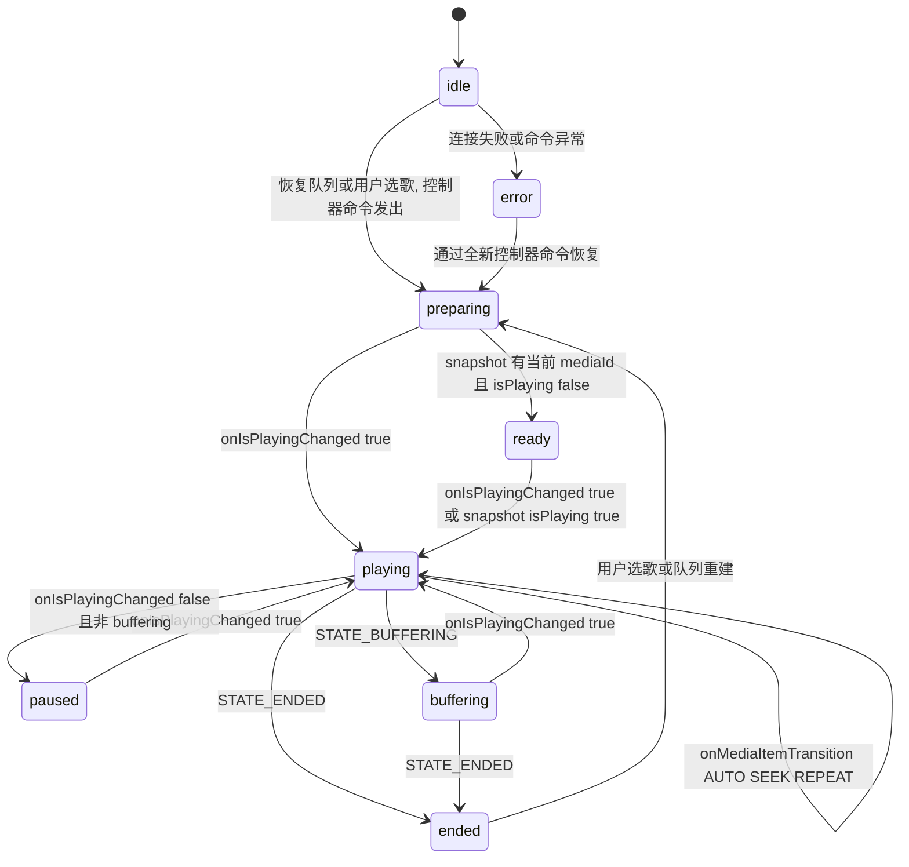
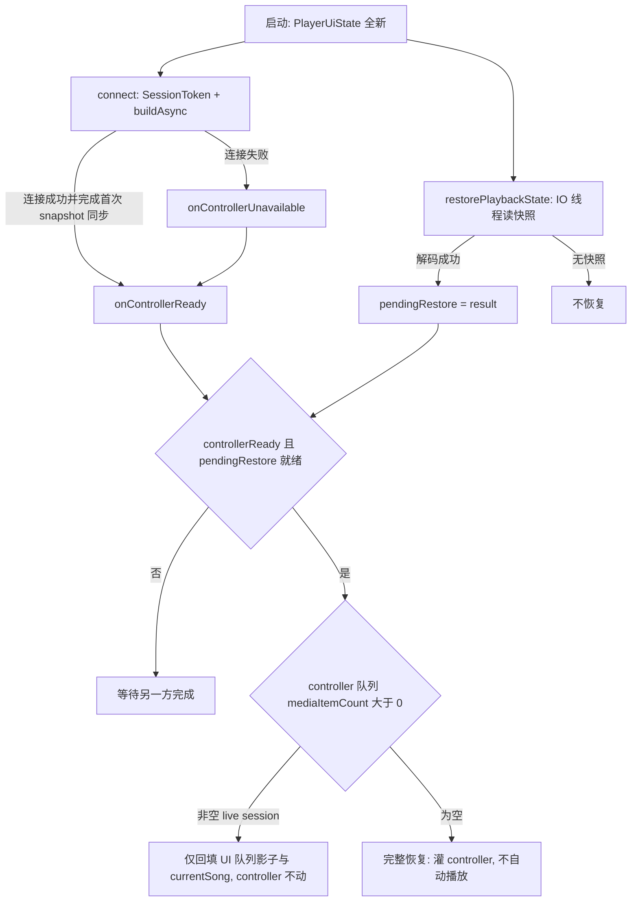

# Playback State Machine and Restore

The state model along the playback chain is deliberately kept small: **Media3 is always the source of truth for transport state**, and the application-layer state machine answers only one question — how the service, controller, domain synchronizer, feature facades, and UI should react to Media3 events. The normative document lives at `docs/architecture/PLAYBACK_STATE_MACHINE.md`; this page aligns that document's rules line-by-line with the code and highlights three counter-intuitive hard constraints: progress rendering only goes through the `positionMs` narrow flow, `isPlaying` jumps must re-emit a notification, and restore decisions must converge only after the `MediaController` connects.

Queue and window synchronization details live in `/openwiki/player/queue-architecture.md`, the Android integration surface of the service and `MediaController` in `/openwiki/player/service-and-controller.md`, the facade orchestration overview in `/openwiki/player/runtime-facades.md`, and the full start-to-restore lifecycle in `/openwiki/workflows/playback-session-lifecycle.md`.

## Responsibility Layering and Ownership

| Layer | Owner | Responsibility |
| --- | --- | --- |
| Media session service | `AppMediaSessionService` | Holds the `ExoPlayer` and `MediaSession`; saves the last song and position snapshot on service destruction / task removal. |
| Controller adapter | `PlaybackController` | Connects the `MediaController`, translates Media3 callbacks into `ControllerPlaybackSnapshot` / `PlaybackControllerCallbacks`, and executes queue/play/pause/seek commands. |
| Domain synchronizer | `ControllerPlaybackStateSynchronizer` | Maps the controller snapshot back to app playback state: `mediaId -> Song` resolution, queue current-index alignment, tracking start/stop transition decisions. Pure function, no Android dependency. |
| Feature facade | `PlayerControllerStateFacade` (plus `PlayerMediaEventFacade`, `PlayerPlaybackFacade`, `PlayerSessionFacade`) | Writes sync results into `PlayerUiState`, drives duration accounting and the progress ticker, triggers persistence, and applies restore results. |
| UI | `PlayerUiState` consumers | Render only; **the UI must not infer Media3 state itself** — realtime positions such as the progress bar / lyrics can only subscribe to the `positionMs` narrow flow. |

Two cross-cutting contracts:

- **mediaId contract**: `SongMediaItemMapper` writes the decimal `Song.id` into `MediaItem.mediaId`; `ControllerPlaybackStateSynchronizer.resolveControllerSong` parses it with `toIntOrNull()` and **ignores non-numeric ids** (keeping the existing `currentSong`), thereby keeping system-injected malformed media items out of business state.
- **Single-point mapping**: `ControllerPlaybackStateSynchronizer` is the only place that maps a controller snapshot back into `PlayerUiState`. No other path (service log listeners, Bluetooth monitoring, etc.) may bypass it to rewrite playback state fields.

### The Three-Layer State View

Playback state exists on three levels, and the restore/persistence contract must keep their ownership straight:

- **Media3 controller state** (source of truth in `:player` `PlaybackController`): `mediaItemCount`, the current mediaId, `isPlaying`, position and buffering. This is the only basis for the live-session criterion (`mediaItemCount > 0`) and for restore-time controller operations (`prepareQueue` / `playQueue`).
- **Runtime UI state** (`PlayerUiState`, feature layer): alongside Media3 state it carries explore playback's **dual flag** — `isExplorePlay` (the session-level fact that an explore queue is playing) and `isExploreModeActive` (the configuration-level fact that explore mode is enabled in settings). In restore/switch timing `isExplorePlay=true` may briefly hold while the mode is off; `PlayerMediaEventFacade` uses the dual flag as a backstop before learning listen results / refilling the queue.
- **Persistent snapshot** (DataStore `playback_state`): the serialized queue, position, infinite-play state, and the **`isExplorePlay` session flag** (added v3.11.0, no legacy fallback), restored after process restart/crash/UI rebuild according to the controller-queue criterion so explore-queue auto-refill survives restart.

## Normative State Machine and Major Transitions

*Normative playback state machine: Media3 events (`onIsPlayingChanged`, `STATE_BUFFERING`, `STATE_ENDED`, `onMediaItemTransition`, connection failure) drive the transitions; the solid transitions all funnel through `PlaybackController` callback translation into `PlayerControllerStateFacade`.*

> The diagram above is preserved from the architecture doc; the transition semantics encoded in it are documented precisely in the tables that follow.

### Normative States

| App state | Media3 source | Meaning and main side effects |
| --- | --- | --- |
| `idle` | No connected controller, no current media item, or empty business queue | Nothing playable; restore scenarios keep the UI selection and do not start tracking. |
| `preparing` | After `setMediaItems`/`setMediaItem` + `prepare()`, before the ready snapshot | The queue or single song has been sent to Media3 but is not ready yet; the business side keeps the requested `PlayQueue` as authoritative and waits for the controller snapshot to update duration / statistics. |
| `ready` | Controller has a current item and `STATE_READY` but `isPlaying=false` | Media is ready and resumable; the pause/stop path writes to disk and does not count valid playback duration. |
| `playing` | `onIsPlayingChanged(true)` or snapshot `isPlaying=true` | Starts/resumes `PlayDurationTracker`; updates current song, queue index, duration and same-name versions from the snapshot. |
| `paused` | `onIsPlayingChanged(false)` and not buffering, not ended | User/system pause; pauses duration tracking and saves playback state. |
| `buffering` | Snapshot `STATE_BUFFERING` | Temporary stall from media loading; **must not be treated as a user pause** — buffering must not flip isPlaying into a saved pause state. |
| `ended` | `STATE_ENDED`, natural end of a media item or auto transition | Stops current tracking, clears the tracked song, restores the add-next play mode as needed, refills the infinite queue near the window tail, and zeroes position at queue end. |
| `error` | Controller connection failure or a Media3 exception surfaced | Logged only via `AppLog`/`AppLogger` (release builds avoid bare URIs/paths/device info); the UI offers a recoverable action when playback is affected (e.g. `PlayerErrorFacade`'s replay prompt). |

### Transition Table

| From | Event (Media3 source) | To | Notes |
| --- | --- | --- | --- |
| `idle` | App restores a saved queue or user picks a song → `prepareQueue`/`playQueue`/`playSingle` | `preparing` | Restore always goes through a fresh controller command. |
| `preparing` | Snapshot has a current `mediaId` and is not playing | `ready` | The synchronizer resolves the song and aligns `PlayQueue.currentIndex`. |
| `preparing`/`ready`/`paused` | `onIsPlayingChanged(true)` | `playing` | `isPlayingTransition` only resumes tracking when there is a current song. |
| `playing` | `onIsPlayingChanged(false)` and `isBuffering=false` | `paused` | Writes playback state and pauses duration tracking. |
| `playing` | `STATE_BUFFERING`, or `onIsPlayingChanged(false)` with `isBuffering=true` | `buffering` | Not treated as an intentional pause. |
| `buffering` | `onIsPlayingChanged(true)` | `playing` | Resumes normal tracking without resetting the current song. |
| `idle`/`ready`/`paused` | Snapshot `isPlaying=true` (live-session adoption) | `playing` | When the UI state is rebuilt (off-screen/background return, config change, ViewModel rebuild) but the service keeps playing, Media3 does not re-emit `onIsPlayingChanged` for the newly created `MediaController`; that jump is detected by `syncControllerPlaybackState` and fires a notification (hard constraint two). |
| `playing`/`buffering` | `onMediaItemTransition`, reason `AUTO`/`SEEK`/`REPEAT` | `playing` or `ended` | Natural end, manual track change (headset/lock screen/notification), and single-item repeat all enter `handleMediaItemEnded`: it stops tracking the old track and starts tracking the new one by mediaId; a window-tail wrap (`isMediaItemWrap` by index) triggers queue refill and add-next mode restore. |
| `playing`/`paused`/`buffering` | `STATE_ENDED` → `onPlaybackEnded` | `ended` | `handlePlaybackEnded` sets `isPlaying=false` and position `0`. |
| any | Controller connection failure or command exception | `error` | Pending actions stay isolated; failures are only logged and never pollute the business queue. |
| `ended`/`error` | User picks a valid song or queue rebuild | `preparing` | Restore always goes through a fresh controller command. |

## Single-Point Mapping: ControllerPlaybackStateSynchronizer

`ControllerPlaybackStateSynchronizer.sync(current, snapshot, trackedSongId)` is a pure function taking the `ControllerPlaybackState` projected from `PlayerUiState` plus the controller snapshot, and producing a `ControllerPlaybackSyncResult`:

- **Song resolution**: `resolveControllerSong` first queries `songs`, then `playQueue.songs`, matching by id; on a failed resolution (non-numeric / unknown id) it keeps the original `currentSong`.
- **Queue alignment**: `syncQueueCurrentIndex` only relocates `currentIndex` when the current queue item differs from the controller song — same-name songs enqueued repeatedly share one mediaId, so the id-equality short-circuit avoids the index snapping back to the first occurrence.
- **Duration**: `durationMs` only accepts non-negative snapshot values (`coerceAtLeast(0)`; `C.TIME_UNSET` is already filtered to null in `PlaybackController.toPlaybackSnapshot`); it also emits a `DurationUpdate` so the duration tracker can correct the 90% completion threshold.
- **Same-name versions**: recomputed only when a song change is detected (`songChanged`) — same `groupKey`, playable, sorted by sample rate descending.
- **Playback start (once per song)**: only emits `PlaybackStart` when `snapshot.isPlaying && controllerSong != null && trackedSongId != controllerSong.id`. A steady-state snapshot for an already-tracked song does not re-trigger `startPlayback`; this is the implementation of "each song starts playback tracking only once".

`isPlayingTransition(previousIsPlaying, newIsPlaying, isBuffering, hasCurrentSong)` independently gives tracking-transition decisions:

- `shouldPauseTracking` = previously playing && now not playing && **not buffering**;
- `shouldResumeTracking` = previously not playing && now playing && has a current song.

`PlayerControllerStateFacade` consumes the result: it applies `DurationUpdate` and `PlaybackStart`, writes back `trackedSongId` and `PlayerUiState`, then notifies the ticker on the jump. `PlaybackStart` carries the snapshot position as `initialPlayedMs` — on kill-and-restore the restore-point progress counts toward the played-duration base, so "played before the kill + finished after restore" still meets the 90% valid-playback threshold without re-zeroing the timer; a normal new track has position 0 and is unaffected.

## Hard Constraint One: Progress Rendering Is Driven Only By the positionMs Narrow Flow

- The sole advancement source for the progress display is the `positionMs` narrow flow (`PlayerRuntime._positionMs`), written periodically by `PlayerPlaybackProgressTicker`: a coroutine loop reads Media3's locally extrapolated position (no IPC) and **writes straight to the narrow flow**, bypassing `PlayerUiState`. The default interval is 200ms — the code comment records the tightening from 500ms (500ms left lyrics highlighting lagging ~250ms on average, "half a beat off"; at 200ms the narrow flow is only locally subscribed by the lyrics page / progress bar, so the 5fps local-recomposition cost is negligible and average lag drops to ~100ms). The early-documentation claim of "direct write every 500ms" is outdated.
- `PlayerUiState.currentPositionMs` is **deliberately not refreshed from the controller snapshot**: `applyControllerPlaybackState` keeps the field as-is. If it refreshed with the snapshot, the main `uiState` would change continuously at snapshot frequency (far above 5fps), triggering whole-shell recomposition; keeping the old value means that in playback steady-state the rest of the `ControllerPlaybackState` copy is equal, so the `StateFlow` emits nothing new.
- When discrete events (seek, track change, restore, pause) write `currentPositionMs`, `NarrowFlowSync.update` one-way-propagates the main-state change to the narrow flow so the UI immediately reflects the target position; the comparison baseline is the **pre-update uiState old value**, not the narrow flow's current value — otherwise the two beat differently during playback and every discrete update flushes a stale position back into the narrow flow (visible as a progress-bar jump-back jitter roughly every 5s).
- Corollary: **snapshot sync itself does not advance the progress display**. If the ticker does not run, progress stays at 0 — which is precisely what hard constraint two must solve.

## Hard Constraint Two: isPlaying Jumps Must Re-emit onIsPlayingChanged

The progress ticker only starts/stops when it receives `onIsPlayingChanged` (`PlayerRuntime` wires `controllerStateFacade`'s notification to `playbackProgressTicker::updateRunningState`, which internally starts/cancels the coroutine by `uiState.isPlaying`; on start the loop body **writes one real position before delaying**, so it does not wait for the first interval).

Hence the hard constraint: **any path that flips `isPlaying` from false to true (or back) must emit that notification**, or the ticker will not start, progress stays at 0, and the song is actually playing.

In the live-session scenario (off-screen/background return, config change, ViewModel rebuild) the UI state is brand new while the service `ExoPlayer` keeps playing: Media3 only calls `onIsPlayingChanged` when isPlaying changes, and a newly created `MediaController` does **not** replay it on listener registration. Here `syncControllerPlaybackState` is the only path that can pull the ticker up — after syncing it detects `wasPlaying != result.state.isPlaying` and only re-emits the notification on a jump.

The jump check **cannot be dropped**: `PlaybackController.listener.onEvents` wires `onPlaybackSnapshot` into a high-frequency callback (Media3's event-batch aggregation hook emitting a snapshot on every event batch), so an unconditional notification would make `updateRunningState()` run repeatedly in playback steady-state.

By contrast, the discrete callback path `handleControllerIsPlayingChanged` notifies unconditionally (it is the edge-triggered `onIsPlayingChanged` callback anyway), and per `isPlayingTransition` either pauses tracking + writes to disk (real pause) or resumes tracking (start); buffering-induced fake pauses do neither.

## Playback Tracking and Buffering Semantics

- **Each song starts tracking only once**: `PlaybackStart` is deduplicated by `trackedSongId`; `handleMediaItemEnded` stops tracking and clears `trackedSongId`, so the next song's snapshot emits `PlaybackStart` again.
- **Buffering is not a user pause**: `PlaybackController` carries `controller?.playbackState == Player.STATE_BUFFERING` inside the `onIsPlayingChanged` callback; `isPlayingTransition` therefore ignores isPlaying jitter during buffering — it neither pauses duration tracking nor writes a pause state. `ControllerPlaybackStateSynchronizerTest.isPlayingTransitionIgnoresBufferingPause` and `PlayerControllerStateFacadeTest.handleIsPlayingChangedDoesNotPauseTrackingWhileBuffering` lock in this behavior.
- The tracking implementation `PlayDurationTracker` (`:player`, injected via `PlaybackDurationMonitorFactory`) accumulates duration on IO coroutines: `startPlayback(songId, durationMs, initialPlayedMs)` settles the previous song and starts counting from the restore point; `stopPlayback` settles valid playback (completion rate ≥ 90% or long songs ≥ 5 minutes count as one valid play, seconds-skipped songs are removed once they qualify, and short plays < 5s added twice to the skip list), with all Room writes on a background thread.

## ended and error Transition Effects

- `onMediaItemTransition` (`AUTO`/`SEEK`/`REPEAT`) and window-tail wraps under `REPEAT_MODE_ALL` (`isMediaItemWrap` by index — not by reason, since `REPEAT` only means single-item repeat) both translate into `onMediaItemEnded(startedSongId, wrapped)`, entering `PlayerMediaEventFacade.handleMediaItemEnded`: it first reads the just-ended song's actual played duration and `trackedSongId`, stops tracking, and clears `trackedSongId`; under explore play (the `isExplorePlay && isExploreModeActive` dual backstop) it first calls `onExploreSongSettled(songId, playedMs)` to learn the listen result (a skip vote for <30s or <1/4 total duration, per `ExplorePlaybackPolicy.isSkipped`), then refills `ExplorePlaybackPolicy.REFILL_COUNT`(5) songs only when remaining ≤ `ExplorePlaybackPolicy.REFILL_THRESHOLD`(0) — i.e. the just-ended song was second-to-last and the new current track has 0 left after it (remaining 1, i.e. third-to-last, is not refilled, avoiding a replay pull-back while the business queue's `currentIndex` is unsynced; fixed 2026-10-20); under infinite play it refills when remaining ≤ `DEFAULT_REFILL_THRESHOLD`(5) or a wrap occurred; it restores the add-next play mode via `QueueManager`; finally it fires the sleep-timer "play finished last song" hook. A single-item queue wrap (index 0→0, no `onMediaItemTransition`) is caught by `onPositionDiscontinuity`'s AUTO discontinuity + a position rewind (`isSingleItemLoopRewind`).
- `STATE_ENDED` → `handlePlaybackEnded` only does the state wrap-up of `isPlaying=false`, position `0`.
- `onPlayerError` → `PlayerRuntime.handlePlayerSourceError` looks up the current song and writes a readable `errorMessage` ("local file missing or unplayable") to the UI; `PlayerErrorFacade.playFromQueue` gives the same prompt for unplayable songs. Recovery (restart after `ended`/`error`) always goes through a fresh controller command; pending actions are discarded by `abortPendingActions` on connection failure and reported via `onControllerUnavailable` (while disconnected, commands are buffered FIFO with a cap of 64; beyond the cap the earliest is dropped and the user is prompted).

## Persistence Decoupling

Playback-state persistence is fully decoupled from the UI progress beat: **progress rendering does not trigger high-frequency disk writes**, and persistence is handled by three independent paths.

### PlaybackStateStore and Snapshot Serialization

- `PlaybackStateStore` (`:player`, implementing `:domain`'s `PlaybackStateStorage` and `PlaybackStateRepository`) writes six keys into the DataStore `playback_state`: `play_queue_json` (queue JSON), `play_position_ms`, `is_infinite_play`, `infinite_played_ids`, `is_explore_play`, `current_song_id`; legacy SharedPreferences (`music_player_prefs`) is a read fallback that is cleared after a successful save (migration). Write failures are only logged via `AppLogger` and **never interrupt playback control**.
- **Empty-session protection**: as long as the queue is empty and not infinite play, the save does not overwrite the queue JSON and dispatches along three branches: existing queue + a current song → keep the queue, only update `currentSongId` and position; no existing queue but a current song → write an empty queue + `currentSongId`/position (restore falls back to a single-song queue by `currentSongId`); fully empty with no existing snapshot → write no keys and keep the legacy fallback (legacy is only cleared after a real DataStore write). This blocks two regression classes: the transient "fully empty" during the UI-rebuild window, and the live-session reconnect where the first-frame snapshot sync sets `currentSong` and the autosaver then writes one "empty queue + currentSong" snapshot (overwriting the valid queue written 5s earlier with an empty array, so every subsequent kill yields an empty queue) — otherwise queue and progress would be lost forever. Explicit clears (user clears the queue / ends playback) go through `clearPlaybackState()` (which also removes the `is_explore_play` key).
- `PlaybackStateSnapshotSerializer` encodes `songIds`/`currentIndex`/`playMode`/`playOrderIds` by occurrence into a JSON array (preserving repeated-enqueue semantics); on decode it filters invalid songs against the current library, returns null on a missing `currentIndex` or corrupted JSON, allows an empty queue (`allowEmpty`) only for infinite play or a recorded `currentSongId`, and filters infinite-play played ids down to still-existing songs.
- `saveCurrentPlaybackSnapshot` / its suspend variant `persistCurrentPlaybackSnapshot` only overwrite `CURRENT_SONG_ID` and `PLAY_POSITION_MS` and **preserve the queue JSON**: used to overlay the last playing song and progress onto an existing queue (on restore a stale queue index is corrected by `currentSongId`, and a song not in the stored queue falls back to a single-song queue).

### PlayerPlaybackStateAutosaver: Periodic Lightweight Save

`PlayerPlaybackProgressTicker` calls `PlayerPersistenceGraph.onPlaybackPosition` → `PlayerPlaybackStateAutosaver.onPlaybackPosition` every time it writes the narrow flow, throttled by `SystemClock.elapsedRealtime` — by default **5 seconds** (`DEFAULT_INTERVAL_MS`, crash-recovery granularity is enough; exit/track-change/pause still have the explicit save fallback) before running `syncPlaybackState()` (first pulls one fresh controller snapshot to correct state) + `savePlaybackState(positionMs)`. `PlayerPersistenceFacade.savePlaybackStateAsync` captures the position on the calling thread and only then moves the DataStore write to IO, avoiding a main-thread blocking write during playback. The 5fps progress beat therefore never touches the disk; the write frequency is fixed at 5s plus discrete events.

### Service-Side Exit Snapshot

`AppMediaSessionService` calls `saveCurrentPlaybackSnapshot` in `onDestroy`/`onTaskRemoved`: the songId and position are read **synchronously** on the calling thread (ExoPlayer is only accessible on its application thread) and the DataStore write is handed to the process-level `ApplicationScope` coroutine asynchronously (the suspend variant `persistCurrentPlaybackSnapshot`), which then records the playlist resume point. The persistence coroutine can still run to completion after the service instance is destroyed.

### PlaybackRestoreCoordinator: Playable-Session Restore

`PlaybackRestoreCoordinator.restore(allSongs)` upgrades the storage-layer `RestoredPlaybackState` (queue, positionMs, infinite-play state) into a `PlaybackRestoreResult`: when the queue's current song is playable (`uri != null`) it additionally constructs a `RestoredPlayableSession(song, positionMs, sameNameSongs)` whose same-name versions come from `SongVersionManager.sortedSameNameSongs` sorted by sample rate descending — the restore "same-name version" panel shares data with the full-restore path. `isExplorePlay` threads through `RestoredPlaybackState`/`PlaybackRestoreResult` on the same path as `isInfinitePlay`, and `PlayerPersistenceFacade.applyPlaybackRestoreResult` writes it back to `PlayerUiState` so explore-queue auto-refill survives restart.

## Hard Constraint Three: The Restore Decision Converges at onControllerReady

After a process rebuild (off-screen/background return, config change, ViewModel rebuild) the UI state is brand new, and restore must answer: is the service still playing a live session?

*Restore-decision handshake: the DataStore read and the controller connection advance in parallel, and `PlayerPersistenceGraph` converges them in `maybeApplyRestore` with the `controllerReady`/`pendingRestore` flags, using whether the controller queue is empty as the sole criterion.*

Rules and reasoning:

- **The decision must be made after the `MediaController` connects (`onControllerReady`)**. `PlayerStartupFacade.start`'s order is: start the service → connect the controller (`connect`'s `onConnected` finishes the first snapshot sync before firing `onControllerReady`) → load the library → `restorePlaybackState`; no matter which async line finishes first, it waits for the other, because guessing a live session from `position > 0` or `queueInfo == null` before the controller state is known necessarily races — `currentPlaybackPositionMs` degrades to a UI-state value (always 0 after a rebuild) while the controller is not ready, misclassifying a live session as session-less, and then the snapshot overwrites the playing session.
- **The sole live-session criterion is a non-empty controller queue**: `liveSessionActive()` = `controllerQueueInfo()?.mediaItemCount ?: 0 > 0`. Non-empty → the snapshot only backfills the UI; empty (cold start / empty service session) → full snapshot restore.
- **Live-session branch**: `PlayerPersistenceFacade.applyRestoreResult(restoreController = false)` restores the UI queue, `currentSong` and `sameNameSongs`, and **never touches the controller** — no queue rebuild, no restore-position write, no `isPlaying` overwrite; the real position and isPlaying are left to post-connect `syncControllerPlaybackState` (whose jump notification also pulls the ticker up, per hard constraint two). Rebuilding the queue would overwrite the playing session with the snapshot position and rewind progress; `PlaybackController.prepareQueue` additionally self-guards against overwriting a live session (skipping straight out when `mediaItemCount > 0`).
- **Full-restore branch**: `prepareControllerQueue(queue, currentIndex, positionMs)` pushes the queue and the restore-point position back into the controller **without autoplay**; the UI side writes `currentSong`, restore-point position, and `isPlaying=false`.
- **The UI queue shadow (`playQueue` etc.) is restored from the snapshot in every case**: the controller's snapshot sync only adjusts `currentIndex` and never fills `songs`; skipping the UI-queue restore on that branch leaves the playback queue permanently empty after rebuild, and infinite-play state (`isInfinitePlay`/`infinitePlayedSongIds`) is lost too.
- **A startup connection failure also releases the decision**: `handleControllerUnavailable` calls `onControllerReady` as well — otherwise `pendingRestore` hangs forever and the UI queue is never restored (during playback while unavailable the `pendingRestore` was already consumed, so this fallback is side-effect free).

### Restore and the Windowed Queue

Both restore branches and every runtime sync operate on the **windowed controller queue**, not the full business queue: `PlayerControllerQueueFacade.buildControllerQueue` routes through the `ControllerQueuePlannerPort` (bound by Hilt `PlayerModule.provideControllerQueuePlanner` to `WindowedControllerQueuePlanner`, which forces a fresh window from the queue cursor via `ControllerWindowSynchronizer.planControllerQueue`). `remainingMediaItems()` therefore measures the window (controller `mediaItemCount` minus `currentMediaItemIndex` minus one), falling back to the planned window's `remainingAfterStart` when the controller is empty. This matters for the refill thresholds below: they fire against the controller window, and refills extend that window rather than re-downloading the whole queue.

## Window Refill Accompanying Every Sync

`PlayerRuntime` wires a refill rule to the `onControllerPlaybackSynced` hook of `PlayerControllerStateFacade`: when the synced business queue is non-empty, infinite play is off, and the controller's remaining media items ≤ `DEFAULT_REFILL_THRESHOLD`(5), it calls `syncPlayerQueue` to re-push the business queue into the controller. The snapshot-sync path therefore doubles as the queue-refill trigger point near the window tail (infinite-play refill logic is documented in `/openwiki/player/random-and-infinite.md`).

## Test Anchors

- **`ControllerPlaybackStateSynchronizerTest`**: snapshot mapping (song resolution, queue-index alignment, duration), unknown mediaId keeps the current song, already-tracked songs do not re-emit `playbackStart`, and transition decisions that ignore buffering pauses / handle real pause and resume.
- **`PlayerControllerStateFacadeTest`**: sync updates UI and tracking, snapshot position does **not** overwrite `uiState.currentPositionMs`, false→true and true→false jumps notify the ticker exactly once, repeated steady-state syncs notify 0 times, real pauses pause tracking and write to disk, and buffering pauses do neither.
- **`PlaybackStateStoreTest`**: queue/position/mode/play-order round-trips, invalid-song filtering, repeated queue items preserved, infinite-play state (including empty queue), `is_explore_play` read/write round-trip (v3.11.0), currentSongId snapshot index correction and single-song-queue fallback, empty-session save preserving the existing snapshot, and legacy SharedPreferences fallback + migration.
- **`PlayerMediaEventFacadeTest`**: on explore track change it calls `onExploreSongSettled` (with the actual played ms), refills only when the ended song was second-to-last (remaining 0), does not refill for third-to-last (remaining 1) or a full queue, and still refills without learning the listen result when `trackedSongId` is null.
- **`PlaybackStateSnapshotSerializerTest`**: repeated items/index/mode/order round-trips, corrupted JSON and missing `currentIndex` return null, optional-field defaults, and malformed/nonexistent infinite-play ids are filtered.
- **`PlayerPersistenceFacadeTest`**: async saves capture the position first, restore applies the queue and playable session, **under a live session only the UI queue is restored and the controller is completely untouched** (position and isPlaying are not overwritten), infinite-play state restores, and a stale queue index still persists by currentSong.
