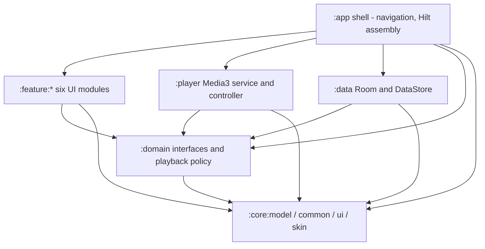

# Quick Start

This repository is **melody-in-heart** (applicationId `cn.com.dcsgo.mihx`): a fully local, offline-first, ad-free, network-free Android music player. Current version is `3.12.2` (versionCode 50), `minSdk 33` / `targetSdk 36`, Java 11 bytecode. The stack is Kotlin 2.0.21 + Jetpack Compose (BOM 2025.09.01) + Media3 1.9.0 (with the Jellyfin FFmpeg decoder extension) + Hilt 2.52 + Room 2.6.1 (`MelodyDatabase` **v17**, **14 entity tables**) + DataStore 1.1.1 + WorkManager 2.9.1 + LiteRT 1.4.1 / TFLite (via the `org.tensorflow.lite.Interpreter` API for on-device emotion inference). The project is split into **15 Gradle modules** (`:app`, five `:core:*`, `:domain`, `:data`, `:player`, six `:feature:*`, `:benchmark`), and module boundaries are enforced by the custom `verifyProductArchitecture` gate. Before editing any code read the routing table on this page to find the matching topic page; run `./gradlew check` before committing.

## What to read, what to trust

- **Source and tests are the only authority.** Every wiki conclusion carries `repo://` evidence, but implementation keeps evolving — when you act, trust the current code above any doc.
- `CLAUDE.md` and `docs/` are high-value historical references (build conventions, queue/state-machine design docs), but **they may lag the code** and must be cross-checked. `CLAUDE.md` mostly tracks current versions but its Room status comments historically drifted — verify against `MelodyDatabase` (now **v17 / 14 entities**) and the exported snapshots under `data/schemas/` (`1.json..17.json`). Its version table otherwise matches the catalog (Compose BOM `2025.09.01`, Kotlin `2.0.21` with the built-in `org.jetbrains.kotlin.plugin.compose` compiler — never the old `composeOptions { kotlinCompilerExtensionVersion }` block).
- The repository root `AGENTS.md` convention: OpenWiki pages are refreshed by scheduled workflows; do not hand-edit pages under `openwiki/` unless explicitly asked.

## Module overview



*Legal dependency direction: only `:app` may see every module; dependencies between features, or from a feature to `:data`/`:player`, are forbidden by `verifyProductArchitecture`. As of v3.11.0, `:player` implementation classes were moved from the legacy `cn.com.dcsgo.mihx.data.player` package into `cn.com.dcsgo.mihx.player` (matching the module namespace); the gate now fails on any residual reference to the old package.*

| Layer | Module | One-line responsibility |
| --- | --- | --- |
| App shell | `:app` | `MelodyApplication` (Hilt `@HiltAndroidApp` + Coil `ImageLoaderFactory`) / `MainActivity` / `AppRoot` / `AppNavHost`, route table `AppRoutes`, bottom-bar shell, permission coordinator, emotion-scan worker, skin-shell resolver, Hilt assembly |
| Feature | `:feature:home/playlist/user/lyrics/player/settings` | Each feature exposes `XxxRoute` + `XxxScreen` (the Route/Screen pattern is enforced by the architecture task); `:feature:player` additionally hosts the `PlayerRuntime` facade composition root |
| Domain | `:domain` | Repository interfaces + pure playback policy (planner/synchronizer/coordinator, incl. `MoodSlotResolver`, `ExplorePlaybackPolicy`), no Android dependencies |
| Data | `:data` | Room `MelodyDatabase` (v17, 14 entity tables incl. `word_preferences` + `song_emotions`) + migrations, DataStore wrappers, narrow adapters binding domain interfaces |
| Player | `:player` | `AppMediaSessionService` (ExoPlayer + MediaSession), `PlaybackController` (MediaController client), windowed queue planning, Bluetooth coordination, `EmotionAnalyzer` + `FfmpegPcmDecoder` inference support |
| Core | `:core:model` / `:core:common` / `:core:ui` / `:core:skin` | Pure data types (`WordPreference`, `RandomEnhanceMode`, emotion model coordinates) / `AppLog` + `PerformanceTrace` / theme and shared Compose components / skin description model, parser and fail-closed validation |

Layering detail and Hilt binding points: [/openwiki/architecture/module-graph.md](/openwiki/architecture/module-graph.md).

**Offline and privacy invariants**: the app's own manifest declares `POST_NOTIFICATIONS`, `FOREGROUND_SERVICE`, `FOREGROUND_SERVICE_MEDIA_PLAYBACK` and `BLUETOOTH_CONNECT` — there is **no `INTERNET` permission**. `READ_MEDIA_AUDIO` is accepted solely to accelerate the import scan (a fast direct `java.io.File` traversal when already granted), but SAF document-tree access remains the primary and fallback path and `READ_EXTERNAL_STORAGE` is still banned by the architecture task; a denied `READ_MEDIA_AUDIO` silently falls back to SAF. Backup/data-extraction rules must keep excluding playback state, Room files, DataStore files and the album-art cache. Notification and Bluetooth permissions may only be requested from user-triggered Settings paths, never on the startup path (startup-path requests fail the gate). `MelodyApplication` additionally installs the Coil `ImageLoaderFactory` and configures a bounded memory (20% max) / 64 MB disk image cache deferred until first image load (shortens the cold-start path).

## Common commands

All commands run from the repository root; use `.\gradlew.bat` on Windows and `./gradlew` on macOS/Linux.

```bash
# Fast single-module compile (quickest feedback after an edit)
./gradlew :data:compileDebugKotlin

# Full JVM unit-test run (no device needed)
./gradlew test
# Single module / single test class
./gradlew :player:test --tests "cn.com.dcsgo.mihx.player.window.ControllerQueuePlannerTest"

# Need a device/emulator
./gradlew :app:connectedAndroidTest      # Compose instrumentation tests
./gradlew :benchmark:connectedCheck      # Macrobenchmark (cold start / scrolling frame rate)

# Format and architecture gates
./gradlew spotlessCheck                  # or spotlessApply to auto-fix
./gradlew verifyProductArchitecture

# Pre-commit full gate: root spotlessCheck + verifyProductArchitecture + check/test across all 15 subprojects
./gradlew check
```

### `verifyProductArchitecture` gate at a glance

A custom validation task wired into the root `check` lifecycle. Since m-10 (2026-10-15) the rule body lives in `buildSrc` (`ProductArchitectureVerification`) as pure, unit-tested logic over the file tree; the root task only collects files and raises, collecting **all** violations at once instead of failing on the first. Main rule families:

- **Module boundaries**: features must not depend on `:data`/`:player`/other features; implementation-layer imports (`cn.com.dcsgo.mihx.data.repository/local`) must not leak into feature/domain/player; `MusicRepository` must stay an internal storage coordinator bound through narrow adapters (`SongRepositoryAdapter`, `PlaylistRepositoryAdapter`, `MusicImportRepositoryAdapter`, `AlbumArtRepositoryAdapter`).
- **Module graph completeness**: all 15 product modules listed in `settings.gradle.kts` (`:app`, `:core:model/common/ui/skin`, `:domain`, `:data`, `:player`, the six `:feature:*`, `:benchmark`) must exist, each with a local `.gitignore` covering generated Android/Gradle output.
- **Hilt wiring**: the entry points (`MelodyApplication` `@HiltAndroidApp`, `MainActivity`/`AppMediaSessionService` `@AndroidEntryPoint`, `PlayerViewModel` `@HiltViewModel`) and DI modules (app-side `CoroutineModule`/`LoggerModule`/`PlayerModule`, data-side `DatabaseModule`/`RepositoryModule`/`DataStoreModule`) must exist; the old `PlayerViewModelComponents`/`PlayerViewModelComponentFactory` assembly hub must not reappear.
- **Room schema immutability**: historical JSON under `data/schemas/` (1–17.json now) must not be modified; v1/v2/v3 content assertions lock the migration semantics.
- **UI and code conventions**: `LazyColumn` `items` must carry a stable `key`; direct `android.util.Log` calls are banned (must use `AppLog`); `:core:model` must stay a pure data model without Android resources or UI resource ids.
- **Release and privacy**: release must have `isMinifyEnabled` + `isShrinkResources`; the `:app` manifest must not declare `AppMediaSessionService`; backup rules must contain the agreed privacy exclusions; requests for notification/Bluetooth/`READ_MEDIA_AUDIO` permissions must not appear on the startup path (startup-path requests fail); `READ_EXTERNAL_STORAGE` must never be declared; `com.google.android.things` dependencies/references must not exist.
- **Performance anchors**: `MusicRepository` import/scan and `PlaybackController` hot paths must keep `PerformanceTrace` operation anchors; the `:benchmark` module shape and `StartupBenchmark` terminology are checked.

On failure a `GradleException` report names each violated rule. Full rule list and release constraints: [/openwiki/operations/build-and-verification.md](/openwiki/operations/build-and-verification.md).

### Build variants

| Variant | Highlights |
| --- | --- |
| `debug` | No minification; `applicationIdSuffix=".debug"` so it can coexist with a release install |
| `release` | R8 minify + resource shrink; only `arm64-v8a`; falls back to debug signing when `keystore.properties` is missing, and passes `-PrequireReleaseSigning=true` to fail the build instead (prevents accidentally shipping a debug-signed package) |
| `benchmark` | inherits release settings but uses debug signing, non-debuggable, adds `x86_64` for emulators |

### Room schema change flow (common pitfall)

Change an entity → bump `MelodyDatabase.VERSION` → build to export the new schema JSON to `data/schemas/` → write `Migration(N, N+1)` and register it in `MelodyMigrations.ALL` → add a narrow unit test for complex migrations. **Never modify already-exported historical schema JSON.**

## Task → page-to-read routing table

| What you are changing | Read first | Companion narrow verification |
| --- | --- | --- |
| Explore play (探索播放) / word-preference voting / random & infinite modes | [/openwiki/player/random-and-infinite.md](/openwiki/player/random-and-infinite.md), [/openwiki/concepts/emotion-model.md](/openwiki/concepts/emotion-model.md) | `./gradlew :feature:player:test :domain:test --tests "cn.com.dcsgo.mihx.domain.playback.ExplorePlaybackPolicyTest"`, `./gradlew :data:test --tests "cn.com.dcsgo.mihx.data.repository.WordPreferencesRepositoryTest"` |
| Queue / windowed sync / `PlayQueue` invariants | [/openwiki/player/queue-architecture.md](/openwiki/player/queue-architecture.md) | `./gradlew :player:test :feature:player:test` |
| `PlayerRuntime` facade graph / learning feedback | [/openwiki/player/runtime-facades.md](/openwiki/player/runtime-facades.md), [/openwiki/player/state-machine.md](/openwiki/player/state-machine.md) | `./gradlew :feature:player:test` |
| Playback state machine / process restore / service and Bluetooth | [/openwiki/player/state-machine.md](/openwiki/player/state-machine.md), [/openwiki/player/service-and-controller.md](/openwiki/player/service-and-controller.md) | `./gradlew :domain:test --tests "cn.com.dcsgo.mihx.domain.playback.ControllerPlaybackStateSynchronizerTest"` |
| Emotion analysis or mood time-slot anything-play | [/openwiki/concepts/emotion-model.md](/openwiki/concepts/emotion-model.md), [/openwiki/workflows/emotion-analysis-pipeline.md](/openwiki/workflows/emotion-analysis-pipeline.md) | `./gradlew :domain:test --tests "cn.com.dcsgo.mihx.domain.playback.MoodSlotResolverTest"` plus `./gradlew :core:ui:test` |
| Style switching / multi-theme-color update (skin shell, `ThemeVariant`, tab/menu layout) | [/openwiki/architecture/app-shell-navigation.md](/openwiki/architecture/app-shell-navigation.md), [/openwiki/architecture/module-graph.md](/openwiki/architecture/module-graph.md) | `./gradlew :core:skin:test :app:test --tests "cn.com.dcsgo.mihx.app.shell.*"` |
| Sorting the local-music list / screen orientation / duplicate-song cleanup | [/openwiki/architecture/data-persistence.md](/openwiki/architecture/data-persistence.md) | `./gradlew :data:test :domain:test` |
| Room / DataStore / migration / backup exclusions | [/openwiki/architecture/data-persistence.md](/openwiki/architecture/data-persistence.md), [/openwiki/operations/build-and-verification.md](/openwiki/operations/build-and-verification.md) | `./gradlew :data:test` |
| Navigation / app shell / permissions / theme | [/openwiki/architecture/app-shell-navigation.md](/openwiki/architecture/app-shell-navigation.md) | `./gradlew :app:connectedAndroidTest` |
| Add a module / change dependency boundaries / touch Hilt wiring | [/openwiki/architecture/module-graph.md](/openwiki/architecture/module-graph.md) | `./gradlew verifyProductArchitecture` |
| Full playback session (start → track change → settle → restore) | [/openwiki/workflows/playback-session-lifecycle.md](/openwiki/workflows/playback-session-lifecycle.md) | player-related tests |
| Pre-commit / pre-release overview | [/openwiki/operations/build-and-verification.md](/openwiki/operations/build-and-verification.md), [/openwiki/testing/test-map.md](/openwiki/testing/test-map.md) | `./gradlew check` |

### Three hard constraints per task area (know before editing)

- **Player**: `PlayQueue.songs` is the business queue that may contain duplicates; `MediaController` only holds the current ± window (≤71 items after planning: 20 before + current + 50 after); `MediaItem.mediaId` must equal `Song.id.toString()`; `PlayerViewModel` is a thin `@HiltViewModel` facade — real logic lives in the `PlayerRuntime`-composed facade/graph layer, so do not stuff logic into the ViewModel and never reintroduce the `PlayerViewModelComponents` hub.
- **Emotion feature**: batch scans are driven by a WorkManager periodic task scheduled from `MelodyApplication.onCreate` (while charging with sufficient battery, ~6h cycles; manual triggers auto-requeue); `EmotionAnalyzer` decodes to 16 kHz mono PCM (`FfmpegPcmDecoder`, memory-budgeted against `maxMemory()`, matching the `largeHeap` app) and runs a fixed YAMNet embedding (521 AudioSet classes) + a per-window V/A head in `:player` assets to produce per-window V/A curves, whole-song mean, and a `vocalScore`; results go to Room `song_emotions`; failures go to DataStore JSON and songs accumulating `MAX_ATTEMPTS` (=3) failures stop being auto-retried. Mood time-slot anything-play is decided by `MoodSlotResolver` over half-open `[start, end)` intervals (`end <= start` wraps midnight); tag filtering happens at the planner entry, and an empty pool falls back to full-library random.
- **Explore play / word preference (v3.11.0+)**: `RandomEnhanceMode` is `OFF` / `TIME_SLOT` / `EXPLORE` — `TIME_SLOT` and `EXPLORE` are mutually exclusive; `EXPLORE` generates a 10-song batch, disables infinite random, increments like/dislike votes per emotion word when a song settles (full listen ≥30s **and** ≥1/4 of duration → LIKE; quick skip → DISLIKE) via `WordPreferenceRepository.recordSongOutcome`, and auto-refills 5 songs when the just-ended song was second-to-last (queue remaining `== REFILL_THRESHOLD` = 0) via `refillExplorePlayQueue`. Since v3.12 votes are **ratio-weighted**: vote weight = per-word share × 100 (`ExplorePlaybackPolicy.VOTE_WEIGHT_SCALE`), so a skipped track knocks its dominant emotion words harder while incidental words lose almost nothing. Refill pools tier by liked-and-no-dislike → only-no-dislike → full library; the demotion test is whether the pool can fill `REFILL_COUNT` songs, not whether it is non-empty. (Constants `INITIAL_BATCH_SIZE=10`, `REFILL_COUNT=5`, `REFILL_THRESHOLD=0`, `MIN_LISTEN_MS=30_000`, `MIN_LISTEN_RATIO=0.25`, `VOTE_MIN_RATIO`, `VOTE_MAX_TAGS` in `ExplorePlaybackPolicy`.)
- **Data layer**: Room (`melody.db`, 14 tables, immutable schema snapshots 1–17) + five DataStore preference files (`player_settings`, `playback_state`, `playlist_resume`, `mood_time_slot`, `emotion_failures`); v1-era SharedPreferences JSON is migrated into Room on first launch via `SharedPreferencesLegacyJsonMigration`. Sorting is persisted orthogonally as a `SongSortMode` (IMPORT_ORDER / TITLE / ARTIST / ALBUM / DURATION / SAMPLE_RATE / PLAY_COUNT / LAST_PLAYED) plus an ascending flag in `player_settings`. Screen orientation (SENSOR_AUTO / LANDSCAPE / PORTRAIT) is applied to the Activity via `requestedOrientation` from `AppRoot`.

## Recent evolution on this page's core claims

- **Model coordinate system is now `yamnet-va-v5-vocal`.** `EmotionModelSpec.MODEL_VERSION = "yamnet-va-v5-vocal@edbf6fe5"` (label `yamnet-va-v5-vocal`, params fingerprint `b8a45a93`, fingerprint `edbf6fe5`). Semantics: arousal is a **real RMS loudness envelope** mapped through a `[-30, -5]` dB floor/ceiling window; valence is **calibrated** by bias/scale (`V_CAL_BIAS=0.25`, `V_CAL_SCALE=0.85`); **vocal-compensated anchors** shift instrument-dominant tracks (valence ≤ `VOCAL_COMP_THRESHOLD=0.010`) up by `VOCAL_COMP_SHIFT=0.091` at read time. If the model assets change, the fingerprint in the version string changes and the periodic/scan worker **auto-repicks and rescans** rows whose stored `modelVersion` mismatches, or that are missing a `vocalScore`.
- **Emotion scan pending logic.** The worker treats a song as pending if it was never analyzed with the current `MODEL_VERSION` **or** it has been analyzed but is missing `vocalScore`, provided it has a local file and has not failed `MAX_ATTEMPTS` (=3) times. Manual scans (`batch=300`, `APPEND` chaining, paused/`isStopped`-aware) auto-queue the next batch while a gap remains, and abort instead of requeueing when the whole batch fails.
- **Async random/infinite play.** `PlayerRuntime.playRandomQueue(onResult)` and `startInfinitePlay(onResult)` now run the suspend planner off the main thread and report `(started, moodSlotName)` through the callback (used for the elected-slot toast). Explore-play starts through the same path with `isExplorePlay` set.
- **DB v16 → v17 migration.** `MIGRATION_16_17` adds `index_songs_albumId` and `index_playback_events_songId` (album-directory lookup / orphan-album cleanup and `DELETE ... WHERE songId IN (...)` previously scanned whole tables); schema export is now `17.json`. Cruise highlights of the v11→v16 range in the same object: v12 adds `song_emotions.userTagsEdited`; v14 adds `song_emotions.vocalScore`; v15 relabels stored curves to the v5 coordinate string without a rescan (compensation is read-derived); v15_16 rescales legacy word votes ×100 to match the ratio-weighted scale.
- **Ratio-weighted vote scale migration.** `MIGRATION_15_16` multiplies all historical `word_preferences.likeVotes`/`dislikeVotes` by 100 so old 1-vote-per-word counts stay comparable with new shares×100 weights; because `WordPreference.kind` is a relative (likes-vs-dislikes) comparison, the scaling does not flip any classification.
- **Explore refill near the queue end.** `refillExplorePlayQueue` fires from `PlayerMediaEventFacade.handleMediaItemEnded` when the just-ended song was second-to-last (`remainingMediaItems() <= exploreRefillThreshold`, where `REFILL_THRESHOLD = 0`), and both exploration learning and refill require `isExplorePlay && isExploreModeActive` (a mode switch that left `EXPLORE` exits the session).

## New since the last quickstart write-up

- **v3.12.2 / versionCode 50** (up from 3.11.0 / 46). The app now exposes ratio-weighted word-preference learning and near-end explore refill described above, plus the DB v16→v17 index migration and (M-20) `MelodyApplication` `AppLog.install(..., performanceLoggingEnabled = true)` so `PerformanceTrace` whitelisted operations still log under release while normal debug logging is off.

## All wiki pages

- Entry and operations: this page, [build / verify / release operations](/openwiki/operations/build-and-verification.md), [test map](/openwiki/testing/test-map.md)
- Architecture: [module layering and dependency boundaries](/openwiki/architecture/module-graph.md), [app shell, navigation and cross-module wiring](/openwiki/architecture/app-shell-navigation.md), [data persistence: Room and DataStore](/openwiki/architecture/data-persistence.md)
- Player: [PlayerRuntime and the facade list](/openwiki/player/runtime-facades.md), [queue and windowed sync](/openwiki/player/queue-architecture.md), [random & infinite play (incl. explore play)](/openwiki/player/random-and-infinite.md), [playback state machine and restore](/openwiki/player/state-machine.md), [playback service and MediaController](/openwiki/player/service-and-controller.md)
- Domain concepts: [emotion domain model, word vocabulary and word-preference votes](/openwiki/concepts/emotion-model.md), [mood time-slot and enhance modes](/openwiki/concepts/mood-time-slot.md)
- End-to-end workflows: [emotion analysis pipeline](/openwiki/workflows/emotion-analysis-pipeline.md), [playback session lifecycle](/openwiki/workflows/playback-session-lifecycle.md)
