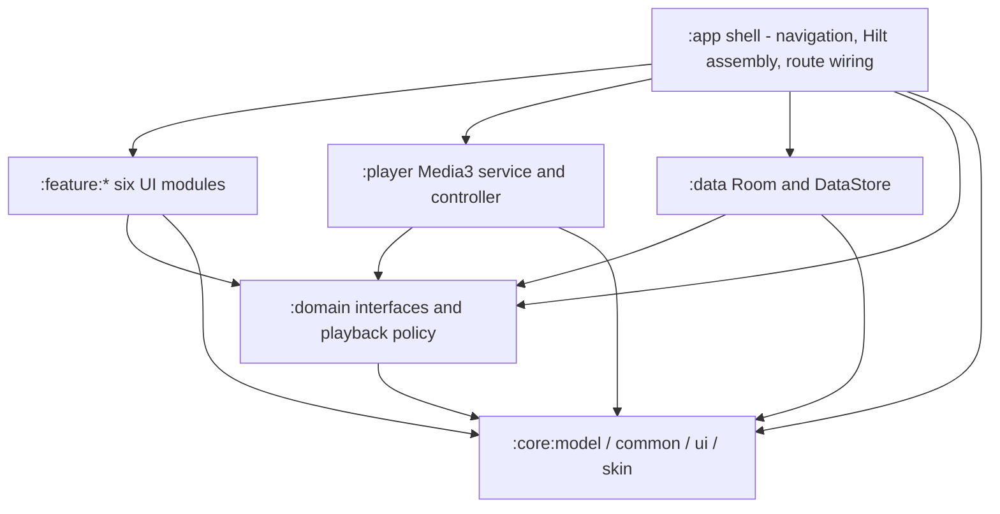

# Quick Start

This repository is **melody-in-heart** (applicationId `cn.com.dcsgo.mihx`): a fully local, offline-first, ad-free, network-free Android music player. Current release is **`3.15.0` / versionCode 54**; `minSdk 33`, `targetSdk 36`, `compileSdk 36`, Java 11 bytecode. Stack: Kotlin 2.0.21 + Jetpack Compose (BOM 2025.09.01) + Media3 1.9.0 (with the Jellyfin FFmpeg decoder extension) + Hilt 2.52 + Room 2.6.1 + DataStore 1.1.1 + WorkManager 2.9.1 + LiteRT 1.4.1 (on-device emotion inference through the `org.tensorflow.lite.Interpreter` API). The build is split into **15 Gradle modules** (`:app`, `:core:model` / `:core:common` / `:core:ui` / `:core:skin`, `:domain`, `:data`, `:player`, six `:feature:*`, `:benchmark`), and module boundaries are enforced by the custom `verifyProductArchitecture` gate.

Persistence at this release: **`MelodyDatabase` v20 with 14 entity tables**, `exportSchema = true`, exported snapshots **`1.json` … `20.json`** under `data/schemas/cn.com.dcsgo.mihx.data.local.MelodyDatabase/`, and **19 registered migrations** (`MIGRATION_1_2` … `MIGRATION_19_20` in `MelodyMigrations.ALL`). Plus five DataStore preference files (`player_settings`, `playback_state`, `playlist_resume`, `mood_time_slot`, `emotion_failures`). Before editing code, find your area in the routing table below; run `./gradlew check` before committing.

## What to read, what to trust

- **Source and tests are the only authority.** Every wiki conclusion carries `repo://` evidence, but the implementation keeps moving — when you act, trust the current code above any document.
- `AGENTS.md` (repository root) is the working convention file: the generated `openwiki/` tree is optional just-in-time context, changes must be proven by the narrowest quiet validation, and generated wiki pages must not be hand-edited (the scheduled workflow refreshes them).
- `README.md` is the **user-visible feature contract** in Chinese — the source of truth for UI labels such as `本地音乐`, `文件管理`, `存储与音质统计`, `深度校验`, `音质档位`, `随心播放`, `探索播放`, `多版本管理`. When you rename or move a surface, update the label here.
- `docs/README.md` is the index into `docs/`: queue architecture, playback state machine, mood time-slot design, the product-refactor audit, and the UI design references. These are design records, so cross-check them against code before relying on a detail.
- `CLAUDE.md` is now a **5-line OPENWIKI pointer stub** that only forwards to `AGENTS.md`; do not cite its old version tables or line numbers. Version truth lives in `app/build.gradle.kts` + `gradle/libs.versions.toml`, schema truth in `MelodyDatabase` + `data/schemas/`.

## Module overview



*Legal dependency direction: only `:app` may see every module. Cross-feature dependencies and feature→`:data`/`:player` dependencies fail `verifyProductArchitecture`. `:player` implementation classes live in `cn.com.dcsgo.mihx.player` (the legacy `cn.com.dcsgo.mihx.data.player` package must not reappear).*

| Layer | Module | One-line responsibility |
| --- | --- | --- |
| App shell | `:app` | `MelodyApplication` (Hilt `@HiltAndroidApp` + Coil `ImageLoaderFactory`), `MainActivity`, `AppRoot` / `AppNavHost`, route table `AppRoutes`, skin-driven shell, permission coordinator, emotion-scan worker, application-scoped ViewModels (`MoodTimeSlotViewModel`, playlist resume) |
| Feature | `:feature:home/playlist/user/lyrics/player/settings` | Each feature exposes `XxxRoute` + `XxxScreen` (Route/Screen split enforced by the gate). `:feature:player` hosts the `PlayerRuntime` facade composition root; `:feature:playlist` hosts the library list, `SongSorter`, file-check and `StorageStatsScreen`; `:feature:user` hosts mood time-slot editing, version management and the 音质说明 sheet |
| Domain | `:domain` | Repository interfaces + pure playback/sorting policy (`MoodSlotResolver`/`MoodSlotPolicy`/`MoodPoolStats`, `ExplorePlaybackPolicy`, `SongSortMode`, `SongVersionComparer`), no Android dependencies |
| Data | `:data` | Room `MelodyDatabase` (v20, 14 entity tables) + migrations and legacy-JSON import, DataStore wrappers, `AudioMetadataExtractor` (spec reading), `MediaStorageStatsRepositoryImpl` (byte measurement), narrow adapters binding domain interfaces |
| Player | `:player` | `AppMediaSessionService` (ExoPlayer + MediaSession), `PlaybackController`, windowed queue planning, Bluetooth coordination, `EmotionAnalyzer` + `FfmpegPcmDecoder` inference support, persisted playback state |
| Core | `:core:model` / `:core:common` / `:core:ui` / `:core:skin` | Pure models incl. `AudioQualityTier` + `LocalMusicStorageStats`, `WordPreference`, `RandomEnhanceMode`, emotion coordinates / `AppLog` + `PerformanceTrace` / shared Compose components (`SongEmotionSection`, `SongInfoDialog`) / skin description model, parser and fail-closed validation |

Layering detail and Hilt binding points: [/openwiki/architecture/module-graph.md](/openwiki/architecture/module-graph.md).

**Offline and privacy invariants**: the app manifest declares `POST_NOTIFICATIONS`, `FOREGROUND_SERVICE`, `FOREGROUND_SERVICE_MEDIA_PLAYBACK`, `BLUETOOTH_CONNECT` and `READ_MEDIA_AUDIO` — there is **no `INTERNET` permission**. `READ_MEDIA_AUDIO` only accelerates the import scan (direct `java.io.File` traversal once granted); SAF document-tree access stays the primary and fallback path, and `READ_EXTERNAL_STORAGE` is banned by the gate. Notification/Bluetooth/`READ_MEDIA_AUDIO` requests must never appear on the startup path (only user-triggered Settings paths may ask). Backup/data-extraction rules must keep excluding playback state, Room files, DataStore files and the album-art cache. `MelodyApplication.onCreate` installs `AppLog` (with `performanceLoggingEnabled = true` plus a small `PerformanceTrace.allow(...)` whitelist for release), installs the uncaught-exception handler, and schedules emotion scanning; its Coil loader caps memory at 20% and disk at 64 MB and defers image-stack init to first load.

## Common commands

All commands run from the repository root; use `.\gradlew.bat` on Windows and `./gradlew` on macOS/Linux.

```bash
# Fast single-module compile (quickest feedback after an edit)
./gradlew :data:compileDebugKotlin

# Full JVM unit-test run (no device needed)
./gradlew test
# Single module / single test class
./gradlew :core:model:test --tests "cn.com.dcsgo.mihx.core.model.AudioQualityTierTest"

# Need a device/emulator
./gradlew :app:connectedAndroidTest      # Compose instrumentation tests
./gradlew :benchmark:connectedCheck      # Macrobenchmark (cold start / scrolling frame rate)

# Format and architecture gates
./gradlew spotlessCheck                  # or spotlessApply to auto-fix
./gradlew verifyProductArchitecture
./gradlew :buildSrc:test                 # unit tests for the gate's rule body

# Pre-commit full gate: root spotlessCheck + verifyProductArchitecture + check/test across all 15 subprojects
./gradlew check
```

**PR/push CI** (`.github/workflows/pr-check.yml`, ubuntu-24.04, JDK 17) runs `./gradlew check :app:assembleDebugAndroidTest :buildSrc:test --no-daemon --stacktrace` — the instrumentation sources are compiled without a device so UI signature drift is still caught. Markdown/`docs/`/`openwiki/`-only changes do not trigger it, and a **version-only push** (a diff touching nothing but `versionCode`/`versionName` in `app/build.gradle.kts`) skips the heavy check; the detection is deliberately conservative (any other file, any extra changed line, a new branch, a force push or a non-push event falls back to the full run).

### `verifyProductArchitecture` gate at a glance

A custom validation task registered in the root `build.gradle.kts` `verification` group and wired into the root `check` lifecycle. Since m-10 (2026-10-15) the rule body lives in `buildSrc` as pure logic (`ProductArchitectureVerification.verify(rootDir)` returning **all** violations at once, unit-tested by `ProductArchitectureVerificationTest`); the task only collects files and raises a `GradleException` naming every violated rule. Main rule families:

- **Module boundaries**: features must not depend on `:data`/`:player`/other features; implementation-layer imports (`cn.com.dcsgo.mihx.data.repository/local`) must not leak into feature/domain/player; `MusicRepository` must stay an internal storage coordinator bound through narrow adapters (`SongRepositoryAdapter`, `PlaylistRepositoryAdapter`, `MusicImportRepositoryAdapter`, `AlbumArtRepositoryAdapter`).
- **Module graph completeness**: all 15 product modules listed in `settings.gradle.kts` must exist, each with a local `.gitignore` covering generated Android/Gradle output.
- **Hilt wiring**: the entry points (`MelodyApplication` `@HiltAndroidApp`, `MainActivity`/`AppMediaSessionService` `@AndroidEntryPoint`, `PlayerViewModel` `@HiltViewModel`) and DI modules (app-side `CoroutineModule`/`LoggerModule`/`PlayerModule`, data-side `DatabaseModule`/`RepositoryModule`/`DataStoreModule`) must exist; the retired `PlayerViewModelComponents`/`PlayerViewModelComponentFactory` hub must not reappear.
- **Room schema immutability**: exported JSON under `data/schemas/` is frozen history (currently `1.json`–`20.json`); v1/v2/v3 content assertions lock the earliest migration semantics.
- **UI and code conventions**: `LazyColumn` `items` must carry a stable `key`; direct `android.util.Log` calls are banned (use `AppLog`); `:core:model` must stay a pure data model without Android resources or UI resource ids; Spotless must stay in the version catalog and applied by the root build.
- **Release and privacy**: release must have `isMinifyEnabled` + `isShrinkResources`; `:app` must not declare `AppMediaSessionService`; backup rules must contain the agreed privacy exclusions; startup-path permission requests fail; `READ_EXTERNAL_STORAGE` must never be declared; no Android Things references.
- **Performance anchors**: `MusicRepository` import/scan and `PlaybackController` hot paths must keep `PerformanceTrace` operation anchors; the `:benchmark` module shape and `StartupBenchmark` terminology are checked.

Release signing is decided *outside* the `buildTypes` block (the gate regex truncates at the first closing brace): debug falls back to debug signing with a warning, while `-PrequireReleaseSigning=true` fails the build when `keystore.properties` is missing. Full rule list: [/openwiki/operations/build-and-verification.md](/openwiki/operations/build-and-verification.md).

### Build variants

| Variant | Highlights |
| --- | --- |
| `debug` | No minification; `applicationIdSuffix=".debug"` and `versionNameSuffix="-debug"` so it can coexist with a release install |
| `release` | R8 minify + resource shrink; only `arm64-v8a`; signing config from `keystore.properties` (see above) |
| `benchmark` | inherits release settings but uses debug signing, non-debuggable, adds `x86_64` for emulators |

### Room schema change flow (common pitfall)

Change an entity → bump `MelodyDatabase.VERSION` → build to export the new schema JSON to `data/schemas/` → write `Migration(N, N+1)` and register it in `MelodyMigrations.ALL` → add a narrow unit test for complex migrations (`MelodyDatabaseMigrationTest` runs `runMigrationsAndValidate` against the exported snapshot). **Never modify already-exported historical schema JSON.** When a migration only changes data (like v19→v20), it still deserves its own version: folding it into an unreleased migration means devices already on the intermediate version never execute it.

## Task → page-to-read routing table

| What you are changing | Read first | Companion narrow verification |
| --- | --- | --- |
| Audio quality tiers (标准 / 较高 / 极高 / 无损 / 高解析), spatial audio, bit depth / bitrate / channels / codec fields | [/openwiki/concepts/audio-spec-and-quality-tiers.md](/openwiki/concepts/audio-spec-and-quality-tiers.md), [/openwiki/architecture/data-persistence.md](/openwiki/architecture/data-persistence.md) | `./gradlew :core:model:test --tests "cn.com.dcsgo.mihx.core.model.AudioQualityTierTest"` |
| 存储与音质统计 (library byte total, per-tier shares, spatial count, unknown sizes) | [/openwiki/workflows/storage-and-quality-stats.md](/openwiki/workflows/storage-and-quality-stats.md), [/openwiki/concepts/audio-spec-and-quality-tiers.md](/openwiki/concepts/audio-spec-and-quality-tiers.md) | `./gradlew :core:model:test --tests "cn.com.dcsgo.mihx.core.model.LocalMusicStorageStatsTest"` |
| Local-music sorting (incl. `BIT_RATE`) and 多版本管理 / version comparison | [/openwiki/workflows/library-sorting-and-version-management.md](/openwiki/workflows/library-sorting-and-version-management.md), [/openwiki/architecture/data-persistence.md](/openwiki/architecture/data-persistence.md) | `./gradlew :feature:playlist:test --tests "cn.com.dcsgo.mihx.feature.playlist.SongSorterTest"`, `./gradlew :domain:test --tests "cn.com.dcsgo.mihx.domain.playback.SongVersion*"` |
| File check (快速 / 深度校验) and metadata backfill | [/openwiki/concepts/audio-spec-and-quality-tiers.md](/openwiki/concepts/audio-spec-and-quality-tiers.md), [/openwiki/workflows/library-sorting-and-version-management.md](/openwiki/workflows/library-sorting-and-version-management.md) | `./gradlew :data:test --tests "cn.com.dcsgo.mihx.data.repository.MusicRepository*"` |
| Mood time-slot anything-play incl. **excluded** emotion tags / pool statistics | [/openwiki/concepts/mood-time-slot.md](/openwiki/concepts/mood-time-slot.md), [/openwiki/player/random-and-infinite.md](/openwiki/player/random-and-infinite.md) | `./gradlew :domain:test --tests "cn.com.dcsgo.mihx.domain.playback.MoodSlotResolverTest" --tests "cn.com.dcsgo.mihx.domain.playback.MoodPoolStatsTest"`, `./gradlew :feature:player:test --tests "cn.com.dcsgo.mihx.feature.player.PlayerRandomQueueFacadeTest"` |
| Explore play (探索播放) / word-preference voting / random & infinite modes | [/openwiki/player/random-and-infinite.md](/openwiki/player/random-and-infinite.md), [/openwiki/concepts/emotion-model.md](/openwiki/concepts/emotion-model.md) | `./gradlew :domain:test --tests "cn.com.dcsgo.mihx.domain.playback.ExplorePlaybackPolicyTest"`, `./gradlew :data:test --tests "cn.com.dcsgo.mihx.data.repository.WordPreferencesRepositoryTest"` |
| Queue / windowed sync / `PlayQueue` invariants | [/openwiki/player/queue-architecture.md](/openwiki/player/queue-architecture.md) | `./gradlew :player:test :feature:player:test` |
| `PlayerRuntime` facade graph / caches / learning feedback | [/openwiki/player/runtime-facades.md](/openwiki/player/runtime-facades.md), [/openwiki/player/state-machine.md](/openwiki/player/state-machine.md) | `./gradlew :feature:player:test` |
| Playback state machine / process restore / service and Bluetooth | [/openwiki/player/state-machine.md](/openwiki/player/state-machine.md), [/openwiki/player/service-and-controller.md](/openwiki/player/service-and-controller.md) | `./gradlew :domain:test --tests "cn.com.dcsgo.mihx.domain.playback.ControllerPlaybackStateSynchronizerTest"` |
| Emotion analysis, tag ratios, playback-page emotion pills | [/openwiki/concepts/emotion-model.md](/openwiki/concepts/emotion-model.md), [/openwiki/workflows/emotion-analysis-pipeline.md](/openwiki/workflows/emotion-analysis-pipeline.md) | `./gradlew :core:model:test --tests "cn.com.dcsgo.mihx.core.model.*Emotion*"`, `./gradlew :core:ui:test` |
| Style switching / multi-theme-color update (skin shell, `ThemeVariant`, tab/menu layout) | [/openwiki/architecture/app-shell-navigation.md](/openwiki/architecture/app-shell-navigation.md), [/openwiki/architecture/module-graph.md](/openwiki/architecture/module-graph.md) | `./gradlew :core:skin:test :app:test --tests "cn.com.dcsgo.mihx.app.shell.*"` |
| Room / DataStore / migration / backup exclusions | [/openwiki/architecture/data-persistence.md](/openwiki/architecture/data-persistence.md), [/openwiki/operations/build-and-verification.md](/openwiki/operations/build-and-verification.md) | `./gradlew :data:test` |
| Navigation / app shell / permissions / theme | [/openwiki/architecture/app-shell-navigation.md](/openwiki/architecture/app-shell-navigation.md) | `./gradlew :app:connectedAndroidTest` |
| Add a module / change dependency boundaries / touch Hilt wiring | [/openwiki/architecture/module-graph.md](/openwiki/architecture/module-graph.md) | `./gradlew verifyProductArchitecture :buildSrc:test` |
| Full playback session (start → track change → settle → restore) | [/openwiki/workflows/playback-session-lifecycle.md](/openwiki/workflows/playback-session-lifecycle.md) | player-related tests |
| Pre-commit / pre-release overview | [/openwiki/operations/build-and-verification.md](/openwiki/operations/build-and-verification.md), [/openwiki/testing/test-map.md](/openwiki/testing/test-map.md) | `./gradlew check` |

### Hard constraints per task area (know before editing)

- **Player**: `PlayQueue.songs` is the business queue that may contain duplicates; `MediaController` only holds the current ± window (≤71 items after planning: 20 before + current + 50 after); `MediaItem.mediaId` must equal `Song.id.toString()`; `PlayerViewModel` is a thin `@HiltViewModel` facade — real logic lives in the `PlayerRuntime`-composed facade/graph layer, so do not stuff logic into the ViewModel and never reintroduce the `PlayerViewModelComponents` hub.
- **Emotion feature**: batch scans are driven by a WorkManager periodic task (`emotion_periodic_scan`) scheduled from `MelodyApplication.onCreate` — every 6 h, initial delay 30 min, charging + battery-not-low, `NetworkType.NOT_REQUIRED`; manual triggers (`emotion_manual_scan`) analyze up to 300 songs per batch and re-enqueue with `APPEND` unless paused, stopped, or the whole batch failed. `EmotionAnalyzer` decodes to 16 kHz mono PCM (`FfmpegPcmDecoder`, memory-budgeted against `maxMemory()`) and runs a fixed YAMNet embedding + a per-window V/A head in `:player` assets to produce per-window curves, a whole-song mean and a `vocalScore`; results go to Room `song_emotions`; failures go to a DataStore JSON store and songs accumulating `MAX_ATTEMPTS` (=3) failures stop being auto-retried.
- **Explore play / word preference**: `RandomEnhanceMode` is `OFF` / `TIME_SLOT` / `EXPLORE` — `TIME_SLOT` and `EXPLORE` are mutually exclusive. `EXPLORE` generates a 10-song batch, disables infinite random, increments ratio-weighted like/dislike votes per emotion word when a song settles (full listen ≥30 s **and** ≥1/4 of duration → LIKE; quick skip → DISLIKE), and refills 5 songs when the just-ended song was second-to-last (`REFILL_THRESHOLD = 0`); refill pools tier by liked-and-no-dislike → only-no-dislike → full library, and the demotion test is whether a pool can fill `REFILL_COUNT` songs, not whether it is non-empty.
- **Audio spec model**: the raw specs (`sampleRate`, `bitDepth`, `bitRateKbps`, `channelCount`, `audioCodec`, `spatialAudio`) are persisted on `songs`; the tier is **derived on read** by `AudioQualityTier.classify` and never stored, so changing a threshold relabels the whole library with no migration. Lossy tiers read bitrate only (192 / 320 kbps steps), lossless reads bit depth + sample rate, DSD goes straight to 高解析, spatial audio requires `audio/eac3-joc` or multichannel (>2) `audio/ac4`, and `UNKNOWN` renders as empty string instead of a guess. Rows written before v18/v19 have `0`/`null` sentinels until a **深度校验** (`FileCheckMode.DEEP` → `refreshMetadata`) backfills them.
- **Data layer / sorting**: Room (`melody.db`, 14 tables, immutable snapshots 1–20) + five DataStore files; v1-era SharedPreferences JSON is migrated into Room on first launch via `SharedPreferencesLegacyJsonMigration`. Sorting is persisted orthogonally as a `SongSortMode` plus an ascending flag in `player_settings`; the eight modes are `IMPORT_ORDER`, `TITLE`, `ARTIST`, `ALBUM`, `DURATION`, **`BIT_RATE`**, `PLAY_COUNT`, `LAST_PLAYED`. `BIT_RATE` replaced the old `SAMPLE_RATE` mode: legacy persisted values are normalized to `BIT_RATE` on read in `PlayerSettingsRepository`, so **no data migration is needed** (the comparison itself uses `Song.bitRateKbps`). Version grouping uses `titleOverride ?: (title + artist + album)`; v19→v20 wiped `song_group_overrides` because old manual keys no longer map to the new group-key semantics.

## Release history relevant to this page

- **v3.13 → v3.15 deltas.** Audio-spec classification (5 quality tiers + `UNKNOWN`), spatial-audio recognition (E-AC-3 JOC / multichannel AC-4, recognition only — no Atmos rendering promise), bit-depth / bitrate / channel / codec capture at import, and a `深度校验` backfill path that re-reads and writes those columns; a read-only **存储与音质统计** page under `本地音乐 → 文件管理`; the local-music sort mode switching from sample rate to **比特率**; time slots gaining **excluded** emotion tags; and read-only emotion tag pills (with ratios) on the playback page.
- **Schema growth.** v17→v18 adds `songs.bitDepth`; v18→v19 adds `songs.bitRateKbps`, `channelCount`, `audioCodec`, `spatialAudio`; v19→v20 deletes all `song_group_overrides` rows (group-key semantics changed from `titleOverride ?: title` to `titleOverride ?: 歌名 + 歌手 + 专辑`; old "attach to group" / "detach" values cannot be remapped, so users re-link once after upgrade). Earlier in the same range: `MIGRATION_16_17` added `index_songs_albumId` and `index_playback_events_songId`; `MIGRATION_15_16` rescaled legacy word votes ×100 for ratio-weighted learning.
- **Emotion coordinate system is still `yamnet-va-v5-vocal`** (`EmotionModelSpec.MODEL_VERSION = "yamnet-va-v5-vocal@edbf6fe5"`, sourced from `core/model/emotion_model_spec.properties`). Rows whose stored `modelVersion` mismatches — or that lack `vocalScore` — are auto-repicked and rescanned, with a 3-failure ceiling per song.

## All wiki pages

- Entry and operations: this page, [build / verify / release operations](/openwiki/operations/build-and-verification.md), [test map](/openwiki/testing/test-map.md)
- Architecture: [module layering and dependency boundaries](/openwiki/architecture/module-graph.md), [app shell, navigation and cross-module wiring](/openwiki/architecture/app-shell-navigation.md), [data persistence: Room v20 and DataStore](/openwiki/architecture/data-persistence.md)
- Player: [PlayerRuntime and the facade list](/openwiki/player/runtime-facades.md), [queue and windowed sync](/openwiki/player/queue-architecture.md), [random & infinite play (incl. explore play)](/openwiki/player/random-and-infinite.md), [playback state machine and restore](/openwiki/player/state-machine.md), [playback service and MediaController](/openwiki/player/service-and-controller.md)
- Domain concepts: [emotion domain model, tags and ratio projections](/openwiki/concepts/emotion-model.md), [mood time slots, excluded tags and pool policy](/openwiki/concepts/mood-time-slot.md), [audio spec model: quality tiers and spatial audio](/openwiki/concepts/audio-spec-and-quality-tiers.md)
- End-to-end workflows: [emotion analysis pipeline](/openwiki/workflows/emotion-analysis-pipeline.md), [playback session lifecycle](/openwiki/workflows/playback-session-lifecycle.md), [library sorting and version management](/openwiki/workflows/library-sorting-and-version-management.md), [storage and quality statistics](/openwiki/workflows/storage-and-quality-stats.md)
