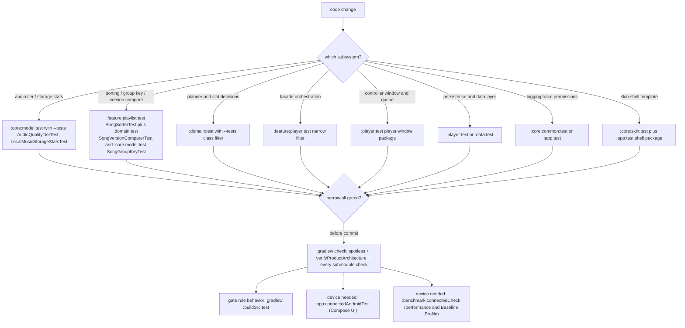

# Test map and verification strategy

This page answers two questions: **which invariant is locked by which test class**, and **which narrow verification to run before changing a subsystem**.

The governing rule is that production source and tests are the authority; wiki prose, briefs and review notes are only hypotheses until a named test pins them. So a behavior described here without a test anchor is a coverage gap, not a specification — and a test that contradicts prose wins. Practically that means the repository's decision logic is written to be pinned without a device: JUnit 4 with hand-written fakes (no mocking framework), planners/resolvers taking shuffle, clock, `isPlayable` and ratio maps as injected parameters, and the audio/emotion arithmetic living in pure `:core:model`/`:domain` functions. The full command matrix and every gate rule live on `/openwiki/operations/build-and-verification.md`; the behaviors themselves are elaborated on `/openwiki/concepts/audio-spec-and-quality-tiers.md`, `/openwiki/concepts/emotion-model.md`, `/openwiki/concepts/mood-time-slot.md`, `/openwiki/player/random-and-infinite.md`, `/openwiki/player/queue-architecture.md` and `/openwiki/architecture/data-persistence.md`.

## 1. Three-layer verification split

| Layer | Command | Device | Responsibility |
| --- | --- | --- | --- |
| **JVM unit tests** | `.\gradlew.bat :domain:test`, `:player:test`, `:data:test`, `:feature:player:test`, `:feature:playlist:test`, `:feature:user:test`, `:core:common:test`, `:core:model:test`, `:core:ui:test`, `:core:skin:test`, `:app:test` (Windows; `./gradlew` on macOS/Linux) | Not needed | First gate for logic changes. Covers all planner/resolver/coordinator/facade orchestration, repository persistence semantics, snapshot serialization, the emotion-model and audio-spec pure-function suites, the skin/shell/template catalogs, and the sorting/version-comparison helpers. **Almost every behavior regression should be caught here** |
| **Gate rule tests** | `.\gradlew.bat :buildSrc:test` | Not needed | Unit tests for the `verifyProductArchitecture` rule body (§4). They are also run implicitly: `buildSrc` is compiled and tested before any module task, so a broken gate rule fails every invocation, not just `check` |
| **Instrumented tests** | `.\gradlew.bat :app:connectedAndroidTest` | Needs device/emulator | The only place real Compose composition happens: `HomeScreenComposeTest` / `PlaylistScreenComposeTest` / `SettingsScreenComposeTest` assert empty states, control `contentDescription`s, dialog flows and the rendered Hi-Res badge copy |
| **Macrobenchmarks** | `.\gradlew.bat :benchmark:connectedCheck` | Needs device/emulator | Performance regression and Baseline Profile generation. `StartupBenchmark` runs cold start at 5 iterations in two modes (`CompilationMode.None()` as the no-profile control and `CompilationMode.Partial(baselineProfileMode = BaselineProfileMode.Require)`); `ScrollBenchmark` and `BaselineProfileGenerator` write `app/src/main/baselineProfiles/baseline-prof.txt`, bundled by release builds via `profileinstaller` |



*JVM unit tests are the daily narrow gate, `check` is the full pre-commit gate, the gate's own rule tests guard the guard, and the device layer only enters for rendering and performance.*

`check` aggregates the root-level `spotlessCheck`, the root-level `verifyProductArchitecture`, and every subproject's own `check` (each of which runs that subproject's unit tests and its own `spotlessCheck`); a failure can therefore be formatting, an architecture assertion, or a unit test — read the `GradleException` message first.

## 2. This release's coverage: audio spec, storage stats, sorting, versions, mood pools

The audio-quality release (bit depth / bitrate / channel / codec MIME columns, tier labelling, storage statistics, version grouping and comparison) was shaped so its arithmetic is a pure function and its framework I/O is a thin boundary. The new suites are what make that split safe:

| Suite | Module | Locked behavior |
| --- | --- | --- |
| `AudioQualityTierTest` | `:core:model` | Lossy ladder by bitrate alone (`audio/mpeg` 128→`STANDARD`, 192→`HIGH`, 320→`VERY_HIGH`, 0→`UNKNOWN`); lossless by depth and sample rate (`audio/flac` 16/44.1→`LOSSLESS`, 24/48 and 24/96→`HI_RES`, `audio/raw` 16/44.1→`LOSSLESS`); DSD short-circuits (`audio/dsd` 1 bit/2.8 MHz→`HI_RES`); empty MIME or all-zero specs stay `UNKNOWN`; the **spatial matrix** — `audio/eac3-joc` is spatial at any channel count (asserted at 2), `audio/ac4` only when `channelCount > 2` (6 and 10 yes; 2 and 0 no), plain `audio/eac3` / `audio/ec+3` never, `audio/flac` 2ch never; and `Song.qualityTier` / `qualityLabel` are derived from the persisted specs (HI_RES → `高解析`, a spec-less `Song` → empty label, never a guess) |
| `LocalMusicStorageStatsTest` | `:core:model` | Aggregation of `AudioQualityTier` shares: one song per tier yields count 1 and ratio 1/6 each; measured sizes are summed while a 0-byte or missing entry is counted in `unknownSizeSongs` (2 of 3 measured, `totalBytes = 3500`, `sizeCoverageRatio = 2/3`); an empty library still returns **every** `AudioQualityTier.entries` bucket in enum order at count 0 / ratio 0; spatial audio is recounted with the latest `isSpatial` rules (2 of 6: JOC and multichannel AC-4) and a stale persisted `spatialAudio = true` row on a plain DD+ song does **not** inflate the count; a FLAC with unknown bit depth but 44.1 kHz stays `LOSSLESS`, not `UNKNOWN` |
| `FileSizeFormattersTest` | `:core:common` | `formatFileSize` thresholds and precision: `< 1024` stays bytes (`0 B`, `512 B`), KB and MB at one decimal (`1.0 KB`, `1.5 MB`), GB at two (`2.50 GB`), negative size degrades to `未知`. The same function feeds the storage-stats total and the `SongInfo` file-size line, so the two surfaces cannot disagree |
| `MoodPoolStatsTest` | `:domain` | Three-layer pool counting with two different thresholds: `excluded` counts songs whose excluded word ratio reaches `EXCLUDE_MIN_RATIO` (a 27 % 「躁」 ratio excludes), `matched` counts only the remaining songs whose included word ratio reaches `MATCH_MIN_RATIO` (a 20 % 「静谧」 ratio does not match), `available = librarySize - excluded` so unanalysed songs without words stay available; exclusion pre-empts inclusion (a song is never both); a blank include-tag set still counts exclusions and leaves `matched` 0 |
| `SongGroupKeyTest` | `:core:model` | Group-key semantics: the default key is 歌名 + 歌手 + 专辑 (separated by `U+0001`), so the same triple shares a key while a different artist **or** album splits it; manual reassignment stores the target's `groupKey` in `titleOverride` and joins that group (`groupKeyLabel` = target title); manual detach uses `"标题#id"`, sets `isDetachedFromGroup` and gets a group of one; a legacy pure-title override neither crashes nor merges into a default group (old rows are cleared by the 19→20 migration) |
| `SongVersionComparerTest` | `:domain` | Version-comparison contract: versions sort by sample rate descending with exactly one recommendation; the recommendation follows `qualityScore` (sample rate × lossless weight), **not** raw sample rate (a 48 kHz MP3 loses to a 44.1 kHz FLAC) and ties break on the higher injected bitrate; conditional spec rows — 位深 only when some version has `bitDepth > 0`, 音质 / 声道 / 空间音频 only when any version carries that data (missing cell = `未知` / `—`), 比特率 and 文件大小 only when the injected `bitRateOf` / `fileSizeOf` returns something, with absent cells shown as `未知`; identical rows collapse into `commonFields` (two versions with no lyrics and no cover put 歌词/封面 in common, not in rows) and `diffCount` / `sameCount` report the split; the 采样率 bar is normalized to the max (1.0 / 0.5); `diffHint` renders `格式、采样率 不同` or `规格一致` |
| `SongSorterTest` | `:feature:playlist` | `SongSorter.sort(..., SongSortMode.BIT_RATE, ...)` orders by `bitRateKbps` in both directions (320/0/128 → `2,3,1` ascending) and keeps an unknown bitrate (`0`) at the low end of the ascending order. **Known gap:** only BIT_RATE is pinned; the collator and id-tiebreak comparators (see §3) have no assertions |
| `MelodyDatabaseMigrationTest` | `:data` | v1→**v20** migration regression, including the release's three steps: 17→18 adds `songs.bitDepth` defaulting to 0, 18→19 adds `bitRateKbps=0` / `channelCount=0` / `audioCodec NULL` / `spatialAudio=false`, and 19→20 clears the legacy `song_group_overrides` rows entirely (both plain-title joins and `标题#id` detaches) so the new group-key semantics start from a clean table (details in §6.7) |
| `PlayerRandomQueueFacadeTest` (mood-exclusion group) | `:feature:player` | Exclusion before inclusion at the planner entry: a song carrying an excluded word at or above the display threshold (`躁` 27.4%) is removed and counted in the `excluded N songs by tags` log, a 10% ratio is not; an empty include pool falls back to the **excluded-filtered** library (`fall back to full library after exclusions`) so exclusion can never be undone; the same exclusion applies to infinite refill, whose exhausted mood pool degrades to `fall back to non-excluded library` including unanalysed songs (details in §6.2) |

Two adjacent suites pin the version-management orchestration that sits on top of the keys: `SongGroupCoordinatorTest` (detach writes `"标题#id"` and refreshes the current song, reassign writes the target key, reset writes `null`, and a failed update never reads a repository snapshot) and `SongVersionManagerTest` (grouping drops unplayable songs, same-name versions sort by sample rate descending, `switchToVersion` plays an existing queue entry or inserts the missing one after the current song).

## 3. Coverage boundaries: what is deliberately not unit-tested

A test map is only honest if it names its holes. These are intentional, and each one names what stands in for it:

| Boundary | Why it is not unit-tested | What replaces it |
| --- | --- | --- |
| File probing (`AudioMetadataExtractor`, `AudioTrackSpecExtractor.read`, `readBitDepth`) | Needs the real media framework and a real file; a fake retriever would only test the fake | The extractor is reduced to "read four numbers, call `AudioQualityTier.classify`/`isSpatial`", and those predicates are exhaustively pinned. The architecture gate additionally forbids `import android.*` in `:core:model`/`:domain` (beyond a five-path baseline, `Song.kt` included) so the tested predicate cannot be bypassed by a second implementation. DEEP file verification is the operational backfill |
| SAF size queries and the 8-permit concurrency in `MediaStorageStatsRepositoryImpl` | `ContentResolver` + `Context`; no test file exercises it | The split is the substitute: the repository only returns `songId → bytes`, and all arithmetic plus ratio/coverage math lives in the pinned `LocalMusicStorageStats.from` |
| Bitrate / file-size cell strings in the version comparison | Produced from the live `SongInfo` dialog path | `SongVersionComparer.compare` takes `bitRateOf` / `fileSizeOf` lambdas, so row presence and `未知` filling are tested while extraction stays out of scope |
| WorkManager emotion-scan scheduling (`EmotionScanWorker`, `EmotionScanScheduler`, work-info progress) | Needs instrumented WorkManager infrastructure; the worker's own progress/reschedule logic has no JVM test | The analysis it drives is covered by the pure `player` analyzer suites (`EmotionAnalyzerArousalTest`, `EmotionAnalyzerLimitsTest`, `YamnetClassMapTest`); scheduling is verified only by device use |
| `SongSorter` modes other than BIT_RATE (TITLE / ARTIST / ALBUM via `Collator.getInstance(Locale.CHINA)`, PLAY_COUNT / LAST_PLAYED id tiebreaks) | Locale- and host-dependent collation, and the current suite only asserts BIT_RATE | Nothing yet — this is a real gap: a comparator regression in pinyin ordering or tiebreak stability would only be caught by manual UI inspection |
| Compose rendering and `contentDescription` strings | No Compose runtime on the JVM | The instrumentation suites (§7) — the only place the shell/Compose wiring is exercised end to end |
| Room/DataStore Android wiring | Needs Android classes | Robolectric `MigrationTestHelper` for schema migrations, a real `PreferenceDataStoreFactory` over a temp file for DataStore, and hand-written fake DAOs for repositories |

## 4. The architecture gate: the guard for the layering rules

`verifyProductArchitecture` (registered in the root `build.gradle.kts`, `group = "verification"`) delegates to the `buildSrc` object `ProductArchitectureVerification.verify(rootDir)`, which walks `kt/kts/java/xml/toml` files (skipping `build/`, `.gradle/`, `.git/`, `.idea/`, `buildSrc/`) and returns a list of violation strings — empty means pass. It is **collection-style**: every violated rule is reported in one run, and each message names the offending file or module path. That is deliberate, and a gate failure is the intended signal, not noise to route around: a red gate means a layering, naming or contract rule was broken, and the message tells you where.

Rules that matter most when touching the release's subsystems:

- **Pure layers stay pure** — `:core:model` and `:domain` may not `import android.*` beyond a ratchet baseline (`AlbumEntry.kt`, `ArtistEntry.kt`, `Song.kt`, `FolderImporter.kt`, `MusicImportRepository.kt`); no UI resource ids or `res/` files in `:core:model`.
- **No blocking on disk I/O in production code** — `src/main` may not call `runBlocking` (comments are ignored; the rules scan code).
- **Safe loading** — bare `loadSongInfo(` is only allowed inside `core/ui/.../SongInfoLoader.kt`; every other call must go through `loadSongInfoSafely` (the fix for a crash where an uncaught Room exception escaped a `LaunchedEffect` coroutine).
- **Observability is not dead code** — `PerformanceTrace.allow(` must have at least one real call site in `src/main`, and `MusicRepository`/`PlaybackController` must keep their anchor operations (`music_import_scan`, `music_import_folder`, `controller_play_queue`, `controller_prepare_queue`, `controller_sync_queue`, `play_next_command`).
- **Module direction** — `feature/*` must not depend on `:data`, `:player`, or another `:feature:*`; implementation-package imports may not leak into `feature`/`domain`/`player`; `:player` must not reference the retired `cn.com.dcsgo.mihx.data.player` package.
- **Tests as contracts** — `PlaybackWindowPerformanceShapeTest` must exist and keep the terms `100`, `500`, `1_000`, `71`, `WindowedControllerQueuePlanner`.
- **Migration/schema discipline** — `MelodyMigrations` must keep `Migration(1, 2)` and `Migration(2, 3)`, `DatabaseModule` must call `addMigrations(*MelodyMigrations.ALL)`, and the exported schemas `1.json`/`2.json`/`3.json` stay immutable snapshots (`quick_skip_short_play_counts`, `lrcUri` boundaries).
- **Release/privacy shape** — release build type keeps `isMinifyEnabled`/`isShrinkResources`, backup and data-extraction rules keep the DB/DataStore/art-cache excludes, and feature-owned Route/Screen files exist instead of `AppOverlay` branches.

`ProductArchitectureVerificationTest` is the gate's own regression suite. It builds minimal repositories in a `TemporaryFolder` and proves the rules **report rather than crash**: an empty repo still yields several locatable violations in one pass (Spotless catalog, module graph, per-module `.gitignore`, Hilt entry point); a direct `android.util.Log` call is flagged while `AppLogger.kt` is exempt by path; a bare `loadSongInfo(song)` is flagged and the same call inside `SongInfoLoader.kt` is exempt; `PerformanceTrace.allow(...)` without a call site is flagged and satisfied by one real `src/main` call; a `feature` module depending on `:data` is flagged; a `cn.com.dcsgo.mihx.data.player` reference in `:player` is flagged; and `extractBracedBlock` survives nested lambda braces in a `release { }` block while a missing block returns `null`. Because the rules are path-plus-substring assertions, renaming a required file or a required message term is a violation by design — and because these fixtures are synthetic, a *new* rule needs both a fixture test here and a run of the real task.

## 5. Regression baseline: random, mood-slot and explore tests

The contextual-shuffle design's checklist item 7 is an explicit regression floor: **with the switch off, lucky-play behavior must be bit-identical to the pre-enhancement build, and the existing `RandomQueuePlanner` tests must stay untouched and green**. This means:

- Every assertion in `RandomQueuePlannerTest` and `UniformRandomPlannerTest` defines "current behavior", not refactorable implementation detail; enhancements may only occur at the candidate-pool entry (`PlayerRandomQueueFacade`-side filtering), never inside the planners' filtering/layering/elimination semantics.
- The non-mood-prefixed cases of `PlayerRandomQueueFacadeTest` (e.g. `playRandomQueueStartsSequentialQueueAndLeavesInfiniteMode`) carry the same regression duty; `moodFilterDisabledKeepsOriginalBehavior` and `moodFilterInactiveOutsideSlotTime` directly assert "switch off / slot missed ⇒ behavior identical to current".
- A PR that edits these files (or turns them red) is by default a behavior change and must declare it in the PR description.

Explore playback adds a second regression family inside the same facade, so `PlayerRandomQueueFacadeTest`'s explore group and `PlayerMediaEventFacadeTest`'s explore group are equally baseline-locking (start/refill/settle chain). Explore decisions are split into a pure `:domain` policy (`ExplorePlaybackPolicy`) plus facade-side pool selection, keeping them JVM-testable without a device.

## 6. Test anchors grouped by subsystem

### 6.1 Random (`RandomQueuePlanner` / `UniformRandomPlanner`)

| Test class | Locked behavior |
| --- | --- |
| `domain/.../RandomQueuePlannerTest` | Random-queue planning semantics: `recentSongIds` elimination (eliminated songs never enter a batch, picked songs join the recent set); when candidates are exhausted the history is cleared and re-drawn with `resetHistory = true`; with uniform random on, low-play-count songs are still preferred after recent-filtering; `planInfiniteStart` only records **queue-playable** songs into the coverage set; `planInfiniteRefill` excludes songs already in queue and keeps the existing exclusion set; returns `null` when no song is playable |
| `domain/.../UniformRandomPlannerTest` | Layered preemption: switch off degrades to the injected shuffle; on, layers are built dynamically from raw play counts with the low layer preferred, the low layer never exceeded when it has enough slots, and the high layer filling shortfall only; extra-tier layering stays effective even when all counts exceed any fixed threshold (the threshold comes from the distribution, not a constant); equal counts degrade to pure random; `orderSongs` groups by count and shuffles within a group; `buildPlayOrderIds` puts the current song first in `SHUFFLE` mode and layers the rest |

Uniform-random compatibility is a design requirement: the mood/emotion-filtered candidate pool feeds straight into `selectSongs` with zero changes to the layering logic, and the above tests are the proof of that compatibility.

### 6.2 Mood time slots (`MoodSlotResolver`, `MoodPoolStats`, facade filtering and degradation)

| Test class | Locked behavior |
| --- | --- |
| `domain/.../MoodSlotResolverTest` | Time-slot decisions: normal ranges are left-closed/right-open (start minute hits, end minute does not, one minute before start does not); across-midnight (`end <= start`) hits at 22:00, 23:41, 00:00 and 05:59 but not at 06:00, 21:59 or noon; a legal config hits at most one slot in a full-day per-minute scan while illegal multi-hit data resolves deterministically to the earliest start (`hitSlot` id); the switch off or an empty config never activates; validation taxonomy — blank name, overlong name (`NAME_MAX_LENGTH = 20`, 21 rejected / 20 accepted), **no included *and* no excluded tags** (`NO_TAGS`) while include-only and exclude-only configs are both savable, an included tag repeated in `excludedTags` (`EXCLUDED_TAG_OVERLAP`), zero length, overlap returning `Conflict` naming the conflicting slot, touching endpoints allowed, same-id edit not self-conflicting; and `overlaps` circular-timeline semantics (overnight × morning intersects, overnight does not overlap midday, two overnight slots always intersect, a full-day slot intersects any non-zero slot) |
| `domain/.../MoodPoolStatsTest` | Pool statistics for the config screen: `excluded` / `matched` / `available` counted with the two thresholds described in §2, exclusion counted before inclusion, unanalysed songs kept in `available`, and a blank include set still reporting exclusions. It reads the **full** per-word ratio map (no display top-N truncation), so a word ranked fifth can still exclude |
| `feature/player/.../PlayerRandomQueueFacadeTest` (mood group) | Facade-side filtering and degradation: when a slot hits, the random pool narrows to songs whose included word reaches `MATCH_MIN_RATIO` (a 70 % 「静谧」 ratio matches, a 16 % one does not) while a song with no ratio injection keeps the pre-change "has the word ⇒ match" behavior; excluded words remove songs at the display threshold (27.4% yes, 10% no) and log `excluded N songs by tags`; an empty include pool falls back to full-library random (`fall back to full library`, never failing to start) while a non-empty library that lost songs to exclusion falls back to the **excluded-filtered** library (`fall back to full library after exclusions`); a missed slot time or a disabled switch reproduces the current behavior; and mood filtering composes with uniform random so tiered preemption still applies inside the filtered pool (a 0-play song ranks before a 10-play one) |
| `feature/player/.../PlayerRandomQueueFacadeTest` (mood infinite refill) | Refill under a slot: the mood pool is used while it has unplayed songs, then degrades to `fall back to non-excluded library` (unanalysed songs are eligible there, excluded ones never are), and a mood pool with fewer remaining songs than the batch size tops up with exactly those remaining songs instead of repeating already-played ones |

Slot decisions, validation and pool statistics are pure `:domain` functions (`MoodSlotResolver`, `MoodSlotPolicy`, `MoodPoolStats`); the config-edit UI and the facade share the same `validate`/`overlaps`/thresholds, so the tests are the contract and no second overlap or threshold implementation may be written in the UI.

### 6.3 Explore playback and word-listening preferences

Explore replaces plain lucky-random with a **10-song initial batch** filtered by mood emotion tags and per-word listening votes, an automatic **5-song refill** once the just-ended song is second-to-last, and a **settle step** that votes each word of a finished song up or down via `ExplorePlaybackPolicy`.

| Test class | Locked behavior |
| --- | --- |
| `domain/.../ExplorePlaybackPolicyTest` | Pure skip-vs-complete judgment `isSkipped(playedMs, durationMs)`: skipped when played **< 30s OR < 1/4 of duration** — a 4-min song played 20s is skipped, an 8-min song played 60s (>30s but <1/4=120s) is skipped, a 4-min song played 70s is a full listen; a short song fully played under 30s is still skipped (`MIN_LISTEN_MS=30_000`); duration `<=0` falls back to the 30s rule only. Also locks the constants `INITIAL_BATCH_SIZE=10` / `REFILL_COUNT=5` and the ratio-weighted vote layer: `voteWeightOf(ratio) = round(ratio × VOTE_WEIGHT_SCALE=100)` so a dominant 80% word weighs 80 while a sub-0.5% word drops to 0 (equals not voting), `votesOf` drops zero-weight words, and the vote gate **is** the display gate (`VOTE_MIN_RATIO == EmotionGroup.MIN_RATIO`, `VOTE_MAX_TAGS == EmotionGroup.MAX_TAGS`, referenced directly so they cannot drift) |
| `feature/player/.../PlayerRandomQueueFacadeTest` (explore group) | Explore start and refill: `playRandomQueue` under explore mode produces **exactly 10 songs**, sets `isExplorePlay`, exits infinite mode (cleared `infinitePlayedSongIds`) and logs `explore=true`; an active explore session **blocks `startInfinitePlay`** while a session the user ended allows infinite play again. `refillExplorePlayQueue` prefers songs carrying liked words and no disliked words, falls back to the "no disliked words only" pool (logs `no liked match`), then to the full library (`fall back to full library`) when every song carries a disliked word or the no-dislike pool is smaller than `REFILL_COUNT`; it does nothing outside an explore session; the regenerate regression uses `startedSongId` to correct the business-queue `currentIndex` so a stale index never syncs back to replay the just-ended song |
| `feature/player/.../PlayerRandomQueueFacadeTest` (word-filter precedence) | Vote-driven narrowing: a song tagged with a disliked word is excluded, a song with **no liked word** is excluded from the liked pool but can enter the no-dislike fallback, `NEUTRAL` (tie) words are neither liked nor disliked, and the filtered pool is bounded by the refill cap |
| `feature/player/.../PlayerMediaEventFacadeTest` (explore group) | Explore tail handling in `handleMediaItemEnded`: when the just-ended song was **second-to-last** (new `remainingItems == 0`) it settles the ended song (`onExploreSongSettled(songId, playedMs)`) **and** triggers `refillExplorePlayQueue`; third-to-last (`remainingItems == 1`) or a still-long queue triggers no refill (avoiding re-pull to replay); a `null` tracked song skips the settle but still refills |
| `data/.../WordPreferencesRepositoryTest` | Vote counting over the Room `word_preferences` table: `recordSongOutcome(votes, liked=true)` increments each word's `likeVotes`, `false` its `dislikeVotes`, by the **given per-word weight** (80-weight 「emo」 vs 20-weight 「治愈」); votes accumulate without flipping ownership on a single skip (3/2 stays `LIKE`), a 1/1 tie is `NEUTRAL`, zero-weight and empty word lists are ignored, `clearAll` empties the table and the map. The repository writes **per-word atomic SQL increments** (`ensureWordPreference` + `addWordVotesDelta`, M-22 review) with saturating `MIN(x, 2147483647)` math so two concurrent settles cannot lose votes |
| `:feature:player` `PlayerQueueFacadeTest` (explore session lifecycle) | `setPlayQueue` (a user manual queue replacement) **exits** the explore session (`isExplorePlay=false`, `isInfinitePlay=false`); merely calling `addToPlayQueue` (append) keeps it alive |
| `:feature:player` `PlayerPersistenceFacadeTest` + `PlayerPersistenceGraphTest` + `PlaybackStateStoreTest` | The `isExplorePlay` flag traverses save/restore so a killed process resumes into the same explore state, and the snapshot store's live-session/empty-session guards apply equally to an explore queue (an empty save carrying only `currentSongId` must not wipe a restored explore queue) |

The `WordPreferenceKind` ownership rule (`like > dislike → LIKE`, `dislike > like → DISLIKE`, tie → `NEUTRAL`) lives in `core/model` `WordPreference.kind`; the repository is deliberately vote-only and never computes `kind`, so single-skip outcomes cannot flip a thoroughly-liked word.

### 6.4 Emotion model (`:core:model` logic, `:core:ui` pure helpers)

The emotion engine's shared contract lives in `core:model` so every consumer (analysis, display, explore voting) builds on the same code; the display-side pure helpers are tested in `core:ui`. These are the parts that move when the V-A coordinate system is recalibrated.

| Test class | Locked behavior |
| --- | --- |
| `core/model/.../EmotionGroupAnchorTest` | Anchor-table **structural invariants**: every auto anchor stays inside the V-A domain (`±0.95`); auto anchors keep ≥ 0.25 Euclidean spacing so no two groups fight over windows in the Voronoi partition; semantic ordering — RAGE (燃) is the highest-arousal group, ABYSS (窒息) the lowest-valence, BRIGHT/LOVE the two most-positive, STILL (静谧) lowest-arousal; the negative-valence set is exactly {emo, 躁, 窒息}; no anchor sits on the origin and RAGE stays reachable; **WITTY stays excluded from automatic voting** while the manual `groupOf` path stays open; legacy curves vote with the legacy anchor table, and a manual point uses the same coordinate system as the row's own curve |
| `core/model/.../EmotionGroupVoteOrderTest` | Vote **ordering** is deterministic and process-stable: ratio ties fall back to group declaration order (`EmotionGroup.ordinal`), independent of the anchor table, so recalibration never changes tied order; identical curves give identical `categoriesFor` results repeatedly; a higher ratio still outranks declaration order |
| `core/model/.../EmotionConfidenceTest` | Confidence is the **top vote share**: `voteRatios` keeps every voted group (even those the display layer drops below `MIN_RATIO`) while `categoriesFor` is the filtered view, so base and display share one computation; confidence is zero when nothing votes and lower when votes spread; it follows the row's own anchor table, is computed on the vocal-compensated curve, shows a hint only when votes spread (never for user-tagged or curve-less songs), and treats contradictory cold+warm tag lists as their own level |
| `core/model/.../EmotionTagRatioTest` | Each tag carries its **share of the whole song** (元气 50% / 燃 25% / 静谧 25%): ratios sum to 1 when all groups pass the display threshold, sub-threshold tags are dropped, user-tagged words carry no ratio, ratios come from the compensated curve, and an empty curve yields none |
| `core/model/.../EmotionVoteRatiosTest` | Explore voting uses the **displayed** distribution, not the full one (full average 6.26 words/song vs 2.31 gated = the detail-page count): only dominant words get a vote, the vote set equals what the detail page shows, user-tagged words vote at full weight, an empty curve votes nothing, and the gate defaults to the display gate |
| `core/model/.../VocalCalibrationTest` | Vocal compensation is **read-derived** (curve bytes never change, so switching coordinate systems needs no rescan): instrumental songs (`vocalScore` below the threshold) get a constant valence shift, vocal songs and rows without a `vocalScore` do not; only valence moves, never arousal; no-compensation returns the same instance; and compensation pushes votes positive while preserving vocal songs' words |
| `core/model/.../SongEmotionDerivedPointTest` | User-calibration **coordinates are derived, not stored**: the corrected point is the mean anchor of the user's tags within the row's own coordinate system, so it never goes stale when the system recalibrates; stored coordinates are deliberately ignored (that was the bug); user-only rows derive with the current anchor table; multiple tags average in the row's system |
| `core/model/.../EmotionModelSpecTest` | The model-version string is `<coordinate label>@<content fingerprint>`: the label decides which anchor table applies while the fingerprint is the build-time hash of the model assets, so changing assets without touching the label still forces a rescan. Also pins that the anchor table was calibrated for the **current** coordinate parameters (`EmotionGroup.ANCHORS_CALIBRATED_FOR == EmotionModelSpec.PARAMS_FINGERPRINT`, so editing the calibration parameters without recalibrating fails), that the table is chosen by label not fingerprint (any `current@…` resolves to the same table, legacy or unknown labels resolve to the legacy table, and the two differ), and that the current label resolves to the enum anchors |
| `core/ui/.../SongEmotionSectionTest` | The display-side pure helpers: `smoothCurve` keeps length and shrinks noise with short-list passthrough (2 items, 1 item); `lowConfidence` marks the undetermined band (either axis absolute value < 0.15); the **word table is closed** — 10 groups, 39 unique words (9×4 + the ABYSS group's 3), `headline` is each group's first word and `groupOf(headline)` round-trips; `categoriesFor` picks the nearest group by vote ratio and abstains on near-zero windows (`0.05/0.05` × 10 votes → empty); `headlineTagsFor` caps at `MAX_TAGS`; WITTY (鬼畜) is excluded from automatic voting (the V-A-center vacuum bug) while `groupOf("鬼畜")` still resolves; `emotionTagsOf` gives user tags priority and returns empty at low confidence; `avgOfWords` maps same-group words to that group's anchor, averages across groups (and the average lies between the two anchors), and returns `null` for unknown words or an empty list |

Nothing here asserts a `hasSignificantPeak`-style presentation threshold any more: the current suite pins the functions above, so a change to peak detection has no unit-level anchor.

### 6.5 Queue and window (planners, synchronizer, performance shape, wrap detection)

| Test class | Locked behavior |
| --- | --- |
| `domain/.../ControllerQueuePlannerTest` | Playable-order expansion: empty queue returns `null`; `SEQUENTIAL` keeps order with `startIndex` pointing at the requested song; `REVERSE` reverses; `SHUFFLE` expands stably by `playOrderIds`; when the requested song is unplayable it jumps to the next playable item |
| `player/.../ControllerQueuePlannerTest` (same-name class in `:player`) | Controller planning semantics: `remainingAfterStart` tail-batch detection; **duplicate songs fully preserved** (`1,2,2,3` is not deduplicated, and a duplicate id's startIndex resolves to the requested occurrence); after "add as next" controller order is `1,2,5,3`; a play-mode change rebuilds controller order; all-unplayable returns `null` |
| `player/window/PlaybackWindowPlannerTest` | Window slicing: `DEFAULT_PREVIOUS_COUNT=20` / `DEFAULT_NEXT_COUNT=50` clamped at queue boundaries; window-index ↔ full-queue-index mapping (`controllerStartIndex` / `fullQueueStartIndex`); in `REVERSE` mode the window follows reverse-play order |
| `player/window/ControllerWindowSynchronizerTest` | Window caching: a non-forced plan reuses the window but re-anchors `startIndex` to the current song; a forced plan (like after `addSongAsNext`) invalidates the cache and recomputes; empty queue returns `null`; stable shuffle / reverse-play order enters the window |
| `player/window/PlaybackWindowPerformanceShapeTest` | Product-level performance shape: for 100 / 500 / 1000-song queues the controller window always stays **≤ 71 and ≥ 51 items** (checked at queue head/middle/tail, including that a 1000-song stable shuffle window does not balloon to the whole queue). **`verifyProductArchitecture` locks this file's existence and keywords** (`100`, `500`, `1_000`, `71`, `WindowedControllerQueuePlanner`), so deleting the file or renaming keywords fails the architecture gate |
| `player/.../MediaItemWrapDetectionTest` | Wrap decisions: window tail (index 70) → 0 counts as wrap; normal forward, one `previous` step, first switch (`C.INDEX_UNSET`), and a new non-zero index do not; **a backward step in a 2-song small window counts as wrap** (harmless: the refill planner dedups); empty/single-item windows cannot wrap. The decision must use indices, not the transition reason, because Media3 reports tail wraps under `REPEAT_MODE_ALL` as `SEEK` |
| `player/.../SingleItemLoopRewindDetectionTest` | Single-item loop wrap (0→0 under `REPEAT_MODE_ALL` fires no `onMediaItemTransition`, so it is recognized only via AUTO discontinuity + position rewind-back): with known duration, "old position near the end" decides precisely; unknown duration falls back to a conservative threshold (old position < 30s treated as buffering jitter, not completion); a `SEEK` reason (manual drag to start) must not count as finished; multi-song queues, index changes, and a non-zero new position never count; threshold boundary values still decide |

### 6.6 State machine and persistence

| Test class | Locked behavior |
| --- | --- |
| `domain/.../ControllerPlaybackStateSynchronizerTest` | Media3 snapshot → UI state mapping: `mediaId` (`= Song.id.toString()`) maps back to the business queue and updates `currentIndex`, producing a duration update and a playback-start event; an unknown `mediaId` leaves the current song alone; a tracked song does not emit playback-start twice; a buffering pause is not a real pause (`isPlayingTransition` three-state); `QueueManager.restorePlayModeAfterNextSong` restores the pre-next-song play mode only for the relevant song, and the play-order builder is injectable |
| `domain/.../PlaybackRestoreCoordinatorTest` | Startup restore: storage with no state → `null`; the current song missing or unplayable → restored queue but no playable session; the happy path yields a playable session carrying the restore position and the same-name song group (sorted by sample rate descending); **the infinite-play flag and coverage set traverse restore untouched** |
| `player/.../PlaybackStateStoreTest` | DataStore snapshot store: save/restore round-trips keep queue, `currentIndex`, mode, `playOrderIds`, duplicate items and infinite-play state; restore filters songs that no longer exist; `saveCurrentPlaybackSnapshot` corrects index/position from the live current song and can even create a queue for a song that was not in the saved queue; **an empty-session save (transient all-empty state during UI rebuild) must not erase an existing snapshot** (2026-09-03 regression, named in the test); an empty save with no prior snapshot writes nothing; an empty save carrying only a `currentSongId` keeps the existing queue but updates position (2026-10-06 live-session regression), or restores a single-song queue when no queue existed; restore falls back to legacy SharedPreferences and the next successful save clears the legacy keys |
| `player/.../PlaybackStateSnapshotSerializerTest` | Snapshot JSON robustness: round-trip preserves duplicates/index/mode/play order; corrupt JSON and a missing required `currentIndex` decode to `null` (no exception); absent optional fields take defaults; malformed/unusable entries in `infinitePlayedIds` are silently dropped |
| `:feature:player` same-name facade tests | Every facade has a same-named JVM test that records side effects via fake callables to verify pure-planner orchestration above it. Representative anchors: `PlayerQueueFacadeTest` (setPlayQueue updates state and triggers persistence); `PlayerControllerQueueFacadeTest` (`remainingMediaItems` prefers controller info, falls back to the planned queue when there are no items); `PlayerMediaEventFacadeTest` (tail/wrap triggers refill, non-infinite mode does not, and "add as next" restores play mode and consumes a one-shot marker); `PlayerPersistenceFacadeTest` (captures the current position **before** the async save; live-session restore skips the controller but restores the UI queue); `PlayerPlaybackStateAutosaverTest` (save throttling: one immediate save then throttled by interval, `reset` releases the next save) |
| `feature/player/.../PlayerPersistenceFacadeTest` + `PlayerPersistenceGraphTest` | Persistence handshake regression: the `controllerReady` and `pendingRestore` flags converge in either order; a live session only refills the UI queue while an empty session fully restores; a connection failure fallback releases; no snapshot means no restore. This logic is the site of four past regressions (4fdb2ae/0cce0de/53af2cc/2026-10-06); the graph test uses `Dispatchers.Unconfined` so its internal `launch(io)/withContext(main)` runs synchronously without a coroutines-test dependency |
| `feature/player/.../NarrowFlowSyncTest` + `PlayerSleepTimerCoordinatorTest` | Narrow-flow regression baselines (2026-09-03 progress-bar rewind fix): discrete `uiState` updates must not write stale position/reset countdown back into the narrow flow (the comparison baseline must be the pre-update `uiState` old value); real position changes (seek), the restore path, and timer start must propagate to the narrow flow; a cancel reset must go through the explicit reset entry `resetSleepTimerNarrowFlow` / `resetRemainingMs` rather than relying on a `uiState` value diff |

### 6.7 Data layer (Room repositories, settings, DB migration, legacy migration, lyrics, artwork)

The data-layer unit tests **do not start Android**: Room-repository tests run against a hand-written in-memory `FakeMelodyDao` per test file, and settings/snapshot tests run a real DataStore via `PreferenceDataStoreFactory` + a temp file; `:data` explicitly pulls in the real `org.json` test dependency (`testImplementation(libs.org.json)`) because the Android SDK's org.json is a stub that throws on the JVM. The **schema migration** tests, by contrast, are Robolectric-instrumented (they need Room's `MigrationTestHelper` + the exported `data/schemas/` JSON) and run under `sdk = [34]`.

| Test class | Locked behavior |
| --- | --- |
| `data/local/migration/MelodyDatabaseMigrationTest` | **Hand-written migration regression (m-4, 2026-10-15)** now covering v1→**v20** (`MelodyDatabase` is at `version = 20`). `MigrationTestHelper.runMigrationsAndValidate` walks every step and validates the post-migration schema against the target-version exported schema JSON (columns/indexes/PRIMARY KEY all aligned), so any hand-written SQL drifting from the `@Entity` definitions fails. Data-integrity assertions insert old-shape rows before a step and check survival/new-column defaults: v1→10 keeps inserted songs and fills per-version defaults (`album NOT NULL DEFAULT ''` from 3→4, `durationMs NOT NULL DEFAULT 0` from 6→7, nullable `lrcUri` stays NULL from 2→3); 1→2 creates `quick_skip_short_play_counts`; 4→5 creates the `artists`/`albums`/`song_artist_cross_ref` catalog; 5→6 creates `playback_events`; 8→9 creates `song_emotions` and 9→10 adds the four personalization columns (`embeddingB64`, `userValence`, `userArousal`, `userTags`) with all-NULL "not calibrated" defaults; 10→11 creates `word_preferences` (word `PRIMARY KEY`, `likeVotes`, `dislikeVotes`, `updatedAt`) with an inserted row round-tripping; 11→12 adds nullable `userTagsEdited` (NULL = "can't tell if the user edited"); 12→13 stamps the model coordinate fingerprint and clears stale stored user coordinates; 14→15 restamps `modelVersion` to the v5 label without touching stored curves or `vocalScore` (compensation is read-derived); **15→16 rescales all historical votes ×100** so old rows align with the weighted 15–100 vote-per-song scale (ownership is relative, so rescaling changes no kind); **16→17 adds the two missing indices** `index_songs_albumId` and `index_playback_events_songId` (verified via `PRAGMA index_list` plus data survival); **17→18 adds `songs.bitDepth`** defaulting to 0 for existing rows (backfilled only by a DEEP file check); **18→19 adds the audio-quality columns** `bitRateKbps`, `channelCount`, `audioCodec`, `spatialAudio` with 0/0/NULL/false defaults; **19→20 clears `song_group_overrides` entirely** (plain-title joins and `标题#id` detaches alike), because the new 歌名+歌手+专辑 key cannot map them |
| `data/repository/SongEmotionsRepositoryTest` | Real Room in-memory DB (no fake DAO — the projection SQL itself is under test): **P0 light projection** — `getAll`/`observeAll` omit `embeddingB64` while upsert still persists it and single-row `get` still decodes it; upsert inherits user tags so a rescan does not swallow corrections; `saveCorrection` creates a user-only row for an unanalysed song and `clearCorrection` deletes it while keeping model data; correction coordinates are **not stored** (derived at read time); `saveCorrection` persists the `userTagsEdited` flag; curve round-trips through flat JSON; and **bulk read keeps `vocalScore`** (2026-10-25 regression: the projection once omitted it, so list rows silently skipped vocal compensation while detail rows applied it — a silent null field) |
| `data/repository/WordPreferencesRepositoryTest` | Vote accumulation, weighted strength and neutrality over a `FakeMelodyDao` in-memory `word_preferences` table — see §6.3 |
| `data/repository/MusicRepositoryRoomTest` | Library repository: startup rebuilds playlist cross-references from Room (by `sortOrder`) and filters orphan references; adding a song to a playlist persists the cross-reference and rejects duplicates; local file verification is fully preserved without a context; `titleOverride` group-override write/clear round-trips and drives `groupKey` on restore |
| `data/repository/PlayStatsRepositoryRoomTest` | Play stats: `increment` / `incrementRawPlayCount` / `updatePlayDuration` persist incrementally and stamp `lastPlayedAt`; batch reads default missing songs to 0; `getRankedCounts` sorts deterministically (tie-break by id ascending) and `useRawCounts` switches the metric |
| `data/repository/QuickSkipSongsRepositoryRoomTest` + `PlaylistResumeDataStoreTest` | Quick-skip member decisions/dedup/short-play-count reset; playlist-resume DataStore record/overwrite/single-song single-clear semantics |
| `data/repository/PlayerSettingsRepositoryTest` | Settings persistence: defaults when nothing is stored (theme `SYSTEM`, variant `MONO`, lyric font scale 1, global uniform random on, Bluetooth monitoring off, playback notification off, daily listening goal 120 minutes); per-key legacy SharedPreferences fallback happens exactly once — after the first DataStore write the legacy key is deleted (separate assertions for the dark-theme, global-uniform-random, Bluetooth-monitoring and notification paths); non-legacy keys like `lyricFontScale` and `dailyListeningGoalMinutes` persist directly. **Explore-mode settings** lock the `RandomEnhanceMode` tri-state (`OFF`/`TIME_SLOT`/`EXPLORE`): nothing stored defaults to `OFF`; a legacy `mood_time_slot_enabled=true` without the new key falls back to `TIME_SLOT`; `setRandomEnhanceMode(EXPLORE)` writes `RANDOM_ENHANCE_MODE=EXPLORE` and syncs the legacy switch to false, while `TIME_SLOT` syncs it to true, so both read paths agree. (The `screenOrientationMode` setting exists on the repository but is not exercised by this file.) |
| `data/local/migration/LegacyJsonSnapshotParserTest` | v1 JSON snapshot parsing: song/playlist/group-override/play-stat prefix keys (`play_count_*`, `raw_play_count_*`, `play_duration_*`)/quick-skip songs and short-play counts; optional-field absence takes Chinese defaults; corrupt JSON recovers per-segment instead of failing wholesale; duplicate URIs dedup while URI-less songs are kept; playlist references point only at migrated songs and `sortOrder` is re-ordered |
| `data/local/migration/SharedPreferencesLegacyJsonMigrationTest` | One-shot migration orchestration: all data writes to `FakeMelodyDao` and writes the `MigrationStateEntity` completion marker; corrupt JSON still migrates stats and still writes the marker (no retry); **an existing completion marker means a full skip** (zero writes) |
| `data/util/LrcParserOffsetTest` | LRC `[offset:]` tag regression (2026-09-03 lyrics-live optimization, previously the offset was dropped): a positive value advances everything (`timeMs += offset`), a negative delays it, a missing/invalid value keeps the original timestamp, it applies to every timestamp of a multi-timestamp line, and blank content returns `null` |

### 6.8 `:core:skin` description lock

The skin-description suite locks "description-driven shell == the current app structure, and the contract can express radically different shells". Several tests deliberately read source files rather than self-proving against the description, because a self-proving test can lock in a wrong description (the library was once asserted to have 5 segments including a spurious 「歌曲」 that only exists on the artist/album detail pages).

| Test class | Locked behavior |
| --- | --- |
| `core/skin/.../DefaultSkinTest` | The built-in skin JSON == today's app structure: 3 bottom tabs (曲库/播放/我的) matching `AppDestinations`; player is a normal tab, not a sheet; library page has exactly 4 segments (`LibraryTab`: 歌单/歌手/专辑/情绪) with a default of 歌单 and a search entry; every library segment has sections so none renders blank; the me page is fixed to one screen; surface token is `0`; art size is `44dp`; `startPage` is the player page because the app launches there |
| `core/skin/.../SkinParserValidationTest` | Fail-closed validation with precise reasons: every bad input gives a typed `SkinIssue.Code` plus the offending field — non-JSON (`MALFORMED_JSON`), missing schema version, unsupported version (states `1` is supported), **unknown part rejected and fails closed** (even a real androidx widget not in the catalog), unknown icon, tab targeting a missing page, duplicate tab ids, single-entry bottom bar, missing start page, invalid player entry, invalid cover shape, invalid row template, invalid song-list source, negative song count, and a segment without sections |
| `core/skin/.../SkinExpressivenessTest` | The contract can express shells radically different from current (a NetEase-style 3-tab card wall with a vinyl player page; a minimal two-page skin with the player as a global sheet and a persistent mini bar). Also locks the **scope boundary at L5/L6**: all three skins use only L1–L5 `SkinPartCatalog` parts and need no L6 presentation parts, and the catalog itself contains no L6/L7 entries. `songList` with `template: grid` proves one part renders differently per template |
| `core/skin/.../NeteaseSkinJsonTest` | The shipped NetEase user-skin JSON (`dcsgo.skin.netease.json` under `/tmp/skinpack/`) parses cleanly through `SkinParser`, and its fields match design intent: `playerEntry = sheet`, 3 tabs 我的/发现/云村, `surface = 1`, grid template on the artist/album song-list segments |
| `core/skin/.../LibrarySegmentsMatchSourceTest` | Metadata-level lock: the description's library segments must match the `LibraryTab` enum **exactly** (including order) by parsing `feature/playlist`'s `PlaylistComponents.kt`; the `SkinPartCatalog.LIBRARY_SEGMENTS` whitelist must equal the `LibraryTab` labels; the source really has 4 segments and no 「歌曲」; every described segment has `sectionsBySegment` defined |

### 6.9 `:app` shell, navigation and cross-module catalogs

These live in `:app` because cross-module consistency — `:core:skin` vs a feature module — cannot be tested in either module (architecture gates forbid core→feature back-deps, and a feature cannot see `:core:skin`); `:app` sees both and acts as the assembly layer.

| Test class | Locked behavior |
| --- | --- |
| `app/shell/AppShellEquivalenceTest` | Runtime-shell equivalence with the pre-refactor app: the built-in `DefaultShell.shell` keeps the three original tabs in order (曲库/播放/我的) mapped to `AppRoutes.PLAYLIST/HOME/USER`; tab ids are stable and unique (a duplicate id caused a dirty-tab rendering-key collision); the start route is `AppRoutes.HOME` matching the original `startDestination`; the mini player shows on the library page when a song is loaded and hides on the player page. Each assertion names the pre-refactor source it cross-checks |
| `app/shell/DefaultShellConsistencyTest` | The two shells must agree: `DefaultShell.shell` (startup Kotlin constants) and `SkinShellResolver.resolve(DefaultSkin.JSON)` (the description-driven path user skins take) produce the same tabs, start route, mini-player and player-entry settings; the built-in JSON parses with zero warnings; the start route is the player page, not the library |
| `app/shell/SheetSkeletonTest` | The drawer-type skeleton is expressible and assemblable: the minimal sheet sample skin (2 tabs 曲库/我的, no player tab, `playerEntry = SHEET`, mini player as the drawer handle, start on the library page) passes validation with zero warnings |
| `app/shell/PlayerSheetNavTest` | Drawer **content** back semantics: the player sheet is a single-level state, not a stack, so back from artist detail / album detail / lyrics returns to `PlayerSheetContent.Player`, and back on the player page closes the drawer (`null`); detail-to-detail is a replacement, never a stack push. Guards the bug where a Navigation destination stole the back press and left the drawer unreachable |
| `app/shell/LibrarySongListTemplateTest` | L3 template resolution: the default skeleton resolves to `SongListTemplate.DEFAULT` (zero visual change), the grid sample resolves to `GRID`, a skeleton with no songList part falls back to `DEFAULT`, and an unknown template value is rejected fail-closed at import |
| `app/shell/GridLayoutSwitchTest` | The global "artist/album grid layout" switch → shell mapping: on forces `GRID` across every `SkinShellResolver.knownSkins`; off keeps the skin's own template (must not overwrite `songList.template`); both builtin skins are list rows by default when off |
| `app/shell/LuckyPlayEntryPolicyTest` | The 「随心播放」 entry-bar policy `shouldShowLuckyPlayEntry`: shows on the sheet shell when no song is drawn, never while a song is playing (mutually exclusive with `shouldShowMiniPlayer`), and never on the tab shell because the player page already has the FAB |
| `app/shell/SongListTemplateCatalogTest` | L3 whitelist ↔ enum consistency: `SkinPartCatalog.SONG_LIST_TEMPLATES` must match the `SongListTemplate` enum's ids exactly, contains `default` and `grid`, and has no duplicates — preventing "description legal but assembly breaks" / "assembly supports but validation rejects" |
| `app/shell/SkinSwitcherCatalogConsistencyTest` | Cross-module section key: `UserSections.SKIN_SWITCHER` must equal `SkinPartCatalog.SKIN_SWITCHER` literally, so the user-page skin-switcher key and the description part catalog cannot drift |

### 6.10 `:feature:playlist` (templates, selection, sorting)

| Test class | Locked behavior |
| --- | --- |
| `feature/playlist/.../SongListTemplateTest` | The L3 row-template enum contracts: `DEFAULT`/`GRID` ids equal the catalog whitelist strings (`default`/`grid`); `fromId` returns `DEFAULT` for unknown values in a fail-safe manner (null, empty, unknown and case-sensitive `"GRID"` all degrade); `fromId("grid")` returns `GRID`; ids are distinct and non-blank. Pure Kotlin, no Android/Compose dependency |
| `feature/playlist/.../SongSelectionControllerTest` | Song-selection controller state logic: `filterSongs` returns all songs on a blank query and matches title or artist case-insensitively otherwise; `toggleSearch` closes and clears the query; `enterSelectMode`/`exitSelectMode` manage the multi-select set (toggle add/remove, exit clears) |
| `feature/playlist/.../SongSorterTest` | `SongSorter` BIT_RATE ordering only — see §2 and the gap noted in §3 |

### 6.11 Common, permissions and small regression locks

| Test class | Locked behavior |
| --- | --- |
| `app/.../RuntimePermissionPolicyTest` | Version gates: the notification permission returns the `POST_NOTIFICATIONS` spec only on API 33+ (`TIRAMISU`); `BLUETOOTH_CONNECT` only on API 31+ (`S`); lower versions return `null` (each with its Chinese rejection copy) |
| `core/common/.../AppLoggerTest` | Log redaction: `content://`, `file://` URIs, POSIX/Windows paths, Bluetooth addresses, and device names/`bluetoothName` fields replaced with placeholders; a `Throwable`'s message and stack are redacted too. This backs the gate rule against direct `android.util.Log` |
| `core/common/.../PerformanceTraceTest` | Tracing: `measure` passes through the block's return value; log output goes through a **dedicated `performance` AppLog channel** (M-20 review: the old `AppLog.info` was gated by `debugLoggingEnabled`, so an allow-listed release trace was computed then discarded — now the allow-list decides *which* operations output, and the output path is independent of the debug switch); release silence is governed by `isEnabled`; `allow`/`disallow` whitelist operations through to release builds; metadata is built lazily only when tracing is on; a non-allow-listed release operation neither logs nor builds metadata; sensitive metadata is redacted |
| `core/common/.../FileSizeFormattersTest` | Byte-size formatting shared by storage statistics and the song-info dialog — see §2 |
| `app/.../ResolveResumeSongTest` | Playlist-resume song resolution: `null` when the resume is absent, the song is absent from the playlist, or the song is unplayable under the injected/default (`uri != null`) rule |
| `core/model/.../LyricsHighlightLeadTest` | The lyric-line highlight lead (`HIGHLIGHT_LEAD_MS`) pre-scroll compensation: the upcoming line is highlighted ~300 ms early by default, `leadMs=0` preserves strict timestamp behavior, and a negative lead delays it |
| `feature/user/.../UserSectionsTest` | Me-page section keys and order: 5 hardcoded items (userInfo, playStats, moodTimeSlot, emotionScan, fileCheck) plus an optional trailing `skinSwitcher`; keys are distinct, non-blank, and `UserSections.SKIN_SWITCHER` equals the literal `skinSwitcher` |

## 7. Instrumented suites: the only rendering gate

`app/src/androidTest` holds the only tests that run real Compose composition, which makes them the sole place where `contentDescription` strings, dialogs and rendered copy are asserted (a string used by eye only, like any other test gap, is unverified). They take the screen composables as pure parameters (state in, callbacks out), so no ViewModel, player or database is needed:

| Suite | Locked behavior |
| --- | --- |
| `HomeScreenComposeTest` | The empty state renders both copies (`还没有音乐可播放`, the 曲库 hint) and the 「随心播放」 entry (`随机播放低播放量歌曲`); a playing song renders title/artist/album, the control descriptions `播放队列` / `上一首` / `暂停` / `下一首`, the play-mode description (`播放模式: 顺序播放`), `无限随机播放`, and the Hi-Res badge `Hi-Res 音频（96kHz / 24bit）` derived from the tier rules pinned in §2 |
| `PlaylistScreenComposeTest` | Library empty state plus the create-playlist dialog round-trip; a populated list renders song counts (`1 首歌曲`) and `暂无歌曲`; the add-to-playlist dialog filters and reports `已添加`; open / rename / delete flows each call their callback once and delete confirms with its own copy |
| `SettingsScreenComposeTest` | Settings copy and the interactive toggles: the random-explanation line, the daily-goal options (30/60/90/120/无目标), Bluetooth and notification sections, their permission buttons (`申请蓝牙权限`, `申请通知权限`) and the switch descriptions |

Because these run on a device they are not part of the daily loop; they are the confirmation layer for UI-signature drift, and CI additionally compiles them (`:app:assembleDebugAndroidTest`) without a device to catch API changes early.

## 8. Narrow verification commands

Policy: **prefer the narrowest quiet validation that proves the change** — change one module, run that module's tests, and converge with `--tests` class filters; leave the full `check` for pre-commit. **Preserve failure output in full** (no truncation, no summary-only): `verifyProductArchitecture` failures name the offending file, and unit-test failures give the full assertion diff.

```bash
# ① audio spec / tiers / storage stats / file size (the audio-quality release)
.\gradlew.bat :core:model:test --tests "cn.com.dcsgo.mihx.core.model.AudioQualityTierTest" --tests "cn.com.dcsgo.mihx.core.model.LocalMusicStorageStatsTest"
.\gradlew.bat :core:common:test --tests "cn.com.dcsgo.mihx.core.common.format.FileSizeFormattersTest"

# ② sorting, group keys, version grouping and comparison
.\gradlew.bat :feature:playlist:test --tests "cn.com.dcsgo.mihx.feature.playlist.SongSorterTest" --tests "cn.com.dcsgo.mihx.feature.playlist.SongListTemplateTest"
.\gradlew.bat :core:model:test --tests "cn.com.dcsgo.mihx.core.model.SongGroupKeyTest"
.\gradlew.bat :domain:test --tests "cn.com.dcsgo.mihx.domain.playback.SongVersionComparerTest" --tests "cn.com.dcsgo.mihx.domain.playback.SongVersionManagerTest" --tests "cn.com.dcsgo.mihx.domain.playback.SongGroupCoordinatorTest"

# ③ changing a planner / slot / pool decision (the random-and-mood-slot regression floor)
.\gradlew.bat :domain:test --tests "cn.com.dcsgo.mihx.domain.playback.RandomQueuePlannerTest" --tests "cn.com.dcsgo.mihx.domain.playback.UniformRandomPlannerTest" --tests "cn.com.dcsgo.mihx.domain.playback.MoodSlotResolverTest" --tests "cn.com.dcsgo.mihx.domain.playback.MoodPoolStatsTest"

# ④ changing facade orchestration (mood filter/exclusion/degrade, explore start/refill, infinite-play refill)
.\gradlew.bat :feature:player:test --tests "cn.com.dcsgo.mihx.feature.player.PlayerRandomQueueFacadeTest"
.\gradlew.bat :feature:player:test --tests "cn.com.dcsgo.mihx.feature.player.PlayerMediaEventFacadeTest" --tests "cn.com.dcsgo.mihx.feature.player.PlayerQueueFacadeTest"
.\gradlew.bat :feature:player:test --tests "cn.com.dcsgo.mihx.feature.player.PlayerPersistenceGraphTest" --tests "cn.com.dcsgo.mihx.feature.player.PlayerSleepTimerCoordinatorTest"

# ⑤ changing explore-skip policy / word-listening votes / explore-mode settings
.\gradlew.bat :domain:test --tests "cn.com.dcsgo.mihx.domain.playback.ExplorePlaybackPolicyTest"
.\gradlew.bat :data:test --tests "cn.com.dcsgo.mihx.data.repository.WordPreferencesRepositoryTest" --tests "cn.com.dcsgo.mihx.data.repository.SongEmotionsRepositoryTest"
.\gradlew.bat :data:test --tests "cn.com.dcsgo.mihx.data.repository.PlayerSettingsRepositoryTest"

# ⑥ changing the emotion model (anchors / vote order / confidence / calibration / derived point / UI helpers)
.\gradlew.bat :core:model:test --tests "cn.com.dcsgo.mihx.core.model.Emotion*" --tests "cn.com.dcsgo.mihx.core.model.VocalCalibrationTest" --tests "cn.com.dcsgo.mihx.core.model.SongEmotionDerivedPointTest"
.\gradlew.bat :core:ui:test --tests "cn.com.dcsgo.mihx.ui.components.SongEmotionSectionTest"

# ⑦ changing the controller window / sync
.\gradlew.bat :player:test --tests "cn.com.dcsgo.mihx.player.window.*"
.\gradlew.bat :domain:test --tests "cn.com.dcsgo.mihx.domain.playback.ControllerQueuePlannerTest"

# ⑧ changing playback-state persistence (snapshot store, serializer, restore)
.\gradlew.bat :player:test --tests "cn.com.dcsgo.mihx.player.PlaybackStateStoreTest" --tests "cn.com.dcsgo.mihx.player.PlaybackStateSnapshotSerializerTest"
.\gradlew.bat :domain:test --tests "cn.com.dcsgo.mihx.domain.playback.PlaybackRestoreCoordinatorTest"

# ⑨ changing the data layer / migration
.\gradlew.bat :data:test
# DB schema migration (Robolectric + MigrationTestHelper; needs the data/schemas export)
.\gradlew.bat :data:test --tests "cn.com.dcsgo.mihx.data.local.migration.MelodyDatabaseMigrationTest"

# ⑩ changing logging / tracing / permissions
.\gradlew.bat :core:common:test
.\gradlew.bat :app:test

# ⑪ changing the skin description / shell / template catalogs
.\gradlew.bat :core:skin:test
.\gradlew.bat :app:test --tests "cn.com.dcsgo.mihx.app.shell.*"
.\gradlew.bat :feature:playlist:test --tests "cn.com.dcsgo.mihx.feature.playlist.*"

# ⑫ changing a gate rule (buildSrc)
.\gradlew.bat :buildSrc:test

# ⑬ pre-commit full gate (formatting + architecture assertion + all module unit tests)
.\gradlew.bat check

# ⑭ device layer (needs real device/emulator; UI assertions and performance regressions)
.\gradlew.bat :app:connectedAndroidTest
.\gradlew.bat :benchmark:connectedCheck
```

Operational notes:

- One Gradle invocation accepts several `--tests` filters; the wildcard `--tests "cn.com.dcsgo.mihx.player.window.*"` covers a whole package.
- When changing `MusicRepository` import/scans or a `PlaybackController` queue path, besides unit tests confirm the `PerformanceTrace` anchors were not renamed (e.g. `music_import_scan`) — `verifyProductArchitecture` fails directly on that.
- A new gate rule needs a fixture test in `ProductArchitectureVerificationTest` **and** a run of `.\gradlew.bat verifyProductArchitecture` against the real tree; the fixture proves the message fires, the task proves the repository now passes.
- After changing the startup path or home-list implementation, run `:benchmark:connectedCheck` once to regenerate the Baseline Profile; macrobenchmarks on MIUI hardware can fail to complete the automated permission/frame-confirmation steps because of ROM restrictions.
- For fast compile feedback (no tests) use a single-module compile task like `.\gradlew.bat :player:compileDebugKotlin`.

## Related pages

- `/openwiki/operations/build-and-verification.md` — command matrix, every `verifyProductArchitecture` rule, benchmark and Baseline Profile operations
- `/openwiki/concepts/audio-spec-and-quality-tiers.md` — tier/spatial rules and display surfaces the §2 suites pin
- `/openwiki/concepts/emotion-model.md` — the V-A coordinate system and calibration the `:core:model` emotion tests lock
- `/openwiki/concepts/mood-time-slot.md` — include/exclude thresholds, pool statistics and facade filtering
- `/openwiki/architecture/data-persistence.md` — Room/DataStore persistence and the v1→v20 migration history behind §6.7
- `/openwiki/architecture/module-graph.md` — module boundaries that force the cross-module consistency tests into `:app` and that the gate enforces
- `/openwiki/architecture/app-shell-navigation.md` — the shell/navigation structure the `:app` shell tests verify
- `/openwiki/player/random-and-infinite.md` — full derivation of the locked random-chain behavior
- `/openwiki/player/queue-architecture.md` — dual-queue model and the window pipeline's locked invariants
- `/openwiki/player/runtime-facades.md` — the facade runtime side of the same-name facade tests
- `/openwiki/quickstart.md` — first-run orientation and the shortest verification path
