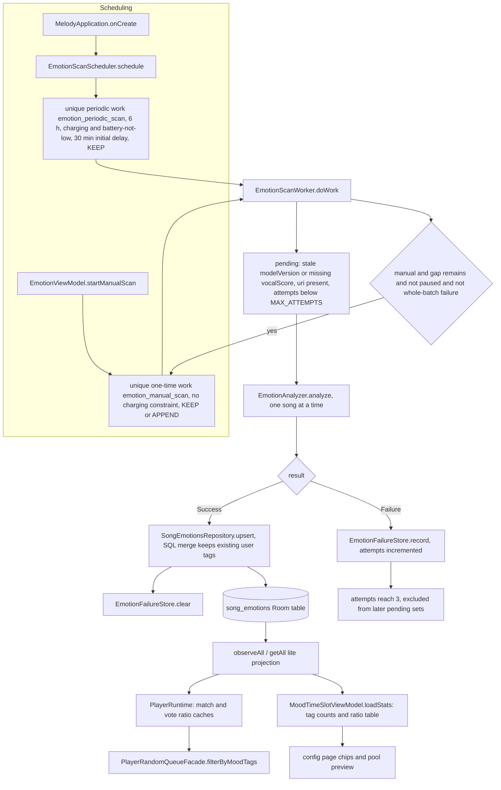
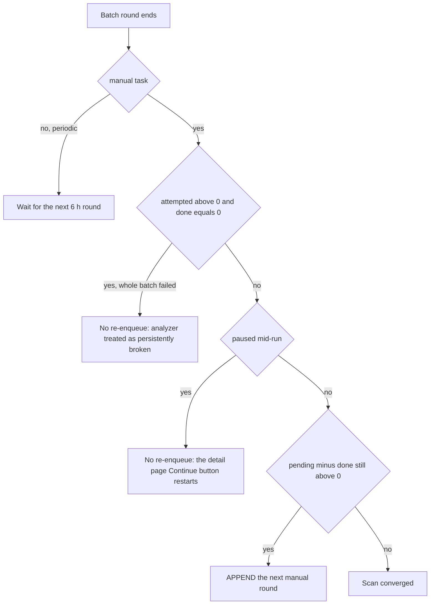

# Emotion analysis pipeline: scheduling → inference → persistence → consumers

The emotion feature is a closed on-device loop. **Scheduling** (a periodic charge-gated scan armed at app startup, plus a manual immediate scan) feeds the same **batch-scan worker**, which filters the library down to songs awaiting analysis. The worker drives **inference** (`EmotionAnalyzer`: FFmpeg/vendor decode → 16 kHz mono PCM → YAMNet embeddings → VA head, with RMS loudness as arousal and an AudioSet vocal score), **persists** into Room `song_emotions` while merging user calibration in SQL, and records failures **out of band** in a DataStore store so retry logic is bounded. Everything downstream — player caches, mood time-slot statistics, the detail chart, the library Emotions tab, manual calibration — reads the model output only through the projections in `:core:model`, never through raw curve math at the call site.

The domain model and vocabulary live in `/openwiki/concepts/emotion-model.md`; the table/migration catalogue in `/openwiki/architecture/data-persistence.md`; the playback-side decision in `/openwiki/concepts/mood-time-slot.md`. This page owns the flow, the operational limits, and the failure semantics.

## End-to-end overview



*Two trigger chains converge on one worker; success writes the model row and clears the failure record, failure only accumulates an attempt, and the whole-library read path fans the result out to player caches and mood-slot statistics.*

## Batch-scan scheduling: periodic and manual chains

**Periodic chain** is armed at app startup: `MelodyApplication.onCreate` calls `EmotionScanScheduler.schedule(this)` (after installing the logger, the performance-trace allow-list and the uncaught-exception handler). The scheduler enqueues `PeriodicWorkRequestBuilder<EmotionScanWorker>` under the unique name `emotion_periodic_scan`, period 6 hours, constraints `setRequiresCharging(true)` + `setRequiresBatteryNotLow(true)`, network `NOT_REQUIRED`, initial delay 30 minutes, policy `ExistingPeriodicWorkPolicy.KEEP` (later launches never replace the existing task). The enqueue is wrapped in `runCatching`, so a WorkManager failure only logs and never blocks startup.

**Manual chain** is triggered by the "My" page entry card: `AppNavHost.onEmotionScanNow` calls `EmotionViewModel.startManualScan()` and toasts "已开始扫描，可离开本页，后台继续". The ordering inside `startManualScan` matters: `setEmotionScanPaused(false)` runs first, then the enqueue — otherwise a freshly started worker would read the previous pause value and skip immediately. `WorkManager.enqueueUniqueManualScan()` (an extension in `EmotionScanWorker.kt`) builds a one-time request with input `KEY_MANUAL = true` under the unique name `emotion_manual_scan`, default policy `KEEP`, and **no constraints at all** — the manual scan is not charge-gated.

Batch sizes differ by trigger: periodic runs take `BATCH_SONGS = 40` per round (incremental convergence in the background), manual runs take `MANUAL_BATCH_SONGS = 300` per round so a large library can be swept in one session.

## EmotionScanWorker: pending filter, batch loop, re-enqueue rules

The Worker is a `CoroutineWorker` and is not Hilt-instantiated, so it resolves its singletons through `EntryPointAccessors.fromApplication(applicationContext, EmotionScanEntryPoint)` (music repository, emotion repository, analyzer, settings repository, failure repository).

**Pending filter.** At the start of `doWork` the worker loads the library, the `songId → modelVersion` map, and the failure map, then keeps a song only if all three hold:

1. `analyzed[songId] != EmotionAnalyzer.MODEL_VERSION` **or** `songId in songIdsMissingVocalScore()` — not analyzed under the current model/coordinate version, or analyzed before `vocalScore` existed. The DAO backfill query is restricted to `windowsAnalyzed > 0`, so a manually tagged `user-only` row (failed analysis) is not a vocal-score backfill candidate; it re-enters the batch through the version mismatch instead.
2. `it.uri != null` — a locally readable file.
3. Its failure record's `attempts < MAX_ATTEMPTS` (`EmotionScanWorker.MAX_ATTEMPTS = 3`). Songs at or above the cap are excluded from automatic retries so every round converges instead of re-burning the same broken files.

An empty pending set returns `Result.success()` immediately, logging the library size and, when relevant, how many songs were skipped for repeated failure. A non-empty set logs `pending/library`, the batch size and the excluded-failure count.

**Per-song loop** over `pending.take(batch)`:

- `isStopped` (system stop / WorkManager's 10-minute truncation) breaks out; the paused flag breaks out too and sets `pausedMidway`.
- Pause is cooperative and cheap: the `emotionScanPaused` settings flow is subscribed **once** at batch start into an `AtomicBoolean`, so the loop reads memory instead of doing one DataStore read per song (a 300-song manual batch previously did 300 disk reads).
- `setProgress(workDataOf(KEY_PROGRESS_CURRENT to song.title))` publishes the current title to `EmotionViewModel`.
- `runCatching { analyzer.analyze(songId, uri, MODEL_VERSION) }` — a thrown exception is downgraded to `Failure(INFERENCE_ERROR)`.
- **Orphan guard before persistence**: the song may have been deleted mid-batch, so success/failure is written only if `musicRepository().containsSong(song.id)` still holds (an allocation-free O(n) membership test, not a library snapshot copy). Otherwise both the emotion row and the failure record are skipped, so no orphan rows appear.
- Success → `emotionRepository().upsert(result.emotion)` + `failureRepo.clear(song.id)`; failure → `failureRepo.record(song.id, result.reason)` only. **A single-song failure is recorded and never thrown, so it cannot abort the batch.**

**Re-enqueue rules** are the anti-infinite-loop core and apply to the manual chain only:



*Manual re-enqueue decision: a whole-batch failure and a mid-run user pause both stop the chain; every other remaining gap is chained with `ExistingWorkPolicy.APPEND`, which is also why `cancelUniqueWork(emotion_manual_scan)` cancels the whole queued chain when the user pauses.*

## Inference pipeline: EmotionAnalyzer

`EmotionAnalyzer` (`@Singleton`, `:player`) turns any audio `Uri` into a per-window `(valence, arousal)` curve, matching the server training/evaluation probe bit-for-bit (measured maxDiff = 6e-6):

1. **Decode** — `MediaExtractor` selects an audio track, prefers `FfmpegPcmDecoder` (the same FFmpeg extension used by the playback chain), falls back to vendor `MediaCodec` only for safelisted mime types; output is downmixed to mono s16 and linearly resampled to 16 kHz `FloatArray` (resampling math in `Long` to avoid overflow on long tracks).
2. **Sliding window** — 5 s window (`WINDOW_SEC`, 80 000 samples) with a 2.5 s hop (`HOP_SAMPLES`, 40 000).
3. **In-window inference** — 16 384-sample frames (`FRAME`, 0.975 s at 16 kHz) run through `emotion_yamnet.tflite`; the 1024-d embeddings are averaged within the window, and the AudioSet class sigmoid scores from the same output batch are accumulated as the vocal score, so vocal detection costs no extra decode or inference.
4. **VA head + arousal** — the mean embedding feeds `emotion_va_head.tflite`; valence is recalibrated `v' = (v − V_CAL_BIAS) / V_CAL_SCALE` clamped to `[-1,1]`, while **arousal is not the head's output**: it is the window RMS of the already-decoded PCM mapped `20·log10(rms)` from `[DB_FLOOR, DB_CEIL] = [-30, -5]` dBFS onto `[-1,1]`. The constants come from `EmotionModelSpec` (generated from `core/model/emotion_model_spec.properties`), not from literals here.
5. **Summary** — song-mean V/A, `peakSec = argmax(window arousal) * HOP_SEC`, `windowsAnalyzed`, `durationSec`, the whole-song mean YAMNet embedding (retraining feedstock), and `vocalScore` = mean vocal-class score over all frames. The stored curve keeps the **raw, unsmoothed** window values; smoothing and vocal compensation are read-time concerns.

The output tensor index is discovered (`first output whose shape().last() == 1024`), so a YAMNet export or runtime output-order change needs no code edit. Inference is serialized: decoding runs outside `synchronized(lock)` because it is pure CPU with no shared state, but the entire sliding-window loop holds the lock, and `close()` takes the same lock — the periodic and manual jobs are two distinct unique tasks that WorkManager may run concurrently, and a TFLite `Interpreter` is not thread-safe (concurrent `invoke` crashes natively). Measured cost is ~120 ms per window, i.e. CPU-intensive work that must run off the main thread; the worker's coroutine context satisfies that.

### Decode path: FFmpeg first, safelist fallback, raw-track fallback

- **FFmpeg first.** On some ROMs the vendor soft-decode component natively crashes (real-device SIGSEGV on a Snapdragon ALAC decoder); playback never hits it because ExoPlayer prefers the FFmpeg extension. Analysis drives the same extension directly via `FfmpegPcmDecoder` whenever `FfmpegPcmDecoder.handles(mime)` matches.
- **No blind fallback.** If FFmpeg fails, `mediaCodecFallbackSafe(mime)` permits vendor `MediaCodec` only for aac/flac/opus/vorbis; ffmpeg-only mimes (alac/mp3/g711 — exactly where the crash and the infinite loop appeared) return `DECODE_UNSUPPORTED_FORMAT`. Before fallback the extractor is rewound with `seekTo(0)`, since FFmpeg already consumed samples.
- **Raw track.** A container that exposes true audio as `audio/raw` with no matching decoder is read straight to s16 via `readRawPcm` (which already resamples, so the caller does not resample twice).
- **Watchdog.** The decode loops share a 60 s (`MAX_DECODE_MS`) wall-clock deadline that abandons the song as `DECODE_TIMEOUT`.

### Over-length and memory-budget circuit breakers

Two sample limits are computed per source sample rate (`samplesLimits`): a **duration limit** (`MAX_SECONDS = 20 min` × clamped source rate, the true "too long" boundary) and a **memory limit** sized from the decode budget. A song is rejected before decode when the track's `KEY_DURATION` implies more samples than a limit: exceeding the duration limit reports `TOO_LONG`, exceeding only the memory limit reports `TOO_LARGE_FOR_DEVICE` (e.g. 192 kHz material well under 20 minutes). Unknown duration (`durationUs <= 0`) is not pre-blocked; it falls through to mid-decode truncation and the OOM catch. Mid-decode, `ShortAccum` capacity is `maxSamplesForSrc(...)` and silently truncates at the cap; `truncationReason` then classifies the song by whichever limit was tighter.

### Heap-adaptive decode budget, largeHeap, and high sample rates

Both `EmotionAnalyzer` and `FfmpegPcmDecoder` derive one budget at construction from the device heap:

```
memoryBudgetForHeap(maxHeapBytes) = (maxHeapBytes - 64MB reserved).coerceIn(96MB, 512MB)
```

The app declares `android:largeHeap="true"`, so the reported `maxMemory` is usually well above the 256 MB baseline and the derived budget therefore also exceeds the old fixed 192 MB (256 MB heap → 192 MB, 384 MB → 320 MB, 512 MB → 448 MB, capped at 512 MB). The budget covers decode buffer **plus** resampled output. The steady-state peak is `samples × (2 + 64000/srcRate)` bytes; for source rates above `TRANSIENT_DOMINANT_RATE = 64 kHz` the final `ShortAccum` `copyOf` doubling (old array plus new array alive together = `samples × 3` bytes) dominates and binds through a transient limit with a safety margin (≈ budget / 3.5). Under a 192 MB budget, 44.1 k/48 k stay duration-bound (behaviour unchanged), 96 k cuts at ≈ 7.5 min, and 192 k at ≈ 3.3 min — deterministic, instead of an OOM at 192 kHz. Source rates are clamped to 8 k–192 k before the math so malformed headers cannot overflow the `Int` capacity.

**OOM is caught as `Error`.** `catch (oom: OutOfMemoryError)` is a separate branch from `catch (e: Exception)` (OOM is not an `Exception`, and the Worker's fallback previously mislabelled it `INFERENCE_ERROR`); it now reports `TOO_LARGE_FOR_DEVICE`, which after pre-decode gating means an unknown-duration or extreme high-rate file.

## Memory discipline (real-device OOM, hard constraint)

> **Decoded PCM must live in primitive-type arrays; boxed collections are forbidden in the decode path.**

A former `ArrayList<Short>` boxed sample-by-sample: 4 min of 44.1 kHz stereo = 10.58 M `Short` objects (≈16 B each) plus a ≈70 MB reference array ≈ 240 MB, which with the inference arrays blew the 256 MB heap; after GC recovered nothing, a 2.5 KB allocation on the ExoPlayer thread OOMed the process. Today the decode side uses `ShortAccum` uniformly (doubling `ShortArray` with a hard capacity, silent drop + `truncated` flag for the caller to classify), inference reuses one set of `embArr`/`scoreArr` output arrays for the whole song (the previous per-frame allocation churned ≈6 MB per song), the song embedding accumulator is a `DoubleArray`, and the resample math is done in `Long`. Any new decode path that reintroduces a boxed collection re-buries the regression.

## Failure handling: out-of-band attempts and the "cannot analyze" section

Failures are recorded **outside** `song_emotions`, in `:data`'s `EmotionFailureStore` (DataStore preferences, one JSON object keyed by `songId` with `reason`/`failedAt`/`attempts`; a corrupted entry is skipped on parse). `record` increments `attempts`, `clear` removes the entry after a success, and `clearForRetry` wipes entries so counting restarts from zero. DataStore was chosen because the volume is a handful of songs and no Room schema change is needed. Because the attempt counter is out of band, the batch never needs to mutate the library or the emotion table to give up: the pending filter simply stops selecting the song, and `Result.success()` is still returned so WorkManager does not retry the whole job.

| Reason | Meaning |
| --- | --- |
| `EXTRACT_FAILED` | SAF permission revoked / file moved or deleted / damaged container |
| `NO_AUDIO_TRACK` | no audio track in the container |
| `TOO_SHORT` | decoded PCM shorter than one analysis window (≈ < 5 s) |
| `TOO_LONG` | over-length breaker (20 min) |
| `TOO_LARGE_FOR_DEVICE` | sample rate too high or file too large: decode memory exceeds the device budget (transcode and re-import) |
| `DECODE_TIMEOUT` | single-song decode watchdog (60 s) |
| `DECODE_UNSUPPORTED_FORMAT` | FFmpeg-only mime with no safe fallback / no decoder (transcode to AAC/FLAC) |
| `INFERENCE_ERROR` | TFLite inference exception |

**Retry policy.** Three cumulative attempts is the automatic cap. The escape hatch is the analysis report screen's "无法分析" section, which lists each failed song with its user-readable reason (plus "失败 N 次" when `attempts > 1`), a check badge and the tag list for songs that were manually tagged meanwhile, a per-song 标记/修改 action opening `EmotionCalibrateDialog` in words-only mode, and two batch buttons: add to playlist and retry failed songs. "Retry" calls `EmotionViewModel.retryFailedSongs()`, which clears every failure record (`clearForRetry`), clears the pause flag, and appends a manual scan, after which the pending filter re-admits those songs. Badge state comes from `EmotionViewModel.calibratedTagsOf(songId)`.

**Coverage linkage.** Failed songs have no model row (at most a `user-only` tag row), so they contribute nothing to mood time-slot matching; low analysis coverage therefore shrinks the time-slot candidate pool until songs are fixed or manually tagged.

## Scan state exposed to the UI: EmotionViewModel

`EmotionViewModel` (`@HiltViewModel`, one shared instance for the "My" card and the report page) is a pure Flow state machine, not a "query on page entry" view model:

- **Lazy, idempotent observation.** Consuming pages call `observe()` when visible; it returns immediately if a collection job is active. Lazy start exists because unconditional `init` collection made cold start query the emotion table and race `PlayerViewModel`'s `loadSongs`, breaking playback-queue/progress restoration.
- **Signal source** — `combine(tick, manual WorkInfo flow, periodic WorkInfo flow, emotionScanPaused)`. For the manual task both `RUNNING` and `ENQUEUED` count as scanning (instant button feedback, and WorkManager re-pushes state after a process kill); `currentSongTitle` comes from the last `RUNNING` task's `progress[KEY_PROGRESS_CURRENT]`.
- **Cadence** — while scanning, status is rebuilt every 2 s (work-info/progress pushes also trigger immediately); when idle, once per signal change.
- **Aggregate-only reads on `Dispatchers.Default`** — `countSongs`, `tableStat()` (row count + max analyze time), `recentAnalyzedTimestamps(20)`, `correctionCount()`, `currentFailures()`. This keeps per-poll cost O(1) instead of materializing the table.
- **Duration stats** — adjacent success-timestamp deltas, with gaps in `1..600_000 ms` only (larger gaps are inter-batch idle).
- **Row rebuild fingerprint** — `total|stat.count|corrected|paused|tick|contentFingerprint`; an unchanged fingerprint skips rebuilding the flattened rows, and a failed build keeps the old key so the next tick retries.
- **Operations** — `startManualScan` (resume), `pauseScan` (set flag + `cancelUniqueWork(emotion_manual_scan)`), `retryFailedSongs`, `refresh()`.

Pause is cooperative end to end: the flag is observed before the batch and before each song, so the in-flight song finishes and the scan then stops; resuming is just `startManualScan`.

## Persistence boundary: song_emotions writes

`SongEmotionsRepository` is the only writer of `song_emotions`.

- **`upsert` (rescan path)** issues one atomic `UPDATE ... WHERE songId = :songId` whose `CASE` expressions keep the existing `userTags`/`userTagsEdited` whenever the incoming row carries none, and only falls back to a plain insert when the `UPDATE` affected 0 rows. Merging in SQL (rather than read-merge-write in Kotlin) removes the TOCTOU window in which a user calibration saved mid-scan could be silently overwritten by the worker's stale copy.
- **`saveCorrection`** atomically `UPDATE`s only the user tag columns (leaving model columns untouched) and, if no row matched, `INSERT OR IGNORE`s a `user-only` row (`curveJson = "[]"`, `windowsAnalyzed = 0`, `modelVersion = "user-only"`). `INSERT OR IGNORE` rather than `@Upsert` matters: an upsert would replace an existing analyzed row with an empty curve.
- **`clearCorrection`** nulls the user columns and then deletes the row entirely if it is a fully empty user-only row (`windowsAnalyzed == 0`, no embedding), because `buildRows` treats the presence of a row as "analyzed".
- **Read paths** — `getAll`/`observeAll` map the `SongEmotionLite` projection with `embedding = null` and memoize curve parsing in `parsedCurveCache` keyed by `analyzedAt`; Room re-emits the whole table on any row change, so during a batch only the newly written row re-parses its `curveJson`. The single-row `get(songId)` is the only path that decodes the embedding.

**User calibration write-back.** `AppRoot` provides `LocalEmotionCorrectionController` once at the NavHost root, so every page that renders the song-detail emotion section gets the "不像？标记" capability without callback threading. The controller's `save` delegates to `AppMediaMetadataViewModel.saveEmotionCorrection`: an empty word set means "back to automatic", requires an existing row (returns false otherwise) and calls `clearCorrection`; a non-empty set is validated word by word with `EmotionGroup.groupOf` (out-of-vocabulary words return false — `avgOfWords` is deliberately not the validator because it silently drops invalid words), then `saveCorrection` stores **only the words**, because coordinates are derived at read time from the row's own curve. `edited = isUserCorrection(modelTagsOf(...), words)` records whether the user disagreed with the model (it must use `modelTagsOf`, since `emotionTagsOf` already returns the user's own words on a calibrated row); adopting the model's own tags is not an independent correction. On success the controller calls `emotionViewModel.refresh()`, on failure it toasts that the song has not finished analysis, and `SongEmotionSection` overrides the row locally so the dialog result shows immediately.

**Schema boundary.** The emotion table is untouched by recent migrations: `16 → 17` only adds indices, `17 → 18` (song bit depth) and `18 → 19` (bitrate/channel/codec/spatial flags) only add `songs` columns, and `19 → 20` only runs `DELETE FROM song_group_overrides` to drop legacy manual version-group keys — unrelated to analysis, it affects grouping, not emotion rows. The last `song_emotions` column addition was `13 → 14` (`vocalScore`); `12 → 13` rewrote the `modelVersion` label and nulled the stale stored user coordinates, and `14 → 15` relabelled rows for the v5 coordinate system — coordinate/scale migrations, not schema changes. So upgrading through v17–v20 neither invalidates nor re-triggers the emotion pipeline.

## Downstream consumers: projections, not curve math

The model output is consumed exclusively through `:core:model` projections. Each re-derives one consistent view of a row: `emotionMatchRatiosOf` (full tag distribution for matching), `emotionVoteRatiosOf` (the same distribution gated at display thresholds for vote learning), `emotionTagRatiosOf` (display list with ratios), `emotionTagsOf` (headline tags, user words first), and `emotionDisplayOf` (tags + ratios + confidence from **one** vote). All of them honor user calibration first, vote on `compensatedCurve`, and select anchors by `modelVersion`; no UI or facade re-implements that logic against a raw curve.

**Player caches (`PlayerRuntime.observeMoodSlotCaches`).** A single long-lived subscription to `songEmotionRepository.observeAll()` computes **both** distributions per emission (`emotionMatchRatiosOf` and `emotionVoteRatiosOf(VOTE_MIN_RATIO, VOTE_MAX_TAGS)`) on `Dispatchers.Default`, then stores them in the volatile `moodEmotionRatiosCache` and `exploreVoteRatiosCache`. Work is O(library) **per emission**, not per lookup: the facades read the caches through `moodEmotionTagsOf` (a key view, zero allocation) and `moodEmotionTagRatiosOf`. Because the subscription is continuous, new analysis rows and user calibrations reach playback decisions without polling or refresh callbacks.

**Mood time-slot filtering (`PlayerRandomQueueFacade.filterByMoodTags`).** At the random-queue entry the candidate pool is restricted to songs whose matched ratio for any active-slot tag clears `MoodSlotPolicy.MATCH_MIN_RATIO` (user-tagged words have no ratio and count as 1.0, i.e. a strong match). Zero matches returns `null` so the caller degrades to a full-library shuffle, and a pool below `MoodSlotPolicy.POOL_WARN_THRESHOLD` logs that it will loop. Tag exclusions are applied to the song list before this filter.

**Config-page statistics (`MoodTimeSlotViewModel.loadStats`).** On entering the mood time-slot page, one `getAll()` snapshot on `Dispatchers.IO` produces (a) per-tag song counts via `emotionTagsOf`, sorted descending for the chip badges, (b) a `songId → tag ratios` table via `emotionMatchRatiosOf`, and (c) the library size from `countSongs()`. Storing the ratio table invalidates the `poolStatsCache`, and `poolStats` then computes matched/excluded/available counts (cached per include/exclude tag set + library size) — deliberately ratio-based rather than count-based, since one song can carry several tags and "has the word" is not "will match". A failure degrades to empty counts so configuration still works. This is the coverage signal that makes the R1 risk visible: the page shows how thin the pool is before a slot is enabled.

**Rendering.** `SongEmotionSection` takes one `emotionDisplayOf(shown)` per row and renders tag chips with their percentages plus a confidence hint (`SPREAD` → "模型把握不大，词条仅供参考", `MIXED` → the song may carry more than one emotion). The chart plots the **compensated** curve, smoothed by `smoothCurve` (moving average, window 5, shrunken at the edges, lists shorter than 3 returned as-is) inside a `remember`, with dashed reference lines and V/A legend colors derived from the theme; it no longer draws a peak marker. A `user-only` row is not early-returned: the words are shown with the note that automatic analysis failed and the user's tags take precedence, and only the chart area is replaced. A song with no row at all shows the "not analyzed yet, runs automatically while charging" placeholder. The library Emotions tab and the playlist/player surfaces consume the same projections through `EmotionViewModel.rows` / `PlayerViewModel.currentEmotion`.

## Operations quick reference

| Item | Value | Location |
| --- | --- | --- |
| Periodic task | `emotion_periodic_scan`, 6 h, charging + battery not low, 30 min delay, `KEEP` | `EmotionScanScheduler` |
| Manual task | `emotion_manual_scan`, one-time, no constraints, `KEEP` / `APPEND` | `EmotionScanWorker` |
| Batch size | 40 periodic / 300 manual songs per round | `EmotionScanWorker` |
| Auto-retry cap | `MAX_ATTEMPTS = 3` (manual retry still possible) | `EmotionScanWorker` |
| Model version stamp | `yamnet-va-v5-vocal@edbf6fe5` (regenerated by build) | `EmotionModelSpec` / `EmotionAnalyzer.MODEL_VERSION` |
| Sampling | 16 kHz mono, frame 16 384, window 5 s, hop 2.5 s | `EmotionAnalyzer` |
| Decode breakers | 20 min duration limit, heap-adaptive memory limit, 60 s watchdog | `EmotionAnalyzer` |
| Decode memory budget | `(maxHeap − 64MB).coerceIn(96MB, 512MB)`; doubling transient binds above 64 kHz | `memoryBudgetForHeap` / `samplesLimits` |
| App heap declaration | `android:largeHeap="true"` | `app/src/main/AndroidManifest.xml` |
| Failure storage | DataStore `emotion_failures`, attempts counted out of band | `EmotionFailureStore` |

Thresholds that belong to the model itself (anchor tables, display/vote ratio gates, confidence bands, vocal compensation) are catalogued in `/openwiki/concepts/emotion-model.md` and are not duplicated here.

## Tests

- `SongEmotionSectionTest` locks the display-layer pure functions: `smoothCurve` length preservation/noise reduction and short-list passthrough, `lowConfidence`, the 10-group word table (unique words, headline first), `categoriesFor` nearest-group voting with zero-window abstention, WITTY exclusion from automatic voting, the `MAX_TAGS` cap, user tags overriding the model in `emotionTagsOf`, and `avgOfWords` anchor math including invalid/empty input.
- `PlayerRandomQueueFacadeTest` locks consumer-side filtering: a slot only draws from tagged songs, zero matches falls back to the full library (asserting the "fall back to full library" log line), and behaviour is unchanged outside the slot window. It injects `moodEmotionTagRatiosOf` directly, with `null` ratios defaulting to 1.0.
- `EmotionAnalyzerLimitsTest` locks the decode budget math: 44.1 k/48 k bound by the 20-minute duration limit, 96 k/192 k bound by memory first, `samplesCutoffReason`/`truncationReason` distinguishing `TOO_LONG` from `TOO_LARGE_FOR_DEVICE`, `memoryBudgetForHeap` clamping and scaling, a larger heap admitting a 10-minute 192 kHz file, and the doubling transient binding at 192 kHz.
- There are **no dedicated unit tests** for `EmotionScanWorker`, `EmotionFailureStore`, or the `song_emotions` migrations beyond the generic Room migration validation, so scheduling, re-enqueue, attempt-cap and decode changes still need on-device regression — OOM, long compilations and 192 kHz files were all found by real-device log forensics, twice.

## Related pages

- `/openwiki/concepts/emotion-model.md` — curve → tag projections, vocabulary, calibration semantics, every render surface
- `/openwiki/concepts/mood-time-slot.md` — how the mood time-slot planner consumes the caches
- `/openwiki/architecture/data-persistence.md` — Room schema, migration catalogue, `song_emotions` entity
- `/openwiki/player/random-and-infinite.md` — random/infinite playback entry points
- `/openwiki/operations/build-and-verification.md` — build gates, generated model spec, on-device verification
- `/openwiki/quickstart.md` — orientation
