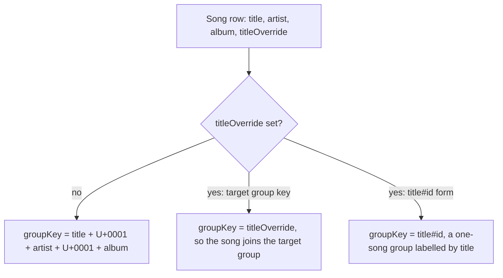
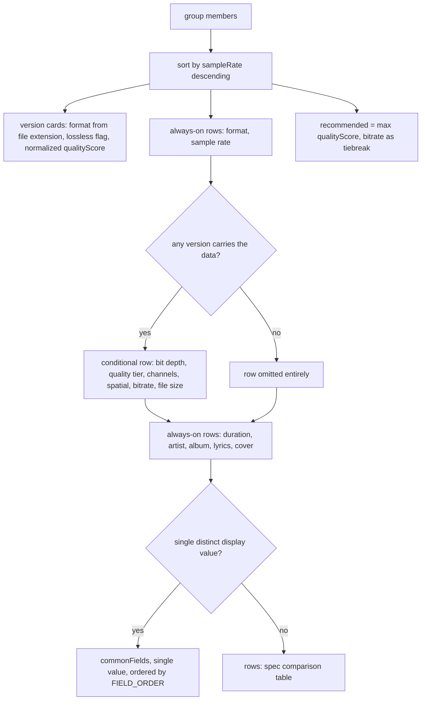
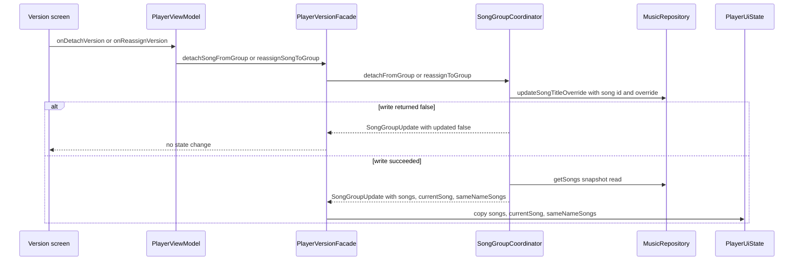

# Library sorting and same-song version management

Two features that look like one ("how songs are grouped and ordered in the local library") are in fact separate, independently owned mechanisms:

- **Ordering** is a pure function over a `List<Song>` — `SongSorter` in `:feature:playlist` — fed by two persisted settings (`SongSortMode` + ascending flag) and by play-statistics maps. No grouping is involved; the local list is sorted whatever the group keys are.
- **Version grouping** is a pure *model* contract — `Song.groupKey` in `:core:model` — plus a comparison engine (`SongVersionComparer`), a mutation coordinator (`SongGroupCoordinator`) and two screens. Grouping is derived, never stored: the only persisted state is an optional per-song override string.

Keeping that split in mind explains most of the behaviour below: sorting can reorder versions away from each other, grouping can merge two different titles into one version group, and neither one contains the other.

| Concern | Owner | Module |
| --- | --- | --- |
| Sort dimensions | `SongSortMode` enum | `:domain` (`domain/model`) |
| Persistence + legacy normalization | `PlayerSettingsRepository` (DataStore `player_settings`) | `:data` |
| Ordering itself | `SongSorter` | `:feature:playlist` |
| Group key derivation | `Song.defaultGroupKey` / `Song.groupKey` | `:core:model` |
| Group membership / queue scoping | `SongVersionManager` | `:domain` |
| Manual override writes | `SongGroupCoordinator` (+ `song_group_overrides` table) | `:domain` + `:data` |
| Field-by-field comparison | `SongVersionComparer` | `:domain` |
| Screens + routes | `VersionManagementScreen`, `VersionComparisonScreen` | `:feature:user` |

## Ordering the local music list

### Persisted state

`SongSortMode` is an eight-value enum (`IMPORT_ORDER`, `TITLE`, `ARTIST`, `ALBUM`, `DURATION`, `BIT_RATE`, `PLAY_COUNT`, `LAST_PLAYED`) whose `label` carries the Chinese menu text. Dimension and direction are **orthogonal settings**: `song_sort_mode` stores `SongSortMode.name` and `song_sort_ascending` is a separate boolean defaulting to `true`.

`PlayerSettingsRepository.songSortMode` performs one deliberate read-time normalization before enum lookup:

```kotlin
val stored = preferences[PlayerSettingsKeys.SONG_SORT_MODE]
// 旧版本把该排序项持久化为 SAMPLE_RATE，现改为比特率排序，读取时平滑迁移
val normalized = if (stored == "SAMPLE_RATE") SongSortMode.BIT_RATE.name else stored
SongSortMode.entries.firstOrNull { it.name == normalized } ?: SongSortMode.IMPORT_ORDER
```

**`BIT_RATE` replaced `SAMPLE_RATE`; this is an in-memory alias only.** Consequences to respect when changing this area:

- Do **not** add a Room migration for it — the sort setting is not in Room at all (it lives in the `player_settings` DataStore).
- Do **not** add a new preference key. The reader maps the retired string `"SAMPLE_RATE"` to `BIT_RATE` and otherwise matches `SongSortMode.entries`; anything unknown (including `null`) falls back to `IMPORT_ORDER`.
- Writes only ever store `mode.name`, so a device that still holds `"SAMPLE_RATE"` reports `BIT_RATE` until the user picks a mode, at which point the old string is overwritten. Because the enum has no `SAMPLE_RATE` member, removing the alias would silently change those users' list order rather than fail.

### Sort modes and their keys

`SongSorter.sort` builds one comparator per mode; string fields go through a single `Collator.getInstance(Locale.CHINA)` instance (Chinese / pinyin ordering), numeric fields compare directly.

| Mode | Primary key | Secondary key |
| --- | --- | --- |
| `IMPORT_ORDER` | `id` | — (import order, natural id order) |
| `TITLE` | `groupKey` (collator) | — |
| `ARTIST` | `parsedArtists.firstOrNull()` (collator) | `groupKey` (collator) |
| `ALBUM` | `album` (collator) | `groupKey` (collator) |
| `DURATION` | `durationMs` | — |
| `BIT_RATE` | `bitRateKbps` | — |
| `PLAY_COUNT` | `playCounts[id] ?: 0` | `id` |
| `LAST_PLAYED` | `lastPlayedAt[id] ?: 0L` | `id` |

Notes that the keys imply:

- `TITLE` sorts by **`groupKey`, not `title`**. Since the default key starts with the title and then appends artist and album, this orders by title first, and versions of the same song (identical key) stay adjacent instead of scattering — provided the sort is stable, which `sortedWith` is.
- `ARTIST` uses `parsedArtists.first()`, so `"A / B"` sorts under `A`, not under its raw artist string. `parsedArtists` is computed once per `Song` at construction (it is used as a comparator key on every comparison).
- `PLAY_COUNT` / `LAST_PLAYED` fall back to `0` for never-played songs and then tie-break on `id`, which is what keeps the list from jittering.
- `BIT_RATE` reads `Song.bitRateKbps`, so an unknown bitrate (`0`) sorts at the low end in ascending order — pinned by `SongSorterTest`.

Direction is applied by **reversing the comparator**, not by reversing the output list:

```kotlin
val ordered = if (ascending) songs.sortedWith(comparator) else songs.sortedWith(comparator.reversed())
```

So a descending sort also reverses the tiebreak (`PLAY_COUNT` descending orders equal counts by descending `id`). "Ascending" is a single boolean; there is no per-mode default direction, and `IMPORT_ORDER` responds to it like any other mode (descending = newest-imported first).

### Where sorting actually runs

The persisted value travels: `PlayerSettingsRepository` (DataStore flow) → `PlayerRuntime.songSortMode` / `songSortAscending` → `PlayerViewModel` (`stateIn`, `SharingStarted.Eagerly`, initial `IMPORT_ORDER` / `true`) → `AppNavHost` (`collectAsStateWithLifecycle`) → `PlaylistRouteState.sortMode/sortAscending` → `PlaylistScreen` → `LocalMusicManagementView`.

Inside the view the ordering is memoized against a content fingerprint rather than map identity, because `uiState.playCounts` / `lastPlayedAt` are new `Map` instances on every refresh:

```kotlin
val playCountsKey = remember(playCounts) { playCounts.entries.sortedBy { it.key }.hashCode() }
val displaySortedSongs = remember(localSongs, sortMode, sortAscending, playCountsKey, lastPlayedKey) {
    SongSorter.sort(localSongs, sortMode, sortAscending, playCounts, lastPlayedAt)
}
```

`localSongs` is `songs.filter { it.uri != null }` — the list that arrives is the *grouped* library projection (`getGroupedSongs(...).flatten()`), so versions of one song start out adjacent and the sort decides whether they stay that way. Search filtering happens after sorting, and the sort menu (`SortModeDropdownMenu`) renders the eight modes with a check mark on the current one plus a fixed bottom item that toggles direction and shows the current arrow.

The statistics behind `PLAY_COUNT` / `LAST_PLAYED` are loaded with the library snapshot into `PlayerUiState.playCounts` / `lastPlayedAt` via `getPlayCountsForSort()` (the effective `play_count` column) and `getLastPlayedAtForSort()` (rows with a non-null timestamp only).

## Same-song version grouping

### The group key contract

`Song.groupKey` is derived, not persisted:

```kotlin
val defaultGroupKey: String get() = "$title$GROUP_KEY_SEPARATOR$artist$GROUP_KEY_SEPARATOR$album"
val groupKey: String get() = titleOverride ?: defaultGroupKey
```

`GROUP_KEY_SEPARATOR` is **U+0001** (`\u0001`), chosen because it cannot occur in a real title/artist/album tag — the point is to prevent `"AB"+"C"` colliding with `"A"+"BC"`.



*How a song's group key is derived; only the override is persisted.*

The three override shapes and their rendering rules:

| Override value | Written by | `groupKey` | `groupKeyLabel` | `isDetachedFromGroup` |
| --- | --- | --- | --- | --- |
| `null` | never touched / reset | `defaultGroupKey` | `title` | `false` |
| target group's **full** `groupKey` | `reassignToGroup` | that key → merges into the target group | text before the first U+0001 = the target's title | `false` |
| `"$title#$id"` | `detachFromGroup` (`SongVersionManager.detachedGroupKey`) | a key no other song produces → one-song group | `title` | `true` |

Because reassignment copies the target's *current* `groupKey`, chained reassignment works: if the target is itself overriding, the copied key is already the target's resolved key, so both land in the same group.

**Grouping never renames anything.** `Song.title` and the rest of the metadata are untouched; the override only changes membership and the label shown for the group header. Nothing about the group is stored as a list or a group id — groups are recomputed on every read by `groupBy { it.groupKey }`.

### The v20 group-key reset

Until the 2026-11 semantic change, `groupKey` was `titleOverride ?: title` and manual overrides stored a **pure title**. Under the composite key that legacy value cannot be mapped to a target group in any reliable way: it would leave the song in a silent one-song group (or, worse, merge unrelated songs that happen to share that string). The reset is a one-statement Room migration:

```kotlin
val MIGRATION_19_20 = object : Migration(19, 20) {
    override fun migrate(db: SupportSQLiteDatabase) {
        db.execSQL("DELETE FROM `song_group_overrides`")
    }
}
```

Operationally:

- `MelodyDatabase` is now `version = 20`, and **all** legacy manual links — both "linked to another group" and "detached" — are deleted once. After upgrade users must re-associate; there is no attempt to translate old values.
- The reset deliberately occupies its own version instead of being folded into the unreleased 18→19 step, so devices already sitting at 19 still execute the `DELETE`.
- `SongGroupKeyTest` pins the *new* semantics only, including that a legacy pure-title override neither crashes nor merges into a default group — it stays its own group with the raw override as key and label. Do not read that test as "legacy overrides still work".

### Where groups are consumed

| Consumer | Rule |
| --- | --- |
| `SongVersionManager.groupedSongs` | playable songs grouped by `groupKey` (`uri != null`), each group's internal order preserved |
| `SongVersionManager.sortedSameNameSongs` | members of the song's group, playable only, **sorted by `sampleRate` descending** |
| Version management screen | `uri != null` songs, groups with **≥ 2** members only, versions sorted by `sampleRate` descending |
| Comparison route | member list = all songs whose `groupKey` equals the route's `groupId` |
| Playback panel version switcher | `PlayerUiState.sameNameSongs`, i.e. `sortedSameNameSongs`, so the "N 个版本" list is always sample-rate ordered |
| Playing a version | queue is scoped to `getSongsWithSameName(song, allSongs)` — the whole group, starting at the clicked version |

A detached song therefore disappears from the version-management page (its group has one member) and shows no version switcher, which is exactly the "renders as a one-song group" behaviour. Note the ordering convention of the *group list* itself: both `VersionManagementScreen` and the comparison route's previous/next computation order groups by plain `String` comparison of the group label (`sortedBy { it.displayTitle }` / `sortedBy { it.first().groupKeyLabel }`), **not** by the pinyin collator used for the local music list.

## Comparing versions

`SongVersionComparer.compare(songs, fileNameOf, bitRateOf, fileSizeOf)` is a pure function returning a `ComparisonResult` (cards, `recommendedIndex`, `rows`, `commonFields`, `sameCount`, `diffCount`).



*The comparison pipeline: two unconditional rows, six gated rows, five more unconditional rows, then a partition into the diff table and the collapsed common set.*

### Ordering and row composition

- Versions are sorted by `sampleRate` **descending**; `recommendedIndex` indexes into that sorted list, so the recommended card is usually first but not by construction.
- `format` comes from the file name extension (`Song.uri.lastPathSegment`, injected as `fileNameOf`); an empty extension renders `"未知"`. `LOSSLESS_EXTENSIONS = {flac, wav, aiff, aif, ape, alac, wv, tak}` drives both the lossless badge and scoring.
- Two rows are unconditional: **格式** and **采样率** (the latter also carries a 0..1 bar normalized to the maximum sample rate).
- Six rows are conditional on *any* version carrying the data: **位深** (`bitDepth > 0`), **音质** (`qualityTier != UNKNOWN`), **声道** (`channelCount > 0`), **空间音频** (`spatialAudio`), **比特率** and **文件大小** (either injected string non-blank). Missing values inside an existing row render `"未知"` / `"—"`, so a row never disappears because one version lacks the field.
- Five rows are always appended: **时长**, **艺术家**, **专辑**, **歌词**, **封面**.
- The partition criterion is "more than one distinct `display` string": differing rows go to `rows` (the spec table, in construction order), identical rows collapse into `commonFields` as `label to value`, sorted by the label's position in `FIELD_ORDER` (unknown labels last).

### Recommendation scoring

```
qualityScore(song) = qualityOf(sampleRate, format) / maxScore
qualityOf(rate, fmt) = rate * (1.0 if fmt in LOSSLESS_EXTENSIONS else 0.6)   // 0 when rate <= 0
recommended = maxBy(qualityScore, thenBy bitRateKbps parsed from the bitrate string)
```

So the recommendation is **not** the highest sample rate: 44.1 kHz FLAC (×1.0) beats 48 kHz MP3 (×0.6) — pinned by `recommendedFollowsQualityScoreNotRawSampleRate`. Ties on score are broken by the higher bitrate string parsed as `substringBefore(" ")` (e.g. `"2304 kbps"` → `2304`), and only when bitrate data is available; with neither score nor bitrate the first card in sorted order wins.

`diffHint(songs, fileNameOf)` reuses `compare` with **no** bitrate/file-size injection (so those rows can never appear) and produces the group-row subtitle: the first two differing labels joined by `、`, `"… 等 N 项不同"` when more than two differ, and `"规格一致"` when nothing differs.

### The data-access rule: file strings are injected, not read

`SongVersionComparer` runs in `:domain` and must not touch Android APIs, yet the comparison needs two values that only exist after reading the file: a formatted bitrate string and a file size. The engine therefore takes them as lambdas (`bitRateOf`, `fileSizeOf`), and the comparison screen supplies them from per-version `SongInfo` objects it loads itself:

```kotlin
LaunchedEffect(songs) {
    val loaded = buildMap {
        songs.forEach { song -> song.uri?.let {
            loadSongInfoSafely(loadSongInfo, song)?.let { info -> put(song.id, info) }
        } }
    }
    versionInfos = loaded
}
val comparison = remember(songs, versionInfos) { SongVersionComparer.compare(songs, bitRateOf = …, fileSizeOf = …) }
```

The comparison is recomputed when the metadata map lands, so rows appear progressively without blocking the first frame. `loadSongInfoSafely` (in `:core:ui`) swallows non-cancellation throwables and logs them, rethrowing `CancellationException`; the build enforces that no call site invokes `loadSongInfo` bare, and that `:core:model` / `:domain` contain no `import android.*` beyond a named baseline (which today includes `core/model/.../Song.kt` because of `android.net.Uri`). Practically: **any new comparison column derived from the file must arrive through an injected parameter, never by opening the file inside `:domain`.**

## Managing groups from the UI

### Navigation

Both screens are feature-owned route/screen pairs registered in `AppNavHost` (the architecture check fails the build if `VersionManagementRoute.kt` / `VersionManagementScreen.kt` disappear):

| Route | Constant | Argument |
| --- | --- | --- |
| `version-management` | `AppRoutes.VERSION_MANAGEMENT` | — |
| `version-comparison/{groupId}` | `AppRoutes.VERSION_COMPARISON` | `groupId` = URL-encoded `groupKey` |

The entry point is the **library** screen: the "文件管理" card in `LocalMusicManagementView` exposes a 多版本管理 button that calls `onShowVersionManagement`, wired in `AppRouteActionMappers` to `navigate(AppRoutes.VERSION_MANAGEMENT)`. Both destinations belong to the **曲库 (playlist) tab** for bottom-bar highlighting and swipe affinity — `RouteAffinity` lists `VERSION_MANAGEMENT` in `PLAYLIST_CHILDREN` and matches the `version-comparison/` prefix to `AppRoutes.PLAYLIST`; they are *not* in the 我的 (`USER_CHILDREN`) set.

Inside the comparison route the host computes the sibling groups from the same library projection (`uri != null`, groups of ≥ 2, ordered by `groupKeyLabel`) and hands `previousGroupKey` / `nextGroupKey` to the screen. Choosing one navigates to that group with

```kotlin
navController.navigate(AppRoutes.versionComparison(targetGroupKey)) {
    popUpTo(AppRoutes.VERSION_COMPARISON) { inclusive = true }
    launchSingleTop = true
}
```

i.e. the neighbouring group **replaces** the current comparison page, so Back still returns to whatever preceded the comparison page. The screen renders the reference version's play/seek bar (A/B listening), a horizontal version strip, the diff summary (共同 N 项 / 差异 N 项), a collapsible common-field card, the spec table and a file-path card carrying per-version delete / detach / reassign actions. The reference defaults to `comparison.recommendedIndex` and can be re-pointed by tapping a column or a strip card.

### Actions, coordinator, state

Detach, reassign and reset all funnel through one private path in `SongGroupCoordinator`:



*One override write, then a snapshot read only on success; `sameNameSongs` is refreshed only when the edited song is the one playing.*

Details worth preserving:

- `updateSongTitleOverride` is a synchronous repository call (`Boolean`); a `false` result short-circuits **before** the snapshot read, which is why `SongGroupCoordinatorTest` asserts `songs == emptyList()` on failure.
- The coordinator recomputes `currentSong` and `sameNameSongs` only when `currentSongId == song.id`. Detaching the song that is playing therefore immediately rewrites the playback panel's version switcher; detaching any other version leaves the panel untouched.
- `isPlayable` defaults to `uri != null` and is injectable for tests.
- `resetGroupKey` (write `null`, restoring the default key) exists end-to-end — coordinator, `PlayerVersionFacade.resetSongGroupKey`, `PlayerRuntime`, `PlayerViewModel` — but no screen currently offers it; the UI exposes only detach and reassign.
- Persistence: the override is a row in `song_group_overrides` (`songId` PK, nullable `titleOverride`, `updatedAt`). The library is written as a whole snapshot, and `replaceSongs` deletes the entire override table before re-upserting only rows whose `titleOverride` is non-null — so clearing an override really removes the row. On startup `RoomMusicLibraryDataSource.restore` reads the table once and maps each row back onto the song (`entity.toSong(overrides[id]?.titleOverride)`).

### The reassign dialog

`ReassignVersionDialog` is shared by both screens. Its candidate list excludes the song itself, songs without a `uri`, and songs already sharing the current `groupKey` (re-associating into the same group would be a no-op), then filters by title/artist search, keeps **one representative per target group** (`distinctBy { it.groupKey }`) and sorts by title. Confirming writes **the representative's `groupKey`** — never its label — which is what makes cross-title grouping possible.

## Focused tests

| Suite | Module | What it pins |
| --- | --- | --- |
| `SongSorterTest` | `:feature:playlist` | `BIT_RATE` ordering ascending and descending, and unknown bitrate (`0`) staying at the low end while ascending. Other modes (collator, `id` tiebreaks) have no assertions |
| `SongGroupKeyTest` | `:core:model` | default key equality only when title+artist+album match; artist/album splits; reassign joins the target and labels with the target title; `"title#id"` detaches and keeps the title label; legacy pure-title override neither crashes nor merges |
| `SongVersionComparerTest` | `:domain` | sample-rate descending order, common-vs-diff partition counts, expected row labels, lossless weighting, normalized sample-rate bar, `diffHint` wording, and the conditional gating of bit depth / quality / channels / spatial / bitrate / file-size rows plus bitrate tiebreak |
| `SongGroupCoordinatorTest` | `:domain` | detach writes `"Song#1"` and refreshes the current song, reassign writes the target key, reset writes `null`, failed writes skip the snapshot read |
| `MelodyDatabaseMigrationTest.migration19To20ClearsLegacyGroupOverrides` | `:data` | v19 rows (a pure-title link and a `晴天#2` detach) are all gone after migrating to 20 |

See `/openwiki/testing/test-map.md` for the surrounding suite layout and commands.

## Safe-change guide

- **Add a sort mode**: extend `SongSortMode` (label included) *and* the `when` in `SongSorter.sort`; the menu iterates `SongSortMode.entries` and the repository resolves stored names against them, so no other wiring is needed. Unknown persisted names already fall back to `IMPORT_ORDER`.
- **Rename or retire a sort mode**: add a read-time alias in `PlayerSettingsRepository` exactly like `"SAMPLE_RATE" → BIT_RATE`; do not add a Room migration (the setting is not in Room) and do not add a parallel key.
- **Change what identifies a version group**: this is a data migration event, not a code-only edit. The composite-key change required clearing `song_group_overrides` in a new DB version (and a version of its own so devices at the previous version still run it). Expect users to re-associate, and keep `SongGroupKeyTest`'s "legacy value must not merge" guarantee.
- **Add a comparison column**: append the row inside `SongVersionComparer.compare`, gate it on "any version has the data", add the label to `FIELD_ORDER` so `commonFields` ordering stays stable, and derive any file metadata through an injected lambda from the UI layer.
- **Touch the sort pipeline**: remember the direction reverses the comparator (tiebreaks included) and that `LocalMusicManagementView` memoizes on content hashes of the play-statistics maps, so a new source of sort data needs its own invalidation key.

Related pages: `/openwiki/architecture/app-shell-navigation.md` (route table, `RouteAffinity`), `/openwiki/architecture/data-persistence.md` (schema, migration chain, sort persistence), `/openwiki/concepts/audio-spec-and-quality-tiers.md` (the tier and spec fields reused by the comparison rows), `/openwiki/quickstart.md`.
