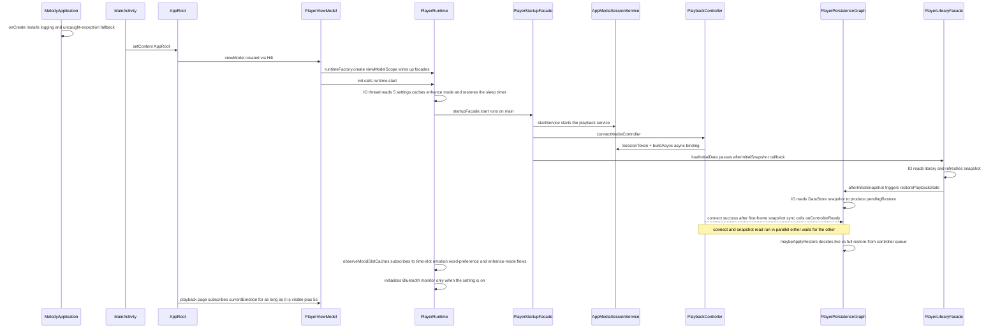
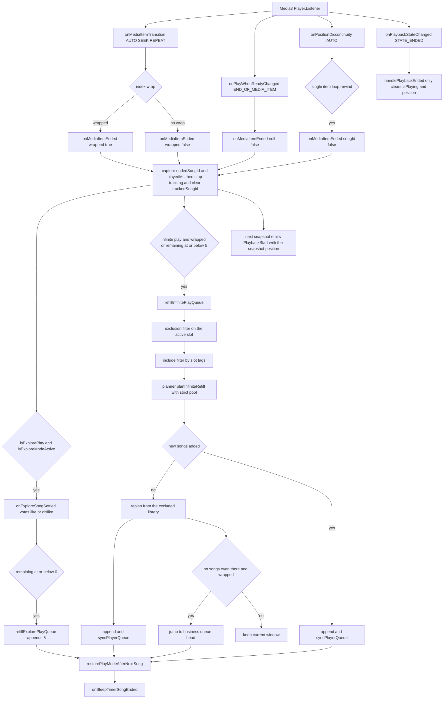

# Workflow: Playback Session Lifecycle

This page stitches one complete playback session start to finish: **app startup → facade initialization and MediaController connect → playback-snapshot restore decision → queue setup and playback start → mood-slot exclusion/inclusion filtering before the random planner → song change / settlement / auto refill → duration tracking and quick-skip → in-session bypaths → the recovery loop after a process kill**. Per-point detail is not expanded here: dual queue / window synchronization lives in `/openwiki/player/queue-architecture.md`, random and infinite refill planning in `/openwiki/player/random-and-infinite.md`, the facade wiring catalog in `/openwiki/player/runtime-facades.md`, state-machine invariants and restore-decision rules in `/openwiki/player/state-machine.md`, and the service/controller integration surface in `/openwiki/player/service-and-controller.md`. The emotion model behind the filter thresholds is in `/openwiki/concepts/emotion-model.md`, the time-slot rules in `/openwiki/concepts/mood-time-slot.md`.

## Cold start to playback: timeline overview

*Cold start to playback: after the UI chain wires up layer by layer, `startupFacade.start` starts the service, connects the controller, and loads the library (the restore read is triggered after the first snapshot); the restore decision waits until the "connect" and "snapshot read" async lines converge in `PlayerPersistenceGraph`; the mood-slot/emotion/word caches and the page-scoped emotion observer are subscriptions layered on top and never block any startup step.*

## Phase 0: process assembly and main-thread discipline

- **Process entry**: `MelodyApplication` (`@HiltAndroidApp`) installs in `onCreate` `AppLog` (level controlled by `BuildConfig.DEBUG`), a global uncaught-exception fallback (first logs a redacted message, then hands off to the system handler), and schedules the emotion batch scan `EmotionScanScheduler.schedule`. The image stack (Coil `ImageLoaderFactory`) is deferred to first load to shorten the cold-start path.
- **UI assembly**: `MainActivity` (`@AndroidEntryPoint`) only does `setContent { AppRoot() }`; `AppRoot` creates `PlayerViewModel` and other Hilt ViewModels through `viewModel()` in the Activity scope.
- **Runtime assembly**: `PlayerViewModel` is a thin shell, not a policy owner. Its constructor takes three dependencies — `PlayerRuntimeFactory`, `MediaStorageStatsRepository` and `SongEmotionRepository` — builds `PlayerRuntime` (the feature composition root) with `runtimeFactory.create(viewModelScope)`, and ignites it in `init { runtime.start() }`; nearly every playback method is a one-line forward to the runtime (`playRandomQueue`/`startInfinitePlay` forward the `(started, moodSlotName)` result callback, `uiState`/`positionMs`/`sleepTimerRemainingMs`/`validationResult`/`isValidating`/`quickSkipSongs` are direct `runtime.*` getters). The one thing it builds itself is the playback page's emotion flow `currentEmotion` (below). Playback policy — queues, tracking, refill, settle — still lives in the runtime's facades, not in the ViewModel.
- **Main-thread discipline**: `PlayerRuntime.start()` moves all blocking sources on the startup path off the main frame — the five DataStore-backed settings (`globalUniformRandomEnabled`, `bluetoothPlaybackMonitoringEnabled`, `playbackNotificationEnabled`, `dailyListeningGoalMinutes`, and `randomEnhanceMode`) and the sleep-timer restore (2 reads + possibly 1 write) all finish on `dispatchers.io` before `startupFacade.start()` runs on the main thread. The enhance mode is read once on IO and cached in `randomEnhanceModeCache` so that a user tapping 「随心播放」 before the subscriptions exist cannot hit a race; that cache is what `moodSlotEnabled` (mode == `TIME_SLOT`) and `exploreModeEnabled` (mode == `EXPLORE`) read afterwards, i.e. **zero DataStore IO per random start**.
- **Continuous cache maintenance**: after `startupFacade.start()` the mood-slot/emotion/word caches are maintained by `observeMoodSlotCaches()`, which opens four long-lived subscriptions and never blocks startup — the DataStore time-slot config flow (`moodSlotConfigsCache`), `songEmotionRepository.observeAll()` mapped on `dispatchers.default` into **two** ratio maps (`moodEmotionRatiosCache` for matching/refill filtering, `exploreVoteRatiosCache` for vote counting), the Room word-preference flow (`wordPreferenceCache`), and the `randomEnhanceMode` settings flow, which mirrors `isExploreModeActive` into UI state and **exits a live explore session** (`randomQueueFacade.stopExplorePlay()`) when the user switches the mode away from `EXPLORE`. The Bluetooth monitor is initialized **only when** the persisted `bluetoothPlaybackMonitoringEnabled` is true via `bluetoothGraph.initialize()`.

`PlayerStartupFacade` fixes the boot steps into a **fixed order**: `startService` → `connectMediaController` → `loadInitialData` (passing `restorePlaybackState` as the `afterInitialSnapshot` callback; the restore read is deliberately placed after the library's first snapshot because snapshot decoding uses the just-loaded library to filter out obsolete songs) → `listenForSongChanges`. This order is locked down by `PlayerStartupFacadeTest`.

### The playback-page emotion observer

The playback page shows a read-only emotion tag strip above the progress bar. It is fed by `PlayerViewModel.currentEmotion`, which is composed, not queried:

1. `combine(uiState, songEmotionRepository.observeAll())` — the current song's id looks up the emotion row in the whole-table flow (the "current song changed" and "an analysis/calibration was written" events arrive on the same stream).
2. `distinctUntilChanged()` then `stateIn(viewModelScope, SharingStarted.WhileSubscribed(5_000), null)`.
3. `NowPlayingSurface` is the consumer: `playerViewModel.currentEmotion.collectAsStateWithLifecycle()` and feeds it into `HomeRouteState.emotion` → `SongInfoSection` → `HomeEmotionRatios`, computed with the same `emotionTagRatiosOf` thresholds the detail page uses. `currentEmotion` is also one of the `remember` keys of the route state, so a new analysis result refreshes the strip without recomposing the rest of the tree.

The `WhileSubscribed(5_000)` lifecycle is the point of this design:

- The upstream Room flow and the combine run **only while the playback page (tab or drawer form) is subscribed**, plus a 5-second grace window. Tab switches, drawer open/close and a quick return do not tear down and rebuild the subscription; once the user has actually left the page, collection stops on its own and the ViewModel is not holding a whole-table emotion stream alive for the rest of its lifetime.
- It must **not** be replaced by per-screen `SongEmotionRepository.get(songId)` queries. `get` is the only repository entry that materializes `SongEmotion.embedding` (~5.3 KB per song); `observeAll()` is a deliberately lightweight projection without embedding, which is what makes a continuously-subscribed page flow acceptable. A per-screen `get()` would also re-query on every song change and reintroduce the "flow per consumer" cost model this observer exists to avoid.

## Phase 1: service start and MediaController connect

- **startService does not use FGS**: `PlaybackController.startService` uses `context.startService(...)` rather than `startForegroundService(...)`. The reason is recorded in a comment (2026-09-03 ANR regression fix): `startForegroundService` forces `startForeground()` within 5 seconds, but `MediaSessionService` only posts its notification once media items exist / playback is active — under a cold-start empty session the call never fires and the system flags an FGS timeout. The method's only call chain is the foreground UI cold start (Activity foreground), where `startService` is legal; even a future background launch can bind through the `connect()` SessionToken mechanism.
- **connect**: `SessionToken` + `MediaController.Builder.buildAsync()` bind asynchronously; on success, `addListener` and `drainPendingActions` (replays UI commands queued while disconnected, FIFO capped at 64) run first, then `onConnected(snapshot)` fires. `PlayerMediaControllerGraph.connect` uses the first-frame snapshot to sync `controllerStateAdapter` before it triggers `onConnected` → `persistenceGraph.onControllerReady()` — **this is why the restore decision gets a trustworthy controller state**.
- **Connection-failure fallback**: a failed connect aborts pending actions and reports `onControllerUnavailable`; `PlayerRuntime.handleControllerUnavailable` logs, writes the reason and dropped count into `errorMessage`, but **still calls `persistenceGraph.onControllerReady()`** to release the restore decision — otherwise `pendingRestore` would hang forever and the UI queue would never recover.

## Phase 2: snapshot-restore decision (live-session criterion)

The restore question is: **does the server still have a live playing session?** Answering wrong either overwrites a playing session with the DataStore snapshot (progress rollback) or discards a recoverable session. The implementation converges in `PlayerPersistenceGraph`:

1. **Two async lines in parallel**: `restorePlaybackState()` reads and decodes DataStore on `dispatchers.io` (`PlaybackRestoreCoordinator.restore(state().songs)` produces a `PlaybackRestoreResult`), returns to main to write `pendingRestore`; the controller connection success (or failure fallback) sets `controllerReady`. **Whichever finishes first waits for the other** — `maybeApplyRestore()` makes no decision until both flags are ready.
2. **The sole live-session criterion**: `liveSessionActive()` = `controllerQueueInfo()?.mediaItemCount ?: 0 > 0`. It deliberately does not guess with "playback position > 0" — the restore IO read can finish before MediaController connects (`buildAsync` binds asynchronously cross-process), at which point `currentPlaybackPositionMs` degrades to a UI-state value (always 0 after a rebuild) and would misclassify a live session as none.
3. **Two-branch apply** (`PlayerPersistenceFacade.applyRestoreResult`):

| controller queue | branch | UI side | controller side |
| --- | --- | --- | --- |
| empty (cold start / server empty session) | **full restore** `restoreController=true` | restores `playQueue`, infinite-play state, `currentSong`, restore-point position, `isPlaying=false` | `prepareControllerQueue(queue, currentIndex, positionMs)` fills the queue and restore-point position, **no autoplay** |
| non-empty (live session) | **UI queue shadow only** `restoreController=false` | restores the queue shadow plus `currentSong`/`sameNameSongs`; position and playing state are left to the post-connect `syncControllerPlaybackState` | **never touched** — no queue rebuild, no position write |

Two invariants (detailed in `/openwiki/player/state-machine.md` "constraint three"):

- **The UI queue shadow must be restored in both branches**: controller snapshot sync only adjusts `currentIndex`, never fills `songs`; skipping the UI side would leave the playback queue permanently empty after a rebuild and lose the infinite-play state.
- **Rebuilding the queue has two guards**: the decision layer only calls `prepareControllerQueue` when no live session exists; `PlaybackController.prepareQueue` carries a second guard internally (`mediaItemCount > 0` early-returns). It is the only one of the three queue commands (`playQueue`/`prepareQueue`/`syncQueue`) allowed to carry a live-session guard; `playQueue` is explicitly forbidden from adding one (otherwise a user tap-to-play request would be silently swallowed).

The full-restore branch's playable session is produced by `PlaybackRestoreCoordinator`'s upgrade step: when the restored queue's current song is playable it builds `RestoredPlayableSession(song, positionMs, sameNameSongs)`, same-name versions sorted by sample rate descending, sharing the same data as the full restore path. **Explore-play sessions persist across restart**: `PlayerPersistenceFacade.savePlaybackState` stores `isExplorePlay` alongside the queue, and `PlaybackRestoreCoordinator`/`applyRestoreResult` rehydrate `isExplorePlay` before the next song boundary so explore auto-refill and settlement keep working after a kill (see Phase 7).

## Phase 3: setup queue and start playback

The queue-replacement chain (user song tap / "contextual play" / playlist playback):

1. UI → `PlayerRuntime.setPlayQueue` → `PlayerQueueFacade.setPlayQueue`: `PlaybackQueueActionPlanner.replaceQueue` generates a new `PlayQueue` (built by `QueueManager.createQueue` producing `playOrderIds`) + a `PlayQueueIndex(startIndex)` action + the `exitInfinitePlay` flag. **Any manual queue replacement also exits an explore session**: when `exitInfinitePlay` is set the plan clears `isInfinitePlay`/`infinitePlayedSongIds` **and `isExplorePlay`** — tapping a play list / TOP chart / artist / album leaves explore auto-refill and settlement off, and pressing 「随心播放」again re-enters explore per the settings mode.
2. `applyPlan` writes the plan into `PlayerUiState` (including exiting infinite play and `nextPlayState`), then executes the playback action `playFromQueue(queue, index)`.
3. `playFromQueue` first passes `PlayerErrorFacade`'s **playability guard**: a target song without a uri does not start, writing `the local file for "«title»" cannot be played`; only playable songs reach `playbackSessionGraph.startQueuePlayback`.
4. `PlaybackSessionCoordinator.startQueuePlayback` plans the windowed controller queue via `controllerQueuePlanner::plan` (business queue → playback window, see the queue-architecture page), and `PlaybackController.playQueue` starts it with `REPEAT_MODE_ALL` + `setMediaItems` + `prepare()` + `play()`; simultaneously `durationTracker.startPlayback(song.id, duration)` starts the timer and returns `trackedSongId`/`sameNameSong`.
5. Single-song playback (e.g. out-of-library single tap) uses `playSingle`: `REPEAT_MODE_OFF` + `setMediaItem`, same tracking start.

The controller's real state from there flows back through high-frequency `onEvents` snapshots: `PlayerControllerStateFacade.syncControllerPlaybackState` maps the snapshot back into `PlayerUiState` (mediaId → Song resolution, queue-index alignment, duration correction) and emits a `PlaybackStart` when "the snapshot is playing, a song resolves, and `trackedSongId != controllerSong.id`" (tracking starts once per song). The `isPlaying` transition must emit a ticker notification, and progress rendering only goes through the `positionMs` narrow flow — see constraints one/two in the state-machine page.

### Random start: exclusion filter → include filter → planner

「随心播放」(`playRandomQueue`) and 「无限随机」(`startInfinitePlay`) both run through `PlayerRandomQueueFacade`, and the mood-slot enhancement inserts two filters *in front of* the planner. The order matters and is fixed:

1. **Resolve the active slot** — `activeMoodSlot()` returns null when the enhance mode is not `TIME_SLOT`, when there are no configs, or when no slot covers the current minute of day; otherwise it returns `MoodSlotState(slotName, tags, excludedTags)` derived from the hit `TimeSlotConfig`. `slotName` is what the runtime surfaces as `currentMoodSlot()?.slotName` in its `onResult(started, moodSlotName)` callback for the 「已按…开启无限随机播放」toast.
2. **Exclusion first** — `filterOutExcludedMoodTags(songs, mood)` removes any song whose emotion ratio map contains an excluded word at or above `MoodSlotPolicy.EXCLUDE_MIN_RATIO` (= `EmotionGroup.MIN_RATIO`, 15%, the detail page's display threshold). The rule is "if the user *sees* this emotion on the detail page, this song must not be shuffled out of that slot"; it logs `moodSlot: excluded N songs by tags=…`. This produces `baseSongs`.
3. **Include filter second** — `filterByMoodTags(baseSongs, mood)` keeps songs whose ratio for an included word clears `MoodSlotPolicy.MATCH_MIN_RATIO` (0.35f, confidence threshold). An empty result returns null and the caller continues with `baseSongs`, i.e. the fallback is **the excluded-filtered library, never the raw library** — a failed include match must not resurrect the excluded songs.
4. **Planner** — `RandomQueuePlanner.planRandomQueue(candidates, recentPlayedSongIds, uniformRandomEnabled, playCounts, batchSize)`: explore mode passes `batchSize = ExplorePlaybackPolicy.INITIAL_BATCH_SIZE` (10), normal random uses the planner default. `playCounts` needs a suspend library query, which is why the whole entry is a coroutine launched from the runtime with a result callback instead of a synchronous Boolean.
5. **Commit** — `setPlayQueue(plan.songs, 0, PlayMode.SEQUENTIAL)` (which clears `isInfinitePlay`/`isExplorePlay` through the replacement plan), then `updateState` writes `isInfinitePlay = false`, `infinitePlayedSongIds = emptySet()` and `isExplorePlay = explore`; `recentPlayedSongIds` is replaced by the planner's history.

Explore mode **deliberately skips both mood filters**: `val mood = if (explore) null else activeMoodSlot()`. Exclusion is a time-slot judgement ("don't play 躁 at 2am"), while an explore session is library-wide by design and is steered by word-preference votes instead (Phase 4).

`startInfinitePlay` builds no new pool: it keeps the current queue, is **blocked while an explore session is live** (`current.isExplorePlay` → return false), and only refills immediately when the window is already at the tail (`remainingMediaItems() <= DEFAULT_REFILL_THRESHOLD`), so a wrap after the current song cannot replay the old window.

## Phase 4: song change and settlement paths

### Media3 event translation

*Song change and settlement: all four Media3 signal classes flow into `handleMediaItemEnded` (or the terminal wrap-up); that entry runs the fixed sequence "settle old track → explore settle/refill (double-flag) → infinite refill (exclusion → include → planner → excluded-library fallback → queue-head wrap) → restore add-next mode → sleep-timer hook", then the next snapshot resumes tracking as a new session.*

Translation-rule highlights:

- **Wrap is decided by index, not reason**: `isMediaItemWrap` (new index 0, previous index was the window's last item) — Media3 reports the `REPEAT_MODE_ALL` tail wrap as `SEEK` (manual next) or `AUTO` (natural end), while `REPEAT` only means single-item repeat. The `wrapped` flag is the infinite-refill trigger (after a wrap the remaining count grows large again, so a threshold-only rule would miss the refill).
- **Manual next goes through the same entry**: headset/lock-screen/notification SEEK skips must reach `onMediaItemEnded` or infinite play would never refill; `PLAYLIST_CHANGED` (the app's own window rebuild) does not trigger it.
- **`STATE_ENDED` (natural stop at queue end) only does UI wrap-up**: `handlePlaybackEnded` sets `isPlaying=false`, position 0, and does not settle.

### The fixed side-effect sequence of `handleMediaItemEnded`

`PlayerMediaEventFacade.handleMediaItemEnded(startedSongId, wrapped)` in order:

1. **Stop old-track tracking**: first captures the just-ended song's actual listen time (`trackedSongId()` and `currentPlayedMs()` **before** the timer is cleared), then `stopPlaybackTracking()` (triggers `PlayDurationTracker.stopPlayback` → settlement, see next section) + `clearTrackedSong()`. Clearing `trackedSongId` is the other half of "track once per song": only the next song's snapshot can emit another `PlaybackStart`.
2. **Explore-session settlement & refill**: while **both** `isExplorePlay` (active session) and `isExploreModeActive` (settings still in explore) hold, first call `onExploreSongSettled(endedSongId, playedMs)` to learn the listening result (this is the only place the settle callback fires; a `trackedSongId == null` skip is ignored), then when `remainingMediaItems() <= ExplorePlaybackPolicy.REFILL_THRESHOLD` (= 0, i.e. the just-ended song was **second-to-last**) refill with `refillExplorePlayQueue(startedSongId)` appending `REFILL_COUNT = 5`. The dual-flag check is the double-safety guard against a mid-restore timing where the explore session flag is true but the user has left explore mode. Third-to-last is deliberately not refilled — that early refill pulled the business-queue `currentIndex` back and replayed the old song (2026-10-20 fix, locked by `PlayerMediaEventFacadeTest`).
3. **Infinite refill**: while in infinite play and (`wrapped` or `remainingMediaItems() <= DEFAULT_REFILL_THRESHOLD = 5`) call `refillInfinitePlayQueue(startedSongId, advanceAfterWrap = wrapped)`. The refill re-runs the **same exclusion → include → planner pipeline** as a random start (Phase 3), over `playQueue.withCurrentSongId(startedSongId)` so the business queue is corrected to the actually playing song. Its three-tier degradation is what keeps an infinite session from stalling:
   - primary pool = the active slot's included tags, planned with `allowHistoryReset = (moodPool == null)` so a strict mood pool is fully consumed (only its remainder is appended) instead of being recycled early;
   - when that pool has nothing left to add, the planner is re-run over `baseSongs` — **the excluded-filtered library** — with `allowHistoryReset = true`; unanalysed songs have no emotion words, so they are never excluded and can carry the fallback;
   - only when even the fallback yields nothing does a wrap jump to the **business queue head** (`queue.withCurrentIndex(0)` + `playFromQueue(headQueue, 0)`) instead of staying at the Media3 window start (which is the business queue's window tail). A non-wrap refill only appends and calls `syncPlayerQueue`. `advanceAfterWrap` on a successful refill points the current item at the first newly appended song and starts it from 0. Planner-level detail lives in `/openwiki/player/random-and-infinite.md`.
4. **Restore the add-next play mode**: `QueueManager.restorePlayModeAfterNextSong` only when "current song == `nextPlaySongId`" restores the queue mode to `playModeBeforeNext`, corrects the business queue's current item with `startedSongId`, clears the temp flags, and `syncPlayerQueue` re-orders the window.
5. **Sleep-timer hook**: `onSleepTimerSongEnded()` handles the "pause after the final song" deadline (see Phase 6).

The explore settlement semantics (v3.12.2): `PlayerRuntime.handleExploreSongSettled(songId, playedMs)` reads the song's emotion **displayed-tag share ratios** from `exploreVoteRatiosCache` — deliberately distinct from `moodEmotionRatiosCache` (the full distribution used for slot matching and refill filtering), because the full distribution is correct for tag *matching* but wrong for *vote counting* (a song 97% non-「治愈」 should not accrue a dislike for「治愈」 just because 3% falls near it). It decides `ExplorePlaybackPolicy.isSkipped(playedMs, durationMs)` — skipped when heard **< 30 s or < ¼ of the total duration** (unknown duration falls back to the 30-second rule) — then builds a **weighted, gated vote map** via `ExplorePlaybackPolicy.votesOf(ratios)` (each tag whose share clears `VOTE_MIN_RATIO = EmotionGroup.MIN_RATIO`, capped at `VOTE_MAX_TAGS = EmotionGroup.MAX_TAGS` so skip/dislike only negates the same tags the detail page displays; weight = rounded share × `VOTE_WEIGHT_SCALE = 100`, zero-weight tags dropped). It casts that integer vote map as **dislike** when skipped, otherwise **like**, into `wordPreferenceRepository.recordSongOutcome(votes, liked = !skipped)`; the re-read snapshot feeds `wordPreferenceCache`, which powers the explore refill pool (`PlayerRandomQueueFacade.buildExploreRefillPool`: liked-with-no-dislike → no-dislike → full library). The pure decision and vote algebra live in `:domain`'s `ExplorePlaybackPolicy` (JVM-testable) with constants `INITIAL_BATCH_SIZE = 10`, `REFILL_COUNT = 5`, `REFILL_THRESHOLD = 0`, `MIN_LISTEN_MS = 30_000`, `MIN_LISTEN_RATIO = 0.25f`, `VOTE_MIN_RATIO`, `VOTE_MAX_TAGS`, `VOTE_WEIGHT_SCALE = 100`. Note that explore refill is the one refill path that does **not** apply the mood-slot exclusion filter — it is steered by word preferences only.

### Window refill for non-infinite queues

Snapshot sync doubles as a refill trigger point: the hook `PlayerRuntime` wires to `onControllerPlaybackSynced` calls `syncPlayerQueue` when "the business queue is non-empty, not in infinite play, and the controller's remaining media items ≤ 5", re-feeding the business queue to the controller so a sequential play mode auto-tops up its window near the tail.

## Phase 5: duration tracking and quick-skip loop

`PlayDurationTracker` (`:player`, injected via `PlaybackDurationMonitorFactory`) is the settlement executor; all Room writes run on a dedicated `SupervisorJob + Dispatchers.IO` scope (a plain Job would let one Room exception kill the whole scope, silently dropping "play count" without logs — the M-5 fix):

- **Tick granularity**: 1s tick (`UPDATE_INTERVAL_MS = 1000`) accumulates only while `isPlaying && !isSeeking`; seek windows are excluded and the timestamp resets afterward.
- **New session**: `startPlayback(songId, durationMs, initialPlayedMs)` settles the previous track, then `incrementRawPlayCount(+1)` (raw play count) for the new song; `initialPlayedMs` seeds the pre-kill restore-point listening time into the base so "already played before the kill + finished after restore" still meets the completion threshold instead of zeroing the timer.
- **Effective-play judgment** (`stopPlayback` → `settlePlayback`, IO coroutine): accumulated time reaching **90%** of the song duration (`COMPLETION_RATE_THRESHOLD = 0.9`) **or over 5 minutes** (long-song fallback) counts one effective play `increment(songId)`.
- **Quick-skip linkage**:
  - A song on the quick-skip list is **auto-removed after an effective play** and its short-play counter resets — once the user has listened all the way through, it is no longer treated as "wants to skip";
  - a **< 5s** (`SHORT_PLAY_THRESHOLD_MS = 5000`) short play accumulated 2 times (`SHORT_PLAY_COUNT_THRESHOLD = 2`) auto-adds the song to the quick-skip list — songs repeatedly opened and skipped get classified by the system.
- **Session records**: any play with positive duration calls `recordPlaybackSession` (startedAt derived from the duration), feeding today/week/month aggregation.

**Single-item queue loop-wrap is the settlement difference for the quick-skip scenario**: under `REPEAT_MODE_ALL` a queue reduced to one song (quick-skip/playlist/album/artist with one left) wraps back to the same item with window index 0→0 unchanged, so Media3 **never fires `onMediaItemTransition`** — settlement (effective play +1, removal from the quick-skip list) would never run and the timer accumulates across loops. `PlaybackController` uses `isSingleItemLoopRewind` from `onPositionDiscontinuity` as the fallback: `AUTO` discontinuity + single-item window + 0→0 + new position ≤ 2s + old position near the end (precise via `duration − 5s` when duration is known, conservative ≥ 30s otherwise; buffering reconnection does not produce a back-to-0 AUTO discontinuity, and a manual scrub to the start is a SEEK reason, not a false positive). After detecting it, it settles the finished play once, then continues loop timing as a new session.

## Phase 6: in-session bypaths

### Sleep timer (SleepTimerCoordinator)

- **Setup**: `start(minutes, playLastSong)` persists the end timestamp and the "play the last song" flag (DataStore), writes discrete UI state, and starts a per-second ticker.
- **Narrow-flow discipline (M-6)**: the countdown's per-second tick **only writes the `sleepTimerRemainingMs` narrow flow** (subscribed only by the sleep-timer Chip), never the main UiState — otherwise the whole shell recomposes every second during an active countdown. Discrete events (start/cancel/expiry) go through `updateState`.
- **Play-the-last-song mode**: at the deadline, when `playLastSong` and playing, `fire()` only sets `sleepTimerPausePending` and **explicitly resets the narrow flow**, waiting for the current song's natural end — that end signal is exactly the `onSleepTimerSongEnded()` at the tail of Phase 4's `handleMediaItemEnded`: while pending, pause and cancel.
- **Cancel/expiry must explicitly reset the narrow flow**: tick values are not in uiState, so `NarrowFlowSync`'s value comparison cannot observe a zeroing; both cancel and fire call `resetSleepTimerNarrowFlow`, otherwise a stale countdown remains on the Chip (2026-09-03 regression fix).
- **Cross-restart restore**: `restore()` reads the persisted `endAtMs` at startup — an expired one is zeroed directly, an unexpired one restores the active state and ticker. This is the "timer restore" `PlayerRuntime.start()` runs on the IO thread.

### Bluetooth disconnect pause

`BluetoothPlaybackCoordinator` (`:player`, implements `:domain`'s `BluetoothPlaybackMonitor`) collapses two auto-pause rules:

1. **Bluetooth disconnect pause**: `wasPlayingThroughBluetooth && !state.isA2dpConnected && isPlaying()` only then calls `pausePlayback()` — all three conditions ("was playing through Bluetooth, A2DP just dropped, still playing") must hold, protecting sessions that never went through Bluetooth;
2. **Audio-interruption pause**: pause when `onAudioInterrupted` fires while playing.

`isPlaying`/`pausePlayback` are constructor-injected lambdas (`PlayerRuntime` wires them to `_uiState.value.isPlaying` and `playbackBridgeFacade.pausePlayback()`), so the coordinator does not depend on the runtime. **Initialization is user-setting gated**: at startup it initializes only when the persisted switch is true; enabling it from the Settings page goes through `initializeBluetoothPlayback()` (writes the setting + updates uiState + initializes the graph). The architectural gate requires `PlayerStartupFacade` never mention Bluetooth, and the startup path never request Bluetooth permission.

### Session wrap-up (ViewModel destruction)

`PlayerRuntime.onCleared` → `PlayerLifecycleFacade.onCleared` wraps up in a fixed order: sync one controller snapshot → save playback state → release the playback controller → release Bluetooth monitoring → release the duration tracker (internally settles the playing track) → stop the progress ticker. The service-start side is wrapped in try/log so a failure never crashes.

## Phase 7: recovery loop after process death

Three **independent paths** cover the pre-crash/kill write (the 200ms progress-render beat itself never touches disk):

1. **Periodic fallback**: `PlayerPlaybackProgressTicker` (200ms, writes only the `positionMs` narrow flow) feeds the same tick into `persistenceGraph.onPlaybackPosition` → `PlayerPlaybackStateAutosaver` throttles to **every 5 seconds** (`DEFAULT_INTERVAL_MS`, crash-recovery granularity) measured by `SystemClock.elapsedRealtime`, executing `syncPlaybackState()` (pulls one latest controller snapshot to correct state) then `savePlaybackStateAsync`.
2. **Discrete-event save**: pause (only a real pause persists, buffering jitter does not), queue operations, song changes, etc. explicitly trigger `savePlaybackStateAsync` — it first captures the position **and the full UI state snapshot** on the calling thread, then moves the DataStore write to IO.
3. **Server-exit snapshot**: `AppMediaSessionService` in `onDestroy`/`onTaskRemoved` calls `saveCurrentPlaybackSnapshot`: songId and position are read **synchronously** on the calling thread (ExoPlayer is only accessible on its application thread), while the DataStore write is attached to the process-level `ApplicationScope` coroutine (the suspend `persistCurrentPlaybackSnapshot`) — which overwrites only `CURRENT_SONG_ID` and `PLAY_POSITION_MS` and **preserves the queue JSON** — so the write completes after the service instance is destroyed.

`PlaybackStateStore` also has an **empty-session protection** with three sub-branches when the queue is empty and infinite play is off:

- **existing queue JSON present + a current song**: keep the existing queue, update only the current song and position — the transient "all-empty and has currentSong" beat during a live-session reconnect would otherwise write the queue JSON as an empty array over the valid snapshot written 5 seconds earlier, and every later process kill would restore an empty queue;
- **no existing snapshot + a current song**: write an empty queue plus song and position, so restore falls back to a single-song queue by `currentSongId`;
- **all empty + no snapshot**: write nothing (also keeps the legacy migration fallback); explicit clearing (user clears the queue / ends playback) goes through `clearPlaybackState()`.

### What the snapshot actually stores (and why new song fields survive)

The queue snapshot is **ids plus queue metadata only**: `PlaybackStateSnapshotSerializer.encodeQueue` writes `songIds`, `currentIndex`, `playMode`, `playOrderIds`; alongside it the store persists `PLAY_POSITION_MS`, `IS_INFINITE_PLAY`, `INFINITE_PLAYED_IDS`, `IS_EXPLORE_PLAY` and `CURRENT_SONG_ID`. Restore (`PlaybackStateStore.restore`) re-resolves those ids against the freshly loaded library: `decodeQueue(json, allSongs)` maps each id through `allSongs.associateBy { it.id }`, drops ids that no longer exist, coerces the stale index into range, repairs `playOrderIds`, and `withCurrentSongId` corrects the index (or falls back to a one-song queue); `decodeInfinitePlayedIds` filters the played-id set to songs still in the library.

The consequence for new fields: because restored `Song` objects come from the library rows rather than from the snapshot, per-file audio attributes added later — `bitDepth`, `bitRateKbps`, `channelCount`, `audioCodec`, `spatialAudio`, `durationMs` — are fully populated after a process restart **without any serializer or schema change**. Only the song id has to remain stable; adding a field to `Song` needs no migration of the playback snapshot (it does need whatever library migration populates that field).

The post-restart loop returns to Phase 2's two branches:

- **Process dead and service dead**: controller queue empty → full-restore branch: queue and restore-point position are reloaded into the controller without autoplay (waiting for the user to press play), `isPlaying=false`.
- **Service still alive** (screen-off/background return, ViewModel rebuild): non-empty live session → only the UI queue shadow is backfilled; the real position and playing state come back via the first-frame snapshot sync, and the ticker is started by `syncControllerPlaybackState`'s isPlaying transition notification.
- **Stats do not break**: after restore the first `PlaybackStart` passes the snapshot position as `initialPlayedMs` into `PlayDurationTracker`, so pre-kill listening time counts toward settlement.
- **Timer does not break**: an unexpired sleep timer is restored by `restore()` countdown.
- **Explore session does not break**: `isExplorePlay` is serialized into the snapshot (`PlaybackStateStore` writes `IS_EXPLORE_PLAY`) and rehydrated on restore, so after a kill the explore queue auto-refill and word-vote settlement resume at the next song boundary instead of silently stopping.
- **The page emotion strip does not break**: `currentEmotion` re-derives from the restored `currentSong` as soon as the playback page subscribes again — there is nothing emotion-related in the snapshot to migrate.

## Test anchors

Before changing any part this page covers, run the matching narrow verification (commands in `/openwiki/testing/test-map.md`):

- **`PlayerStartupFacadeTest`** — locks the exact boot-step order, including "restore read runs after the library's first snapshot".
- **`PlayerPersistenceFacadeTest`** — locks "async save captures the snapshot/position before moving to IO", full-restore application of queue and playable session, **the live-session UI-queue-only restore with the controller completely untouched** (position and isPlaying not overwritten), infinite-play state restore, and falling back to currentSong when the queue index is stale.
- **`PlayerPersistenceGraphTest`** — locks the restore handshake in both orders (restore-read-first vs controller-ready-first), live-session UI-only restore, connection-failure fallback releasing the decision, and no-snapshot applying nothing; this logic is the cluster for four past regressions.
- **`PlayerMediaEventFacadeTest`** — locks `handleMediaItemEnded`'s side-effect sequence: stop tracking/clear trackedSongId, tail and wrap triggering infinite refill (including wrap-with-sufficient-remaining), non-infinite no refill, add-next mode restore with queue sync, **and the explore group** (the second, newer regression family from v3.11.0): settle fires with the captured playedMs, refill only when the ended song was second-to-last (`remaining=0`), no refill for third-to-last, no refill when enough songs remain, and no settle when `trackedSongId == null`.
- **`PlayerRandomQueueFacadeTest`** — locks the random-start and refill chain, now including the exclusion filter family: `playRandomQueue` builds an `INITIAL_BATCH_SIZE = 10` batch in explore mode and sets `isExplorePlay`; a disabled mood switch keeps the original unfiltered behavior; excluded tags remove songs from the pool while an excluded word below the 15% display threshold does not; a word at ~27% (shown on the detail page) does exclude; when the include pool is empty the fallback stays the excluded-filtered library (log line `fall back to full library after exclusions`); infinite refill skips excluded songs and degrades to the non-excluded library (unanalysed songs included) when the mood pool is exhausted; a strict mood pool is not recycled when its remainder is smaller than a batch; user manual queue replacement exits the explore session; `startInfinitePlay` is blocked while an explore session is live; `refillExplorePlayQueue` appends `REFILL_COUNT = 5`.
- **`ExplorePlaybackPolicyTest`** (`:domain`) — locks the pure skip-vs-complete judgment `isSkipped` boundaries (a 4-min song played 20 s, an 8-min song played 60 s; a full listen under 30 s is still a skip).
- **`PlayerPlaybackStateAutosaverTest`** — locks save throttling: first immediate, then throttled by interval, `reset` allowing the next.
- **`PlayerPlaybackSessionGraphTest`** — locks the single-playback/pause session path: `startSinglePlayback` writes `currentSong`, `isPlaying`, the controller duration, `trackedSongId`, the same-name update and the tracker start; `pausePlayback` pauses the controller and the tracker, clears `isPlaying` and requests a state save (fake `PlaybackSessionController` + `PlaybackDurationTracker`).
- **`PlayerSleepTimerCoordinatorTest`** — locks the narrow-flow interaction regression: cancel zeroing must go through the explicit reset entry, start writes discrete state and persists endAt, play-last-song only sets pending instead of cancelling immediately, `onSongEnded` then pauses.
- **`MediaItemWrapDetectionTest`** (`:player`) — locks every index-wrap boundary: tail→0 hit, sequential-forward/single-back/unknown-previous-index/new-index-not-0 excluded, 2-song small-window backward treated as wrap (the refill planner de-duplicates automatically, so a false positive is harmless), empty/single-item windows can never wrap.
- Companion: `SingleItemLoopRewindDetectionTest` (`:player`) locks the single-item loop-wrap judgment's threshold boundaries and the "manual seek must not count as a finished play" anti-cheat case.
- **Not covered by a unit test**: the playback-page emotion observer (`PlayerViewModel.currentEmotion`) and the four `observeMoodSlotCaches()` subscriptions are pure wiring — `WhileSubscribed(5_000)`, `observeAll()`-instead-of-`get()`, and "the enhance-mode flow exits the explore session" are guaranteed only by that code. Changing the sharing strategy, swapping in a per-song query, or moving these subscriptions into a per-screen consumer must be verified by hand on the playback page (leave the page and watch the flow stop ~5 s later).

## Related pages

- `/openwiki/player/state-machine.md` — canon invariants for the playback state machine, snapshot mapping, and restore decisions.
- `/openwiki/player/queue-architecture.md` — the dual-queue model (business queue vs controller window) and per-operation sync flow.
- `/openwiki/player/random-and-infinite.md` — random/infinite refill planner semantics and `advanceAfterWrap`.
- `/openwiki/player/runtime-facades.md` — the `PlayerRuntime` composition root and the responsibility catalog of its facades.
- `/openwiki/player/service-and-controller.md` — server lifecycle, pending actions, event translation, and Bluetooth components.
- `/openwiki/concepts/mood-time-slot.md` — time-slot config, include/exclude word sets, and the pool statistics the config page shows.
- `/openwiki/concepts/emotion-model.md` — where the emotion ratios behind the 15% exclusion and 35% inclusion thresholds come from.
