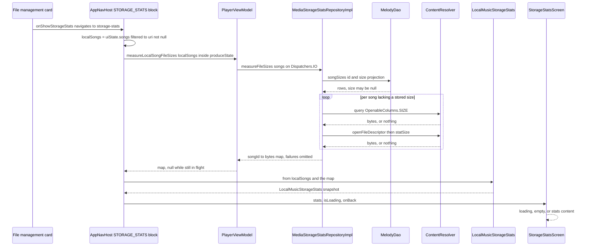
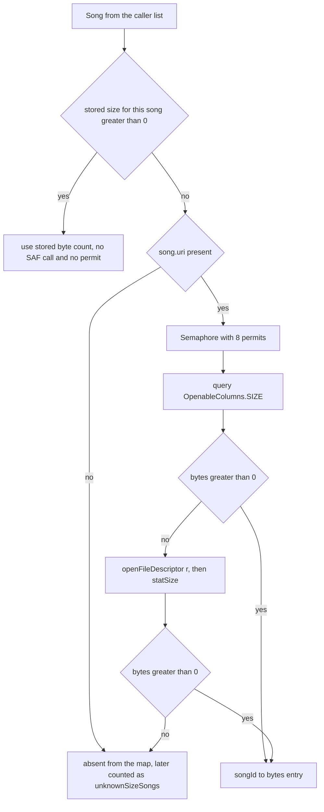

# Storage and quality statistics flow

存储与音质统计 answers two questions over the local library — *how many bytes do my files take* and *how is the library distributed across audio-quality tiers* — on a single read-only page. Three pieces own the answer, and none of them overlaps with another:

| Concern | Owner | Module |
| --- | --- | --- |
| Entry row and navigation | `FileManagementSection` → `PlaylistRouteActions.onShowStorageStats` → `AppRoutes.STORAGE_STATS` | `:feature:playlist`, `:app` |
| Route wiring, filtering, loading flags | the `composable(AppRoutes.STORAGE_STATS)` block in `AppNavHost` (no ViewModel) | `:app` |
| Byte measurement only | `MediaStorageStatsRepository` / `MediaStorageStatsRepositoryImpl` (reached through `PlayerViewModel.measureLocalSongFileSizes`) | `:domain`, `:data`, `:feature:player` |
| Tiers, shares, spatial recount, byte totals | pure `LocalMusicStorageStats.from` + `AudioQualityTier` | `:core:model` |
| Rendering | `StorageStatsScreen` (pure renderer: `stats`, `isLoading`, `onBack`) | `:feature:playlist` |

The split is deliberate and load-bearing: the repository returns a `songId → bytes` map and decides no thresholds, while every rule about what counts as a tier lives in `:core:model`. Nothing in this flow is persisted — the statistics are a snapshot rebuilt on each page entry.

## Entry and route

The only entry is the compact 存储与音质统计 row at the bottom of the 文件管理 card on the 本地音乐 page. It is a `Row` with a `Storage` icon and a chevron, `clickable(enabled = !isImporting)`, so the page cannot be opened while a folder import is running; the click calls `onStorageStatsClick`, which `LocalMusicManagementView` receives as `onShowStorageStats`, forwards through `PlaylistRoute`/`PlaylistScreen`, and `playlistRouteActions` binds to `navController.navigate(AppRoutes.STORAGE_STATS)` (`"storage-stats"`). Because the whole 本地音乐 view lives inside the `PLAYLIST` destination, the entry does not exist in playlist-detail contexts.

`STORAGE_STATS` is a self-contained destination: it has no Route/State/Actions triple and no ViewModel. The `AppNavHost` block performs the entire wiring, and the screen is a pure renderer with one callback (`onBack = navController::navigateUp`).

## The flow



*One page visit: route-local filtering, a suspending measurement pass, pure aggregation, then the screen's three-way branch.*

The route block uses the narrow-flow pattern rather than blocking reads in composition, so the composable never touches Room or `ContentResolver`:

```kotlin
val localSongs = remember(uiState.songs) { uiState.songs.filter { it.uri != null } }
val fileSizes by produceState<Map<Int, Long>?>(initialValue = null, key1 = localSongs) {
    value = runCatching { playerViewModel.measureLocalSongFileSizes(localSongs) }
        .onFailure { AppLog.error("AppNavHost", "measureLocalSongFileSizes failed: ${it.message}", it) }
        .getOrDefault(emptyMap())
}
val stats = remember(localSongs, fileSizes) {
    fileSizes?.let { LocalMusicStorageStats.from(localSongs, it) }
}
StorageStatsScreen(
    stats = stats,
    isLoading = fileSizes == null && localSongs.isNotEmpty(),
    onBack = navController::navigateUp,
)
```

State/lifecycle consequences that follow from this shape:

- The `null` initial value is the "measuring" marker, distinct from "measured, found nothing". That is what lets the screen distinguish a spinner from an empty/unknown result.
- Measurement re-runs when the library list instance changes (`remember(uiState.songs)` → new `key1`) and on every re-entry to the destination. Sizes are never cached across visits and never written back to Room.
- If measurement throws wholesale, the fallback is `emptyMap()`: the page still renders, with every song counted as size-unknown, instead of showing an error state.
- Leaving the page cancels the `produceState` coroutine, so an in-flight SAF pass does not outlive the destination.

## Counting basis (the denominator)

`LocalMusicStorageStats.from(songs, sizeBySongId)` takes the song list as given and uses `songs.size` as the denominator — the caller is responsible for passing local songs only. `AppNavHost` supplies `uiState.songs.filter { it.uri != null }`, and `LocalMusicManagementView` filters the list it renders with exactly the same predicate (the grouped projection it receives is already `uri != null` filtered by `SongVersionManager.groupedSongs`). The two surfaces therefore count the same songs, which is what makes the page's "共 N 首" agree with the 本地音乐 list header.

Songs without a SAF uri (platform-only entries) are excluded from both the numerator and the denominator: they cannot be played locally and have no file to measure. The page also carries a permanent 统计口径 card restating the basis in prose — only songs imported through 添加文件夹 whose file still exists, tiers judged from actual file parameters rather than platform membership tiers, lossless/hi-res requiring bit depth *and* sample rate, DSD short-circuiting to hi-res, missing bit depth tolerated at ≥44.1 kHz, the live spatial rules, the "old data needs one deep verification" caveat, and "stored record first, system query only for the rest". That card is the user-facing contract for everything below and must be updated alongside any rule change.

## Size resolution order

`MediaStorageStatsRepositoryImpl.measureFileSizes` runs entirely inside `withContext(Dispatchers.IO)` and returns early with `emptyMap()` for an empty input. Note that the DAO bridge and the SAF reads never happen on the main thread and never inside composition.



*Resolution order per song: persisted row size, then SAF column, then file-descriptor stat; anything else is omitted rather than defaulted to zero.*

1. **One DAO projection first.** `MelodyDao.songSizes()` is `SELECT id, size FROM songs` returning `SongSizeRow(id, size: Long?)`, mapped to `id → size`. This is a deliberate narrow projection alongside `songIds()` / `songAlbumIds()`: a `SELECT *` would materialize every uri, cover-cache uri, lyric uri and spec column just to sum bytes. The read is `runCatching`-guarded and logs `AppLog.warning` on failure, degrading to "nothing stored" rather than an exception.
2. **Stored value wins when positive.** `storedSizes[song.id]?.takeIf { it > 0L }` short-circuits the whole SAF path — and it does so *outside* the semaphore, so only fallback lookups consume permits.
3. **SAF column.** `contentResolver.query(uri, arrayOf(OpenableColumns.SIZE))` is read from the first row, rejected when the column is missing, the cursor is empty, the value is null, or the value is `≤ 0`.
4. **File-descriptor stat.** When the query yields nothing usable, `contentResolver.openFileDescriptor(uri, "r")?.use { it.statSize }` provides the last chance, again requiring `> 0`.
5. **Failures are tolerated per song.** Both SAF attempts are individually `runCatching`-guarded and return `null`, so a moved file, a deleted document or a revoked folder grant affects exactly that song: it is dropped by `mapNotNull` + `takeIf { it > 0L }` and later surfaces as an unknown-size count instead of failing the page.
6. **Concurrency is capped at 8.** All songs are measured as `async` children of one `coroutineScope`, but each fallback lookup runs inside `semaphore.withPermit`, so a large library cannot open dozens of descriptors at once. The result is a single `Map<Int, Long>`.

### Where the stored size comes from (and why it is often missing)

The import path does not record a size. `songs.size` is the size half of the `size:mtime` fingerprint: `Song.fileFingerprint` → `SongEntity.size` / `lastModified` on persistence, and `fileFingerprint` is only produced by a metadata refresh (`MusicRepository.refreshMetadata`, which opens the descriptor, reads `statSize` and the document's `COLUMN_LAST_MODIFIED` and writes back `"$size:$mtime"`). Songs created by `addFolder` carry no fingerprint, and the legacy SharedPreferences JSON migration writes `size = null`; so a freshly imported library has no stored sizes at all and every row falls through to the SAF pass.

Two operational consequences:

- The stored value is a **snapshot from the last metadata refresh**, not a live reading. A file replaced outside the app keeps reporting its old byte count until the next file check.
- The 未知-size hint's remedy is exactly this backfill path: a file check re-extracts metadata and records fingerprints, so subsequent visits answer from the stored column and, in practice, stop reaching for SAF.

## Aggregation rules

`LocalMusicStorageStats.from` is a pure function with no Android dependency, so every rule below is unit-testable and single-sourced.

- **Tier shares come from `Song.qualityTier`.** The counts are `songs.groupingBy { it.qualityTier }.eachCount()`; the tier itself is `AudioQualityTier.classify(audioCodec, bitRateKbps, bitDepth, sampleRate)`. The statistics page never re-implements a threshold, never reads a stored tier, and never looks at the file extension as anything but a container.
- **Zero-count tiers are kept, in enum order.** Shares are built by mapping over `AudioQualityTier.entries`, producing `AudioQualityShare(tier, count, ratio)` for `STANDARD, HIGH, VERY_HIGH, LOSSLESS, HI_RES, UNKNOWN` even when the library is empty: `ratio = count / total`, or `0f` when `total == 0`. Iterating `entries` also means adding a tier to the enum automatically adds a bucket (and a `when` branch requirement in the screen's color mapping).
- **Spatial audio is recounted, not read.** `spatialAudioSongs = songs.count { AudioQualityTier.isSpatial(it.audioCodec, it.channelCount) }`. The persisted `Song.spatialAudio` column is deliberately ignored, because the rule changed after rows had been written: E-AC-3 JOC always counts, AC-4 counts only with `channelCount > 2`, plain `audio/eac3` / `audio/ec+3` never counts. A stale `spatialAudio = true` on a DD+ row must not inflate the number.
- **Byte totals only include measured songs.** `totalBytes` accumulates `sizeBySongId[song.id]` only when it is `> 0`; the same pass counts `measuredSizeSongs`, and `unknownSizeSongs = totalSongs - measuredSizeSongs`. Nothing is estimated or averaged — a partially measured library reports a smaller total plus a visible unknown count.
- **Derived ratios.** `sizeCoverageRatio = measuredSizeSongs / totalSongs` and `spatialAudioRatio = spatialAudioSongs / totalSongs`, both `0f` when the library is empty. `hasSongs = totalSongs > 0` drives the empty state, and `shareOf(tier)` returns a zeroed `AudioQualityShare` for a missing bucket so callers never null-check.

## What the screen renders

`StorageStatsScreen(stats, isLoading, onBack)` branches exactly three ways: `stats == null && isLoading` → spinner with "正在统计文件大小…"; `stats == null || !stats.hasSongs` → the 还没有本地音乐 empty state; otherwise the scrollable stats content. Because `isLoading` is `fileSizes == null && localSongs.isNotEmpty()`, an empty library goes straight to the empty state instead of flashing a spinner.

Content is four cards, in this order:

1. **总存储占用** — the headline total is `formatFileSize(stats.totalBytes)` when `measuredSizeSongs > 0`, otherwise the literal `—` (never `0 B`, which would read as "empty" rather than "not measured"). Beside it, the song count, then a line that switches between "已统计全部 N 首本地歌曲" and "已测量 X / Y 首 · Z 首大小未知" — the coverage figures come from the measured/unknown counts rather than the precomputed `sizeCoverageRatio`. A tinted row below shows `spatialAudioSongs` plus `formatRatio(spatialAudioRatio)`, with the shared `SpatialAudioIcon`.
2. **音质分布** — a stacked bar plus one row per share. The bar filters `count > 0` segments (zero buckets draw nothing and add no gap), while the rows render *all* shares including zero ones, dimmed (`alpha 0.55` text, `0.25` dot). Each row shows `tier.label`, `tier.rule` and `count 首` + the ratio, so the canonical rule copy is visible on the page rather than paraphrased. Tier colors are taken from theme roles (`primary` for HI_RES, `primary` at 0.72 for LOSSLESS, `secondary` for VERY_HIGH, `secondary` at 0.62 for HIGH, `onSurfaceVariant`/`outlineVariant` at reduced alpha for STANDARD/UNKNOWN) with no hardcoded colors, so light/dark themes adapt automatically.
3. **Unknown-size hint** — rendered only when `unknownSizeSongs > 0`. It names the count and points at 「我的 → 文件校验」 (deep verification) to backfill fingerprints and sizes, then asks the user to re-enter the page. Because measurement happens on entry, that re-entry is the refresh mechanism.
4. **统计口径** — always rendered; the seven bullets described under *Counting basis*, plus the "占用空间优先读取库内记录，缺失项再向系统查询实际文件大小" statement of the resolution order. This is the only place the page explains its own scope, so it must move together with rule changes.

Formatting is shared, not local: the total uses `formatFileSize` from `:core:common` (1024-based, `0 B`/`1.0 KB`/`1.5 MB`/`2.50 GB`, negative → 未知), the same function `AudioMetadataExtractor.getFileSize` uses to fill `SongInfo.fileSize` for the song-detail dialog — so the dialog's single-file size and this page's total can never use different conventions. Percentages use a local `formatRatio`: `0%` at zero, `<0.1%` below 0.001, else one decimal with `Locale.CHINA`.

The page is strictly read-only: its only callback is `onBack`, it owns no state beyond composition, it writes nothing to Room or DataStore, and it never mutates `songs.size` even though it just measured the same numbers. Adding persistence here would create a second source of truth for a value that must stay derived.

## Failures, coverage, and the stale-library caveat

| Situation | What the page shows | Why |
| --- | --- | --- |
| Entire measurement throws | Content, with all songs counted as unknown-size | The route block degrades to `emptyMap()` after logging |
| Individual files moved/deleted/ungranted | Those songs counted in `unknownSizeSongs`, hint card appears | Per-song `runCatching` in `resolveFileSize` |
| Library empty / all songs non-local | Empty state, no spinner | `isLoading` is false when `localSongs` is empty and `hasSongs` is false |
| Stored size present but stale | A plausible-but-old byte count | `songs.size` is only refreshed by a metadata refresh |
| Library imported before DB v18/v19 | Large 未知 share, zero spatial audio | Spec columns were added with defaults; see below |

The last row is the caveat that most often looks like a bug. Migrations v17→v18 (adds `bitDepth`, default `0`) and v18→v19 (adds `bitRateKbps`, `channelCount`, `audioCodec` nullable, `spatialAudio`, all with defaults) deliberately leave old rows blank, and the migration comments state that the values are backfilled by `refreshMetadata` when the user runs a **深度校验**. For a library imported before those versions, `Song.qualityTier` therefore resolves to `UNKNOWN` (lossy with `bitRateKbps == 0`; no lossless MIME) and `spatialAudioSongs` is `0`, until one deep verification repopulates the specs.

**Do not "fix" this by counting the persisted `spatialAudio` column, and do not add a threshold in the screen.** The persisted flag is the exact value that can be stale in both directions, and re-deriving a tier anywhere other than `AudioQualityTier.classify` would let two surfaces disagree about the same file. The honest handling is the one implemented: show the 未知 bucket and the unknown-size hint, and let the file-check path refresh the rows.

## Extension points

- **A new quality tier** requires only the enum: `LocalMusicStorageStats.from` iterates `AudioQualityTier.entries`, so a new bucket appears in `qualityShares` (and in the distribution card's rows) automatically. The screen's `qualityTierColor` `when` is exhaustive, so the compiler forces a color decision; a new label/rule pair must also be reflected in the 统计口径 copy if the rule wording changes.
- **A new measurement source** belongs inside `MediaStorageStatsRepositoryImpl` behind the existing `songId → bytes` contract. Extend the *order* there (before or after the SAF fallbacks) and keep both the semaphore and the `runCatching` discipline; returning fewer entries is always legal, since absence simply means "unknown".
- **A new aggregate** (for example per-album or per-codec byte totals) should be another pure function or property over the same snapshot; the route block stays a two-line `produceState` + `from` wiring.
- **Changing what is measured** — a different denominator, e.g. including non-local songs — is a change to the filter in `AppNavHost` *and* `LocalMusicManagementView` together, plus the 统计口径 card; otherwise the page and the list it is reached from will disagree.

## Focused tests

- `LocalMusicStorageStatsTest` (`:core:model`) pins the aggregation contract: one song per tier yields six buckets of count 1 with ratio 1/6; measured sizes are summed while a 0-byte and a missing entry count as unknown (`totalBytes = 3500`, `measuredSizeSongs = 2`, `sizeCoverageRatio = 2/3`); an empty library still returns every `AudioQualityTier.entries` bucket at zero; spatial audio is recounted live (2 of 6: JOC plus multichannel AC-4) and a stale `spatialAudio = true` on an `ec+3` row does not inflate it; a FLAC with unknown bit depth at 44.1 kHz stays `LOSSLESS`.
- `FileSizeFormattersTest` (`:core:common`) pins `formatFileSize` thresholds and precision — bytes below 1 KB, `1.0 KB`, `1.5 MB`, `2.50 GB`, negative → 未知 — which is what keeps the page's total and the song-detail dialog's file size on one convention.
- The SAF resolution half (`MediaStorageStatsRepositoryImpl`, including the 8-permit concurrency) has no test file: it needs a `ContentResolver`, and the design compensates by pushing all arithmetic into the pinned pure function, leaving the repository with nothing but "read bytes or return nothing".
